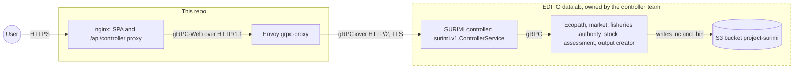
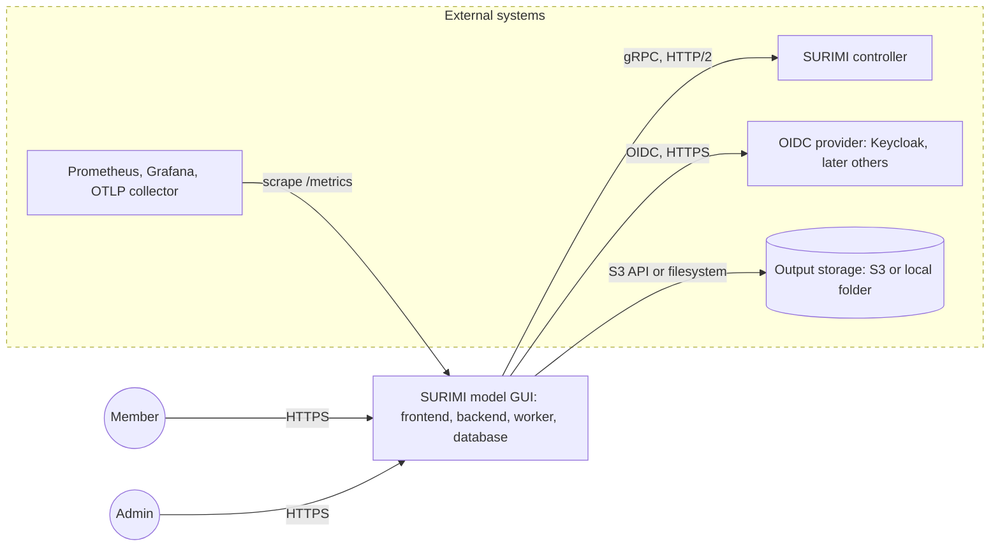
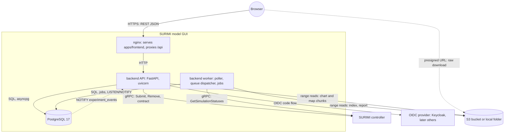
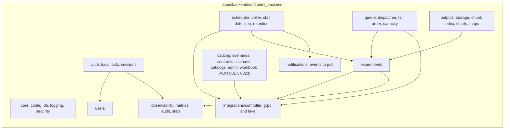
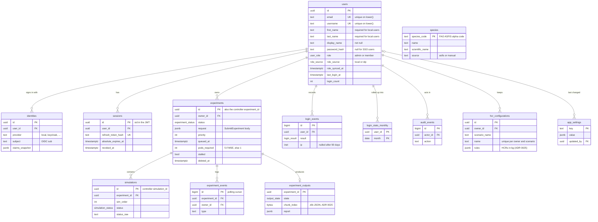
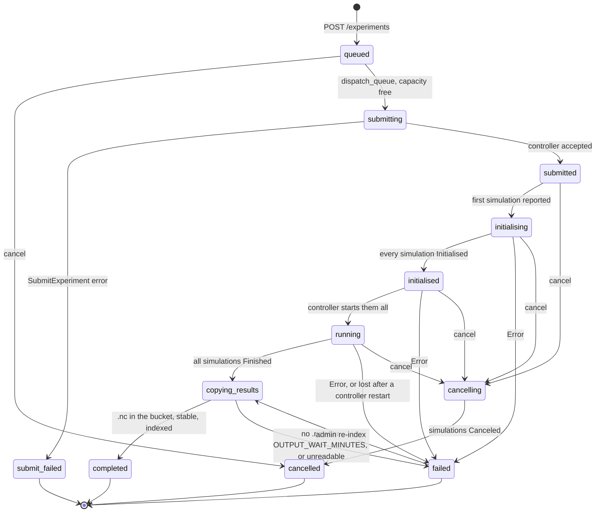
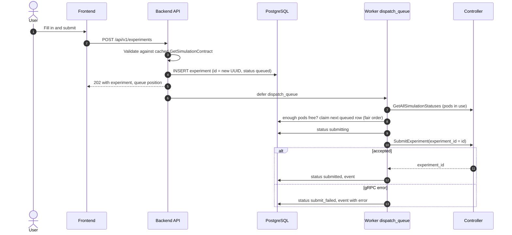
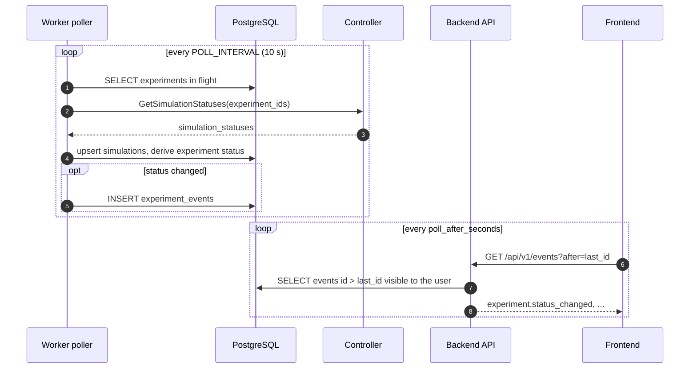
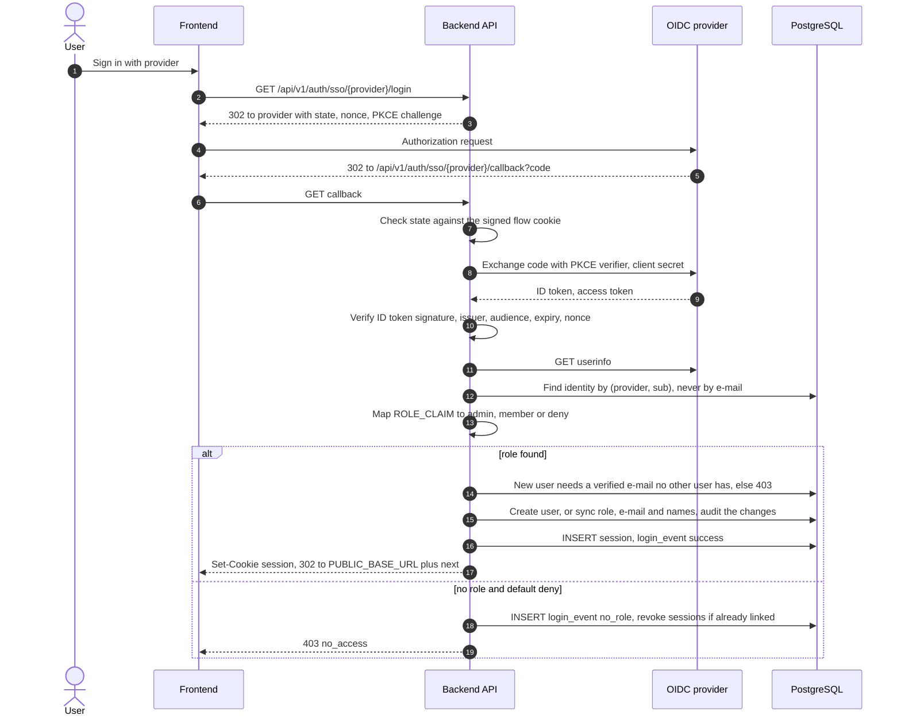

# Architecture

How the SURIMI model GUI fits together, as of 2026-11-03. Part 1 is what runs
today. Part 2 is the target of the
[monorepo and backend plan](plans/2026-11-03-monorepo-and-backend.md) and is
**Proposed** until that plan is accepted. Diagram conventions:
[DIAGRAMS.md](DIAGRAMS.md).

---

## Part 1 — Today

The browser calls the controller directly through Envoy. There are no users,
no database and no server-side state: the runs page lists every experiment on
the controller, and the output dashboards show mock data
(`apps/frontend/src/features/ScenarioOutputs/MockData/`). **Read from source.**

On branch `develop` (not merged into `main`), the first part of
Part 2 runs beside this in compose: `api` (FastAPI), `worker`, `postgres`,
the `db-bootstrap` and `migrate` jobs, and `keycloak` (profile `keycloak`)
for SSO. The API serves sign-in (password and OIDC), sessions, user
administration, the scenario catalogue, harvest control rules, experiments
and their queue, outputs (charts, maps, downloads, presigned links), the
initial biomass and fishing mortality of a scenario (from the controller), and
experiment events to poll; the worker polls the controller, dispatches the
queue and waits for and indexes results (phases 4 to 6, 2026-11-06, polling
and `copying_results` 2026-11-12, **Verified** against `user-<developer>` and its bucket);
nginx routes `/api/v1/` to the API. The frontend does not call it yet (phase 10). **Verified** on the compose
stack, 2026-11-03. The API also serves a static page at `/api/v1/console/`
with sign-in and a home screen. The page calls only the public API
([backend-console](features/backend-console/README.md)). **Verified** in
headless Chrome on the compose stack, 2026-11-06.

### Controller API

`surimi.v1.ControllerService` at `buf.build/surimi/surimi-protocol`, all RPCs
unary. **Read from source**, exported 2026-11-03.

| RPC | Request | Response | Used by the frontend today |
| --- | --- | --- | --- |
| `SubmitExperiment` | `scenario_name`, `experiment_id`, `end_date_time`, `is_mse_run`, `regulations_definitions_summary`, `climate_scenario` | `experiment_id` | Mock only |
| `RemoveExperiment` | `experiment_id` | `experiment_id` | Mock only |
| `GetSimulationStatuses` | `experiment_ids[]` | `simulation_statuses[]` | No; not in `apps/frontend/proto/surimi.binpb` |
| `GetAllSimulationStatuses` | — | `simulation_statuses[]` | Yes |
| `GetSimulationContract` | `scenario_name` | `simulation` (geography, standards, items) | Yes |
| `GetProtocolVersion` | — | version | No |
| `GetScenarioNames` | — | `scenario_names[]` | Yes |

`SimulationStatus` carries `simulation_id`, `experiment_id`, `scenario_name`,
`start_date_time`, `end_date_time`, `status` (free string), `simulation_started`,
`simulation_duration`, `simulation_current`, `ecology_host`, `order`. One
experiment has one or more simulations.

What the controller does **not** offer, and the backend therefore has to:
users and ownership, authentication, a cancel RPC (only `RemoveExperiment`),
push or streaming of status changes, and an RPC that returns outputs. Outputs
are files in the bucket at `experiments/<experiment_id>/<experiment_id>.nc` and
`.bin` (layout read from the local copy in `output_folder/`; bucket path is an
open question in [ISSUES.md](ISSUES.md)).

### Controller behaviour

What the controller does, from its code and from the controller team. Code facts are **Read
from source**, `SURIMI-controller` commit `a8a7f3a` (2026-10-22); answers are
**Confirmed by the controller team, 2026-11-03**. Re-check with `/surimi-services` when the
controller changes.

| Topic | Behaviour | Evidence |
| --- | --- | --- |
| Status values | Exactly `Initialising`, `Initialised`, `Running`, `Finished`, `Error`, `Canceled` (American spelling) | Code, `SimulationManager.cs` |
| Simulations per experiment | MSE run (`is_mse_run = true`): `NR_OF_MSE_RUNS` simulations, 5 on `project-surimi`. Otherwise 1 | Code, `ExperimentManager.SubmitExperiment`; the controller team |
| Parallel simulations | All simulations of an experiment initialise in parallel, alongside the experiment services (CMSY, output creator, value chain). None runs until **all** of that is done; then all run in parallel (`Task.WhenAll`). A simulation can therefore wait in `Initialised` for the others | Read from source, SURIMI-controller `117e604`, `ExperimentManager.RunExperimentAsync` |
| Ecopath pods | One pod per simulation, `ECOPATH_NR_OF_PODS` in total, 10 on `project-surimi`. So at most 2 MSE experiments, or 10 non-MSE, or a mix (for example 1 MSE + 5 non-MSE) | Code, `SimulationDispatcher.cs`; the controller team |
| Submit | `SubmitExperiment` registers the experiment and returns at once; initialisation and the run happen in a background task | Code, `ExperimentManager.SubmitExperiment` |
| No pod free | `SimulationDispatcher.DispatchAsync` throws `Exception("No available pods")` from `EcopathServiceClient.AddInitialise`, which `InitSimulationAsync` calls **before** it registers the simulation. `SubmitExperiment` has already returned OK; the error is only logged ("Exception in Init simulation"), and the simulation is **never created**: `GetSimulationStatuses` returns nothing for the experiment, while the experiment id stays known (a second submit with it fails, `RemoveExperiment` finds it and stops nothing). In an MSE run, simulations that got a pod stay `Initialising` and keep it | Read from source 2026-11-06 (`a8a7f3a`); **Verified** 2026-11-06 on `user-<developer>`: experiment `6e996aab…` submitted OK, log "No available pods", `GetSimulationStatuses` empty. The controller team says "you get an exception", which is true in the controller log, not for the caller |
| Failed initialisation | `InitSimulationAsync` has no error handling: the status stays `Initialising`, never `Error` | Code |
| Cancel | `RemoveExperiment` = cancel the experiment: it cancels each simulation, which ends as `Canceled`. Only `Running` simulations can be cancelled; for any other state the error is logged and swallowed, and the RPC still returns success | Code, `ExperimentManager.CancelExperimentAsync`, `SimulationManager.CancelSimulationAsync`; the controller team |
| Pod release | A pod is released on finalise (`Finished`) and on cancel (`Canceled`), not on `Error` | Code, `EcopathServiceClient.cs` |
| Queue | None. The controller team: "A queue might be a good idea" | Controller team |
| State | Experiments and simulations live in in-memory dictionaries; a controller restart forgets all of them | Code, `ExperimentManager._experiments`, `SimulationManager._simulations` |
| Protocol version | `GetProtocolVersion` returns the first 12 characters of the Buf registry commit the controller was built with (`b10b05a0ca7f` on `user-<developer>`, 2026-11-03), so it can be compared with the backend's pin | Verified |
| Partial results per simulation | Asked 2026-11-03, not answered yet | Open question |
| Scenario contract | One YAML per scenario in `Includes/<scenario>/`, synced nightly from `Official-EwE/SURIMI-data_preprocessing`. Species are `species_code` + optional `life_stage` only: no functional groups, no names, no list of species that take an HCR. Those live in the Ecopath `.semantics` and the fisheries authority CSVs, see [scenario catalog](features/scenario-catalog/README.md) | Read from source, `.github/workflows/sync-surimi-contracts.yml`; contracts Verified 2026-11-05 on `user-<developer>` |
| Climate scenarios | Allowed codes are the contract's `items.climate_scenarios`: `RCP_2.6`, `RCP_4.5`, `RCP_8.5` for `anchovy_bay` and `northwestern_med`, none for `aegean_sea` | Verified 2026-11-05 |
| Initial biomass and fishing mortality | `GetInitialBiomasses(scenario_name)` and `GetInitialFishingMortalities(scenario_name)` return one value per `species_code` + `life_stage`. The controller passes them to Ecopath **without reserving a pod** (a scenario name is not a GUID, so `SimulationDispatcher` uses the first pod). Ecopath reads `<scenario>/initial_biomasses.csv` and `initial_catch.csv` from its input store; F = catch of the last 12 spin-up months ÷ biomass. The files are written by an Ecopath spin-up run with `CREATE_HCR_INITIALISE_FILES` set. Only `northwestern_med` has them (91 rows); for other scenarios the call errors. A species in a multi-species functional group gets the **group's** biomass (ALB = BON = 20,526.8), so its F is its own catch ÷ the group's biomass. An F of 0 is left out of the JSON (proto3 default): 49 of 91 rows. No unit is given; see [ISSUES.md](ISSUES.md) | Read from source, SURIMI-protocol `250f617`, SURIMI-controller `117e604` (`ControllerService`, `EcopathServiceClient`, `SimulationDispatcher.DispatchAsync`), SURIMI-Ecopath `88e1121` (`InitialStateFileService`, `HcrInitialisationFileService`). **Verified** 2026-11-12 on `project-surimi`, through Bruno (the user) and through the backend. The values are identical to the repo file. Other scenarios fail with "MinIO API responded with message=ecopath/<scenario>/initial_biomasses.csv". `user-<developer>` answers `UNIMPLEMENTED` (older build) |
| Request validation | The protocol declares `buf.validate` rules (HCR `0 < biomass_limit, biomass_base ≤ 3.3e12` kg and `0 < f_max ≤ 100`; `scenario_name` and `climate_scenario` not empty), but the controller does not enforce them: it registers no validation interceptor and checks only `scenario_name` on `SubmitExperiment`. Only POSEIDON validates the requests it receives, and it is called only for scenarios with `POSEIDON` fleet segments (`northwestern_med`). So the backend's HCR checks are the only ones, and the empty `climate_scenario` of `aegean_sea` is accepted; see [ISSUES.md](ISSUES.md) | Read from source 2026-11-13, SURIMI-protocol `be08fd33`, SURIMI-controller `117e604` (`Program.cs`, `ControllerService`, `PoseidonServiceClient`), SURIMI-POSEIDON `ValidationInterceptor.java`; corrects the earlier "the controller rejects" (SURIMI-protocol `0c4b6c4`) |
| How an HCR becomes a TAC (fisheries authority) | Once a year, when the controller asks for the next year's regulations (`GetRegulationsAsync`), the fisheries authority computes each regulated species' TAC (total allowable catch: the most that may be landed that year). In the **first** year the TAC is the species' value in `initial_quota.csv`, not the HCR; from the second year on it comes from EwE's `cMSEQuotaCalculator.UpdateQuotas` (NuGet `Eii.Ecopath.EwECore` 6.7, not open here) with `Blim` = `biomass_limit`, `Bbase` = `biomass_base`, `Fopt` = `f_max` and the biomass estimate of the year just ended, where biomass is the sum of Ecopath's grid cells for the species (the whole model area). The TAC is then split between fleets by `quotashare.csv`. Monthly landings are gross catch minus live discards. **Read from source**, SURIMI-fisheries-authority `a68715a`, `Services/QuotaCalculationService.cs` (`GetRegulationsAsync`, `UpdateBiomassAsync`, `UpdateCatchDispositionAsync`), 2026-11-16. The shape of the rule between `Blim` and `Bbase` is in EwECore, not read: **Open question** |
| Where the output files are written before S3 (output creator) | During a run the output creator service records every message it receives to `experiments/<id>/<id>.bin`, relative to its working directory `/app` (so `/app/experiments/<id>/` in its container; `ExperimentRecorderManager`, `base_dir="experiments"`). When the last simulation is finalised (`FinaliseExperiment`) it starts a subprocess (`netcdf_worker_main.py`) that reads the `.bin`, writes `/app/experiments/<id>/<id>.nc`, then uploads every file of that folder to `s3://$AWS_BUCKET_NAME/output_creator/experiments/<id>/` (`S3_Storage.UploadFilesToS3`), the `.bin` too. The local copies are **not deleted** after the upload; a cancel deletes the partial `.bin`. No volume is declared in its Dockerfile, so the folder lives in the container's own filesystem unless the EDITO chart mounts one (not in the SURIMI-Project repos). **Read from source**, SURIMI-output-creator `da3ec9d` (2026-09-29), 2026-11-16 |

What this means for the backend: the queue counts **pods**, not experiments
([ADR 0015](decisions/0015-experiment-admission-queue.md)); capacity problems
show up as runs stuck in `Initialising`, not as RPC errors; cancel must check
the result in the next poll; a run the controller no longer reports must be
marked lost
([scheduler](features/simulation-status-scheduler/README.md)).

---

## Part 2 — Target

### Context

The backend becomes the only client of the controller. Users, ownership, roles,
history and statistics live in our database, because the controller has none of
them.

### Containers

| Container | Technology | Does | Decision |
| --- | --- | --- | --- |
| nginx | nginx 1.27 | Serves the built SPA; proxies `/api/` to the API; one origin so cookies need no CORS | [0006](decisions/0006-protocols-rest-sse-grpc.md) |
| frontend | React 19, Vite, Mantine, TanStack Query, client generated from OpenAPI | UI; no tokens in JavaScript | [0006](decisions/0006-protocols-rest-sse-grpc.md) |
| backend API | Python 3.13, FastAPI, SQLAlchemy 2 async, grpcio `aio` | REST API, auth, RBAC, events to poll | [0002](decisions/0002-backend-python-fastapi.md) |
| backend worker | Same image, `surimi-backend worker`; one leader by PostgreSQL advisory lock | Polls the controller, dispatches the experiment queue, waits for the results of finished runs in the bucket and indexes them (`copying_results` → `completed`), detects stalls. Purges by retention: not built yet (phase 7) | [0019](decisions/0019-worker-row-driven-with-advisory-lock.md), [0015](decisions/0015-experiment-admission-queue.md) |
| PostgreSQL | PostgreSQL 17, database `surimi_modelgui_db` | Users, sessions, harvest control rules, experiments and their queue, simulations, events, output metadata (chunk index, quality report). No output values | [0003](decisions/0003-postgresql-sqlalchemy-alembic.md), [0014](decisions/0014-postgresql-in-repo-bundled-or-external.md) |
| Output storage | S3 API or local folder through `fsspec` | Raw `.nc` and `.bin` written by the output creator; read in place by chunk, never copied | [0009](decisions/0009-output-storage-and-ingestion.md) |

### Protocols

| From → to | Protocol | Why |
| --- | --- | --- |
| Browser → backend | REST/JSON over HTTPS, OpenAPI 3.1 | Browsers speak it natively; works with cookies, caching, Bruno, generated TS types. [ADR 0006](decisions/0006-protocols-rest-sse-grpc.md) |
| Backend → browser | The browser polls `GET /api/v1/events?after=<id>` every `poll_after_seconds` (10 s) | Statuses change at most every worker poll, so a push channel saves nothing noticeable; no long-lived connections through proxies. [ADR 0021](decisions/0021-notifications-by-polling.md) (supersedes SSE, ADR 0008) |
| Backend → controller | Native gRPC over HTTP/2 with TLS | The controller only speaks gRPC; server to server, no gRPC-Web or Envoy needed. [ADR 0006](decisions/0006-protocols-rest-sse-grpc.md) |
| Backend → OIDC provider (Keycloak first) | OIDC Authorization Code with PKCE | Standard, works with any provider; the backend keeps the tokens. [ADR 0004](decisions/0004-authentication-local-and-oidc.md) |
| Browser → storage | A presigned S3 GET, from a `302` (`/outputs/download`) or as JSON (`/outputs/download-url`), `.nc`/`.bin` only (nginx `X-Accel-Redirect` in local mode) | The API only authorises; no file bytes through it; resumable. [ADR 0009](decisions/0009-output-storage-and-ingestion.md) |
| Backend → storage | S3 range requests (`s3fs`) or filesystem, through our own chunk index ([ADR 0020](decisions/0020-own-chunk-index-built-with-h5py.md)) | Same code for both through `fsspec`; only the chunks a view needs are read. [ADR 0009](decisions/0009-output-storage-and-ingestion.md) |
| API ↔ worker | PostgreSQL rows (`experiments`, `experiment_outputs`, `experiment_events`) and `NOTIFY surimi_dispatch` (wakes the worker) | No extra broker to run. [ADR 0019](decisions/0019-worker-row-driven-with-advisory-lock.md), [ADR 0021](decisions/0021-notifications-by-polling.md) |

### Backend modules

Each module has `router.py` (HTTP), `service.py` (rules), `repository.py`
(SQL), `models.py` (tables) and `schemas.py` (Pydantic). Routers never touch
SQL; repositories never check roles, except the ownership scope described in
[ADR 0005](decisions/0005-authorization-roles-and-ownership.md).

### Data model

Full schema with types, defaults, indexes and enums:
[database/schema.dbml](database/schema.dbml); exact index definitions in
[database/indexes.sql](database/indexes.sql), and why each index exists in
[database/README.md § Indexing](database/README.md#indexing) (database `surimi_modelgui_db`,
[ADR 0014](decisions/0014-postgresql-in-repo-bundled-or-external.md)). This
overview shows tables, keys and the columns the flows below rely on.

Retention of each table: [ADR 0013](decisions/0013-data-retention.md).

### Experiment lifecycle

Our states, not the controller's strings: the worker maps each
`SimulationStatus.status` and derives the experiment state from all its
simulations. `queued` waits for controller capacity
([ADR 0015](decisions/0015-experiment-admission-queue.md),
[features/experiment-queue](features/experiment-queue/README.md)). `stalled`
is a flag, not a state: it is set when an experiment has made no progress for
`STALL_AFTER_MINUTES` (default 30), because the controller does not set `Error`
when initialisation fails ([ISSUES.md](ISSUES.md)). `copying_results` holds no
Ecopath pod (the controller freed it at `Finished`) and is no longer polled on
the controller; it cannot be cancelled. `finished_at` is when the run ended,
`completed_at` when its results were ready (user, 2026-11-12). Details:
[features/simulation-status-scheduler](features/simulation-status-scheduler/README.md).

### Main flows

Submit an experiment, then dispatch it when capacity frees:

The row is written before the RPC and the id is ours, so a retry after a
timeout reuses the same `experiment_id` and cannot create a second run.

Status update and notification:

Only one worker runs the poller at a time: the one holding the PostgreSQL
advisory lock ([ADR 0019](decisions/0019-worker-row-driven-with-advisory-lock.md)).
Each cycle polls, then dispatches, so a run that ends frees its pods for the
next queued one in the same cycle.

Sign-in with an OIDC provider (Keycloak first):

Discovery and the provider's keys are fetched from `OIDC_<K>_DISCOVERY_URL`
(in compose `http://keycloak:8080/...`), while the browser and the token
issuer use the public URL (`http://localhost:18083`). The frontend of
phase 10 turns the 403 into a "no access" page.

The role is recomputed at every SSO sign-in
([ADR 0005](decisions/0005-authorization-roles-and-ownership.md)). Local
sign-in ends the same way: one session type for all methods, so every route
checks one thing. [ADR 0004](decisions/0004-authentication-local-and-oidc.md).

### Deployment

| Environment | How | Database |
| --- | --- | --- |
| Local | `deployments/compose.yml`: nginx, api, worker, migrate, postgres; profiles `keycloak` (dev realm), `minio` (S3 stand-in), `observability` (Prometheus, Grafana). `CONTROLLER_MODE=fake` runs without the controller | `postgres:17-alpine`, database `surimi_modelgui_db`, named volume |
| EDITO datalab | Images pushed by GitHub Actions; Helm chart for frontend, api, worker, migrate Job | `postgresql.enabled: true` runs PostgreSQL in the chart (official image, PVC, backup CronJob); `false` connects to `externalDatabase`. [ADR 0014](decisions/0014-postgresql-in-repo-bundled-or-external.md) |
