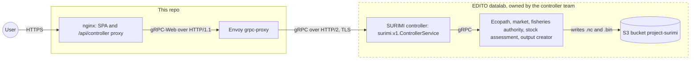
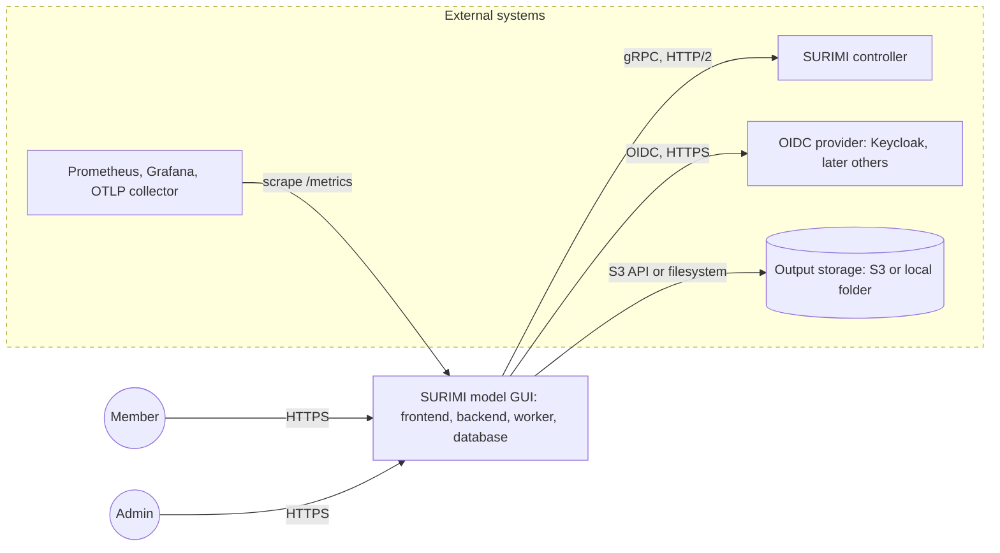
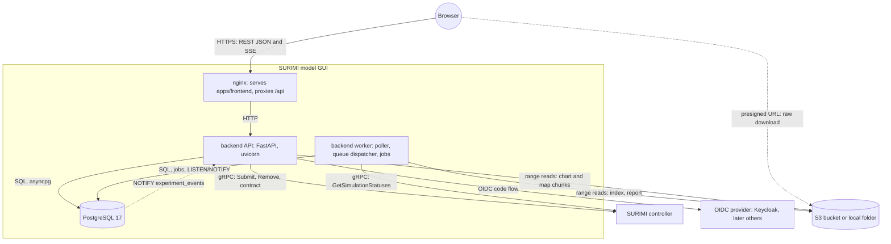
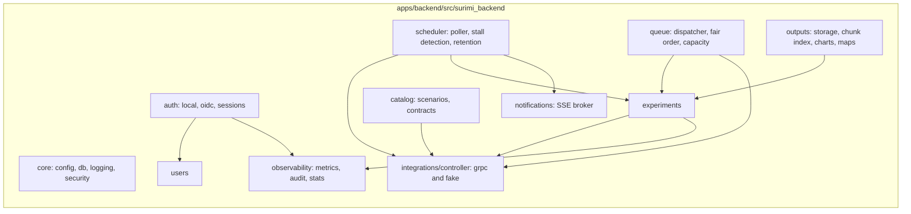
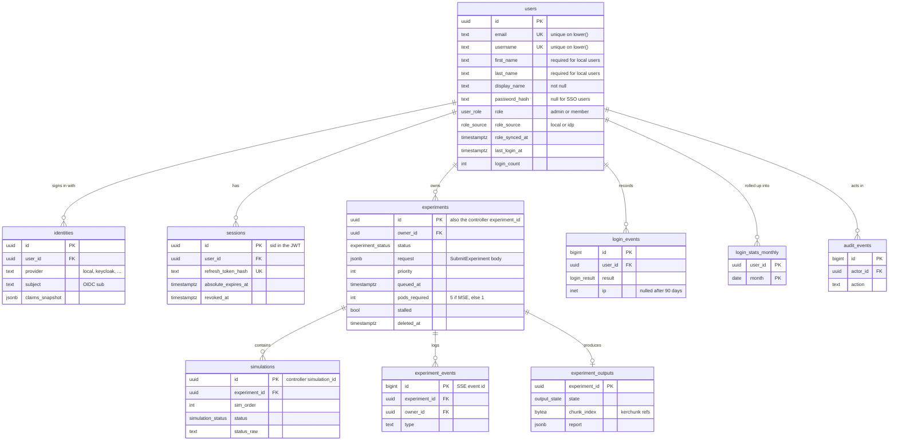
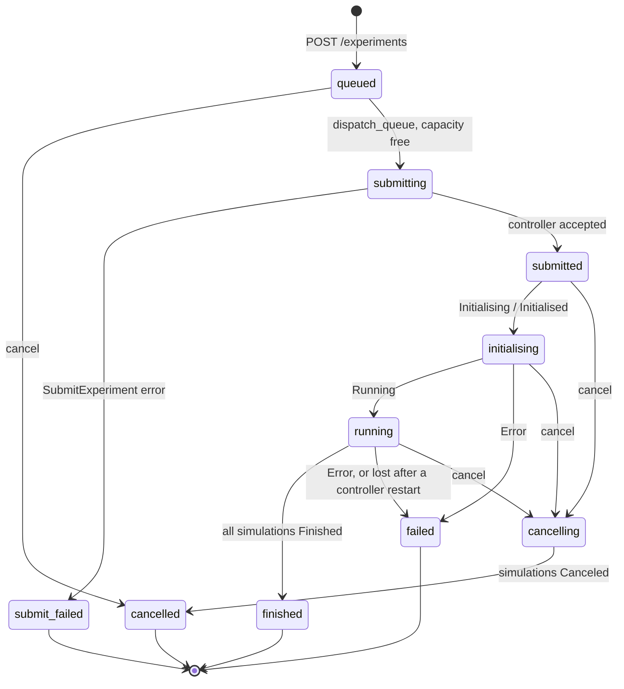
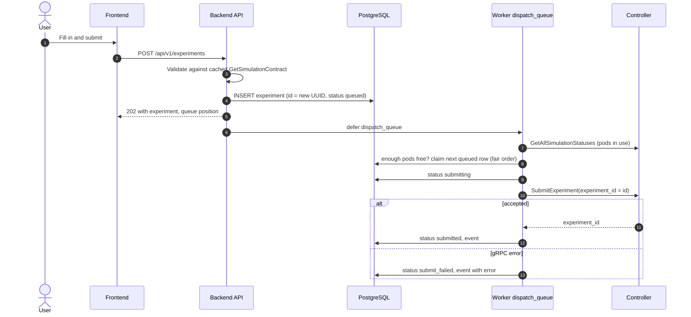
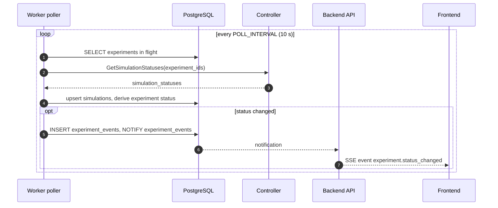
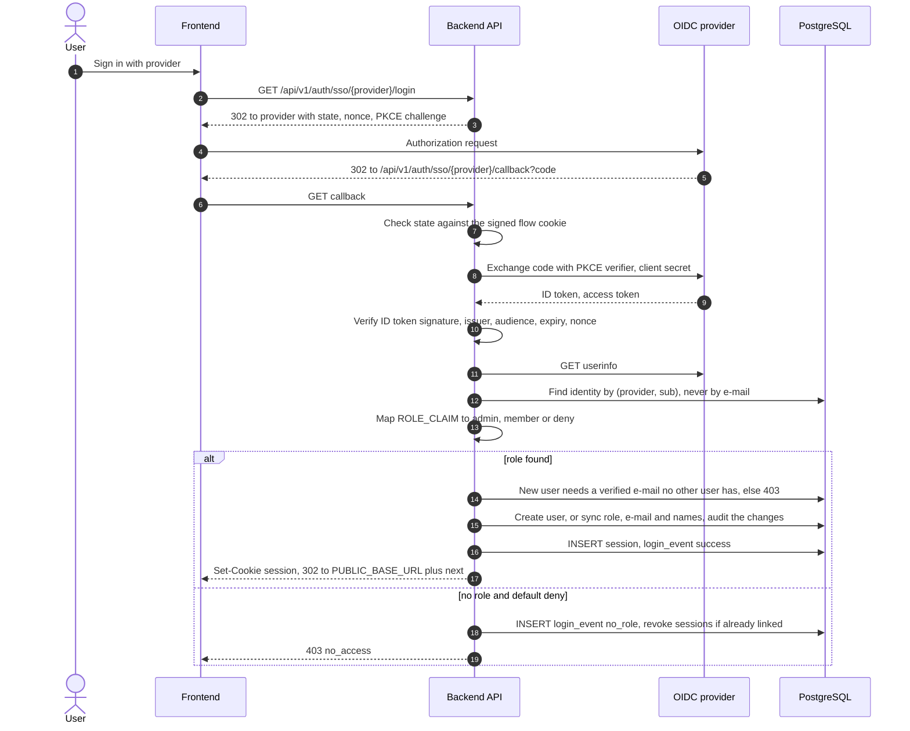

# Architecture

How the SURIMI model GUI fits together, as of 2026-11-03. Part 1 is what runs
today. Part 2 is the target of the
[monorepo and backend plan](plans/2026-11-03-monorepo-and-backend.md) and is
**Proposed** until that plan is accepted. Diagram conventions:
[DIAGRAMS.md](DIAGRAMS.md).

---

## Part 1 — Today

The browser calls the controller directly through Envoy. There are no users,
no database and no server-side state: the runs page lists every experiment on
the controller, and the output dashboards show mock data
(`apps/frontend/src/features/ScenarioOutputs/MockData/`). **Read from source.**

On branch `develop` (not merged into `main`), the first part of
Part 2 runs beside this in compose: `api` (FastAPI), `postgres`, the
`db-bootstrap` and `migrate` jobs, and `keycloak` (profile `keycloak`) for SSO.
The API serves sign-in (password and OIDC), sessions, user administration
and the scenario catalogue from the controller; nginx routes `/api/v1/` to
it. The frontend does not call it yet (phase 10). **Verified** on the compose
stack, 2026-11-03.

### Controller API

`surimi.v1.ControllerService` at `buf.build/surimi/surimi-protocol`, all RPCs
unary. **Read from source**, exported 2026-11-03.

| RPC | Request | Response | Used by the frontend today |
| --- | --- | --- | --- |
| `SubmitExperiment` | `scenario_name`, `experiment_id`, `end_date_time`, `is_mse_run`, `regulations_definitions_summary`, `climate_scenario` | `experiment_id` | Mock only |
| `RemoveExperiment` | `experiment_id` | `experiment_id` | Mock only |
| `GetSimulationStatuses` | `experiment_ids[]` | `simulation_statuses[]` | No; not in `apps/frontend/proto/surimi.binpb` |
| `GetAllSimulationStatuses` | — | `simulation_statuses[]` | Yes |
| `GetSimulationContract` | `scenario_name` | `simulation` (geography, standards, items) | Yes |
| `GetProtocolVersion` | — | version | No |
| `GetScenarioNames` | — | `scenario_names[]` | Yes |

`SimulationStatus` carries `simulation_id`, `experiment_id`, `scenario_name`,
`start_date_time`, `end_date_time`, `status` (free string), `simulation_started`,
`simulation_duration`, `simulation_current`, `ecology_host`, `order`. One
experiment has one or more simulations.

What the controller does **not** offer, and the backend therefore has to:
users and ownership, authentication, a cancel RPC (only `RemoveExperiment`),
push or streaming of status changes, and an RPC that returns outputs. Outputs
are files in the bucket at `experiments/<experiment_id>/<experiment_id>.nc` and
`.bin` (layout read from the local copy in `output_folder/`; bucket path is an
open question in [ISSUES.md](ISSUES.md)).

### Controller behaviour

What the controller does, from its code and from Rik. Code facts are **Read
from source**, `SURIMI-controller` commit `a8a7f3a` (2026-10-22); answers are
**Confirmed by Rik, 2026-11-03**. Re-check with `/surimi-services` when the
controller changes.

| Topic | Behaviour | Evidence |
| --- | --- | --- |
| Status values | Exactly `Initialising`, `Initialised`, `Running`, `Finished`, `Error`, `Canceled` (American spelling) | Code, `SimulationManager.cs` |
| Simulations per experiment | MSE run (`is_mse_run = true`): `NR_OF_MSE_RUNS` simulations, 5 on `project-surimi`. Otherwise 1 | Code, `ExperimentManager.SubmitExperiment`; Rik |
| Ecopath pods | One pod per simulation, `ECOPATH_NR_OF_PODS` in total, 10 on `project-surimi`. So at most 2 MSE experiments, or 10 non-MSE, or a mix (for example 1 MSE + 5 non-MSE) | Code, `SimulationDispatcher.cs`; Rik |
| Submit | `SubmitExperiment` registers the experiment and returns at once; initialisation and the run happen in a background task | Code, `ExperimentManager.SubmitExperiment` |
| No pod free | `SimulationDispatcher` throws `Exception("No available pods")` inside the background initialisation. `SubmitExperiment` has already returned OK; the error is only logged and the simulation stays `Initialising` | Code; Rik says "you get an exception", which is true in the controller log, not for the caller |
| Failed initialisation | `InitSimulationAsync` has no error handling: the status stays `Initialising`, never `Error` | Code |
| Cancel | `RemoveExperiment` = cancel the experiment: it cancels each simulation, which ends as `Canceled`. Only `Running` simulations can be cancelled; for any other state the error is logged and swallowed, and the RPC still returns success | Code, `ExperimentManager.CancelExperimentAsync`, `SimulationManager.CancelSimulationAsync`; Rik |
| Pod release | A pod is released on finalise (`Finished`) and on cancel (`Canceled`), not on `Error` | Code, `EcopathServiceClient.cs` |
| Queue | None. Rik: "A queue might be a good idea" | Rik |
| State | Experiments and simulations live in in-memory dictionaries; a controller restart forgets all of them | Code, `ExperimentManager._experiments`, `SimulationManager._simulations` |
| Protocol version | `GetProtocolVersion` returns the first 12 characters of the Buf registry commit the controller was built with (`b10b05a0ca7f` on `user-alexiosgkikas`, 2026-11-03), so it can be compared with the backend's pin | Verified |
| Partial results per simulation | Asked 2026-11-03, not answered yet | Open question |

What this means for the backend: the queue counts **pods**, not experiments
([ADR 0015](decisions/0015-experiment-admission-queue.md)); capacity problems
show up as runs stuck in `Initialising`, not as RPC errors; cancel must check
the result in the next poll; a run the controller no longer reports must be
marked lost
([scheduler](features/simulation-status-scheduler/README.md)).

---

## Part 2 — Target

### Context

The backend becomes the only client of the controller. Users, ownership, roles,
history and statistics live in our database, because the controller has none of
them.

### Containers

| Container | Technology | Does | Decision |
| --- | --- | --- | --- |
| nginx | nginx 1.27 | Serves the built SPA; proxies `/api/` to the API with buffering off for SSE; one origin so cookies need no CORS | [0006](decisions/0006-protocols-rest-sse-grpc.md) |
| frontend | React 19, Vite, Mantine, TanStack Query, client generated from OpenAPI | UI; no tokens in JavaScript | [0006](decisions/0006-protocols-rest-sse-grpc.md) |
| backend API | Python 3.13, FastAPI, SQLAlchemy 2 async, grpcio `aio` | REST API, auth, RBAC, SSE | [0002](decisions/0002-backend-python-fastapi.md) |
| backend worker | Same image, `surimi-worker` entrypoint, Procrastinate | Polls the controller, dispatches the experiment queue, indexes finished outputs, detects stalls, purges by retention | [0007](decisions/0007-scheduler-worker-postgres-queue.md), [0015](decisions/0015-experiment-admission-queue.md) |
| PostgreSQL | PostgreSQL 17, database `surimi_modelgui_db` | Users, sessions, experiments and their queue, simulations, events, jobs, output metadata (chunk index, quality report). No output values | [0003](decisions/0003-postgresql-sqlalchemy-alembic.md), [0014](decisions/0014-postgresql-in-repo-bundled-or-external.md) |
| Output storage | S3 API or local folder through `fsspec` | Raw `.nc` and `.bin` written by the output creator; read in place by chunk, never copied | [0009](decisions/0009-output-storage-and-ingestion.md) |

### Protocols

| From → to | Protocol | Why |
| --- | --- | --- |
| Browser → backend | REST/JSON over HTTPS, OpenAPI 3.1 | Browsers speak it natively; works with cookies, caching, Bruno, generated TS types. [ADR 0006](decisions/0006-protocols-rest-sse-grpc.md) |
| Backend → browser | Server-Sent Events, `GET /api/v1/events` | Notifications only go one way; SSE reconnects by itself and resumes with `Last-Event-ID`. [ADR 0008](decisions/0008-notifications-sse.md) |
| Backend → controller | Native gRPC over HTTP/2 with TLS | The controller only speaks gRPC; server to server, no gRPC-Web or Envoy needed. [ADR 0006](decisions/0006-protocols-rest-sse-grpc.md) |
| Backend → OIDC provider (Keycloak first) | OIDC Authorization Code with PKCE | Standard, works with any provider; the backend keeps the tokens. [ADR 0004](decisions/0004-authentication-local-and-oidc.md) |
| Browser → storage | `302` from the API to a presigned S3 GET, `.nc`/`.bin` downloads only (nginx `X-Accel-Redirect` in local mode) | The API only authorises; no file bytes through it; resumable. [ADR 0009](decisions/0009-output-storage-and-ingestion.md) |
| Backend → storage | S3 range requests (`s3fs`) or filesystem, through a kerchunk chunk index | Same code for both through `fsspec`; only the chunks a view needs are read. [ADR 0009](decisions/0009-output-storage-and-ingestion.md) |
| API ↔ worker | PostgreSQL: job table and `LISTEN/NOTIFY` | No extra broker to run. [ADR 0007](decisions/0007-scheduler-worker-postgres-queue.md) |

### Backend modules

Each module has `router.py` (HTTP), `service.py` (rules), `repository.py`
(SQL), `models.py` (tables) and `schemas.py` (Pydantic). Routers never touch
SQL; repositories never check roles, except the ownership scope described in
[ADR 0005](decisions/0005-authorization-roles-and-ownership.md).

### Data model

Full schema with types, defaults, indexes and enums:
[database/schema.dbml](database/schema.dbml); exact index definitions in
[database/indexes.sql](database/indexes.sql), and why each index exists in
[database/README.md § Indexing](database/README.md#indexing) (database `surimi_modelgui_db`,
[ADR 0014](decisions/0014-postgresql-in-repo-bundled-or-external.md)). This
overview shows tables, keys and the columns the flows below rely on.

Retention of each table: [ADR 0013](decisions/0013-data-retention.md).

### Experiment lifecycle

Our states, not the controller's strings: the worker maps each
`SimulationStatus.status` and derives the experiment state from all its
simulations. `queued` waits for controller capacity
([ADR 0015](decisions/0015-experiment-admission-queue.md),
[features/experiment-queue](features/experiment-queue/README.md)). `stalled`
is a flag, not a state: it is set when an experiment has made no progress for
`STALL_AFTER` (default 30 min), because the controller does not set `Error`
when initialisation fails ([ISSUES.md](ISSUES.md)). Details:
[features/simulation-status-scheduler](features/simulation-status-scheduler/README.md).

### Main flows

Submit an experiment, then dispatch it when capacity frees:

The row is written before the RPC and the id is ours, so a retry after a
timeout reuses the same `experiment_id` and cannot create a second run.

Status update and notification:

Only one worker runs the poller at a time (a Procrastinate periodic task is
deferred once per period across all workers). A final state also triggers
`dispatch_queue`.

Sign-in with an OIDC provider (Keycloak first):

Discovery and the provider's keys are fetched from `OIDC_<K>_DISCOVERY_URL`
(in compose `http://keycloak:8080/...`), while the browser and the token
issuer use the public URL (`http://localhost:18083`). The frontend of
phase 10 turns the 403 into a "no access" page.

The role is recomputed at every SSO sign-in
([ADR 0005](decisions/0005-authorization-roles-and-ownership.md)). Local
sign-in ends the same way: one session type for all methods, so every route
checks one thing. [ADR 0004](decisions/0004-authentication-local-and-oidc.md).

### Deployment

| Environment | How | Database |
| --- | --- | --- |
| Local | `deployments/compose.yml`: nginx, api, worker, migrate, postgres; profiles `keycloak` (dev realm), `minio` (S3 stand-in), `observability` (Prometheus, Grafana). `CONTROLLER_MODE=fake` runs without the controller | `postgres:17-alpine`, database `surimi_modelgui_db`, named volume |
| EDITO datalab | Images pushed by GitHub Actions; Helm chart for frontend, api, worker, migrate Job | `postgresql.enabled: true` runs PostgreSQL in the chart (official image, PVC, backup CronJob); `false` connects to `externalDatabase`. [ADR 0014](decisions/0014-postgresql-in-repo-bundled-or-external.md) |
