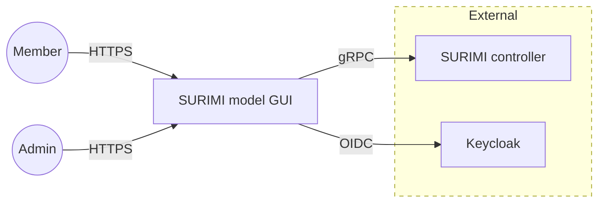
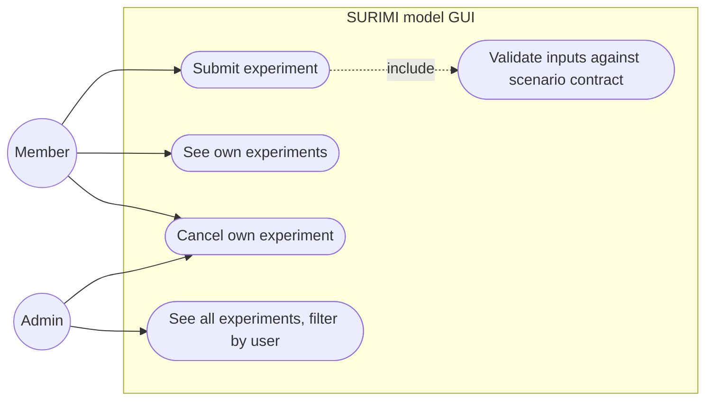
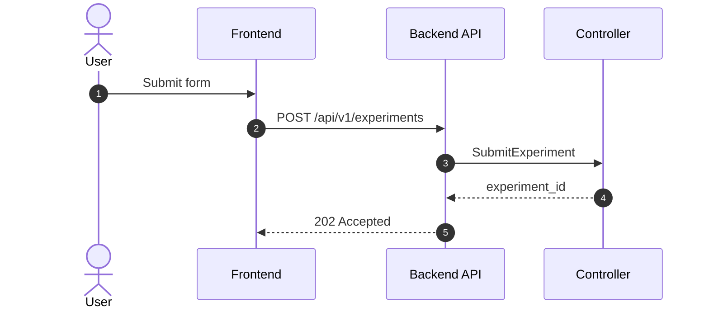
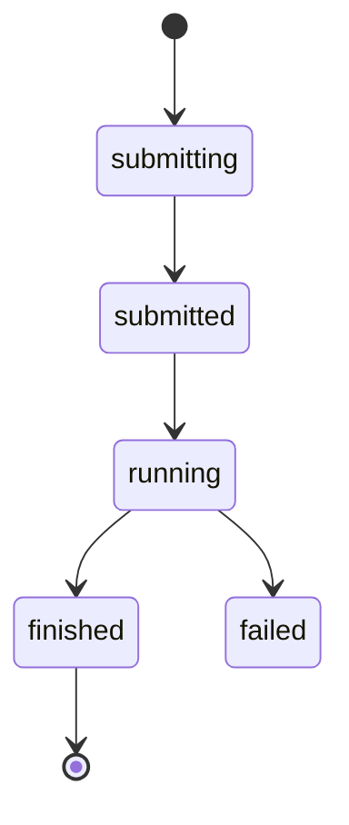
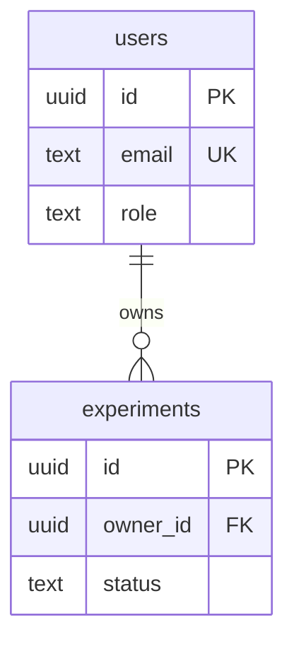

# Diagram conventions

All diagrams are [Mermaid](https://mermaid.js.org/) inside the Markdown file
that uses them. GitHub, VS Code and Bruno render Mermaid, so a diagram is
reviewed in the same diff as the text and cannot drift into a separate tool.
PlantUML is not used: GitHub does not render it.

## Which diagram for what

| Question the diagram answers | Mermaid type | Where |
| --- | --- | --- |
| Who uses the system and what else does it talk to? | `flowchart` (context) | `ARCHITECTURE.md` |
| Which processes exist and which protocol joins them? | `flowchart` (containers) | `ARCHITECTURE.md`, plans |
| Who can do what in a feature? | `flowchart` (use cases) | feature README |
| What happens, in order, across processes? | `sequenceDiagram` | feature README, `ARCHITECTURE.md` |
| What states can a thing be in? | `stateDiagram-v2` | feature README |
| Which tables, keys and relations? | `erDiagram` | feature README, `ARCHITECTURE.md` |
| How is the code inside one app split? | `flowchart` with subgraphs | app README |

Mermaid's `C4Context` and `C4Container` types are still marked experimental and
lay out poorly, so context and container views use `flowchart` with the C4
shapes by convention: people as `(( ))`, systems as `[ ]`, databases as `[( )]`,
external systems in a dashed subgraph.

Mermaid has no UML use-case diagram. Use a `flowchart LR`: actors on the left as
`(( ))`, use cases as stadiums `([ ])` inside a subgraph that is the system
boundary, `-.->|include|` for include relations.

## Rules

- Quote any label with spaces, slashes, brackets or colons: `A["POST /api/v1/experiments"]`.
- Never put `;` in a sequence-diagram message or note: Mermaid reads it as the
  end of the statement and the diagram fails. Use a comma or a full stop.
- Label every arrow with the protocol or the message: `-->|gRPC|`, `->>` with the RPC name.
- One diagram per question. Split a diagram that needs more than about 15 nodes.
- Under each diagram, one or two sentences on what to notice.
- Names in diagrams match the code: table names, RPC names, route paths.

## Templates

### Context

### Use cases

### Sequence

### State

### Entity relations

