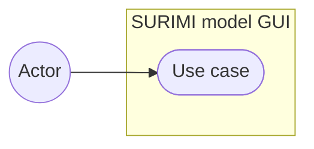

# <Feature title>

**Status:** Planned | Designing | In progress | Done YYYY-MM-DD
**Plan:** link to the plan, if any
**ADRs:** links to the decisions this feature relies on

<One paragraph: what this feature lets which user do.>

| File | Purpose |
| --- | --- |
| [README.md](README.md) | Use cases, design, decisions, open questions |
| [CHANGELOG.md](CHANGELOG.md) | Dated log of every change made for this feature |

---

## Decisions

Every decision this feature relies on, so the feature reads on its own.
Decisions that also shape other features live in an ADR and are summarised
here with a link; decisions that only concern this feature are recorded here
and explained under Target behaviour.

| Decision | Why | Recorded in |
| --- | --- | --- |
| | | ADR link, or "this file" |

---

## Use cases

| Use case | Actor | Pre-conditions | Main flow | Failure cases |
| --- | --- | --- | --- | --- |
| | | | | |

---

## Current state

What the code does today, with file links and evidence labels.

---

## Target behaviour

One subsection per decision: the decision, **why**, and the alternative rejected
and why. Link the ADR when the decision is wider than this feature.

---

## Flows

A `sequenceDiagram` per flow that crosses a process boundary.

---

## State

A `stateDiagram-v2` when the feature has a lifecycle.

---

## Data

An `erDiagram` of the tables this feature adds or changes, and a note on
migrations.

---

## API

| Method | Path | Role | Request | Response | Errors |
| --- | --- | --- | --- | --- | --- |
| | | | | | |

---

## Where the changes are

| Area | File | Change |
| --- | --- | --- |
| | | |

---

## Observability

Log events, metrics and audit events this feature emits.

---

## How to test

Steps to check the feature end to end.

---

## What has been verified

What was run and what it showed. Say what was not checked.

---

## Open questions

Questions that need an answer, with who must answer. Delete each one when it is
answered and state the answer where the fact belongs.
