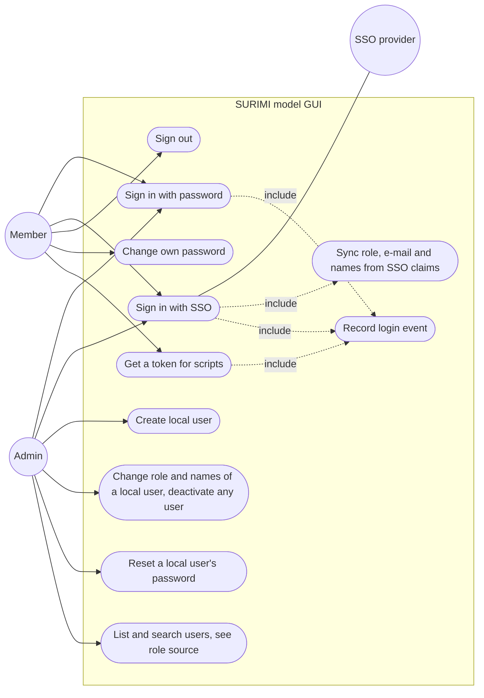
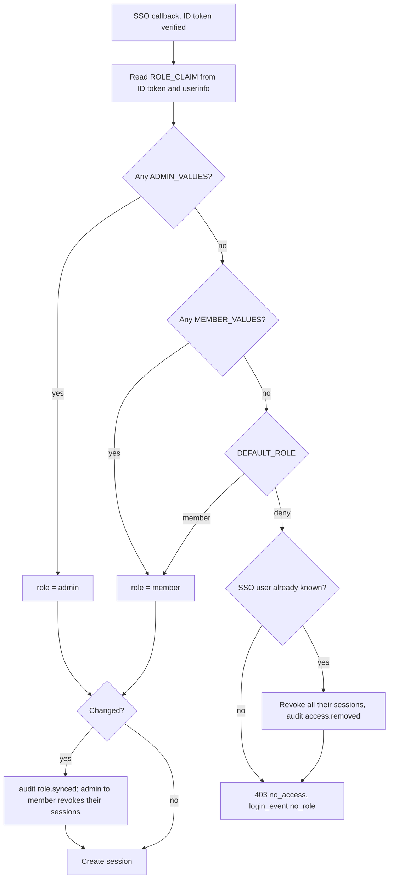
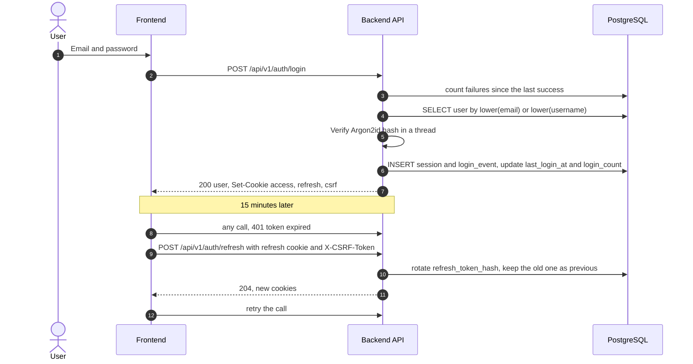

# Authentication and users

**Status:** Built, backend and API (phase 3, 2026-11-03; separate accounts and names 2026-11-04). Frontend in phase 10.
**Plan:** [2026-11-03-monorepo-and-backend](../../plans/2026-11-03-monorepo-and-backend.md), phase 3
**ADRs:** [0004](../../decisions/0004-authentication-local-and-oidc.md), [0016](../../decisions/0016-separate-sso-and-local-accounts.md), [0005](../../decisions/0005-authorization-roles-and-ownership.md), [0010](../../decisions/0010-observability-and-activity-tracking.md), [0013](../../decisions/0013-data-retention.md)
**Changes:** [CHANGELOG.md](CHANGELOG.md)

Users sign in with a local account (email or username and password) or through
an SSO provider (Keycloak first, others later). Roles are `admin` and
`member`. SSO users get their role from the provider's roles or groups, re-read
at every sign-in. Local and SSO users are separate accounts; an SSO user's
e-mail and names also come from the provider. Admins create and manage local
users. Every sign-in is recorded.

---

## Decisions

| Decision | Why | Recorded in |
| --- | --- | --- |
| One backend session (15-min JWT + rotating refresh token, HttpOnly cookies) for every sign-in method | One check on every route; revocable; no tokens in JavaScript | [ADR 0004](../../decisions/0004-authentication-local-and-oidc.md) |
| SSO is generic OIDC with providers as configuration | Another SSO is coming; adding it must be config, not code | [ADR 0004](../../decisions/0004-authentication-local-and-oidc.md) |
| OIDC written on `httpx` + `PyJWT`, not `authlib` | About 200 lines we test end to end; `authlib`'s Starlette client needs `SessionMiddleware` for its flow state, a second session cookie we would add only for this | [ADR 0004](../../decisions/0004-authentication-local-and-oidc.md) |
| Session and user read from the database at every request; the role is taken from the user row, not the token | Sign-out, deactivation and role changes apply at the next request, not after 15 minutes | [ADR 0004](../../decisions/0004-authentication-local-and-oidc.md) |
| `POST /auth/token` returns a bearer token for Bruno and scripts | Cookies and CSRF are awkward outside a browser; the token's session lasts 15 minutes and cannot be refreshed | [ADR 0004](../../decisions/0004-authentication-local-and-oidc.md) |
| Roles `admin` and `member` | "SimpleUser" sounds lesser; `user` collides with the entity; `member` is neutral | [ADR 0005](../../decisions/0005-authorization-roles-and-ownership.md) |
| SSO role mapped from a configurable claim (client roles, realm roles or groups) at **every** sign-in | Roles change in Keycloak and must follow | [ADR 0005](../../decisions/0005-authorization-roles-and-ownership.md) |
| No matching role → sign-in refused by default | Being in a shared realm must not grant access | [ADR 0005](../../decisions/0005-authorization-roles-and-ownership.md) |
| Access removed at the provider → the refused sign-in also ends that SSO user's open sessions | Otherwise a refresh token keeps working for up to 12 h after access was taken away | this file |
| Demotion from admin at the provider ends the user's sessions | An admin page left open must not keep working | this file |
| SSO sessions end after 12 h (`SSO_SESSION_MAX_AGE_HOURS`) | Bounds how long a role removed at the provider keeps working for a user who never signs in again | [ADR 0004](../../decisions/0004-authentication-local-and-oidc.md) |
| Role of an IdP-managed user is read-only in our API | An edit would be overwritten at the next sign-in | this file |
| SSO and local users are separate accounts, never linked by e-mail or username; SSO users are found by `(provider, sub)` only | No takeover through an e-mail claim; no local password left on an SSO account | [ADR 0016](../../decisions/0016-separate-sso-and-local-accounts.md) |
| E-mail unique across all users; a first SSO sign-in with a missing, unverified or taken e-mail is refused (403) | Every user has a real address; no placeholders | [ADR 0016](../../decisions/0016-separate-sso-and-local-accounts.md) |
| An SSO user's e-mail, first, last and display name follow the provider at every sign-in; read-only in the admin API | One source of truth for SSO users, as for their role | [ADR 0016](../../decisions/0016-separate-sso-and-local-accounts.md) |
| A new provider e-mail that is unverified or taken is not copied; the sign-in still works | Nobody is locked out because of another account | [ADR 0016](../../decisions/0016-separate-sso-and-local-accounts.md) |
| `first_name`, `last_name` required for local users, optional for SSO users; `display_name` always set (given, else "first last", else username) | Sorting by surname and formal greetings; not every provider sends names | [ADR 0016](../../decisions/0016-separate-sso-and-local-accounts.md) |
| SSO flow state (state, nonce, PKCE verifier, `next`) in a signed 10-minute cookie, not in a table | Nothing to clean up; the browser that started the flow is the only one that can finish it | this file |
| `OIDC_<K>_DISCOVERY_URL` separate from the issuer | In compose and Kubernetes the API reaches the provider by an internal name, while the issuer in the tokens is the public URL | this file |
| Refresh token reuse revokes the whole session (30 s grace for parallel tabs) | A stolen, replayed token ends the session for both | this file |
| Failed sign-ins: 5 per account in 15 min, counted in `login_events` after the last success; 20 per IP, in memory | The account limit survives restarts and works across replicas; the IP limit is a cheap first filter | this file |
| No self-registration for local accounts | Small, known user group; open question | this file |
| Password policy: 12 to 256 characters, not in a common-password list, not containing the username or e-mail name | NIST 800-63B prefers length to composition rules | this file |
| First admin from `surimi-backend create-admin`, which compose's `migrate` job runs with `--from-env` | No default credentials in images; the admin is configurable at install | this file |

---

## Use cases



| Use case | Actor | Main flow | Failure cases |
| --- | --- | --- | --- |
| Sign in with password | Any | Email or username and password → session cookies | Wrong credentials → 401, same message for an unknown user; 5 failures in 15 min → 429 with `Retry-After`; inactive → 403 |
| Get a token for scripts | Any local user | `POST /auth/token` → bearer token, 15 min | As above |
| Sign in with SSO | Any | Provider round trip; user found by `(provider, sub)` or created; role, e-mail and names synced; session cookies | First sign-in with no verified e-mail → 403 `email_not_verified`, e-mail used by another user → 403 `email_taken`; wrong state or missing flow cookie, bad nonce, signature, issuer, audience or expiry → 400 `sso_failed`; no matching role → 403 `no_access`; provider unreachable → 502 `sso_provider_error` |
| Sync role | System | Read the mapping claim, apply the rules, update `users.role`, audit a change, revoke sessions on demotion from admin | Claim missing → treated as no roles |
| Create local user | Admin | Email, username, first and last name, role, temporary password; must change it at first sign-in | Duplicate e-mail or username → 409; missing name → 422 |
| Deactivate user | Admin | `is_active = false`, sessions revoked | Own account → 422; last active admin → 409 |

---

## SSO role mapping

### Provider configuration

Providers are listed in `OIDC_PROVIDERS` (comma-separated keys); each key
`<K>` reads:

| Variable | Default | Meaning |
| --- | --- | --- |
| `OIDC_<K>_ISSUER` | required | Issuer, as in the tokens |
| `OIDC_<K>_DISCOVERY_URL` | `<issuer>/.well-known/openid-configuration` | Where the API fetches the discovery document; set it when the API reaches the provider by another name |
| `OIDC_<K>_CLIENT_ID`, `OIDC_<K>_CLIENT_SECRET` | required | Confidential client; the secret is sent with HTTP Basic |
| `OIDC_<K>_SCOPES` | `openid email profile` | |
| `OIDC_<K>_DISPLAY_NAME` | the key, title-cased | Text of the sign-in button |
| `OIDC_<K>_ROLE_CLAIM` | empty | Dotted path to the role claim; empty means the provider does not manage roles |
| `OIDC_<K>_ADMIN_VALUES`, `OIDC_<K>_MEMBER_VALUES` | empty | Comma-separated claim values |
| `OIDC_<K>_DEFAULT_ROLE` | `deny` | `deny` or `member`, for users with no matching value |

Env vars rather than a YAML file so Helm can set them from values and Secrets.
The redirect URI to register at the provider is
`<PUBLIC_BASE_URL>/api/v1/auth/sso/<K>/callback`. Example:

```bash
OIDC_PROVIDERS=keycloak
OIDC_KEYCLOAK_ISSUER=https://keycloak.example.org/realms/surimi
OIDC_KEYCLOAK_CLIENT_ID=surimi-modelgui
OIDC_KEYCLOAK_CLIENT_SECRET=…
OIDC_KEYCLOAK_DISPLAY_NAME=Keycloak
OIDC_KEYCLOAK_ROLE_CLAIM=groups
OIDC_KEYCLOAK_ADMIN_VALUES=surimi-admins
OIDC_KEYCLOAK_MEMBER_VALUES=surimi-members
OIDC_KEYCLOAK_DEFAULT_ROLE=deny
```

The discovery document is fetched at the first SSO request and cached for an
hour, so a provider that is down at start-up does not stop the API; only its
own sign-ins fail (502). The issuer it announces must equal `OIDC_<K>_ISSUER`.

### Claim shapes supported

| Source in Keycloak | `ROLE_CLAIM` | Keycloak setup |
| --- | --- | --- |
| Groups (**chosen**, user 2026-11-04; compose default and dev realm) | `groups` | Groups `surimi-admins`, `surimi-members`; Group Membership mapper on the client, claim `groups`, *Full group path* off, *Add to ID token* on |
| Client roles | `resource_access.surimi-modelgui.roles` | Roles `surimi-admin`, `surimi-member` on the client; "client roles" mapper with *Add to ID token* on |
| Realm roles | `realm_access.roles` | Realm roles; "realm roles" mapper with *Add to ID token* on |

Values are compared exactly. With *Full group path* on, Keycloak sends
`/surimi-admins`, which matches nothing unless `ADMIN_VALUES` and
`MEMBER_VALUES` carry the slash too. With it off, a group of the same name
anywhere in the realm counts, so only realm admins should create groups with
these names. The claim is read from the ID token, merged with the userinfo
response when the token lacks it.

**Verified** (2026-11-03 with client roles; again 2026-11-04 with the
`groups` claim, Keycloak 26.4 dev realm in compose; the stored claim is
`["surimi-admins"]` and `["surimi-members"]`). alice (`surimi-admins`) signs in as admin, bob
(`surimi-members`) as member, carol (no group) gets 403 `no_access`; moving
bob to `surimi-admins` makes him admin at the next sign-in, removing him from
every group refuses the next sign-in and his earlier session gets 401.
Client-role and realm-role claims are covered by unit tests only since
2026-11-04.

### E-mail and names (ADR 0016)

| Claim | Column | First sign-in | Later sign-ins |
| --- | --- | --- | --- |
| `email` with `email_verified: true` | `users.email` | Required: missing or unverified → 403 `email_not_verified`; used by any other user, local or SSO, deleted ones included → 403 `email_taken`. Nothing is created; `login_events` result `email_rejected` | Copied when changed. Unverified, or used by another user → old e-mail kept, sign-in goes on, log `auth.sso_email_not_synced` |
| `given_name`, `family_name` | `users.first_name`, `users.last_name` | Copied; may be null | Copied, also to null |
| `name` | `users.display_name` | `name`, else "first last", else the username | Same rule |
| `preferred_username` | `users.username` | Made unique by adding a number; else the e-mail's local part | Not changed: the username is ours |

A changed field is audited as `profile.synced` with the field names only.
**Verified** (2026-11-04, Keycloak 26.4 dev realm): alice's first and last
name are copied; a Keycloak user `dora` with the local admin's e-mail gets
403 `email_taken` and no user is created; bob's e-mail and first name
changed in Keycloak are copied at his next sign-in, and an admin editing his
first name gets 409 `profile_managed_by_provider`.

### Rules



Users from a provider without `ROLE_CLAIM` get `DEFAULT_ROLE` once
(`role_source = local`) and are then managed in our app. A user refused for
no role keeps the role they last had in `users.role`; it has no effect, since
they cannot sign in and have no sessions left.

### When a role change in the provider takes effect

| Setting | Delay |
| --- | --- |
| Built | Next sign-in, at most `SSO_SESSION_MAX_AGE_HOURS` (12 h) for a user who stays signed in |
| `OIDC_RESYNC_ON_REFRESH=true` (**not built**) | At the next refresh, at most 15 min; would keep the provider's refresh token encrypted in `sessions.idp_refresh_token_enc` (the column exists, unused) |
| Provider back-channel logout (**not built**) | Immediate; the provider calls our logout endpoint |

---

## Flows

The SSO sequence is in [ARCHITECTURE.md](../../ARCHITECTURE.md#main-flows).
Local sign-in and refresh:



### Session rules

| Rule | Value |
| --- | --- |
| Access JWT | HS256 with `JWT_SECRET` (at least 32 characters), claims `sub`, `sid`, `role`, issuer `surimi-modelgui`, audience `surimi-modelgui-api`, `ACCESS_TOKEN_MINUTES` (15) |
| Refresh token | Opaque, 32 random bytes, stored as SHA-256; valid `REFRESH_TOKEN_DAYS` (14) since last use; rotated at every refresh |
| Absolute session age | `SESSION_MAX_AGE_HOURS` (720) for password, `SSO_SESSION_MAX_AGE_HOURS` (12) for SSO |
| Reuse of a replaced refresh token | Within 30 s: 401 "retry", nothing revoked (two tabs refreshing at once; the other tab already has the new cookie). Later: the session is revoked (`refresh_token_reuse`) |
| Cookies | `surimi_access` (path `/`), `surimi_refresh` (path `/api/v1/auth`), both HttpOnly; `surimi_csrf` readable; `SameSite=Lax`; `Secure` unless `COOKIE_SECURE=false` |
| CSRF | Cookie requests that change data send `X-CSRF-Token` equal to `surimi_csrf`; bearer requests need none |
| `must_change_password` | Only `me`, `password` and `logout` accept the user's token until the password is changed (403 `password_change_required`) |
| Revocation reasons in `sessions.revoked_reason` | `logout`, `password_changed`, `password_reset`, `deactivated`, `demoted`, `access_removed`, `refresh_token_reuse`, `user_inactive` (found at refresh) |

---

## Data

Tables `users`, `identities`, `sessions`, `login_events`,
`login_stats_monthly`, `audit_events` in [schema.dbml](../../database/schema.dbml),
migrations `0002_auth` and `0003_user_names`. Role-related columns:
`users.role`, `users.role_source`, `users.role_synced_at`,
`identities.claims_snapshot` (only the role claim). Names: `users.first_name`,
`users.last_name` (null only for SSO users whose provider sends none),
`users.display_name` (not null). `users.id` (UUID) is the identifier every
other table uses; e-mail and username are unique ways to find a user, and an
SSO user is found by `identities (provider, subject)`.
Sign-in history keeps the IP for `RETENTION_LOGIN_IP_DAYS` and the user agent
for `RETENTION_LOGIN_USER_AGENT_DAYS` (90 each; 0 means never stored, ADR
0013); a client address that is not an IP is stored as NULL. The job that
clears them after the retention period is the retention purge task of
phase 5.

---

## API

| Method | Path | Role | Request | Response | Errors |
| --- | --- | --- | --- | --- | --- |
| GET | `/api/v1/auth/providers` | public | — | `[{key, display_name, login_url}]` for the sign-in buttons | — |
| POST | `/api/v1/auth/login` | public | `{login, password}` | `UserOut` + cookies | 401, 403, 429 |
| POST | `/api/v1/auth/token` | public | `{login, password}` | `{access_token, token_type, expires_in}` | 401, 403, 429 |
| POST | `/api/v1/auth/refresh` | refresh cookie | `X-CSRF-Token` | 204 + cookies | 401, 403 csrf |
| POST | `/api/v1/auth/logout` | any | — | 204 | 401 |
| GET | `/api/v1/auth/sso/{provider}/login` | public | `?next=` (a path on this site) | 302 to provider + flow cookie | 404 unknown provider, 502 |
| GET | `/api/v1/auth/sso/{provider}/callback` | public | `?code&state` | 302 to `PUBLIC_BASE_URL` + `next`, cookies | 400, 403 `no_access`, `account_inactive`, `email_not_verified` or `email_taken`, 502 |
| GET | `/api/v1/auth/me` | any | — | `UserOut` (incl. `first_name`, `last_name`, `display_name`, `account`, `role`, `role_source`, `has_password`) | 401 |
| POST | `/api/v1/auth/password` | local users | `{current_password, new_password}` | 204, other sessions end | 401, 409 SSO-only, 422 weak |
| GET | `/api/v1/admin/users` | admin | `?q&role&role_source&active&page&size&sort` (`q` also searches first and last name; `sort` also `last_name`) | `{items, total, page, size}` | 403 |
| POST | `/api/v1/admin/users` | admin | `{email, username, first_name, last_name, display_name?, role, temporary_password}` | 201 `UserOut` | 409, 422 |
| GET | `/api/v1/admin/users/{id}` | admin | — | `UserOut` | 404 |
| PATCH | `/api/v1/admin/users/{id}` | admin | `{role?, is_active?, first_name?, last_name?, display_name?}` | `UserOut` | 404, 409 `role_managed_by_provider`, `profile_managed_by_provider` or `last_admin`, 422 own account |
| POST | `/api/v1/admin/users/{id}/reset-password` | admin | `{temporary_password}` | 204, their sessions end | 404, 409 `no_local_password`, 422 |

Every route except `healthz`, `readyz`, `providers`, `login`, `token` and
the SSO routes needs a signed-in user; `/api/v1/scenarios` is now behind
sign-in too. Bruno: `resources/bruno/surimi-modelgui/api/auth/` and
`api/admin/users/`.

---

## Configuration

| Variable | Default | Meaning |
| --- | --- | --- |
| `JWT_SECRET` | required for `serve` | At least 32 characters; compose has a local-only default |
| `PUBLIC_BASE_URL` | `http://localhost:18080` | Origin users see; SSO redirect URIs and the redirect after sign-in |
| `COOKIE_SECURE` | `true` | `false` only for plain-http local runs (compose sets it) |
| `ACCESS_TOKEN_MINUTES`, `REFRESH_TOKEN_DAYS` | 15, 14 | |
| `SESSION_MAX_AGE_HOURS`, `SSO_SESSION_MAX_AGE_HOURS` | 720, 12 | |
| `LOGIN_MAX_FAILURES`, `LOGIN_IP_MAX_FAILURES`, `LOGIN_FAILURE_WINDOW_MINUTES` | 5, 20, 15 | |
| `RETENTION_LOGIN_IP_DAYS`, `RETENTION_LOGIN_USER_AGENT_DAYS` | 90, 90 | 0 = not stored |
| `OIDC_PROVIDERS`, `OIDC_<K>_*` | empty | See above |
| `ADMIN_EMAIL`, `ADMIN_USERNAME`, `ADMIN_FIRST_NAME`, `ADMIN_LAST_NAME`, `ADMIN_PASSWORD` | empty | Read by `create-admin --from-env`; compose's `migrate` job runs it, so the admin exists after every start (existing user: made admin; names kept; password kept unless `--reset-password`). All unset: nothing happens; partly set: exit 2 |

---

## Where the changes are

Rows marked *Frontend (phase 10)* describe what the frontend will need.
They are built only in phase 10, the last phase, if the user agrees then
(user, 2026-11-03).

| Area | File | Change |
| --- | --- | --- |
| Backend | `src/surimi_backend/auth/` | `passwords.py`, `tokens.py`, `sessions.py`, `ratelimit.py`, `history.py` (sign-in events), `role_mapping.py`, `cookies.py`, `dependencies.py` (`CurrentUser`, `AdminUser`, CSRF), `service.py`, `router.py`, `models.py` (`sessions`, `login_events`, `login_stats_monthly`) |
| Backend | `src/surimi_backend/integrations/oidc.py` | Discovery, PKCE, code exchange, ID token checks, userinfo |
| Backend | `src/surimi_backend/users/` | models (`users`, `identities`), repository, service, admin router |
| Backend | `src/surimi_backend/audit/` | `audit_events` table and `record()` |
| Backend | `src/surimi_backend/cli.py` | `create-admin` (`--email`, `--username`, `--first-name`, `--last-name`, `--from-env`, `--reset-password`) |
| Backend | `migrations/versions/20261103_0002_auth.py` | The six tables, their enums and indexes |
| Backend | `migrations/versions/20261104_0003_user_names.py` | `first_name`, `last_name`, `display_name` not null, `login_result` value `email_rejected` |
| Deploy | `deployments/keycloak/surimi-realm.json` | Dev realm: client `surimi-modelgui` with a Group Membership mapper (`groups`, full path off), groups `surimi-admins` and `surimi-members`, test users alice (admin), bob (member), carol (no role) with fixed ids, so their `sub` survives a re-import |
| Deploy | `deployments/compose.yml` | `keycloak` service (profile `keycloak`, port 18083), auth settings on `api`, `create-admin --from-env` in `migrate` |
| Frontend (phase 10) | `apps/frontend/src/features/auth/` | Sign-in page with one button per provider, session context, 401-refresh-retry with `X-CSRF-Token`, route guards, "no access" page, forced password change |
| Frontend (phase 10) | `apps/frontend/src/features/admin/users/` | Users table with role source and account badges, create and edit dialogs; names and e-mail of SSO users read-only |

---

## Observability

Logs: `auth.login_succeeded`, `auth.logout`, `auth.sso_no_role`,
`auth.sso_email_rejected`, `auth.sso_email_not_synced`,
`auth.refresh_token_reused`, `oidc.request_failed`,
`oidc.token_exchange_failed`; no passwords, tokens or cookies. Every sign-in
attempt, success or not, is a `login_events` row (`result` `success`,
`bad_credentials`, `locked` (rate limit), `inactive`, `no_role`,
`email_rejected`, `error`). Audit events: `user.created`, `user.updated`,
`user.password_reset`, `user.password_changed`, `user.admin_ensured`,
`role.synced`, `profile.synced`, `access.removed`. The metric
`surimi_logins_total{method,provider,result}` is not built; it comes with the
observability feature.

---

## How to test

- `cd apps/backend && uv run pytest -q`: unit tests for passwords, tokens,
  role mapping, rate limits and `next` paths; integration tests (PostgreSQL in
  a container) for password sign-in, refresh rotation and reuse, CSRF, admin
  users as admin and member, the CLI, and SSO against an in-process fake
  provider (PKCE, Basic auth, signature, nonce, audience, issuer, expiry,
  userinfo, e-mail refusal, profile sync).
- Against the real Keycloak:
  `docker compose -f deployments/compose.yml --profile keycloak up --build -d`,
  then open `http://localhost:18080/api/v1/auth/sso/keycloak/login` and sign
  in as alice, bob or carol (passwords in `deployments/.env.example`). Move a
  user between groups in the Keycloak admin console
  (`http://localhost:18083`, `admin` / `admin-local-only`) and sign in again.
- Bruno: run `api/auth/post token`, then the other requests.

---

## Open questions

- Password reset by e-mail needs an SMTP server; available? (User)
- Self-registration for local accounts? (User)
- Should an SSO user whose access was removed be shown differently in the
  admin list (today: last role kept, `last_login_at` stops)? (User, phase 10)
