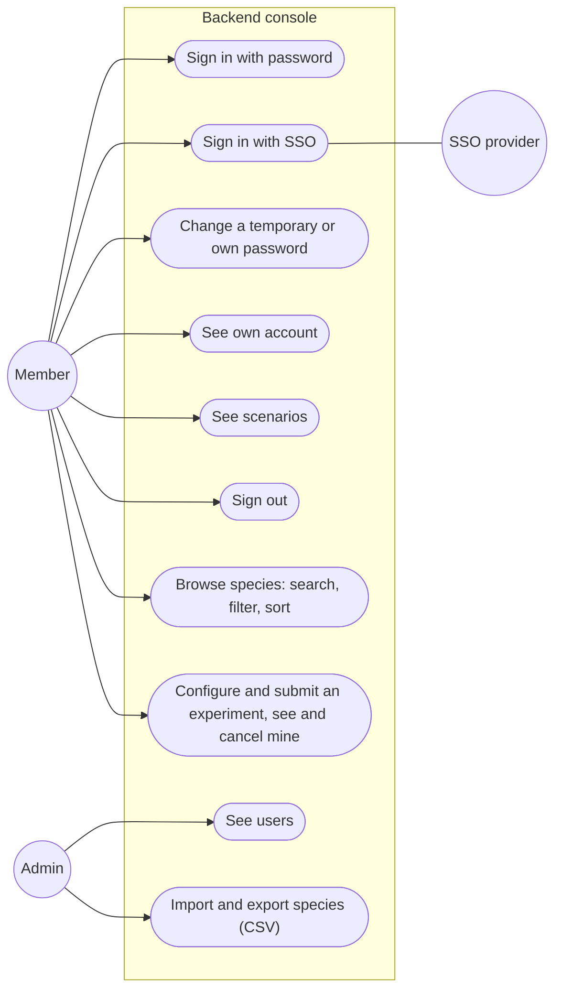
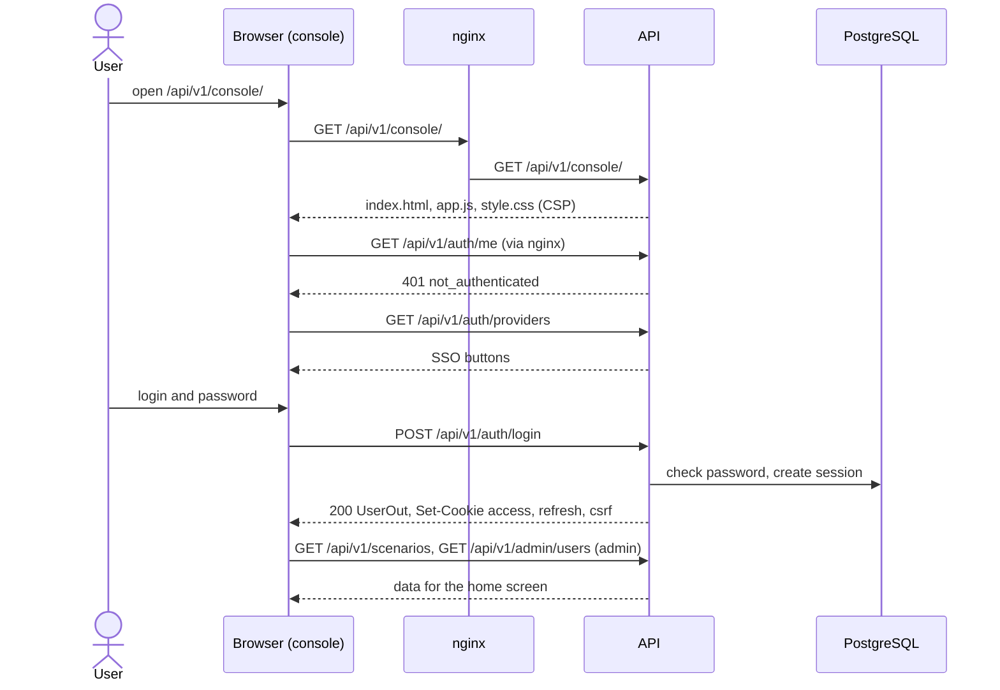
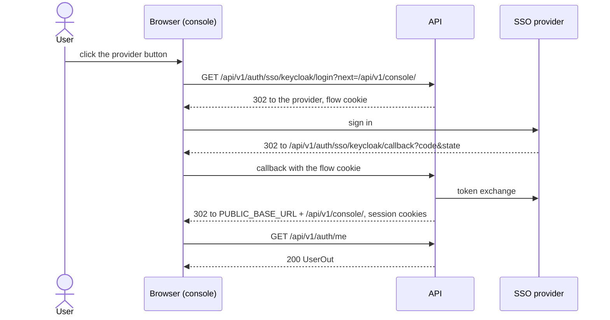

# Backend console

**Status:** Built 2026-11-06 on `develop`, not merged into `main`; species pages, tabs and the experiment tab 2026-11-16; Scenario catalog and Groups import & export tabs 2026-11-27
**Plan:** none; a helper for phases 3 to 9 of [2026-11-03-monorepo-and-backend](../../plans/2026-11-03-monorepo-and-backend.md)
**ADRs:** [0004](../../decisions/0004-authentication-local-and-oidc.md), [0005](../../decisions/0005-authorization-roles-and-ownership.md), [0006](../../decisions/0006-protocols-rest-sse-grpc.md)
**Changes:** [CHANGELOG.md](CHANGELOG.md)

A small web page that the backend serves itself at `/api/v1/console/`. It has a
sign-in screen (password, and a button per SSO provider) and a home screen
that shows the signed-in user, the scenarios the controller offers and, for
admins, the users. Members and admins can use it to try the backend in a
browser, with real cookies, CSRF and SSO redirects, before the phase 10
frontend exists. It is not the product frontend. It only calls the public REST
API and has no endpoints or permissions of its own.

| File | Purpose |
| --- | --- |
| [README.md](README.md) | Use cases, design, decisions, open questions |
| [CHANGELOG.md](CHANGELOG.md) | Dated log of every change made for this feature |

---

## Decisions

| Decision | Why | Recorded in |
| --- | --- | --- |
| Static HTML, CSS and plain JavaScript in the backend package, served with Starlette `StaticFiles` | No build step and no new dependency. The page goes out in the same image as the API | this file |
| Served at `/api/v1/console/` | nginx already forwards `/api/v1/` to the API and `/` to the SPA. Same origin as the API, so the session cookies and CSRF work unchanged | this file |
| The page only calls the existing JSON API (`/api/v1/auth/*`, `/api/v1/scenarios`, `/api/v1/admin/users`, `/api/v1/species`, `/api/v1/admin/species/*`) | It tests the real sign-in flow and cannot do more than the API allows. No second login path to keep secure | this file |
| Strict Content-Security-Policy, no inline script, data written with `textContent` only | User names and e-mails come from SSO providers, so they must never be read as HTML | this file |
| `CONSOLE_ENABLED`, default `true` | Can be turned off where the phase 10 frontend is the only UI | this file |
| Not the phase 10 frontend: no queue, output or admin editing screens, **except** species (a browser for everyone, CSV import and export for admins), the **scenario catalog** (a scenario's entries, functional groups with their species, for everyone; the groups CSV import and export for admins, 2026-11-27) and a **New experiment** tab (choose a scenario, set its options and HCRs, load and save named HCR configurations, submit; see and cancel your experiments) | CLAUDE.md: frontend features wait for phase 10. The user asked for the species pages and the experiment tab on 2026-11-16, to use these features before phase 10 | this file, CLAUDE.md, [scenario-catalog](../scenario-catalog/README.md#console-pages-user-2026-11-16) |
| The home view is split into tabs, one address each: Home (account, scenarios), New experiment, Species, Scenario catalog, and for admins Users, Species import & export and Groups import & export (`#/home`, `#/experiments`, `#/species`, `#/catalog`, `#/users`, `#/species-import`, `#/groups-import`); a tab loads its data when opened | Asked by the user, 2026-11-16, to keep each subject on its own page. One page with hash addresses keeps one sign-in and session code, the Back button and links work, and nothing loads that is not shown. Rejected: one HTML file per page (sign-in, refresh and header repeated) | this file |
| Session: 15-minute access cookie, refreshed once through `POST /auth/refresh` when a call returns 401 | Same rules as the future frontend (ADR 0004) | [ADR 0004](../../decisions/0004-authentication-local-and-oidc.md) |

---

## Use cases

Admins can do everything members can. Only "See users" is limited to admins,
and the API checks that, not the page.

| Use case | Actor | Pre-conditions | Main flow | Failure cases |
| --- | --- | --- | --- | --- |
| Sign in with password | Any local user | Console enabled | Login and password → `POST /auth/login` → home | 401 wrong credentials, 403 inactive, 429 with the wait in seconds: the API's message is shown on the form |
| Sign in with SSO | Any SSO user | Provider configured | Button → `GET /auth/sso/<key>/login?next=/api/v1/console/` → provider → callback → back on the console, signed in | The callback's errors (400, 403, 502) are JSON from the API, not a page (open question) |
| Change password | Local user | Signed in | Current and new password → `POST /auth/password`. If the account must change its password, nothing else is shown until it is done | 401 wrong current password, 422 weak password |
| See own account | Any | Signed in | `GET /auth/me`: name, e-mail, username, role and where it comes from, account kind, last sign-in, sign-in count | Session ended → sign-in screen |
| See scenarios | Any | Signed in, password changed | `GET /scenarios` | 503 controller unavailable: shown in the section |
| See users | Admin | Signed in as admin | `GET /admin/users?size=50` | Members do not see the section |
| Sign out | Any | Signed in | `POST /auth/logout` with the CSRF header → sign-in screen | Already ended → sign-in screen anyway |

---

## Current state

**Read from source**, 2026-11-06.

- [console/__init__.py](../../../apps/backend/src/surimi_backend/console/__init__.py)
  mounts `console/static/` at `/api/v1/console/` when `CONSOLE_ENABLED` is
  true. It adds the security headers to every file it serves, redirects
  `/api/v1/console` and `/` to `/api/v1/console/`, and leaves all of this out
  of the OpenAPI document.
- [static/index.html](../../../apps/backend/src/surimi_backend/console/static/index.html),
  [app.js](../../../apps/backend/src/surimi_backend/console/static/app.js),
  [style.css](../../../apps/backend/src/surimi_backend/console/static/style.css):
  the page.

---

## Target behaviour

### Static files in the backend, not server-side templates

The console is three static files. The browser does the rendering and calls
the JSON API with `fetch`. **Why:** the API already has every route the page
needs, with the CSRF double submit built for a browser. Static files add no
dependency and no build step.

Rejected:
- **Jinja2 templates with HTML form posts.** A new dependency, and a form post
  sign-in would be a second login path with its own CSRF handling next to
  `POST /auth/login`.
- **A route in the React app.** That is phase 10 work, and it would not test
  the backend on its own.
- **FastAPI's `/api/v1/docs` (Swagger UI) only.** It cannot follow the SSO
  redirect and back, and it does not send the CSRF header from the cookie, so
  cookie sessions cannot be tried with it.

### Path `/api/v1/console/`

**Why:** in compose the browser talks to nginx. nginx sends `/api/v1/` to the
API and everything else to the SPA, so this path works with no nginx change.
Because the page has the same origin as the API, the `SameSite=Lax` cookies and
the readable `surimi_csrf` cookie work as they will for the frontend. The
rejected option was `/console/`, which would need its own nginx `location`.

The redirect from `/api/v1/console` to `/api/v1/console/` is relative
(`Location: /api/v1/console/`). Starlette's own slash redirect builds an
absolute URL from the `Host` header, and nginx forwards `$host` without the
port, which would send the browser to `http://localhost/` instead of
`http://localhost:18080/`. `/` redirects to the console as well. This only
matters when the API is opened directly (`http://127.0.0.1:18082/`), because
nginx serves `/` itself.

### Security headers

Every console response carries:

| Header | Value | Why |
| --- | --- | --- |
| `Content-Security-Policy` | `default-src 'none'; script-src 'self'; style-src 'self'; img-src 'self' data:; connect-src 'self'; form-action 'self'; frame-ancestors 'none'; base-uri 'none'` | Only the console's own script runs and it talks only to its own origin. Stops injected script and framing (clickjacking) |
| `X-Content-Type-Options` | `nosniff` | Files are used only as the type they are served as |
| `Referrer-Policy` | `same-origin` | The console URL is not sent to SSO providers or other sites |
| `Cache-Control` | `no-cache` | A new image's page is used right away; the browser revalidates with the ETag |

The script never builds HTML from data. Every value goes into the page through
`textContent`.

### Session handling in the page

- On load: `GET /auth/me`. A 401 leads to one `POST /auth/refresh` with the
  CSRF header, then a second `GET /auth/me`. If that also fails, the sign-in
  screen is shown.
- Any other call that returns 401 also refreshes once and retries. The calls
  that use 401 for something else are excluded: login, refresh, and password
  change (wrong current password).
- Requests that change data (`POST`) copy the `surimi_csrf` cookie into the
  `X-CSRF-Token` header (ADR 0004).
- If `must_change_password` is set, only the password form is shown. The API
  refuses everything else with 403 `password_change_required` until the
  password is changed.

### `CONSOLE_ENABLED`

Default `true`, including in compose. **Why:** in phases 3 to 9 the console is
the only way to try sign-in in a browser. Production can set it to `false`
once the frontend is live. The page grants nothing the API does not already
allow, so leaving it on costs nothing. The rejected option was default
`false`, which would need an extra step on every local setup just to see the
sign-in.

---

## Flows

### Password sign-in

Every call after the page load goes through nginx like the first one. The page
holds no token: the cookies are HttpOnly and the browser sends them.

### SSO sign-in

`next` is checked by `safe_next` (a local path only). The user comes back to
`PUBLIC_BASE_URL`, so SSO through the console works only when the console is
opened on that origin (nginx in compose: `http://localhost:18080`).

---

## API

No new API endpoints. The console's own paths are left out of the OpenAPI
document.

| Method | Path | Role | Response |
| --- | --- | --- | --- |
| GET | `/api/v1/console/` (and its files) | public | The page; 404 when `CONSOLE_ENABLED=false` |
| GET | `/api/v1/console` | public | 307 to `/api/v1/console/` |
| GET | `/` | public | 307 to `/api/v1/console/` (direct access to the API only) |

The page calls: `GET /auth/me`, `GET /auth/providers`, `POST /auth/login`,
`POST /auth/refresh`, `POST /auth/logout`, `POST /auth/password`,
`GET /auth/sso/<key>/login`, `GET /scenarios`, `GET /admin/users`.

---

## Configuration

| Variable | Default | Meaning |
| --- | --- | --- |
| `CONSOLE_ENABLED` | `true` | Serve the console at `/api/v1/console/` |

`COOKIE_SECURE=false` is needed on plain http (compose default). Browsers drop
`Secure` cookies on `http://`, and the console then signs in and immediately
loses the session.

---

## Where the changes are

| Area | File | Change |
| --- | --- | --- |
| Backend | `apps/backend/src/surimi_backend/console/__init__.py` | Mount, security headers, redirects |
| Backend | `apps/backend/src/surimi_backend/console/static/` | `index.html`, `app.js`, `style.css` |
| Backend | `apps/backend/src/surimi_backend/core/config.py` | `console_enabled` |
| Backend | `apps/backend/src/surimi_backend/main.py` | `install_console(app, settings)` |
| Tests | `apps/backend/tests/test_console.py` | Files, headers, redirects, off switch, not in OpenAPI |
| Deploy | `deployments/compose.yml`, `deployments/.env.example` | `CONSOLE_ENABLED` |

---

## Observability

Nothing new. Requests to the console show up in the normal request logs, and
sign-ins are recorded by the auth routes (`login_events`, audit).

---

## How to test

1. `docker compose -f deployments/compose.local.yml up -d`, with `ADMIN_*` set in
   `deployments/.env` (or `--profile keycloak` for SSO).
2. Open `http://localhost:18080/api/v1/console/`.
3. Sign in as the admin: the home screen shows the account, the scenarios and
   the users. Sign out.
4. With Keycloak: click the Keycloak button and sign in as `alice` (admin) or
   `bob` (member). You land back on the console, signed in. `carol` gets the
   API's 403 `no_access`.
5. Unit tests: `cd apps/backend && uv run pytest tests/test_console.py`.

---

## What has been verified

See the newest entry in [CHANGELOG.md](CHANGELOG.md).

---

## Open questions

| Question | Who |
| --- | --- |
| SSO callback errors (`no_access`, `email_taken`, `sso_failed`) are JSON from the API. Should the callback redirect to `next` with an error code instead, so the console and the phase 10 frontend can show a message? That changes the auth API, so it belongs to auth-and-users | User |
| Keep the console after phase 10 (as an ops tool, switched off in production), or remove it? | User, at phase 10 |
