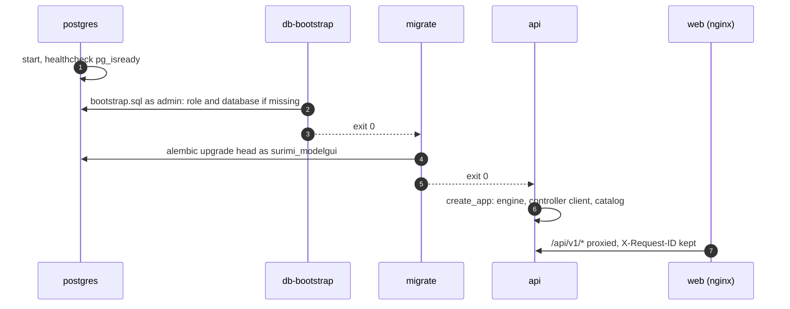

# Backend skeleton

**Status:** Done 2026-11-03 on branch `develop`, not merged into `main`
**Plan:** [2026-11-03-monorepo-and-backend](../../plans/2026-11-03-monorepo-and-backend.md), phase 2
**ADRs:** [0002](../../decisions/0002-backend-python-fastapi.md), [0003](../../decisions/0003-postgresql-sqlalchemy-alembic.md), [0006](../../decisions/0006-protocols-rest-sse-grpc.md), [0010](../../decisions/0010-observability-and-activity-tracking.md), [0011](../../decisions/0011-controller-stubs-from-buf-registry.md), [0014](../../decisions/0014-postgresql-in-repo-bundled-or-external.md)

The backend's foundation: the FastAPI app, settings, JSON logging with request
ids, the database with its bootstrap and migrations, health checks, the
controller client (real gRPC and a fake), the controller stubs pinned to the
protocol registry, the first endpoints (`/api/v1/scenarios`), and the compose
services that run it all. Infrastructure and backend only; no frontend change.

| File | Purpose |
| --- | --- |
| [README.md](README.md) | Design, decisions, what was verified |
| [CHANGELOG.md](CHANGELOG.md) | Dated log of every change made for this feature |

---

## Decisions

| Decision | Why | Recorded in |
| --- | --- | --- |
| FastAPI app factory `create_app(settings, controller=…)`; `surimi-backend serve` runs uvicorn with `factory=True` | Tests build the app with their own settings and controller; no import-time side effects | this file |
| Settings from env vars with pydantic-settings; `DB_*` pieces or `DATABASE_URL` | Helm puts the password in a Secret and the host in values | [ADR 0014](../../decisions/0014-postgresql-in-repo-bundled-or-external.md) |
| Controller URL checked when the client is built, not in `Settings` | The migrate job builds `Settings` too and has no use for the controller | this file |
| `ControllerClient` protocol with two implementations: `GrpcControllerClient` and `FakeControllerClient` (`CONTROLLER_MODE`) | Local runs and CI need no EDITO; the fake builds its answers from the same generated classes, so the JSON shape matches | [ADR 0006](../../decisions/0006-protocols-rest-sse-grpc.md) |
| Deadline on every gRPC call; retries only for reads and only on `UNAVAILABLE` | A timeout can never submit an experiment twice | this file |
| gRPC errors mapped to API errors: `UNAVAILABLE`/`UNIMPLEMENTED` → 502 `controller_unavailable`, `DEADLINE_EXCEEDED` → 504 `controller_timeout`, others → 502 `controller_error` | An ingress 404 in front of a stopped controller arrives as `UNIMPLEMENTED`; users get one clear message | this file |
| Contract returned as protobuf JSON with the `.proto` field names | Same names as the protocol docs and Bruno; typed schemas come with validation in phase 4 | this file |
| Scenario names and contracts cached 10 min, one lock per key | They change only on controller redeploys; a burst after expiry makes one call | this file |
| One error body `{"error": {code, message, details, request_id}}` | Clients and logs can match every failure to its request | this file |
| Pure ASGI request middleware: request id (kept if the caller sends a safe one), one JSON log line per request with the route template | Works with streaming (SSE later); the template, not the raw path, keeps logs groupable | [ADR 0010](../../decisions/0010-observability-and-activity-tracking.md) |
| nginx keeps a caller's `X-Request-ID`, else sends its own | One id across nginx and API logs; Bruno users can trace their request | this file |
| `/readyz`: database required, controller reported only, 2 s each | A controller outage must not take the API out of rotation | [ADR 0010](../../decisions/0010-observability-and-activity-tracking.md) |
| Stubs generated by `packages/proto/generate.py` (`buf export` + `grpcio-tools`) into a workspace package `surimi-protocol`, committed, pinned commit `b10b05a0…` | Runtime lower bounds follow the generator; no remote-plugin rate limits; CI fails on drift | [ADR 0011](../../decisions/0011-controller-stubs-from-buf-registry.md) |
| Migrations inside the package, run by `surimi-backend migrate`; baseline revision `0001_baseline` with no tables | The image needs no extra files; tables come with their features | [ADR 0003](../../decisions/0003-postgresql-sqlalchemy-alembic.md) |
| `deployments/postgres/bootstrap.sql` run by a `db-bootstrap` service using the official `postgres` image (`psql`) | Creating the database is a deployment step; one file for compose and Helm | [ADR 0014](../../decisions/0014-postgresql-in-repo-bundled-or-external.md) |
| Compose order postgres (healthy) → db-bootstrap → migrate → api, each waiting with `service_completed_successfully` | Migrations run once per start, never by each API replica | [ADR 0014](../../decisions/0014-postgresql-in-repo-bundled-or-external.md) |
| Local compose defaults for passwords (`*-local-only`) | `docker compose up` works with no `.env`; shared environments set their own | this file |
| API published on `127.0.0.1:18082` only | Bruno and debugging without exposing the API on the network | this file |
| Backend image: multi-stage, `uv sync --frozen --no-dev --no-editable`, non-root user 10001, healthcheck on `/healthz` | Small, reproducible from the lock file, no source tree at runtime | this file |
| CI jobs `backend` (ruff, format, mypy strict, pytest with PostgreSQL), `backend-image`, `proto-stubs` (regenerate and diff) | Every PR proves the backend, its image and the stubs | this file |

---

## Layout

```
apps/backend/
├── pyproject.toml           surimi-backend; script surimi-backend
├── alembic.ini              for `alembic revision --autogenerate` by hand
├── Dockerfile
├── src/surimi_backend/
│   ├── main.py              create_app()
│   ├── cli.py               serve | migrate | version
│   ├── core/                config, logging (structlog + middleware), db, errors
│   ├── api/health.py        /healthz, /readyz
│   ├── catalog/             /api/v1/scenarios (service with cache, router)
│   ├── integrations/controller/
│   │   ├── base.py          ControllerClient protocol, SimulationStatus, errors
│   │   ├── grpc_client.py   grpc.aio client
│   │   ├── fake.py          in-memory stand-in
│   │   └── convert.py       protobuf → Python
│   └── migrations/          env.py, versions/20261103_0001_baseline.py
└── tests/                   unit tests, gRPC client against an in-process server,
                             integration tests against PostgreSQL 17 (testcontainers)
packages/proto/
├── pyproject.toml           surimi-protocol; [tool.surimi-protocol] module and ref
├── generate.py
└── src/{surimi,buf}/        generated, committed (77 protos)
deployments/
├── compose.yml              + postgres, db-bootstrap, migrate, api
├── postgres/bootstrap.sql
└── nginx/default.conf.template   + location /api/v1/
pyproject.toml, uv.lock, .python-version     uv workspace, Ruff config
```

---

## Flow at start-up



---

## API

| Method | Path | Response | Errors |
| --- | --- | --- | --- |
| GET | `/healthz` | `{"status": "ok"}` | — |
| GET | `/readyz` | `{status, version, protocol, checks: {database, controller}}` | 503 when the database fails |
| GET | `/api/v1/scenarios` | `{"scenarios": [{"name"}]}` | 502 `controller_unavailable` / `controller_error`, 504 `controller_timeout` |
| GET | `/api/v1/scenarios/{scenario_name}/contract` | `{scenario_name, simulation}` | 404 `not_found`, 422 invalid name, 502/504 as above |
| GET | `/api/v1/openapi.json`, `/api/v1/docs` | OpenAPI 3.1 document, Swagger UI | — |

No authentication yet (phase 3). Bruno: `resources/bruno/surimi-modelgui/api/`.

---

## Configuration

| Variable | Default | Meaning |
| --- | --- | --- |
| `DB_HOST`, `DB_PORT`, `DB_NAME`, `DB_USER`, `DB_PASSWORD`, `DB_SSLMODE`, `DB_POOL_SIZE` | `127.0.0.1`, 5432, `surimi_modelgui_db`, `surimi_modelgui`, empty, `disable`, 10 | Database; `DATABASE_URL` overrides |
| `CONTROLLER_MODE` | `grpc` (compose: `fake`) | `grpc` or `fake` |
| `CONTROLLER_GRPC_URL` | empty | `https://host[:port]` or `http://host[:port]` |
| `CONTROLLER_TIMEOUT_SECONDS`, `CONTROLLER_READ_RETRIES` | 10, 2 | Per-call deadline; retries of reads on `UNAVAILABLE` |
| `CATALOG_CACHE_SECONDS` | 600 | Scenario names and contracts |
| `LOG_LEVEL`, `LOG_FORMAT`, `LOG_CLIENT_IP` | `INFO`, `json`, true | Logging |
| `HOST`, `PORT`, `TRUSTED_PROXIES` | `0.0.0.0`, 8000, `127.0.0.1` | Server; proxies trusted for `X-Forwarded-For` |

Compose: `POSTGRES_PASSWORD`, `API_PORT` (18082), `API_BASE_URL` for nginx;
see `deployments/.env.example`.

---

## How to test

```bash
uv sync --all-packages
cd apps/backend
uv run ruff check . && uv run ruff format --check . && uv run mypy
uv run pytest -q                    # all; -m "not integration" without Docker
```

Stack: `docker compose -f deployments/compose.yml up --build -d`, then the
`api/` requests in Bruno (environment `local`), or
`curl http://localhost:18080/api/v1/scenarios`.

---

## What has been verified

2026-11-03 (**Verified**):

- Ruff, Ruff format, mypy strict: clean on 23 source files.
- 35 tests pass: config; health and request ids; catalog with cache, 404,
  422 and 502; the gRPC client against an in-process gRPC server (mapping,
  retry on `UNAVAILABLE` stopping after 3 calls, `INTERNAL` message kept,
  deadline → 504, a host without the service → `controller_unavailable`,
  nothing listening → `controller_unavailable`); against PostgreSQL 17:
  bootstrap twice, migrations as `surimi_modelgui` (owner of
  `alembic_version`, not superuser, cannot create databases), `/readyz`
  ready.
- Stubs: 77 protos from `buf.build/surimi/surimi-protocol:b10b05a0…`;
  regenerating gives byte-identical files with LF endings.
- Compose: postgres healthy, db-bootstrap exit 0, migrate applies
  `0001_baseline` and exits 0, api healthy; through nginx `/api/v1/scenarios`
  200, contract 200, unknown scenario 404, OpenAPI 200; the SPA still served;
  restarting re-runs bootstrap and migrate harmlessly; one JSON log line per
  request with the caller's `X-Request-ID`.
- With `CONTROLLER_MODE=grpc` against `project-surimi`: `/readyz` stays ready
  and reports the controller as not serving; `/api/v1/scenarios` answers 502
  `controller_unavailable` with the gRPC code `UNIMPLEMENTED` (the controller
  answered 404 to everything on 2026-11-03).
- Bruno `api/` requests: valid YAML, each URL answers 200 on the local stack.
- `.github/workflows/ci.yml` passes `actionlint`.

2026-11-03, later the same day (**Verified**): against the controller at
`user-alexiosgkikas-surimi-controller.lab.dive.edito.eu`, `/readyz` ready with
protocol `b10b05a0ca7f`, the scenarios and the `northwestern_med` contract
come from the real controller through nginx.

Not verified: the CI jobs on GitHub.

---

## Open questions

- Does `GetSimulationContract` answer `INTERNAL` or something else for an
  unknown scenario? The catalog checks names first, so it does not matter
  today. (Rik)
