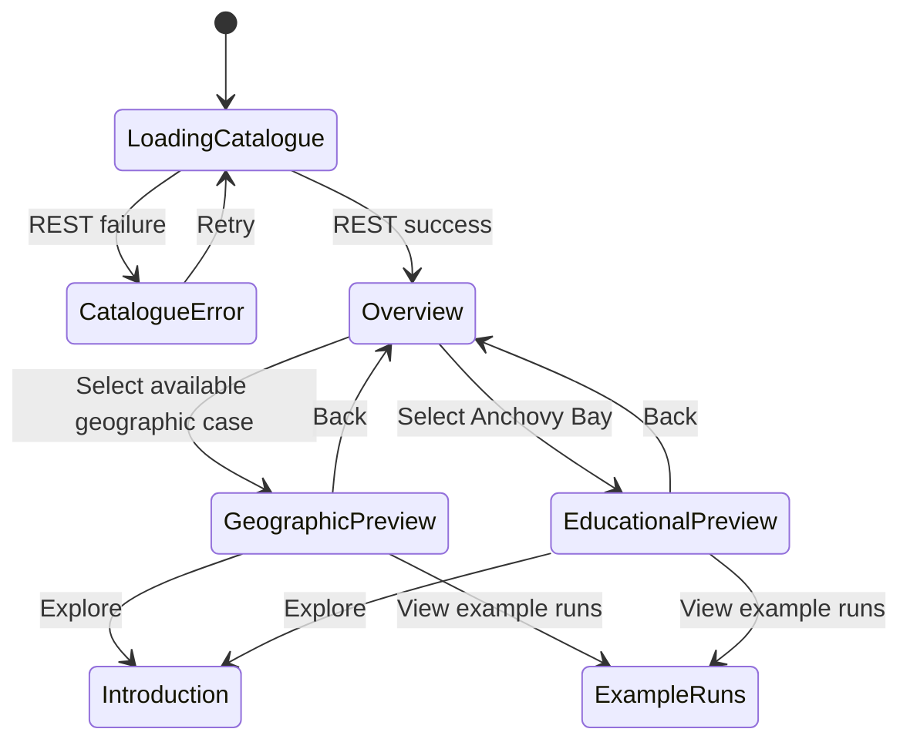

# Case-study map entrance — T02

**Authorized by the user, 2026-11-05:** preserve the current cinematic cards as an unused component and build a large map with three study entrances. Selecting a case zooms into a personalized preview; explicit actions then open its introduction or example runs. No backend/deployment changes.

| Decision | Why | Source |
| --- | --- | --- |
| Preserve `CinematicCaseSelection` | User must not lose the existing videos/intro/layout | User, 2026-11-05 |
| Shared page owns REST loading/error boundary | Prevent the disabled-card flash and keep views independent of fetching | Existing T06 flow |
| Reuse MapLibre, with local Natural Earth context | Real geographic context and camera movement without new dependencies, API keys or tile-service coupling | This feature |
| Aegean selection shows official GFCM GSA 22 + 23 | User confirmed these two subareas define the requested Aegean study-area overlay; retain source geometry rather than drawing an approximate outline | User, 2026-11-06 |
| Northwestern selection shows official GFCM GSA 06 + 07 | Existing case metadata lists these areas; use the same published dataset as Aegean, with source coordinates preserved | User-requested boundary fix, 2026-11-06; case metadata |
| Anchovy Bay is an educational inset | Its illustration has no supplied geographic coordinates; do not invent a real-world location | User asset and case metadata |
| Preview before navigation | The first click is a reversible camera/identity transition | User-approved concept |
| Reduced motion + equivalent case buttons | Selection must work without pulses/camera animation or mouse-only interaction | This feature |

## Experience

Mediterranean overview → select a labelled pulsing study marker or case button → camera flies to the geographic location, or transitions to the educational bay illustration → personalized title/copy/colour/actions. Back to overview reverses the view. REST availability controls both map and list entrances. Geographic loading/WebGL failures do not prevent selection through the case list.

Country/coastline geometry provides basemap context, not model-domain boundaries. Overview markers are illustrative locations documented here, without the removed footer notice; selected sea views show the official GSA 22 + 23 or 06 + 07 boundary overlay with a FAO/GFCM credit. The supplied SVG contains an embedded PNG; it is copied unchanged and used as an illustration, not treated as editable boundary data. Adding it here does not implement the separate T04 introduction redesign.

## Data and files

User-approved refinement, 2026-11-06: the selected Aegean view becomes an immersive map with closer framing of both official areas, no large editorial heading or floating study marker, a small study label and top Back control, compact bottom description/actions and case switcher. All study boundaries use the same Aegean orange token, light fill and faint glow, as confirmed by the user after reviewing the sea themes. Desktop retains gentle tilt/rotation; portrait is top-down to keep the full extent clear of controls. Overview and other case previews retain their existing design.

Map presentation content and illustrative camera locations live in `apps/frontend/mock-data/caseMap.ts`. Basemap reference geometry is a local asset under `apps/frontend/public/maps/`; its provenance and transformations are documented there. Existing case descriptions and API scenario-name mapping remain centralized. Local UI state tracks the selected case only; it creates no run or result.

Natural Earth public-domain context: https://www.naturalearthdata.com/about/terms-of-use/ ; source GeoJSON: https://github.com/nvkelso/natural-earth-vector/tree/master/geojson . No external tile service is used by this entrance.

## Remaining agreement

Confirmed by the user on 2026-11-06: selecting Aegean Sea should show GFCM GSA 22 (Aegean Sea) and GSA 23 (Crete). Use the official FAO/GFCM downloadable geometry as a local GeoJSON overlay, with a subtle fill and boundary lines visible only in the Aegean preview. Retain the source subarea boundary between 22 and 23. The selection label identifies this dataset explicitly. Northwestern now uses the official GSA 06 + 07 polygons matching its case description; final scientific/visual acceptance remains with the project team.

Source: [FAO/GFCM geographical subareas](https://www.fao.org/gfcm/data/maps/geographical-subareas/en). The basemap and boundary dataset may use different coastline resolutions; do not claim coastline-level precision beyond the published source. No new runtime service or dependency is required.

## Interaction states

The existing authenticated REST catalogue request is unchanged. Selection, camera and preview are local UI state; no new cross-process request or database state is introduced. The map loads geographic context from the frontend's own `/maps/mediterranean-context.geojson` asset. On first selection each sea loads its own official overlay (`/maps/aegean-gsa-22-23.geojson` or `/maps/northwestern-gsa-06-07.geojson`) from the same frontend origin, reuses that source later, and hides its fill/outline layers for other selections. A map failure leaves the same case buttons and destinations available.

## Reproduce verification

Run the existing backend and Vite, sign in at `/login`, then open `/`. Select each marker/inset or case button, use Back, and try both destination actions. At a portrait viewport, both geographic markers and all case buttons must fit. With reduced motion, selection jumps directly. With WebGL unavailable, the fallback message and case buttons must still permit navigation. Backend catalogue loading must not render disabled cases prematurely.

No controller/model execution was tested or introduced. Additional model-grid detail beyond the selected official GSA polygons and final visual acceptance remain unverified.

## Light-theme landing refinement — 2026-11-06

User authorized updating the complete signed-in case selector to the shared light design system and a more natural water treatment. Preserve official GSA geometry, camera selection/navigation, authentic backend availability, fallback access and the unused original cinematic component. Shared React Aria buttons handle actions; the reusable UseCaseSelector composition owns its internal appearance. Paper surfaces, primary/secondary accents, typography, focus, spacing and radii consume the established semantic tokens. User confirmed animated waves and reflections, not satellite imagery. The water is a decorative GPU shader on a Mercator plane beneath the opaque land polygons, so it follows pan/zoom/tilt and is masked geographically. It is not measured ocean or bathymetry data. No map tile service or extra renderer/dependency is introduced.

`water/AnimatedWaterLayer.ts` owns GPU resources and a capped repaint timer; hidden tabs stop animation; the Bay now reuses the water layer beneath the transparent illustration while geographic layers are hidden, removal clears timers/listeners/resources, and WebGL context restoration rebuilds resources. A pause/resume control is available independently of reduced motion. A reactive media subscription handles changes to the OS setting while the page is open. Reduced motion renders a still water surface; effect initialization failure leaves the static geographic map and case buttons usable. Sea/land/reflection colours are shared light semantic tokens.

## Compact selector and locked map — 2026-11-06

User confirmed a minimal glass `UseCaseSelector` containing case names and selection state, with no numbers or category labels. It replaces the large `CaseStudyOption` cards. Remove the extra perspectives heading and illustrative-location footer text. The overview fits both geographic studies; the later user refinement widens this frame; `interactive: false` prevents user pan/drag/scroll/double-click/pinch/keyboard map navigation while programmatic selection flights and marker clicks remain. No map navigation controls appear at the top right. Water pause/resume remains a small footer action for accessibility, rather than a zoom/pan control.

**Verified source of refresh failure:** local API logs show `GET /api/v1/scenarios` returning 502 `controller_error` at 2026-11-06T14:51:08Z: the controller's SSL connection failed during `GetScenarioNames`; the following request succeeded. This is an upstream failure, not evidence that FE credentials or map initialization failed. FE catalogue reads retry network/502/503/504 failures twice, keep initial loading visible while retrying, and show a terminal error only after exhaustion. Authorization and schema errors do not retry; writes and global query defaults remain unchanged. Background failures with cached data keep the map and show an explicit stale-availability notice. Backend TLS behaviour is not changed.

## Boundary and illustration refinement — 2026-11-06

User authorized removing country names, equal-width selector options, a wider overview and a bottom-right educational inset. Northwestern Mediterranean uses the existing case description's GSA 06 + 07, extracted unchanged from the same official FAO/GFCM archive as Aegean. Fit the selected camera to the complete polygon extent rather than a fixed marker zoom. These administrative fisheries areas do not assert additional model-grid precision.

The full original Anchovy illustration must remain upright and contained within the available scene; remove negative offsets, rotation and edge masks. Keep a single animated water renderer beneath both geographic and educational views, hiding real-world land/grid/boundary/marker layers in the fictional bay. Increase wave/reflection visibility; retain explicit Pause/Resume, reduced-motion and static GPU fallback. This avoids a second renderer and does not invent geographic coordinates for Anchovy Bay. **Verified:** production build, 26 network tests, unchanged full-lint baseline (18 errors/5 warnings), exact extracted source geometry, and controlled desktop/mobile browser checks for equal option widths, wider overview, selected boundary visibility, contained upright illustration, actual water frame changes, pause stability, resume and live reduced motion. No uncaught browser errors. Final visual/scientific acceptance remains with the user/PM.

## Sea identities — 2026-11-06

**User authorized:** styling-only identities for the two existing selected sea scenes. Northwestern uses the supplied muted marine palette (#1E5B84 primary, #123D5C deep, #2E6F97 secondary, #83B8D0 accent); Aegean uses azure (#2E86B7 primary, #1F6FA5 deep, #6EC4D6 secondary, #B0E3E9 accent). Raw values belong to the palette, semantic roles to the light theme, and scoped scene aliases to the existing map CSS Module. Overview, Anchovy, branding, typography, layout and content remain unchanged.

Update the existing GPU water colours in place when selection changes, plus the ordinary MapLibre background for shader fallback. Reuse the camera transition's duration for palette blending and the same repaint scheduler; no extra renderer, dependency or perpetual render loop. Reduced motion applies the target palette immediately. Light cards retain dark text; any text directly on water uses the on-sea token. User follow-up: retain the new sea backgrounds, but use Aegean orange for every boundary, including fill and the existing subtle glow. The shared `--color-map-study-boundary` token aliases `--color-secondary-ink`, independently of each case’s marker accent. **Verified:** TypeScript/production build, all 26 network tests, and unchanged lint baseline (18 errors/5 warnings). Controlled browser checks at 1440×1000, 1024×900 and 390×844 verify each scoped palette, darker Northwestern water pixels, readable existing surfaces, case navigation, paused-water stability after colour transitions, Resume, immediate reduced-motion colours, static map fallback and original overview/Anchovy colours. No uncaught browser errors. Colour review remains subjective; performance was not benchmarked across devices.
