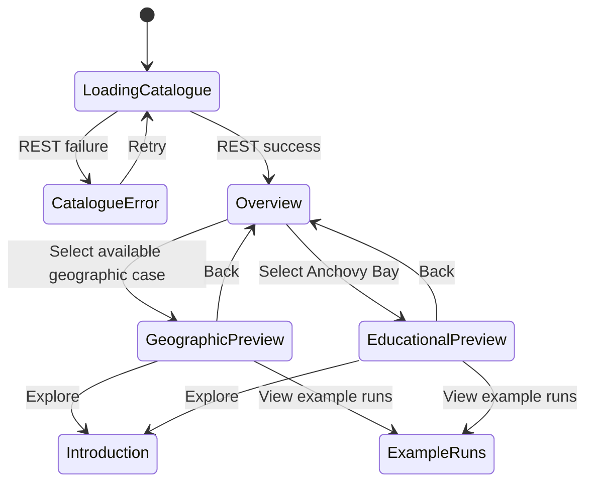

# Case-study map entrance — T02

**Authorized by the user, 2026-11-05:** preserve the current cinematic cards as an unused component and build a large map with three study entrances. Selecting a case zooms into a personalized preview; explicit actions then open its introduction or example runs. No backend/deployment changes.

| Decision | Why | Source |
| --- | --- | --- |
| Preserve `CinematicCaseSelection` | User must not lose the existing videos/intro/layout | User, 2026-11-05 |
| Shared page owns REST loading/error boundary | Prevent the disabled-card flash and keep views independent of fetching | Existing T06 flow |
| Reuse MapLibre, with local Natural Earth context | Real geographic context and camera movement without new dependencies, API keys or tile-service coupling | This feature |
| Aegean selection shows official GFCM GSA 22 + 23 | User confirmed these two subareas define the requested Aegean study-area overlay; retain source geometry rather than drawing an approximate outline | User, 2026-11-06 |
| Northwestern marker remains illustrative | Its boundary overlay is outside this increment | T02 open requirement |
| Anchovy Bay is an educational inset | Its illustration has no supplied geographic coordinates; do not invent a real-world location | User asset and case metadata |
| Preview before navigation | The first click is a reversible camera/identity transition | User-approved concept |
| Reduced motion + equivalent case buttons | Selection must work without pulses/camera animation or mouse-only interaction | This feature |

## Experience

Mediterranean overview → select a labelled pulsing study marker or case button → camera flies to the geographic location, or transitions to the educational bay illustration → personalized title/copy/colour/actions. Back to overview reverses the view. REST availability controls both map and list entrances. Geographic loading/WebGL failures do not prevent selection through the case list.

Country/coastline geometry provides basemap context, not model-domain boundaries. Overview labels identify markers as illustrative locations; the selected Aegean view explicitly identifies its GSA 22 + 23 boundary overlay. The supplied SVG contains an embedded PNG; it is copied unchanged and used as an illustration, not treated as editable boundary data. Adding it here does not implement the separate T04 introduction redesign.

## Data and files

Aegean camera framing fits the published extent, retaining desktop tilt/rotation. Portrait mobile uses a top-down rotated view so the complete outline fits above the preview text.

Map presentation content and illustrative camera locations live in `apps/frontend/mock-data/caseMap.ts`. Basemap reference geometry is a local asset under `apps/frontend/public/maps/`; its provenance and transformations are documented there. Existing case descriptions and API scenario-name mapping remain centralized. Local UI state tracks the selected case only; it creates no run or result.

Natural Earth public-domain context: https://www.naturalearthdata.com/about/terms-of-use/ ; source GeoJSON: https://github.com/nvkelso/natural-earth-vector/tree/master/geojson . No external tile service is used by this entrance.

## Remaining agreement

Confirmed by the user on 2026-11-06: selecting Aegean Sea should show GFCM GSA 22 (Aegean Sea) and GSA 23 (Crete). Use the official FAO/GFCM downloadable geometry as a local GeoJSON overlay, with a subtle fill and boundary lines visible only in the Aegean preview. Retain the source subarea boundary between 22 and 23. The selection label identifies this dataset explicitly. Northwestern boundaries and final visual acceptance remain open.

Source: [FAO/GFCM geographical subareas](https://www.fao.org/gfcm/data/maps/geographical-subareas/en). The basemap and boundary dataset may use different coastline resolutions; do not claim coastline-level precision beyond the published source. No new runtime service or dependency is required.

## Interaction states

The existing authenticated REST catalogue request is unchanged. Selection, camera and preview are local UI state; no new cross-process request or database state is introduced. The map loads geographic context from the frontend's own `/maps/mediterranean-context.geojson` asset. On the first Aegean selection it loads `/maps/aegean-gsa-22-23.geojson` from the same frontend origin, reuses that source later, and hides its fill/outline layers for all other selections. A map failure leaves the same case buttons and destinations available.

## Reproduce verification

Run the existing backend and Vite, sign in at `/login`, then open `/`. Select each marker/inset or case button, use Back, and try both destination actions. At a portrait viewport, both geographic markers and all case buttons must fit. With reduced motion, selection jumps directly. With WebGL unavailable, the fallback message and case buttons must still permit navigation. Backend catalogue loading must not render disabled cases prematurely.

No controller/model execution was tested or introduced. Additional model-grid detail beyond the selected official GSA polygons and final visual acceptance remain unverified.
