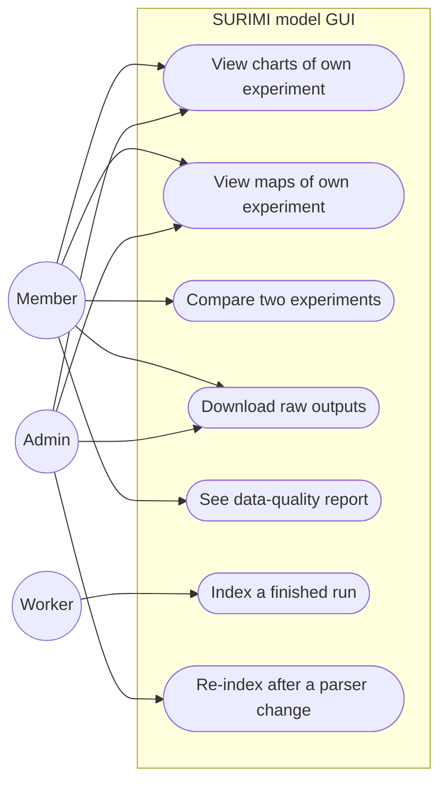
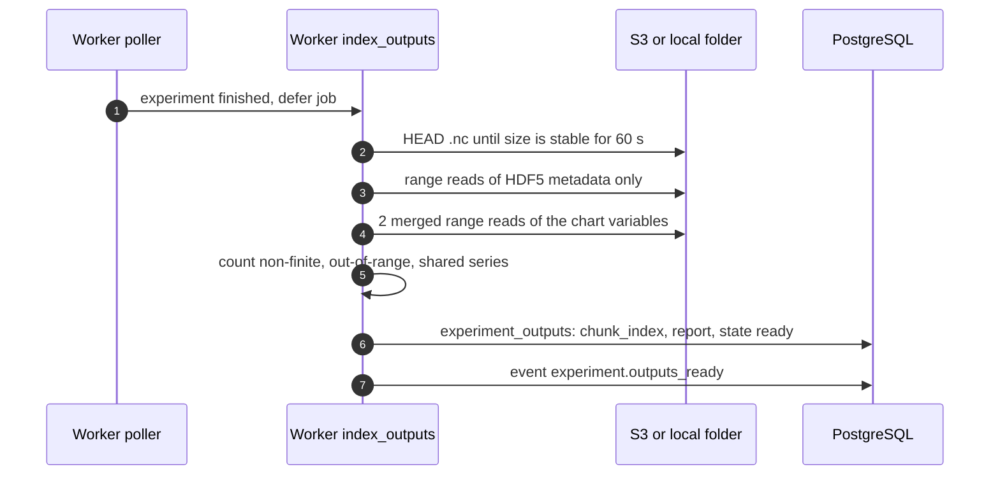
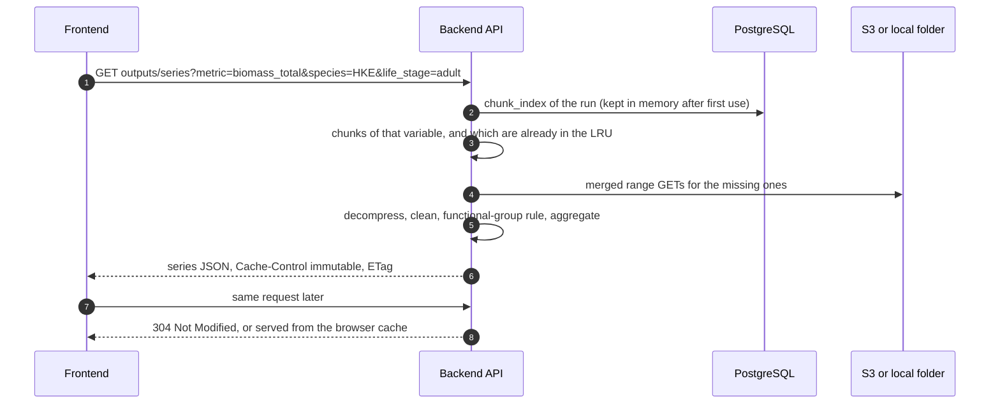
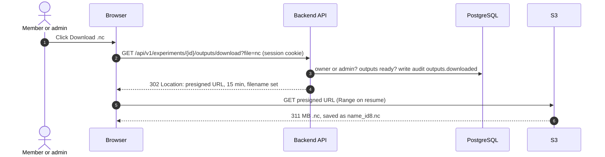
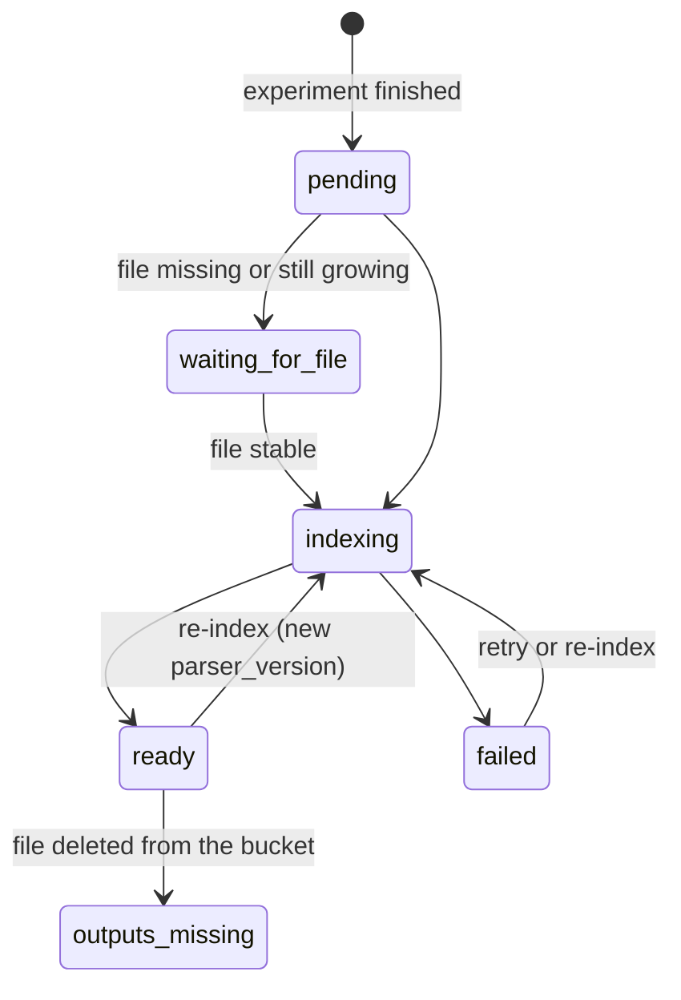

# Experiment outputs

**Status:** Planned
**Plan:** [2026-11-03-monorepo-and-backend](../../plans/2026-11-03-monorepo-and-backend.md), phase 6
**ADRs:** [0009](../../decisions/0009-output-storage-and-ingestion.md), [0007](../../decisions/0007-scheduler-worker-postgres-queue.md)

Finished experiments' outputs stay in their files, in S3 or a local folder.
When a run finishes, the worker builds a small index of where each chunk sits
in the file and a data-quality report. Charts and maps are then read on
request from only the chunks they need. No output values are copied into the
database. The output dashboards switch from mock data to these.

---

## Decisions

| Decision | Why | Recorded in |
| --- | --- | --- |
| The `.nc` is the only copy of the data; the database keeps metadata only | No duplicate to keep in step; measured: all chart data of a run is 2 requests and 0.08 s | [ADR 0009](../../decisions/0009-output-storage-and-ingestion.md) |
| One setting `OUTPUTS_URI` (`s3://…` or `file://…`) read through `fsspec` | Same code for S3 and local, as required | [ADR 0009](../../decisions/0009-output-storage-and-ingestion.md) |
| Read in place by range; never copy whole files | A map needs 0.15–1.7 MB of a 309 MB file (measured) | [ADR 0009](../../decisions/0009-output-storage-and-ingestion.md) |
| Worker job `index_outputs` builds a kerchunk chunk index and a quality report once per run | Turns 1,701 small reads into 2; the report is the only thing worth computing ahead | [ADR 0009](../../decisions/0009-output-storage-and-ingestion.md) |
| Charts and maps on request, with immutable HTTP caching | Finished outputs never change; the browser asks once | [ADR 0009](../../decisions/0009-output-storage-and-ingestion.md) |
| Bounded LRU of compressed chunks per API process; one month at a time | Memory stays fixed: peak 141 MB even for the 6.3 GB variable (measured) | [ADR 0009](../../decisions/0009-output-storage-and-ingestion.md) |
| Downloads: the API authorises, then redirects to a presigned S3 URL (or hands the file to nginx in local mode) | No file bytes through the API; resumable; plain link | [ADR 0009](../../decisions/0009-output-storage-and-ingestion.md) |
| Members download their own `.nc`; admins download `.nc` and `.bin` of any experiment | Confirmed by the user, 2026-11-03; `.bin` format unknown and 1.3 GB | [ADR 0009](../../decisions/0009-output-storage-and-ingestion.md) |
| Every download is an audit event | Who took which data, for 24 months | [ADR 0013](../../decisions/0013-data-retention.md) |
| Clean non-finite and out-of-range values on every read, and report the counts | Every chart sees the same numbers; users see how much was cleaned | [ADR 0009](../../decisions/0009-output-storage-and-ingestion.md) |
| Species sharing one functional-group series counted once in totals | Summing species overstated biomass 1.53× | this file |
| `.bin` not read until its message type is confirmed | Unknown format | [ADR 0009](../../decisions/0009-output-storage-and-ingestion.md) |
| Wait until the `.nc` size is stable for 60 s before indexing | The output creator may still be writing | this file |
| `parser_version` per output; re-index on change | The layout may change upstream | this file |
| **Proposed:** dashboards read a yearly product derived once per run (`summary.json.gz` for all charts, `maps.nc` with all years per species chunk); the monthly `.nc` stays for downloads and drill-down. Would replace "Charts on request" and "Maps on request" below | Dashboards are yearly; playback drops from 394–1,395 requests to 1; product is 3% of the raw size (measured) | [format-benchmark-2026-11-03.md](format-benchmark-2026-11-03.md#proposed-structure) (experiment, not agreed) |

---

## Use cases

---

## Current state

- Dashboards read mock data (`apps/frontend/src/features/ScenarioOutputs/MockData/`,
  `createMockScenarioDataset.ts`). **Read from source.**
- Real outputs: `experiments/<id>/<id>.nc` and `.bin`; two runs copied to
  `output_folder/experiments/`.

### Layout of the `.nc`

**Verified** 2026-11-03 on run `99c1e2a4…` (205 months) with h5py. Every
variable is chunked one month per chunk, gzip level 1.

| Variable | Shape | Chunk | Stored |
| --- | --- | --- | --- |
| `gross_catch`, `dead_discards`, `live_discards` | time 205 × species 96 × fleet 9 × lat 82 × lon 109 | 1 × 24 × 9 × 41 × 27 | 97, 93, 55 MB |
| `biomass` | time × species × lat × lon | 1 × 48 × 82 × 54 | 61 MB |
| `price` | time × species × market 38 × category 1 | 1 month | 1.2 MB |
| `sales_quantity`, `sales_value` | time × species × fleet × market | 1 month | 0.8 MB each |
| `*_total` (catch, discards, biomass) | time × species (× fleet) | 1 month | 0.1–0.3 MB |
| `fishing_activity` | time × fleet | 1 month | < 0.1 MB |
| Axes | `time`, `species_code` + `species_life_stage`, `fleet_country_code` + `fleet_gear_code`, `market_code`, `price_category_code`, `lat`, `lon` | — | — |

The 1,640 chunks of the chart variables lie in two clusters of the file, so
they can be read in 2 merged range requests (3.57 MB).

---

## Target behaviour

### Who does what

| Step | Done by | When | Stores |
| --- | --- | --- | --- |
| Detect that a run finished | Worker poller | Every 10 s | `experiments.status` |
| Index and report | Worker job `index_outputs` | Once, after `finished` | `experiment_outputs`: chunk index, report, state |
| Charts and maps | API, on request | Each view (then browser cache) | Nothing; in-memory chunk LRU only |
| Raw download | Browser, from S3 | On click | Nothing |

### After a run finishes

### A chart or a map

Maps work the same way with `GET outputs/maps`, reading only the chunks that
cover the species and months asked for.

### Rules

- **Cleaning:** `±inf` and `NaN` → `null`; values above a per-metric bound →
  `null`. The same rules run in the report and on every read, so the report's
  counts match what the charts show.
- **Functional groups:** species that share one series inside a group are
  counted once in totals.
- **Charts:** monthly or yearly (mean for biomass and price, sum for catch,
  discards and sales); per species and life stage, fleet or market, or summed.
- **Maps:** monthly or yearly; catch and discards summed over fleets unless a
  fleet is given. Payload `application/octet-stream` float32 little-endian
  with a small JSON header, or JSON with `?format=json`.
- **Report:** `{non_finite: {metric: n}, out_of_range: {...},
  shared_series: [...], months: 205, parser_version}` shown on the dashboard.
- **File gone:** if the `.nc` is no longer in the bucket, state
  `outputs_missing` and a clear message on the dashboard.

### Downloads

| Rule | Value |
| --- | --- |
| Who | Owner: `.nc`. Admin: `.nc` and `.bin` of any experiment |
| When | Outputs `ready` (file present); otherwise 409 with the state |
| Soft-deleted experiment | Owner: no longer; admin: until it is purged |
| Link | Presigned GET, `PRESIGNED_URL_TTL` 15 min, signed for `S3_PUBLIC_ENDPOINT`, one object only. Signed with the EDITO experiments credentials (read and write); the link still allows only `GET` of that object (`PUT`/`DELETE` → 403, verified) |
| Credentials | `S3_ACCESS_KEY_ID`, `S3_SECRET_ACCESS_KEY`, and `S3_SESSION_TOKEN` when they are temporary; reloaded from the mounted Secret when it changes, so links keep working after a rotation |
| File name | `<experiment name, slugified>_<first 8 of id>.nc` via `response-content-disposition` |
| Local mode | `X-Accel-Redirect` to the `internal` nginx location `/protected-outputs/`, nginx mounts the outputs folder read-only |
| Resume | `Range` supported in both modes |
| Trace | `audit_events` `outputs.downloaded` with user, experiment, file; metric `surimi_downloads_total{file}` |
| MSE runs | If the controller writes one file per simulation, the endpoint takes `&simulation=<n>` and the page lists one link per file (open question) |

### State

---

## API

| Method | Path | Role | Response |
| --- | --- | --- | --- |
| GET | `/api/v1/experiments/{id}/outputs` | owner, admin | State, report, metrics, species, fleets, markets, period range, map grid |
| GET | `/api/v1/experiments/{id}/outputs/series` | owner, admin | `?metric&species&life_stage&fleet&market&period_kind&from&to` → series; immutable caching |
| GET | `/api/v1/experiments/{id}/outputs/maps` | owner, admin | `?metric&species&life_stage&fleet&year` or `&month` → grid; immutable caching |
| GET | `/api/v1/experiments/{id}/outputs/files` | owner, admin | Files available to this user, with size and download path |
| GET | `/api/v1/experiments/{id}/outputs/download?file=nc` | owner, admin | `302` to a presigned S3 URL, or the file through nginx in local mode |
| GET | `/api/v1/experiments/{id}/outputs/download?file=bin` | admin | Same, for the `.bin` |
| GET | `/api/v1/outputs/compare` | owner of both, admin | `?a&b&metric&…` → two aligned series |
| POST | `/api/v1/admin/experiments/{id}/outputs/reindex` | admin | 202 |

---

## Configuration

| Variable | Default | Meaning |
| --- | --- | --- |
| `OUTPUTS_URI` | `file:///data/experiments` | Where `<id>/<id>.nc` lives |
| `S3_ENDPOINT_URL`, `S3_ACCESS_KEY_ID`, `S3_SECRET_ACCESS_KEY` | — | For `s3://`; the EDITO experiments credentials |
| `S3_SESSION_TOKEN` | unset | Only if the credentials are temporary |
| `OUTPUT_CHUNK_CACHE_MB` | 256 | Compressed chunks kept in memory per API process |
| `OUTPUT_RANGE_MERGE_GAP_KB` | 64 | Neighbouring ranges closer than this are fetched in one request |
| `PRESIGNED_URL_TTL` | 15 min | Download links |
| `S3_PUBLIC_ENDPOINT` | = `S3_ENDPOINT_URL` | Endpoint browsers can reach; download links are signed for it. On EDITO probably `https://minio.dive.edito.eu` (the controller's dev config uses it; to confirm) |
| `OUTPUTS_NGINX_PREFIX` | `/protected-outputs/` | Local mode: internal nginx location that maps to the outputs folder |

---

## Where the changes are

Rows marked *Frontend (phase 10)* describe what the frontend will need.
They are built only in phase 10, the last phase, if the user agrees then
(user, 2026-11-03).

| Area | File | Change |
| --- | --- | --- |
| Backend | `src/surimi_backend/outputs/storage.py` | fsspec opener, merged range reads, presigned URLs, `X-Accel-Redirect` |
| Backend | `src/surimi_backend/outputs/index.py` | kerchunk index build and load |
| Backend | `src/surimi_backend/outputs/read.py` | chunk selection, LRU cache, decompression, cleaning, aggregation |
| Backend | `src/surimi_backend/outputs/report.py` | data-quality counts |
| Backend | `src/surimi_backend/outputs/router.py` | endpoints above |
| Frontend (phase 10) | `features/ScenarioOutputs/data/` | replace mock datasets with API calls; decode the float32 map payload |
| Deploy | compose `api`, `worker` | memory limit 512 MB each |
| Deploy | `deployments/nginx/default.conf.template` | `location /protected-outputs/ { internal; alias …; }`, outputs volume mounted read-only (local mode) |

---

## How to test

- Contract test on `output_folder/experiments/99c1e2a4…`: the report counts
  match the known problems (infinite `sales_value` in 79 of 205 months); the
  layout matches the table above; a chart load is at most 2 range requests.
- Same results with `file://` and MinIO `s3://`.
- API under a 512 MB memory limit serving maps of the largest run.

---

## What has been verified

2026-11-03, on run `99c1e2a4…`, local disk (**Verified**): the layout above;
partial reads of 0.15 MB (one month map) and 1.67 MB (one year map); the chart
variables in 2 merged range requests (3.57 MB), read and decompressed in
0.08 s; streaming all of `gross_catch` with a 141 MB peak; kerchunk index
built in 0.4 s (27,523 chunks, 2.7 MB JSON). Downloads: presigned URL
against MinIO (file name set, `206` on resume, `403` after expiry and for a
changed key); nginx `X-Accel-Redirect` with the real 311 MB `.nc`
(byte-identical, `206` on resume, `404` on the internal path). Not yet verified: reading through
the index with zarr, and latency against the EDITO bucket.

2026-11-03, [format benchmark](format-benchmark-2026-11-03.md) on the same run
(**Verified**, local MinIO with and without 20 ms delay per request): sizes of
15 monthly, yearly and dashboard variants in NetCDF and Zarr; every dashboard
action against each variant, with S3 requests and bytes counted; reading the
chunk index with merged ranges (our own reader, not kerchunk); all variants
return the same values. Not verified there: a month-at-a-time build within
512 MB, and browser reads straight from Zarr.

---

## Open questions

- Exact bucket path and read credentials for `project-surimi`, and may we get
  presigned URLs on it? (Controller team)
- Message type and purpose of the `.bin`; needed if the `.nc` has everything?
  (Controller team)
- How are the 5 simulations of an MSE experiment written: one file or five,
  and how should they combine on the dashboard? (Controller team)
- Partial results while a run is still going: possible? Asked 2026-11-03, not
  answered. (Rik)
- Retention of raw files in the bucket; our dashboards depend on them.
  (Controller team)
- The format experiment of 2026-11-03 raised more questions (agree the yearly
  product, rechunking request, indicators, units, MSE); they are listed in
  [format-benchmark-2026-11-03.md](format-benchmark-2026-11-03.md#open-questions-from-these-tests).
