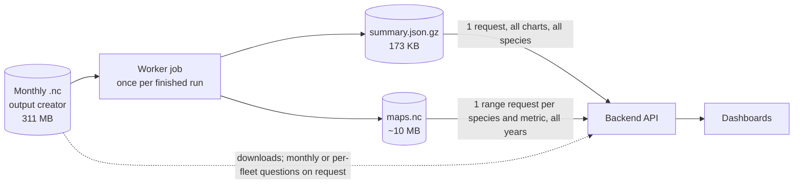

# Output formats: yearly vs monthly, NetCDF vs Zarr

**Date:** 2026-11-03
**Feature:** [experiment-outputs](README.md)
**Status:** Experiment. The [proposal](#proposed-structure) is not agreed and
is recorded only here.
**Scripts:** [benchmark/](benchmark/README.md)

Three questions, from the user on 2026-11-03:

1. How much space do we save if the outputs are aggregated to years instead of
   months?
2. Is Zarr better than NetCDF, and in which situations?
3. What do the dashboards (still on mock data) need, and what format and
   structure should the data follow?

Everything below is **Verified** on run `99c1e2a4…` (205 months, 2013-01 to
2030-01, 311 MB `.nc`) unless labelled otherwise. Laptop, Windows 11, Python
3.13, zarr 3.4.2, netCDF4 1.7.5 (netcdf-c 4.10.1, HDF5 2.2.0), MinIO in
Docker as S3.

---

## Answers

1. **Yearly instead of monthly saves 92% with nothing else changed**
   (311 → 24 MB), and 95% with better compression (16 MB NetCDF, 14 MB Zarr).
   A dashboard product with fleets summed in the maps is **10 MB, 30× smaller**.
   The chart data alone, every species and year, is **37 KB** as gzipped JSON.
2. **Zarr is not better for us in general.** At the same chunk layout it is
   10–18% smaller (zstd against zlib). It is **much worse** when a view needs
   many small chunks, because every chunk is a separate S3 object and requests
   cannot be merged: 2,918 requests and 23 s for a page load against 25
   requests and 1.2 s for NetCDF read through a chunk index. With a good chunk
   layout both are equally fast. Zarr is the better choice only for situations
   we do not have yet (browser reads straight from S3, many writers at once,
   results read while a run is still writing).
3. **The dashboards are yearly, per species code, from end to end.** Nothing on
   them is monthly, per fleet or per market. The best structure is a small
   yearly product derived once per run: one `summary.json` for every chart
   and one `maps.nc` with a chunk per species holding all years. The monthly
   `.nc` stays as the archive and download (see
   [Proposed structure](#proposed-structure)).

---

## 1. Space: yearly against monthly

### Variants

Every variant holds the same run. Yearly = the 17 calendar years 2013–2029:
mean of the 12 months for `biomass`, `biomass_total`, `price` and
`fishing_activity`, sum for catch, discards and sales; a cell with no value in
any month stays empty, not 0. The single month of 2030 (January only) is left
out.

| Id | Content | Format | Chunk | Compression |
| --- | --- | --- | --- | --- |
| M1 | Monthly, everything (the original) | NetCDF | 1 month × 24 or 48 species | gzip 1 + shuffle |
| M2 | Monthly, everything | NetCDF | as M1 | zlib 4 + shuffle |
| M3 | Monthly, everything | Zarr v3 | as M1 | Blosc zstd 3 + shuffle |
| M4 | Monthly, everything | NetCDF | 12 months × 1 species | zlib 4 + shuffle |
| M5 | Monthly, everything | Zarr v3 | 12 months × 1 species | zstd 3 + shuffle |
| A1 | Yearly, everything (fleets, markets) | NetCDF | 1 year × 24 or 48 species, like M1 | gzip 1 + shuffle |
| A2 | Yearly, everything | NetCDF | all years × 1 species | zlib 4 + shuffle |
| A3 | Yearly, everything | Zarr v3 | all years × 1 species | zstd 3 + shuffle |
| D1 | Yearly dashboard product (below) | NetCDF | all years × 1 species | zlib 4 + shuffle |
| D2 | Yearly dashboard product | Zarr v3 | all years × 1 species | zstd 3 + shuffle |
| D3 | Yearly dashboard product | Zarr v3, sharded | as D2, one shard per variable | zstd 3 + shuffle |
| D4 | Yearly dashboard product | NetCDF | 1 year × 1 species | zlib 4 + shuffle |
| D5 | Yearly dashboard product | Zarr v3 | 1 year × 1 species | zstd 3 + shuffle |
| D6 | D1 rounded to 12 significant bits (lossy) | NetCDF | as D1 | BitRound 12 + zlib 4 |
| D7 | D2 rounded to 12 significant bits (lossy) | Zarr v3 | as D2 | BitRound 12 + zstd 3 |

**Dashboard product** (D): maps `biomass`, `landings`, `gross_catch`,
`dead_discards`, `live_discards` per year, species and cell, **summed over
fleets**; `landings = gross_catch − dead_discards − live_discards`; series
`biomass_total`, catch and landings per fleet, sales per fleet and market,
price per market; non-finite values removed and prices above 1,000 EUR/kg
removed.

### Sizes

| Id | Size | vs original | Objects in S3 |
| --- | ---: | ---: | ---: |
| M1 original | 311.1 MB | — | 1 |
| M2 | 198.4 MB | −36% | 1 |
| M3 | 162.9 MB | −48% | 17,239 |
| M4 | 190.7 MB | −39% | 1 |
| M5 | 165.7 MB | −47% | 3,817 |
| **A1** | **24.2 MB** | **−92%** | 1 |
| A2 | 16.3 MB | −95% | 1 |
| A3 | 14.3 MB | −95% | 230 |
| **D1** | **10.4 MB** | **−97%** | 1 |
| D2 | 9.4 MB | −97% | 272 |
| D3 | 9.4 MB | −97% | 35 |
| D4 | 12.2 MB | −96% | 1 |
| D5 | 10.9 MB | −97% | 4,144 |
| D6 (lossy) | 7.0 MB | −98% | 1 |
| D7 (lossy) | 6.1 MB | −98% | 272 |

What each step buys:

| Step | From → to | Saving |
| --- | --- | ---: |
| Better compression only, still monthly | M1 → M2 (NetCDF) / M3 (Zarr) | 36% / 48% |
| **Months → years**, nothing else changed | M1 → A1 | **92%** (12.8×; 205 → 17 time steps) |
| Years + better compression and chunks | M1 → A2 / A3 | 95% |
| Years + fleets summed in maps (dashboard product) | M1 → D1 | 97% (30×) |
| 12-bit rounding on top | D1 → D6 | another 33% |

- **Per simulated year:** 18.2 MB monthly (original) against 0.61 MB for the
  dashboard product.
- **Estimate** for the planned run to 2050 (445 months, linear scaling, not
  measured): original about 675 MB, dashboard product about 23 MB. An MSE
  experiment writes 5 simulations: about 3.4 GB against 113 MB, if each
  simulation gets its own file (open question, see [README](README.md#open-questions)).
- The `.bin` next to the `.nc` (1.37 GB for this run) is not part of these
  numbers.

### What yearly loses

- Seasonality: monthly values cannot be recovered from yearly ones. The
  dashboards do not show months, and the monthly `.nc` stays available.
- The dashboard product (D) also drops per-fleet maps; per-fleet and
  per-market totals stay in its series.
- The final January (2030-01) is not a full year and is left out.

### Lossy rounding (D6, D7)

12 significant bits keep about 3.6 decimal digits. Measured against D1:
largest error per cell 0.012%, median 0.004%, error on totals below 0.00004%.
It saves a third, but at 10 MB per run it is not needed; keep values exact.

### Correctness

- The yearly product equals the yearly mean or sum recomputed from the monthly
  source for 2013, 2020 and 2029 (maps, `biomass_total`, `gross_catch_total`).
- Every variant returned the same yearly biomass map (HKE, 2020) as the
  original file.
- In the size and access tests, `build.py` read infinite values as "no data"
  (its fill-value check also matched infinity). That touched only the 84
  infinite prices and 79 infinite sales values of the monthly file, so sizes
  and access results are unaffected. It was fixed on 2026-11-03 before the
  saved product was built, so the product counts what it removes.

### The saved product

The proposed files for run `99c1e2a4…` are in
`output_folder/experiments/99c1e2a4-5d3f-4e8a-9c6b-1f2a3d4e5f60/derived/`
(git-ignored, like the run itself):

| File | Size | Built by |
| --- | ---: | --- |
| `maps.nc` | 10.4 MB | `build.py … D1_nc_dash_species` |
| `summary.json.gz` | 173 KB | `make_summary.py` |

The summary's `meta.cleaning` records what was removed, counted per yearly
value: 17 infinite sales values, 17 infinite prices and 26 prices above
1,000 EUR/kg.

---

## 2. Access: NetCDF or Zarr, and when

### Method

Each dashboard action was run against each variant on S3 (MinIO), cold, with
every S3 request and byte counted. A second round added 20 ms delay per
request with `netem`, closer to a remote bucket; the real EDITO latency is
still to be measured (phase 6).

Three ways of reading:

- **NetCDF + index:** the chunk index of [ADR 0009](../../decisions/0009-output-storage-and-ingestion.md)
  (byte offset and length of every chunk, built once), neighbouring ranges
  merged when the gap is at most 64 kB, fetched concurrently.
- **NetCDF, plain h5py:** `h5py.File(s3fs.open(...))` with s3fs defaults, what
  a developer gets without the index.
- **Zarr:** zarr-python 3 on S3, consolidated metadata, chunks fetched
  concurrently.

Selected species: HKE (3 rows: no stage, adult, juvenile; the dashboard sums
a species code over its life stages). Selected year: 2020.

| Action | Reads |
| --- | --- |
| S1 open the dashboard | 5 yearly series (biomass, catch or landings, discards, sales, price) + biomass map of one year |
| S2 change year | biomass map of one year |
| S3 press play | biomass maps of all 17 years |
| S4 switch to landings | landings map of one year |
| S5 play landings | landings maps of all years |

For monthly variants the reader fetches the 12 (or 204) months and averages
or sums them, as ADR 0009's on-request design would.

### Results with 20 ms per request

Requests / MB transferred / seconds. Zarr counts include its 2 metadata
requests; the NetCDF index comes from the database and is not counted.

| Variant | S1 open | S2 year | S3 play | S4 landings | S5 play landings |
| --- | --- | --- | --- | --- | --- |
| M1 original, NetCDF + index | 25 / 5.3 / 1.2 | 24 / 1.8 / 0.9 | 394 / 30 / 3.5 | 122 / 5.3 / 2.3 | 1,395 / 90 / 26 |
| M1 original, plain h5py | 16 / 541 / 3.7 | 8 / 367 / 2.4 | 40 / 1,833 / 10 | 10 / 472 / 3.3 | 82 / 4,073 / 53 |
| M3 Zarr, 1-month chunks | **2,918** / 4.4 / **23** | 62 / 1.5 / 2.5 | 1,022 / 25 / 11 | 578 / 1.7 / 7.0 | **9,794** / 28 / **63** |
| M4 NetCDF, 12 months × 1 species, + index | 2 / 2.9 / 1.1 | 1 / 0.04 / 0.5 | 17 / 0.75 / 0.8 | 3 / 0.21 / 0.8 | 51 / 3.5 / 3.3 |
| M5 Zarr, 12 months × 1 species | 244 / 2.7 / 1.4 | 6 / 0.06 / 0.5 | 70 / 0.73 / 0.9 | 17 / 0.20 / 0.8 | 257 / 3.0 / 2.5 |
| A2 yearly NetCDF + index | 2 / 0.31 / 0.5 | 1 / 0.06 / 0.5 | 1 / 0.06 / 0.4 | 3 / 0.29 / 0.7 | 3 / 0.29 / 0.7 |
| A3 yearly Zarr | 20 / 0.28 / 0.9 | 6 / 0.08 / 0.6 | 6 / 0.08 / 0.6 | 17 / 0.27 / 0.7 | 17 / 0.27 / 0.6 |
| **D1 product, NetCDF + index** | **2 / 0.34 / 0.5** | **1 / 0.06 / 0.5** | **1 / 0.06 / 0.4** | **1 / 0.07 / 0.4** | **1 / 0.07 / 0.4** |
| D1 product, plain h5py | 2 / 10.4 / 0.6 | 2 / 10.4 / 0.6 | 2 / 10.4 / 0.6 | 2 / 10.4 / 0.6 | 2 / 10.4 / 0.6 |
| D2 product, Zarr | 18 / 0.29 / 0.7 | 6 / 0.08 / 0.5 | 6 / 0.08 / 0.5 | 7 / 0.08 / 0.5 | 7 / 0.08 / 0.5 |
| D3 product, Zarr sharded | 16 / 0.30 / 0.8 | 4 / 0.09 / 0.7 | 4 / 0.09 / 1.0 | 4 / 0.09 / 0.6 | 4 / 0.09 / 0.7 |
| D4 product, NetCDF 1-year chunks | 2 / 0.28 / 0.6 | 1 / 0.004 / 0.5 | 17 / 0.13 / 0.7 | 1 / 0.004 / 0.9 | 10 / 0.53 / 1.0 |
| D5 product, Zarr 1-year chunks | 18 / 0.23 / 0.9 | 6 / 0.03 / 0.7 | 70 / 0.09 / 1.3 | 7 / 0.03 / 0.7 | 87 / 0.09 / 0.8 |

How far to trust the numbers:

- **Requests and bytes are exact** and the same in both rounds.
- **Times are single runs on a laptop.** About 0.4–0.8 s of each is client
  start-up in the test harness, which a running API pays once. Timings varied
  up to 3× between runs and between variants with the same number of requests
  (M1 against M2).
  Use times for orders of magnitude only.

### What the tests show

1. **Chunk layout matters more than the format.** Rechunking the monthly file
   to 12 months × 1 species (M4) cuts a page load from 25 requests and 5.3 MB
   to 2 and 2.9 MB, and playback from 394 requests and 30 MB to 17 and
   0.75 MB. The original layout mixes 24 or 48 species per chunk, so one
   species drags in the others.
2. **On-request yearly maps from the monthly file are slow.** Playing landings
   for 17 years costs 1,395 requests, 90 MB and about 26 s from the original
   file. The yearly product does it in 1 request and 0.07 MB.
3. **NetCDF needs the chunk index on S3.** Opened with plain h5py, it reads
   52 MB just to open the file and 541 MB for one page load, more than the
   whole file. That is because s3fs fetches 50 MB blocks by default. With the
   index it reads only the chunks it needs. A small file (D1, 10 MB) can
   simply be downloaded whole in 2 requests.
4. **Zarr is worst when a view needs many small chunks.** Zarr cannot merge
   neighbouring chunks into one request, because each is a separate object:
   2,918 requests for M3 against 25 for M1 with the index. With 20 ms per
   request that is 23 s against 1.2 s.
5. **With a good layout, NetCDF + index and Zarr are equally fast.** The yearly
   product answers every action in 1–20 requests and well under 1 MB in
   either format. Sharding (D3) brings Zarr down to 35 objects and 4 requests
   per map.
6. **Zarr is 10–18% smaller** at the same layout (M3 vs M2 −18%, M5 vs M4 −13%,
   A3 vs A2 −13%, D2 vs D1 −10%). That is the zstd codec, not the format.
7. **Building the dashboard product** took 95 s to aggregate and 7.5 s to
   write. The peak memory of the test script was 2.5 GB, because it holds 12
   months of the largest variable at once. **Estimate, not measured:** a
   version that reads one month at a time needs about 100–200 MB, within the
   worker's 512 MB limit.

### When Zarr is the better choice

| Situation | Better | Evidence |
| --- | --- | --- |
| Dashboards through our backend, chunks laid out per species | Equal | Verified (table above) |
| Many small chunks per view (e.g. the original monthly layout) | **NetCDF + index** (merged ranges) | Verified: 25 vs 2,918 requests |
| Smallest file at the same layout | Zarr, by 10–18% | Verified |
| Few objects in the bucket; one file to download, copy, delete or checksum | **NetCDF** (1 object; Zarr 35–17,239) | Verified counts |
| Scientists opening outputs in Panoply, ncview, CDO, NCO, R or MATLAB | **NetCDF** | Not tested here: these tools are built around NetCDF and their Zarr v3 support varies. Verified: zarr-python warns that consolidated metadata, which Zarr needs for a 2-request open, is not part of the Zarr v3 specification |
| Browser reading straight from S3 with no backend (zarrita.js) | Zarr | **Open question**, not tested; we route reads through the backend (ADR 0009) |
| Many processes writing one dataset at once, or appending each month while the run goes on | Zarr (one object per chunk, no single-file lock) | **Open question**, not tested; would matter only if partial results during a run become a requirement (asked of Rik on 2026-11-03) |
| Dask or xarray analysis on cloud storage without building an index first | Zarr | Not tested; not a requirement today |

---

## 3. What the dashboards need

Read from source: `apps/frontend/src/features/ScenarioOutputs/` (mock data).

| Dashboard element | Component | Data | Grain |
| --- | --- | --- | --- |
| Year dock, play button | `YearRingDock` | list of years; a map per year | year |
| Map | `OutputsMapPanel`, `HeatMap` | one species code, one year, biomass or landings per cell | year × cell |
| Biomass trend, history vs forecast | `OutputsTrendChart` | biomass per year; `forecastStartYear` splits the line | year |
| "Simulation points" and upper/lower band | `OutputsTrendChart` | made up in the mock (`buildSimulatedHistoricalSeries`); real source would be observations or the spread of MSE simulations | year |
| Landings and discards bars | `LandingsStackedBarChart` | landings and discards per year | year |
| Sales and price lines | `MarketIndicatorsPanel` | sales (t) and price (EUR/t) per year; made up from the biomass trend in the mock | year |
| Indicator spider | `SpiderDiagram` | economic rent, social benefits, species rebuilding, biodiversity, ecosystem structure; made up in the mock | year |
| Functional group and species pickers | `DashboardOutputsHeader` | `west_med_fishes.csv`: 48 species codes in 9 groups | — |
| Compare two runs | all panels | the same data for a second run, same years | — |

Facts that shape the structure:

- **Everything is per year and per species code.** The dashboard sums all
  life stages of a code (`aggregateSpeciesOutput`). No panel shows months,
  fleets or markets.
- All 48 species in the dashboard CSV exist in the run (Verified), which has
  88 codes in 96 rows. The other 40 codes are never shown.
- The mock map is a list of 64 points per species and year. The real output
  is a regular 82 × 109 grid; 8.5% of the species × cell values hold biomass,
  the rest is land, outside the species' range or a row without biomass.
- The mock's units (biomass t/km², sales t, price EUR/t) do not match the
  `.nc` (`kg`, `EUR`, price per unit mass).
- The mock computes `landings = catches + discards`. In the outputs, quantity
  sold equals gross catch minus dead discards for 23 of 39 caught species
  (live discards are always 0), so landings are
  `gross_catch − dead_discards − live_discards`. **Verified** 2026-11-02.
- Sales, prices, the indicator spider and the biomass band are made up from
  the biomass trend in the mock; the outputs have no series for the five
  indicators.

---

## Proposed structure

**Proposed**, not agreed. When a run is `finished`, the worker job that
indexes outputs (ADR 0009) also derives a small yearly product, stored under
a separate prefix (for example `derived/<experiment_id>/`). Dashboards read
only the product; the monthly `.nc` stays the single archive, for downloads
and any monthly or per-fleet question. If agreed, this replaces the "Charts
on request" and "Maps on request" parts of
[ADR 0009](../../decisions/0009-output-storage-and-ingestion.md); its storage
access, chunk index, caching and downloads stay.

### `summary.json.gz`: every chart

One file per run with every series the dashboards draw, for every species. It
is small enough that the browser loads it once and switching species needs no
new request: **173 KB gzipped** (976 KB raw) for the whole file built for run
`99c1e2a4…` with [make_summary.py](benchmark/make_summary.py), all three
tables in columnar form (Verified). The species table on its own, as rows,
was 37 KB.

| Part | Content |
| --- | --- |
| `meta` | experiment id, scenario, `years` (full calendar years only), units, cleaning counts, product version, source `.nc` ETag |
| `species` | per row: `code`, `life_stage`, name and functional group (from the case-study CSV), `shares_series_with` (functional-group duplicates) |
| `series` | columnar arrays per year and species row: `biomass` (mean), `gross_catch`, `landings`, `dead_discards`, `live_discards`, `sales_quantity`, `sales_value` (sums), `price_realised` (`sales_value / sales_quantity`) |
| `by_fleet` | the same catch, landings and discards per fleet (3,961 rows) |
| `by_market` | price, sales quantity and value per market (24,986 rows) |
| `simulation` | for MSE experiments, a leading dimension of 5, for the band on the biomass chart (open question how MSE outputs are written) |

JSON, not Parquet: Parquet was smaller only for the largest table (160 KB
against 256 KB) and would need a decoder in the browser.

### `maps.nc`: every map

| Item | Value |
| --- | --- |
| Variables | `biomass` (yearly mean), `landings`, `gross_catch`, `dead_discards`, `live_discards` (yearly sums over months and fleets) |
| Dimensions | `year` × `species` (96 rows, with `species_code` and `species_life_stage`) × `lat` 82 × `lon` 109 |
| Chunks | all years × 1 species × whole grid: one request gives a species' maps for every year (play button) |
| Encoding | float32, `NaN` = no data, zlib 4 + shuffle, no rounding |
| Size | 10.4 MB for 17 years (about 0.6 MB per year) |
| As tested (D1) | The tested file also carries the yearly series (`biomass_total`, catch, landings and discards per fleet, sales and price per market, `fishing_activity`). They duplicate `summary.json.gz` and could be dropped |

NetCDF, not Zarr: equally fast here, one object instead of 272, readable by
the same index code as the raw file, and downloadable as is for scientists.

### Rules the product applies

- Calendar years with all 12 months; the closing January is left out.
- Mean for biomass and price; sum for catch, landings, discards and sales.
- An all-empty cell stays empty, not 0.
- `landings = gross_catch − dead_discards − live_discards`.
- Non-finite values and prices above 1,000 EUR/kg are removed and counted in
  `meta`.
- Species sharing one functional-group series are flagged; totals count them
  once.

### API (phase 6) and frontend (phase 10)

| Request | Returns | Size |
| --- | --- | --- |
| `GET …/outputs/summary` | `summary.json.gz` as is, immutable caching | 173 KB |
| `GET …/outputs/maps?metric=biomass&species=HKE` | float32 `[year][lat][lon]` of the species code (life stages summed) + small JSON header | 17 × 36 kB raw; 63 kB read from S3 (measured, 3 rows) |

The mock's `ScenarioOutputsDataset` (annual grids of points per species)
becomes these two responses in phase 10.

### Why

- **The dashboards are yearly:** computing yearly maps from monthly chunks on
  every view costs 24–1,395 requests that the product answers with 1.
- **Small and cheap:** 3% of the raw file per run, computed once in about
  100 s; repeat views cost nothing (immutable caching, ADR 0009).
- **Not a second full copy:** it holds only what the dashboards show, so ADR
  0009's objection to converting whole runs does not apply.
- **One request for every chart:** 37 KB covers all species, so switching
  species or comparing runs needs no new request.
- **One request per species for playback:** all years sit in one chunk.
- **NetCDF for the maps:** as fast as Zarr here, one object instead of 272,
  read by the same index code as the raw file, opened directly by
  scientists' tools.
- **JSON for the series:** what the API returns anyway; Parquet was smaller
  only for the largest table and needs a browser decoder.

### Alternatives considered

| Option | Why not |
| --- | --- |
| Keep ADR 0009 as is: everything on request from the monthly `.nc` | 394–1,395 requests and 30–90 MB for playback (measured); slow on a remote bucket |
| Ask the output creator to write yearly | Loses monthly data for everyone else; we do not control their releases |
| Ask the output creator to rechunk the monthly file (12 months × 1 species, zlib 4) | Worth asking (311 → 191 MB, 12–40× fewer requests), but yearly maps would still be built from 12 months on each view; complements the product |
| Zarr for the product | 10% smaller but 272 objects, a second reader, not one downloadable file; no speed gain measured |
| Zarr for everything (convert the monthly file) | A full second copy; with the original layout 2,918 requests per page load |
| Yearly maps per fleet (full yearly content, 16 MB) | No panel shows fleets; per-fleet totals stay in the summary |
| Round values to 12 bits | Another third smaller with at most 0.012% error; not needed at 10 MB |
| Series in PostgreSQL | Duplicates what a 37 KB file serves in one request; ADR 0009's reasons against copying into the database hold |

### Consequences

- The worker needs write access to the derived prefix and one more step in the
  outputs job; a product version is stored, so a rule change re-derives every
  run.
- The rules (years, sums and means, landings, cleaning, functional groups)
  live in one place, the job.
- Partial years are not shown; the closing January of a run is dropped.
- If raw files are deleted from the bucket, dashboards keep working;
  downloads and monthly drill-down do not.
- The job must process one month at a time to stay within 512 MB (not yet
  measured).

### Open questions from these tests

| Question | Who |
| --- | --- |
| Agree this proposal (it changes part of ADR 0009)? | User |
| Would the output creator write the monthly `.nc` with chunks of 12 months × 1 species and zlib 4? 311 → 191 MB, 12–40× fewer requests per dashboard action (measured) | Output creator team |
| Where do the dashboard indicators (economic rent, social benefits, species rebuilding, biodiversity, ecosystem structure) come from? No output variable holds them | Project partners |
| Unit of `biomass` and catch: the `.nc` says `kg`, the dashboards show t/km² | Output creator team |
| How do the 5 simulations of an MSE experiment enter the product (band on the biomass chart, mean maps)? | Controller team |
| Range-request latency of the EDITO bucket (tests used 0 and 20 ms) | Phase 6 |
