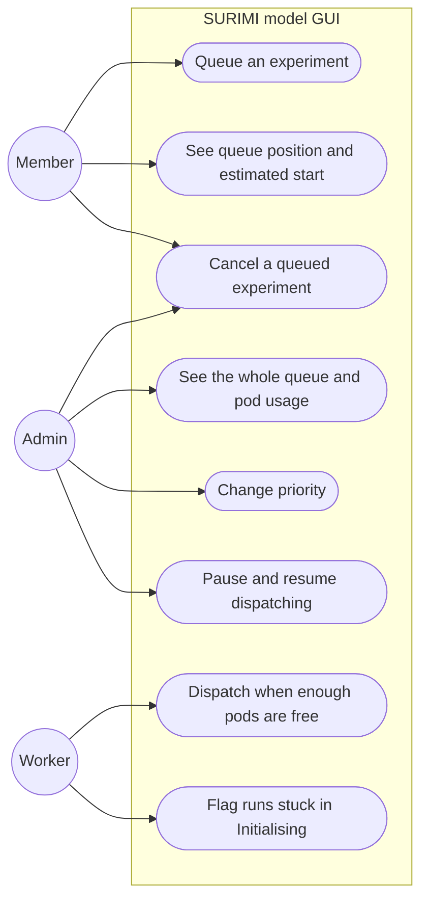
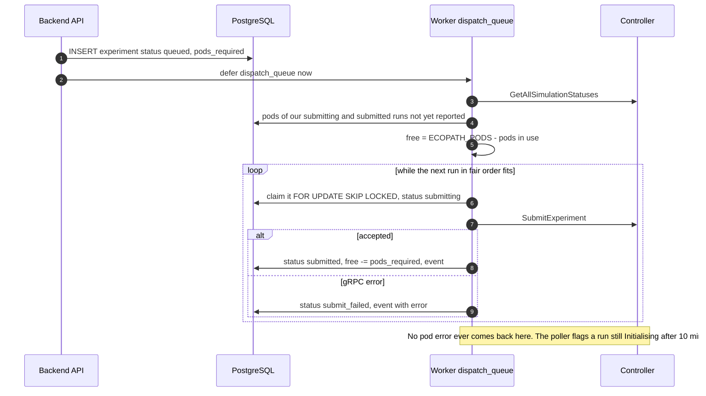

# Experiment queue

**Status:** Planned (designed 2026-11-03, no code yet)
**Plan:** [2026-11-03-monorepo-and-backend](../../plans/2026-11-03-monorepo-and-backend.md), phase 5
**ADRs:** [0015](../../decisions/0015-experiment-admission-queue.md), [0007](../../decisions/0007-scheduler-worker-postgres-queue.md)

Experiments wait in a fair queue and are sent to the controller only when
enough Ecopath pods are free. A busy controller then means "queued, position
3" instead of a run that hangs in `Initialising`. The controller has no queue
of its own (Rik, 2026-11-03), so this is the only one.

---

## Decisions

| Decision | Why | Recorded in |
| --- | --- | --- |
| Admission queue is state in `experiments` (`queued`), not broker messages | Users and admins must see, reorder and cancel it; survives restarts | [ADR 0015](../../decisions/0015-experiment-admission-queue.md) |
| Internal jobs stay on Procrastinate | Different purpose: opaque work items, not user-visible | [ADR 0007](../../decisions/0007-scheduler-worker-postgres-queue.md) |
| Capacity counted in **pods**: MSE experiment = 5, non-MSE = 1, 10 pods in total | One simulation per pod; an MSE run has 5 simulations (Rik, controller code) | [ADR 0015](../../decisions/0015-experiment-admission-queue.md) |
| Pods in use taken from the controller's own simulation list, counting everything not `Finished` or `Canceled` | Includes other clients' runs and pods leaked by `Error` | [ADR 0015](../../decisions/0015-experiment-admission-queue.md) |
| No reliance on submit errors; stall flag after 10 min in `Initialising` | The controller does not return "No available pods" to the caller | [ADR 0015](../../decisions/0015-experiment-admission-queue.md) |
| Fair share by pods per owner, then priority, then age | One user queueing ten runs must not block the rest | [ADR 0015](../../decisions/0015-experiment-admission-queue.md) |
| Small runs may use spare pods ahead of a waiting MSE run, but not after it has waited 30 min | Uses idle pods without starving big runs | [ADR 0015](../../decisions/0015-experiment-admission-queue.md) |
| Real simulation count overrides `pods_required` | A changed `NR_OF_MSE_RUNS` corrects itself | [ADR 0015](../../decisions/0015-experiment-admission-queue.md) |
| Cancel while queued touches only our row | Nothing exists on the controller yet | this file |
| Estimated start from the median duration of the last 20 finished runs of the same scenario and kind (MSE or not) | Good enough for "about 40 min"; no model needed | this file |

---

## Use cases



---

## Capacity, worked example

`ECOPATH_PODS = 10`. In flight: one MSE run of user A (5 pods), one non-MSE run
of user B (1 pod), and a run started from Bruno (1 pod). Free: 10 − 7 = 3.

Queue, in fair order: B's MSE run (5 pods), C's non-MSE run (1 pod).

- B's MSE run does not fit (5 > 3). It has waited 5 min, under
  `MAX_HEAD_WAIT`, so C's 1-pod run goes now. Free: 2.
- When A's run finishes, free becomes 7 and B's MSE run goes.
- If B's run had waited 30 min, C's run would wait behind it.

---

## Flow



---

## State

`queued` is the first state of the lifecycle in
[ARCHITECTURE.md](../../ARCHITECTURE.md#experiment-lifecycle): `queued →
submitting → submitted → …`, and `queued → cancelled` directly.

---

## API

| Method | Path | Role | Response |
| --- | --- | --- | --- |
| GET | `/api/v1/queue` | any | Own queued experiments with `position`, `pods_required`, `estimated_start_at`; global `pods_total`, `pods_in_use`, `queued_total` |
| GET | `/api/v1/admin/queue` | admin | Every queued experiment in dispatch order with owner, priority, pods; every in-flight run with pods, including stalled, `Error` (leaked) and unmanaged ones |
| PATCH | `/api/v1/admin/queue/{experiment_id}` | admin | `{priority}` |
| POST | `/api/v1/admin/queue/pause`, `/resume` | admin | 204 |

`ExperimentOut` gains `queue_position`, `pods_required` and
`estimated_start_at` while queued.

---

## Configuration

| Variable | Default | Meaning |
| --- | --- | --- |
| `ECOPATH_PODS` | 10 | Must equal the controller's `ECOPATH_NR_OF_PODS` |
| `CONTROLLER_MSE_SIMULATIONS` | 5 | Must equal the controller's `NR_OF_MSE_RUNS` |
| `MAX_PODS_PER_USER` | 5 | Pods one user may have in flight (one MSE run or five non-MSE) |
| `MAX_QUEUED_EXPERIMENTS_PER_USER` | 10 | Waiting runs per user |
| `MAX_HEAD_WAIT` | 30 min | After this, nothing overtakes the head of the queue |
| `INIT_TIMEOUT` | 10 min | `Initialising` longer than this → `stalled` |
| `DISPATCH_INTERVAL` | 10 s | How often `dispatch_queue` runs when nothing triggers it |

---

## How to check the queue

Nothing exists yet; this is how to look at it once phase 5 is built.

| Where | How |
| --- | --- |
| Web app | Admin → Queue: waiting runs in dispatch order, pods in use per run, paused or not. Members see their position on the experiments page |
| API | `GET /api/v1/admin/queue` (Bruno: `api/admin/get admin queue`) |
| Metrics | `surimi_queue_length`, `surimi_pods_in_use`, `surimi_pods_total`, `surimi_queue_wait_seconds` on `/metrics` |
| Logs | `experiment.queued`, `experiment.dispatched`, `queue.stalled` with `experiment_id` |
| Database | the query below |

```sql
-- Waiting runs in dispatch order, with each owner's pods in flight
WITH in_flight AS (
  SELECT owner_id, sum(pods_required) AS pods
  FROM experiments
  WHERE status IN ('submitting', 'submitted', 'initialising', 'running', 'cancelling')
  GROUP BY owner_id
)
SELECT e.id, u.username, e.name, e.pods_required, e.priority, e.queued_at,
       coalesce(f.pods, 0) AS owner_pods_in_flight
FROM experiments e
JOIN users u ON u.id = e.owner_id
LEFT JOIN in_flight f ON f.owner_id = e.owner_id
WHERE e.status = 'queued' AND e.deleted_at IS NULL
ORDER BY owner_pods_in_flight, e.priority DESC, e.queued_at;
```

The controller's own view of pods is `GetAllSimulationStatuses` in Bruno
(`grpc-proxy/`): count the simulations whose status is not `Finished` or
`Canceled`.

---

## Observability

Gauges `surimi_queue_length`, `surimi_pods_total`, `surimi_pods_in_use`;
histogram `surimi_queue_wait_seconds`; counter `surimi_queue_stalled_total`;
events `experiment.queued`, `experiment.dispatched`, `experiment.stalled`;
audit `queue.priority_changed`, `queue.paused`.

---

## How to test

- Fake controller with 10 pods: two users each queue one MSE run and one
  non-MSE run; check order, positions and pod counts.
- Fake controller with a Bruno-started run and an `Error` run: both reduce
  free pods.
- Head-of-line: MSE run at the head with 3 free pods; 1-pod runs pass it until
  30 min, then wait.
- Fake controller that leaves a run `Initialising`: flagged after 10 min.
- Two workers: no experiment submitted twice.

---

## Open questions

- Should admins' experiments jump the queue by default? (User)
- Will the controller release pods of `Error` simulations, or expose free pods
  through an RPC? (Rik)
