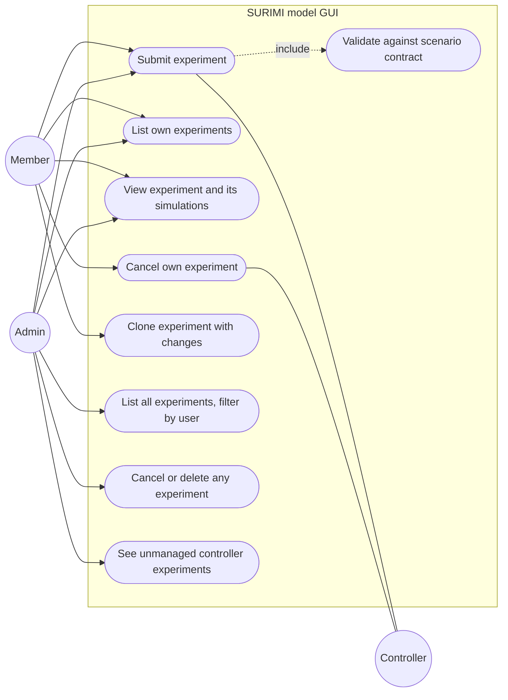

# Experiments

**Status:** Planned
**Plan:** [2026-11-03-monorepo-and-backend](../../plans/2026-11-03-monorepo-and-backend.md), phase 4
**ADRs:** [0005](../../decisions/0005-authorization-roles-and-ownership.md), [0006](../../decisions/0006-protocols-rest-sse-grpc.md), [0011](../../decisions/0011-controller-stubs-from-buf-registry.md), [0015](../../decisions/0015-experiment-admission-queue.md)

Users submit experiments to the SURIMI controller through the backend, see
their own, and cancel them. Admins see and manage every experiment and filter by
owner, scenario, status and date. Submitted experiments wait in the
[experiment queue](../experiment-queue/README.md) until the controller has
capacity.

---

## Decisions

| Decision | Why | Recorded in |
| --- | --- | --- |
| Ownership scoped in the repository; foreign ids return 404 | A new endpoint cannot forget the check; ids cannot be probed | [ADR 0005](../../decisions/0005-authorization-roles-and-ownership.md) |
| REST/JSON API; native gRPC to the controller | Browsers lack gRPC; the controller must leave the public path | [ADR 0006](../../decisions/0006-protocols-rest-sse-grpc.md) |
| `POST` queues the experiment; the worker submits it | Ecopath pods are few; users get a position instead of a failure | [ADR 0015](../../decisions/0015-experiment-admission-queue.md) |
| The backend generates `experiment_id` (UUID v4) and writes the row before calling the controller | The controller accepts any id; a retry reuses the id; a crash leaves a visible row | this file |
| Validate against the scenario contract before queueing | The controller fails late, after minutes, at `CreateRegulations` | this file |
| Store the submitted request as `jsonb` with the protocol version | Clone and audit need the exact input; the shape belongs to the controller | this file |
| Cancel = `RemoveExperiment`, through a `cancelling` state | `RemoveExperiment` is the controller's cancel; it only stops `Running` simulations and reports success anyway (controller code) | this file |
| The form shows the Ecopath pods a run will use (5 for MSE, 1 otherwise) and the current queue | Users understand why an MSE run waits longer | this file |
| Soft delete; purge after 12 months | Statistics still count hidden runs | this file, [ADR 0013](../../decisions/0013-data-retention.md) |
| Unmanaged controller experiments shown to admins and adoptable | Runs started from Bruno or other tools must not be invisible | this file |
| Admins run their own experiments and can cancel and delete anyone's | Confirmed by the user, 2026-11-03; admin includes member | [ADR 0005](../../decisions/0005-authorization-roles-and-ownership.md) |

---

## Use cases

| Use case | Actor | Pre-conditions | Main flow | Failure cases |
| --- | --- | --- | --- | --- |
| Submit | Any signed-in user | Scenario exists | Form → validate → row `queued` → (worker, when capacity frees) `submitting` → `SubmitExperiment` → `submitted` | Validation → 422 with field errors; over `MAX_QUEUED_EXPERIMENTS_PER_USER` → 409; controller error → `submit_failed`; capacity error → back to `queued` |
| Cancel | Owner, or an admin for any user's experiment (audited) | State not final | Queued → `cancelled` at once. Otherwise → `cancelling` → `RemoveExperiment` → `cancelled` when the controller no longer reports running simulations | Controller error → stays `cancelling`, retried by the worker; after 10 min flagged |
| Delete | Owner, or an admin for any user's experiment (audited) | Final state | Soft delete: hidden at once, purged with its output metadata after 12 months; the files in the bucket are not touched | Not final → 409, cancel first |
| Download outputs | Owner or admin | Outputs `ready` | See [experiment outputs § Downloads](../experiment-outputs/README.md#downloads) | Not ready → 409 |
| List | Any | — | Own experiments, newest first, filters and paging; admins see all and may filter by `owner_id` | — |

---

## Current state

The runs pages call `GetAllSimulationStatuses` from the browser and group by
scenario (`apps/frontend/src/hooks/useSimulationStatuses.ts`). Submission and
removal exist only in the mock (`apps/frontend/src/lib/services/controllerMock.ts`). **Read from source.**

---

## Target behaviour

The decisions above, in detail:

- **Validation rules:** scenario in `GetScenarioNames`; species and life
  stages in the scenario contract's items; `end_date_time` after the
  contract's `start_date_time` and not after `maximum_end_date_time`; climate
  scenario in the allowed list; `biomass_limit < biomass_base`. Contracts
  cached 10 min.
- **Ids and crash safety:** the row is written as `queued` with our UUID. The
  dispatcher sets `submitting` before the RPC; a `submitting` row older than
  2 min is resolved by the worker ([scheduler](../simulation-status-scheduler/README.md#self-healing)).
- **Limits:** `MAX_PODS_PER_USER` caps the Ecopath pods a user has in flight and
  `MAX_QUEUED_EXPERIMENTS_PER_USER` caps waiting ones
  ([experiment queue](../experiment-queue/README.md#configuration)).
- **Unmanaged experiments:** ids reported by `GetAllSimulationStatuses` that
  are not in our table are listed to admins read-only and can be adopted by
  assigning an owner. They also count against queue capacity.

---

## API

| Method | Path | Role | Request | Response | Errors |
| --- | --- | --- | --- | --- | --- |
| GET | `/api/v1/scenarios` | any | — | `[ScenarioOut]` | 502 controller |
| GET | `/api/v1/scenarios/{name}/contract` | any | — | `ContractOut` | 404, 502 |
| POST | `/api/v1/experiments` | any | `ExperimentIn` | 202 `ExperimentOut` | 409 limit, 422 |
| GET | `/api/v1/experiments` | any | `?status&scenario&owner_id(admin)&submitted_from&submitted_to&q&page&size&sort` | page of `ExperimentOut` | — |
| GET | `/api/v1/experiments/{id}` | owner, admin | — | `ExperimentDetailOut` with simulations and events | 404 |
| POST | `/api/v1/experiments/{id}/cancel` | owner, admin | — | 202 `ExperimentOut` | 404, 409 final state |
| POST | `/api/v1/experiments/{id}/clone` | owner, admin | partial `ExperimentIn` | 202 `ExperimentOut` | 404, 422 |
| DELETE | `/api/v1/experiments/{id}` | owner, admin | — | 204 (soft) | 404, 409 not final |
| GET | `/api/v1/admin/experiments/unmanaged` | admin | — | `[SimulationStatusOut]` | — |
| POST | `/api/v1/admin/experiments/{id}/adopt` | admin | `{owner_id}` | `ExperimentOut` | 404, 409 |

`ExperimentIn`: `name`, `scenario_name`, `end_date_time`, `is_mse_run`,
`climate_scenario`, `target_fishing_mortalities[]` (`species_code`,
`life_stage`, `biomass_limit`, `biomass_base`, `f_max`). Mapped to
`SubmitExperimentRequest` in `integrations/controller/mapping.py`.

---

## Data

`experiments`, `simulations`, `experiment_events`, `audit_events` in
[schema.dbml](../../database/schema.dbml), with their indexes.

---

## Observability

`experiment.submitted|submit_failed|cancel_requested|cancelled` log events with
`experiment_id`; counters `surimi_experiments_submitted_total{scenario}`;
`surimi_controller_rpc_seconds{rpc,code}`; audit event when an admin acts on
someone else's experiment.

---

## Open questions

- Allowed climate scenario codes: the Bruno example sends `RCP_4.5`, the bucket
  has `ssp126/ssp245/ssp585`. Which does the controller expect? (Controller team)
- How should the 5 simulations of an MSE experiment be shown: one result or
  five? (User, controller team). Known (Rik, controller code, 2026-11-03): an
  MSE experiment has 5 simulations with the same inputs, each on its own
  Ecopath pod; cancel applies to all of them but only stops the `Running` ones.
