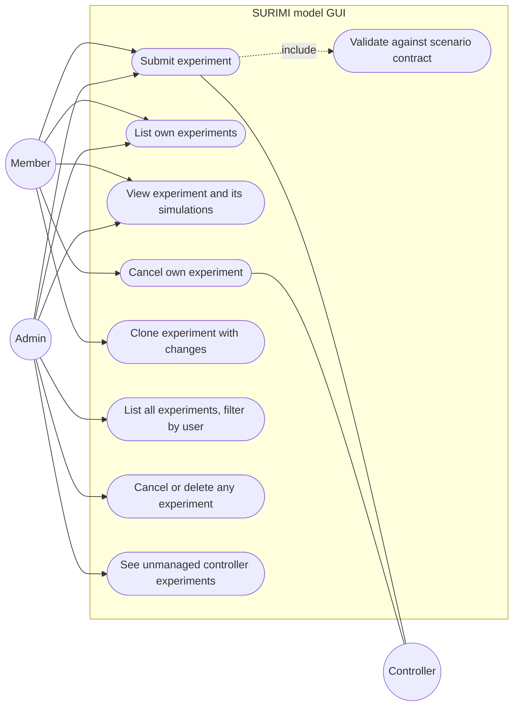

# Experiments

**Status:** Built 2026-11-06 (backend and API) on `develop`, not merged into `main`. Frontend in phase 10
**Changes:** [CHANGELOG.md](CHANGELOG.md)
**Plan:** [2026-11-03-monorepo-and-backend](../../plans/2026-11-03-monorepo-and-backend.md), phase 4, detailed in [2026-11-05-scenario-catalog-hcr-experiments](../../plans/2026-11-05-scenario-catalog-hcr-experiments.md) step 4c
**ADRs:** [0005](../../decisions/0005-authorization-roles-and-ownership.md), [0006](../../decisions/0006-protocols-rest-sse-grpc.md), [0011](../../decisions/0011-controller-stubs-from-buf-registry.md), [0015](../../decisions/0015-experiment-admission-queue.md), [0017](../../decisions/0017-scenario-catalog-from-partner-config.md), [0018](../../decisions/0018-harvest-control-rules-per-user-and-scenario.md), [0022](../../decisions/0022-hcr-biomass-in-kg-tonnes-only-in-the-ui.md)

Users submit experiments to the SURIMI controller through the backend, see
their own, and cancel them. Admins see and manage every experiment and filter by
owner, scenario, status and date. Submitted experiments wait in the
[experiment queue](../experiment-queue/README.md) until the controller has
capacity.

---

## Decisions

| Decision | Why | Recorded in |
| --- | --- | --- |
| Ownership scoped in the repository; foreign ids return 404 | A new endpoint cannot forget the check; ids cannot be probed | [ADR 0005](../../decisions/0005-authorization-roles-and-ownership.md) |
| REST/JSON API; native gRPC to the controller | Browsers lack gRPC; the controller must leave the public path | [ADR 0006](../../decisions/0006-protocols-rest-sse-grpc.md) |
| `POST` queues the experiment; the worker submits it (the API never calls `SubmitExperiment`) | Ecopath pods are few; users get a position instead of a failure | [ADR 0015](../../decisions/0015-experiment-admission-queue.md), [ADR 0019](../../decisions/0019-worker-row-driven-with-advisory-lock.md) |
| Statuses `queued`, `submitting`, `submit_failed`, `submitted`, `initialising`, `initialised`, `running`, `copying_results`, `completed`, `failed`, `cancelling`, `cancelled`. A run the controller reports `Finished` is `copying_results` until its results are in the bucket and indexed, then `completed`; `finished_at` is when the run ended, `completed_at` when its results were ready | Results the user cannot open yet are not a finished experiment (user, 2026-11-12) | [scheduler](../simulation-status-scheduler/README.md#results-copying_results--completed) |
| An experiment the controller never reports within `START_TIMEOUT_MINUTES` (5) is `failed` with "never started … No available pods"; an MSE run with only some simulations started is `failed` too | The controller creates no simulation when no pod is free and reports nothing (**Verified** 2026-11-06) | this file, [scheduler](../simulation-status-scheduler/README.md) |
| The backend generates `experiment_id` (UUID v4) and writes the row before calling the controller | The controller accepts any id; a retry reuses the id; a crash leaves a visible row | this file |
| Validate against the scenario contract and the [scenario catalog](../scenario-catalog/README.md) before queueing | The controller fails late, after minutes, at `CreateRegulations`; the contract alone does not say which species take an HCR | this file, [ADR 0017](../../decisions/0017-scenario-catalog-from-partner-config.md) |
| HCRs from the request, or else the user's saved [harvest control rules](../harvest-control-rules/README.md), copied into the experiment with biomass in kg, passed to the controller unchanged | The controller takes kg (**Confirmed by the controller team, 2026-10-16**); clone and audit need the exact inputs; one unit from the database to the controller (user, 2026-11-13) | [ADR 0018](../../decisions/0018-harvest-control-rules-per-user-and-scenario.md), [ADR 0022](../../decisions/0022-hcr-biomass-in-kg-tonnes-only-in-the-ui.md) |
| `climate_scenario` required only when the contract lists climate scenarios, and must be one of them | `aegean_sea` lists none, the others `RCP_2.6`, `RCP_4.5`, `RCP_8.5` (**Verified** 2026-11-05) | this file |
| Developed and tested against the `user-<developer>` controller | User, 2026-11-05 | this file |
| Store the submitted request as `jsonb` with the protocol version | Clone and audit need the exact input; the shape belongs to the controller | this file |
| Cancel = `RemoveExperiment`, through a `cancelling` state | `RemoveExperiment` is the controller's cancel; it only stops `Running` simulations and reports success anyway (controller code) | this file |
| The form shows the Ecopath pods a run will use (5 for MSE, 1 otherwise) and the current queue | Users understand why an MSE run waits longer | this file |
| Soft delete; purge after 12 months | Statistics still count hidden runs | this file, [ADR 0013](../../decisions/0013-data-retention.md) |
| Unmanaged controller experiments shown to admins and adoptable | Runs started from Bruno or other tools must not be invisible | this file |
| `GET /api/v1/scenarios/{name}/experiment-options` returns everything the experiment form needs in one call: the contract's dates and climate scenarios, the Ecopath pods a run takes, every species entry of the contract with its names, functional group, whether it can carry an HCR and the controller's initial biomass and F, and the user's HCR configurations (ADR 0025; no scenario defaults, ADR 0024) | The form needs five sources (contract, catalog, saved rules, two controller RPCs); combining them once in the backend means the console and the phase 10 frontend do not each repeat it (user, 2026-11-16). Rejected: the client calling the five endpoints itself | this file |
| Admins run their own experiments and can cancel and delete anyone's | Confirmed by the user, 2026-11-03; admin includes member | [ADR 0005](../../decisions/0005-authorization-roles-and-ownership.md) |

---

## Use cases

| Use case | Actor | Pre-conditions | Main flow | Failure cases |
| --- | --- | --- | --- | --- |
| Submit | Any signed-in user | Scenario exists | Form → validate → row `queued` → (worker, when capacity frees) `submitting` → `SubmitExperiment` → `submitted` | Validation → 422 with field errors; over `MAX_QUEUED_EXPERIMENTS_PER_USER` → 409; controller error → `submit_failed`; capacity error → back to `queued` |
| Cancel | Owner, or an admin for any user's experiment (audited) | State not final | Queued → `cancelled` at once. Otherwise → `cancelling` → `RemoveExperiment` → `cancelled` when the controller no longer reports running simulations | Controller error → stays `cancelling`, retried by the worker; after 10 min flagged |
| Delete | Owner, or an admin for any user's experiment (audited) | Final state | Soft delete: hidden at once, purged with its output metadata after 12 months; the files in the bucket are not touched | Not final → 409, cancel first |
| Download outputs | Owner or admin | Experiment `completed` (outputs `ready`) | A redirect to a presigned link, or the link as JSON (`/outputs/download-url`); see [experiment outputs § Downloads](../experiment-outputs/README.md#downloads) | Not ready → 409 |
| List | Any | — | Own experiments, newest first, filters and paging; admins see all and may filter by `owner_id` | — |

---

## Current state

The runs pages call `GetAllSimulationStatuses` from the browser and group by
scenario (`apps/frontend/src/hooks/useSimulationStatuses.ts`). Submission and
removal exist only in the mock (`apps/frontend/src/lib/services/controllerMock.ts`). **Read from source.**

---

## Target behaviour

The decisions above, in detail:

- **Validation rules:** scenario in `GetScenarioNames`; each HCR's species
  and life stage in the catalog's `hcr_eligible` (life stage compared
  case-insensitively, the contract's spelling sent); at most one HCR per
  species and life stage; `0 < biomass_limit_kg < biomass_base_kg ≤ 3.3e12`;
  `0 < f_max ≤ 100`;
  `end_date_time` after the contract's `start_date_time` and not after
  `maximum_end_date_time`; `climate_scenario` one of the contract's
  `climate_scenarios`, and required only when that list is not empty.
  Contracts cached 10 min. An empty `climate_scenario` (`aegean_sea`) goes
  against the proto's `min_len: 1`, but the controller checks only
  `scenario_name`, and the one service that validates requests, POSEIDON, is
  called only for scenarios with `POSEIDON` fleet segments (`northwestern_med`),
  so it is accepted (**Read from source**, SURIMI-controller `117e604`,
  `PoseidonServiceClient.AddInitialise`, 2026-11-13; see
  [ISSUES.md](../../ISSUES.md)).
- **HCRs:** from `harvest_control_rules` (as given) or `hcr_configuration_id`
  (one of the user's configurations for the scenario, ADR 0025: its rules are
  copied, and `hcr_configuration_id` and `hcr_configuration_name` are stored
  with them; someone else's is a 404), not both (422); with neither, no rules
  (no scenario defaults, ADR 0024). `harvest_control_rules_source` is
  `request`, `configuration` or `none`. The list
  sent is stored in `experiments.request` with biomass in kg, and `mapping.py`
  passes it to the controller unchanged.
- **Ids and crash safety:** the row is written as `queued` with our UUID. The
  dispatcher sets `submitting` before the RPC; a `submitting` row older than
  2 min is resolved by the worker ([scheduler](../simulation-status-scheduler/README.md#self-healing)).
- **Limits:** `MAX_PODS_PER_USER` caps the Ecopath pods a user has in flight and
  `MAX_QUEUED_EXPERIMENTS_PER_USER` caps waiting ones
  ([experiment queue](../experiment-queue/README.md#configuration)).
- **Unmanaged experiments:** ids reported by `GetAllSimulationStatuses` that
  are not in our table, and hold pods, are listed to admins in
  `GET /api/v1/admin/queue` (`managed: false`), and can be adopted by
  assigning an owner. They also count against queue capacity. An adopted
  experiment's inputs are unknown (`request.adopted: true`), so it cannot be
  cloned. Built this way instead of a separate `…/unmanaged` endpoint: the
  queue view already lists what holds pods.

---

## Experiment form options

`GET /api/v1/scenarios/{name}/experiment-options` (any signed-in user),
added 2026-11-16 for the console's experiment tab and the phase 10 form:

| Field | Source |
| --- | --- |
| `start_date_time`, `maximum_end_date_time` | Contract (`GetSimulationContract`, cached) |
| `climate_scenarios`, `climate_scenario_required` | Catalog (from the contract): required when the list is not empty |
| `pods_single_run`, `pods_mse_run` | 1 and `CONTROLLER_MSE_SIMULATIONS` (5 on `project-surimi`) |
| `species[]` | Every species entry of the contract, in catalog order: `species_code`, `life_stage`, `hcr_eligible` (only those can carry a rule), `species_name`, `scientific_name`, `functional_group` and its name, `initial_biomass`, `initial_fishing_mortality` (both null when the controller has no value for the entry, e.g. `SWO`) |
| `hcr_configurations[]` | The user's HCR configurations for the scenario (ADR 0025): `id`, `name`, `rule_count`, `updated_at` |
| `initial_values_available`, `notes` | Whether `GetInitialBiomasses` and `GetInitialFishingMortalities` answered (only `northwestern_med` today); notes say what is missing and that the controller gives no unit |

The initial values are passed on as the controller sends them (see
[scenario catalog](../scenario-catalog/README.md#initial-biomass-and-fishing-mortality)):
the evidence points to tonnes over the whole model area, not yet confirmed by
the controller team ([ISSUES.md](../../ISSUES.md)). A controller failure on them is a note, not
an error, so the form still opens.

### Console tab (user, 2026-11-16)

A **New experiment** tab in the backend console, for every signed-in user:
pick a scenario, then name, end date (limited to the contract's range; one
year after the start by default),
climate scenario (when the scenario has any), MSE run (with the pods it
takes), and the harvest control rules: an **Add a species** dropdown with
every species of the contract and its initial biomass and F (the HCR-eligible
ones selectable, the others greyed), and the list of species added, each with
biomass limit and base **in tonnes**, F max **per year** (ADR 0022: tonnes in
the UI, × 1000 to kg in the request) and a Remove button. Every row of the list
is sent; an incomplete row stops the submit with a message (user, 2026-11-16,
after rules typed into an unticked row of the earlier tick-box table were
silently left out). A **Configuration** picker loads one of the user's HCR
configurations into the table; **Save** writes the table to it (with the name
typed), **Save as new** creates another, **Delete** removes it (ADR 0025). The
request always carries the rules as shown (`harvest_control_rules`, an empty
list when none is ticked), so what is on screen is what runs. Below it, **My
experiments**: the user's runs with status, progress, queue position, and a
cancel button while one is possible.

## API

| Method | Path | Role | Request | Response | Errors |
| --- | --- | --- | --- | --- | --- |
| GET | `/api/v1/scenarios` | any | — | `[ScenarioOut]` | 502 controller |
| GET | `/api/v1/scenarios/{name}/contract` | any | — | `ContractOut` | 404, 502 |
| GET | `/api/v1/scenarios/{name}/experiment-options` | any | — | `ExperimentOptionsOut` (see § Experiment form options) | 404, 502 (contract) |
| POST | `/api/v1/experiments` | any | `ExperimentIn` | 202 `ExperimentOut` | 409 limit, 422 |
| GET | `/api/v1/experiments` | any | `?status&scenario&owner_id(admin)&submitted_from&submitted_to&q&page&size&sort` | page of `ExperimentOut` | — |
| GET | `/api/v1/experiments/{id}` | owner, admin | — | `ExperimentDetailOut` with simulations (each with `status`, `status_raw`, `progress`) and events; every `ExperimentOut` has `simulation_counts` | 404 |
| POST | `/api/v1/experiments/{id}/cancel` | owner, admin | — | 202 `ExperimentOut` | 404, 409 final state or `copying_results` (the run has finished) |
| POST | `/api/v1/experiments/{id}/clone` | owner, admin | partial `ExperimentIn` | 202 `ExperimentOut` | 404, 422 |
| DELETE | `/api/v1/experiments/{id}` | owner, admin | — | 204 (soft) | 404, 409 not final |
| POST | `/api/v1/admin/experiments/{id}/adopt` | admin | `{owner_id, name?}` | `ExperimentOut` | 404, 409, 422 (not a UUID) |
| GET | `/api/v1/experiments/{id}/events` | owner, admin | `?page&size` | page of events | 404 |

`ExperimentIn`: `name`, `scenario_name`, `end_date_time`, `is_mse_run`,
`climate_scenario` (optional, see validation), `harvest_control_rules[]`
(optional; `species_code`, `life_stage`, `biomass_limit_kg`,
`biomass_base_kg`, `f_max`; biomass in kg) or `hcr_configuration_id`
(optional, not both). Mapped to `SubmitExperimentRequest` in
`integrations/controller/mapping.py`, which turns the rules into
`target_fishing_mortalities` without converting units.

---

## Data

`experiments`, `simulations`, `experiment_events`, `audit_events` in
[schema.dbml](../../database/schema.dbml), with their indexes.

---

## Observability

`experiment.submitted|submit_failed|cancel_requested|cancelled` log events with
`experiment_id`; counters `surimi_experiments_submitted_total{scenario}`;
`surimi_controller_rpc_seconds{rpc,code}`; audit event when an admin acts on
someone else's experiment.

---

## Open questions

- Can an experiment run with no HCR, for example in `aegean_sea` and
  `anchovy_bay`, which have no fisheries authority inputs? (controller team)
- How should the 5 simulations of an MSE experiment be shown: one result or
  five? (User, controller team). Known (the controller team, controller code, 2026-11-03): an
  MSE experiment has 5 simulations with the same inputs, each on its own
  Ecopath pod; cancel applies to all of them but only stops the `Running` ones.
