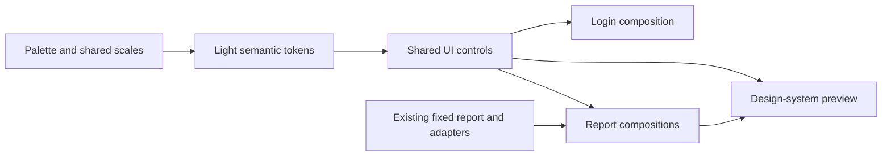

# Frontend design system

**User authorized 2026-11-06:** implement the light theme only, a protected `/design-system` visual preview, React Aria controls and login extraction; remove all Mantine consumers/dependencies. Preserve unrelated work, backend and authentication contracts. The pasted architecture and `styles2` are reference structure, not the chosen palette.

| Decision | Why | Source |
| --- | --- | --- |
| Light theme only | Dark mode explicitly excluded | User 2026-11-06 |
| CSS palette/scales, semantic light tokens, CSS Modules and cascade layers | Central ownership and predictable overrides | [ADR 0018](../../decisions/0018-frontend-css-tokens-and-react-aria.md) |
| `react-aria-components` behind project-owned controls | Accessible behaviour with SURIMI-owned appearance | User architecture |
| Preview actual shared controls/compositions, no props playground | Changes must reach production | User request |
| Red primary, warm secondary, neutral surfaces | Initial editable SURIMI direction, not a certified branding palette | SURIMI brand article and user |
| Temporary semantic aliases for existing pages | Remove Mantine's token resolver while preserving existing scientific/map layouts | This feature |

## Structure and scope

`styles/design-system/` holds palette, spacing, typography, radii, borders, shadows and motion. `styles/themes/light.css` implements semantic tokens. `styles/aria/` holds shared control styles. `components/ui/` owns React Aria wrappers and simple reusable building blocks; `components/presentational/` owns domain-independent visual compositions with display-ready props. Parents own layout; feature hooks/adapters retain data and domain rules. No dark implementation or theme switcher.

`/design-system` sits behind the existing session guard and has Theme, UI components and Presentational components tabs. Static examples show relevant variants and validation states; controls remain functional and keyboard accessible. Preview datasets/descriptive content live under `mock-data/`. Report previews reuse actual existing map/chart/indicator components through existing feature adapters, without scientific REST requests or simulation creation. The existing report map retains its OpenStreetMap tile requests.

Login retains local/SSO services, errors, session restoration and required-password routing. Its fields, buttons and surface use the shared foundation. Mantine layout wrappers are replaced with semantic HTML and CSS layouts, interactive controls with React Aria; charts already use Chart.js. Remove Mantine provider/theme files/packages after the last consumer migrates. `styles2` is kept untouched as the supplied reference; the adopted implementation lives in `styles/` and never imports its reference or dark files. Legacy styles outside the migrated consumers remain for later screen refinement; new/migrated foundation styles use the declared layers.

## Verification

Build, lint compared with known baseline, focused network tests, browser review of login errors/pending/SSO entry, keyboard tabs/selects/popovers/table, protected preview access, report and input-flow navigation. Backend remains unchanged. Record actual results and remaining limits in the changelog.

Brand reference: https://www.surimi-project.eu/crafting-the-surimi-brand-a-strategic-approach-to-visual-identity-and-inclusivity/ . Official source describes orange/red/pink; final application swatches remain subject to user visual review.

## Composition

Read from source: no new REST endpoint, session mechanism, backend table or cross-process flow is introduced. Existing map tile requests remain owned by the map feature. Canonical values live in CSS; `chartTheme.ts` resolves them only where canvas rendering requires colour strings. Theme persistence is intentionally absent because this increment has one supported light theme.

## Review and remaining work

Verified implementation and test details are in [CHANGELOG.md](CHANGELOG.md). Review `/login` and `/design-system`, then refine the palette and each real component. Legacy aliases are a migration boundary, not a second palette; remove them as their remaining consumers are converted. Existing scientific series colours, case-map atmosphere and historical screen-specific styling are not automatically recoloured by every shared-token change.
