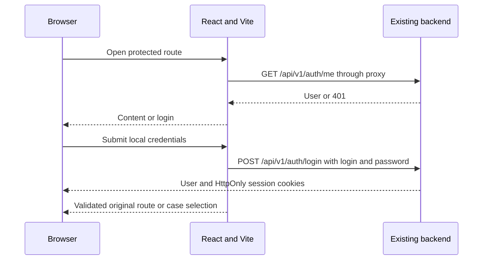

# Frontend local login

**Authorized by the user, 2026-11-05:** implement local password login, run the existing Docker backend and Vite frontend, and test them together. Backend, protocol, CI and deployment files remain unchanged. **Follow-up authorized 2026-11-05:** implement mandatory password-change completion, SSO provider entry/return, and real scenario availability. Backend source, protocol, CI and tracked deployment files remain unchanged.

| Decision | Why | Source |
| --- | --- | --- |
| Local credentials use `/api/v1/auth/login` | Browser cookie flow; `/token` is for Bruno/scripts | Bruno `api/auth/post login.yml` and backend schemas |
| Vite proxies `/api/v1` to localhost:18082 | Keep the browser on one origin for cookies and CSRF | Existing backend port and cookie design |
| Protected parent route checks `useCurrentUser` | One session boundary for all content, including deep links and NetCDF lab | User-confirmed login-first flow |
| Preserve a validated local destination | Deep links remain useful without allowing external redirects or login loops | This feature |
| `/test` is public | User-confirmed exception | User, 2026-11-05 |
| Retry state for session/network failures | API failure must not look like signed out or reveal protected content | Existing AppError distinction |
| Complete required password changes before opening content | Backend blocks business routes until the requirement clears | Backend `must_change_password` |
| Small sign-out control on case selection | Allows completing and testing the local session lifecycle | This feature; existing logout service |

## Flow

## Scope

The login form uses the existing Zod service and TanStack mutation. While session restoration runs, content stays hidden. Wrong credentials, inactive accounts, rate limits and API errors render clearly without a redirect loop. Form values are not persisted. Session cookies remain HttpOnly; the request layer reads only CSRF for authenticated writes.

The protected route excludes `/test` and `/login`. It includes home, introductions, input/run/report routes and `/netcdf-lab`. Unknown private URLs still resolve through the signed-in application. Mandatory-password users are redirected to the password-change form before content is opened. The page refetches the user after successful completion and then returns to the original destination.

Case selection has a user/sign-out control and real REST availability. Scientific reports remain the same fixed example, with no experiment submission or scientific-output API integration. SSO provider buttons are mounted on login; all provider exchange and callbacks are handled by the existing backend.

## Local verification setup

Read all Bruno auth requests and backend schemas first. Start the API/database with existing Compose settings and run Vite on `http://localhost:5173`. API proxy target defaults to `http://127.0.0.1:18082`; the browser stays on `localhost:5173`.

The original Docker build is blocked by the GHCR `uv:0.10.4` image authorization denial. Local verification uses an untracked temporary Dockerfile outside the repo that installs exactly `uv==0.10.4` from PyPI instead. It builds the same backend source and frozen dependency lock. Then `docker compose --env-file deployments/.env -f deployments/compose.yml up --no-build -d api` starts the existing services. This is a local testing workaround, not a repository deployment change.

## Follow-up design — password, SSO and availability

- Mandatory-password users are redirected to `/change-password` with a validated original destination. The form validates current/new/confirmation fields; only current/new are sent. Backend weak-password and incorrect-current-password errors remain visible. A 204 triggers a fresh `/auth/me`; access opens only once the requirement clears. No admin credentials are changed during testing; use a dedicated local test account and deactivate it afterwards.
- Login discovers `/auth/providers` and renders configured SSO buttons alongside local login. Buttons navigate to the backend-provided, same-origin SSO start path with a safe `next`. Backend/Keycloak handle all code/token exchange. Provider-list errors do not disable local login. Browser reload after the callback restores the same SURIMI session.
- Keycloak runtime registration and ignored local `.env` use callback origin `http://localhost:5173`. No checked-in realm/Compose/backend edits. Fresh environments must register their chosen frontend origin as well.
- **Existing backend limitation:** unsuccessful full-page SSO callbacks return backend JSON errors rather than redirecting to a frontend error page. Do not disguise this with a dev-only proxy behaviour or change backend code. Verify denial creates no session, document the limitation, and keep local login available after navigating back.
- Home mounts `useScenarios`. Cards map API scenario identifiers to local case descriptions. Pending/error states show a dedicated loading/retry screen; the cards and intro animation mount only after a successful response, preventing a disabled-card flash. A successful empty list means none are available. Retrying is explicit. Scenario availability controls case-selection entry, not user authorization or scientific outputs. Direct static/demo routes remain authenticated; real submissions are still unimplemented.

## Reproduce local Vite SSO

1. Keep `OIDC_PROVIDERS=keycloak` and set `PUBLIC_BASE_URL=http://localhost:5173` in ignored `deployments/.env`.
2. Start the existing services: `docker compose --env-file deployments/.env -f deployments/compose.yml --profile keycloak up --no-build -d api keycloak` (requires the local API image described above).
3. In the local Keycloak admin console (`http://localhost:18083`), open realm `surimi`, client `surimi-modelgui`. Add `http://localhost:5173/api/v1/auth/sso/keycloak/callback` to **Valid redirect URIs**, preserving the other entries. Use the bootstrap-admin credentials from local configuration.
4. Run/reuse Vite at `http://localhost:5173` and select **Sign in with Keycloak**. Existing local users/passwords are in `deployments/keycloak/surimi-realm.json`; Bob is member, Alice admin, Carol has no access.

This runtime client registration must be repeated if the local Keycloak container is recreated without persisted realm data. When using a different frontend origin, configure both the backend's public base URL and the identity provider's registered callback. Keep `localhost` consistent across the browser flow. No tracked deployment files were changed for this local verification.

Sign-out ends the SURIMI session. It does not sign the user out of Keycloak or unrelated applications; the existing backend does not implement global identity-provider logout.
