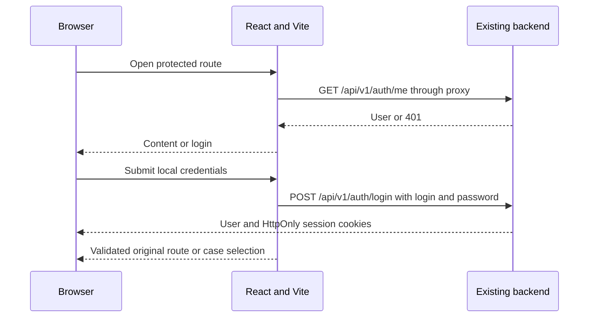

# Frontend local login

**Authorized by the user, 2026-11-05:** implement local password login, run the existing Docker backend and Vite frontend, and test them together. Backend, protocol, CI and deployment files remain unchanged. SSO, scenario availability and password-change form are deferred.

| Decision | Why | Source |
| --- | --- | --- |
| Local credentials use `/api/v1/auth/login` | Browser cookie flow; `/token` is for Bruno/scripts | Bruno `api/auth/post login.yml` and backend schemas |
| Vite proxies `/api/v1` to localhost:18082 | Keep the browser on one origin for cookies and CSRF | Existing backend port and cookie design |
| Protected parent route checks `useCurrentUser` | One session boundary for all content, including deep links and NetCDF lab | User-confirmed login-first flow |
| Preserve a validated local destination | Deep links remain useful without allowing external redirects or login loops | This feature |
| `/test` is public | User-confirmed exception | User, 2026-11-05 |
| Retry state for session/network failures | API failure must not look like signed out or reveal protected content | Existing AppError distinction |
| Block accounts requiring a password change | Backend blocks business routes until the password changes; form is a later step | Backend `must_change_password` |
| Small sign-out control on case selection | Allows completing and testing the local session lifecycle | This feature; existing logout service |

## Flow

## Scope

The login form uses the existing Zod service and TanStack mutation. While session restoration runs, content stays hidden. Wrong credentials, inactive accounts, rate limits and API errors render clearly without a redirect loop. Form values are not persisted. Session cookies remain HttpOnly; the request layer reads only CSRF for authenticated writes.

The protected route excludes `/test` and `/login`. It includes home, introductions, input/run/report routes and `/netcdf-lab`. Unknown private URLs still resolve through the signed-in application. A mandatory-password-change state blocks access and offers sign-out; it does not pretend a password-change screen exists.

Case selection gets a small user/sign-out control. It continues to enable all demo cases and uses fixed example reports: no scenario availability query, submission or scientific-result integration is added. SSO provider discovery/buttons/callback handling are not mounted.

## Local verification setup

Read all Bruno auth requests and backend schemas first. Start the API/database with existing Compose settings and run Vite on `http://localhost:5173`. API proxy target defaults to `http://127.0.0.1:18082`; the browser stays on `localhost:5173`.

The original Docker build is blocked by the GHCR `uv:0.10.4` image authorization denial. Local verification uses an untracked temporary Dockerfile outside the repo that installs exactly `uv==0.10.4` from PyPI instead. It builds the same backend source and frozen dependency lock. Then `docker compose --env-file deployments/.env -f deployments/compose.yml up --no-build -d api` starts the existing services. This is a local testing workaround, not a repository deployment change.
