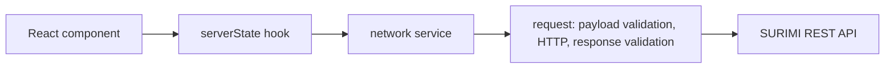

# Frontend REST foundation

**Confirmed by the user, 2026-11-05:** adapt the supplied Axios/Zod/TanStack pattern to SURIMI. This increment provides network infrastructure, typed auth/scenario services and server-state hooks. No login UI, route guards, scenario-page integration, backend or deployment changes.

| Decision | Why | Source |
| --- | --- | --- |
| `src/network/` for HTTP, schemas and services | One discoverable request entry point; services describe endpoints without React | User-approved structure |
| Axios + Zod | Retain the supplied pattern; validate payloads and responses, infer TypeScript types from schemas | User, 2026-11-05 |
| `src/serverState/` for TanStack hooks and query keys | Cache/session presentation concerns stay outside transport and components | User-approved structure |
| No unconditional redirects from HTTP | Login errors, expired sessions and forbidden access need different UI behaviour | Backend auth contracts |
| One refresh in flight; retry an authenticated 401 at most once | Rotating refresh cookies must not race in the same page | Backend auth design |
| Handwritten Zod schemas for the implemented endpoints | Keep this increment small; OpenAPI-generated client tooling is deferred | ADR 0017 |

## Flow

## Boundaries

**Initial foundation snapshot:** the query provider was installed without mounting requests. **Follow-up, 2026-11-05:** local login now mounts auth hooks; see [local login](../frontend-local-login/README.md). Provider discovery and scenario availability hooks are now mounted; password-change completion and real Keycloak SSO are browser-tested. Services cover existing auth and catalogue endpoints only. There is no guessed experiment API or copied surge/port behaviour. HTTP uses same-origin `/api/v1`, credentials, and the readable CSRF cookie for writes. JavaScript does not access authentication tokens.

Login, providers and password-change requests do not trigger automatic refresh on wrong credentials. Protected requests may refresh once after a 401; The HTTP transport does not replay 403, network errors or invalid responses; the catalogue query has the limited read-retry exception described below. A caller can cancel its own wait without cancelling refresh for other callers. CSRF is read again after refresh. The refresh response must be 204.

Application errors use `error.code/message/details/request_id`; default FastAPI validation errors may use `detail`. Non-JSON/proxy errors also normalize safely. Payload-validation errors and successful responses that fail Zod validation are different error kinds. Validation errors retain field paths/messages, never the raw password/body. HTTP errors preserve status, backend code, optional details, request ID and Retry-After. Cancellation remains cancellation.

The HTTP layer returns errors; TanStack manages session cache changes. Terminal session expiry clears protected query data. Login/account switching and logout cancel/remove cached queries. Global queries and mutations do not automatically retry; transport alone handles the bounded auth retry. **Catalogue recovery added for the user-reported refresh failure, 2026-11-06:** `scenarioListOptions` retries network/502/503/504 read failures at most twice (1s/2s backoff); auth, forbidden and invalid-response failures do not replay. Writes retain no retry. The login UI must prevent simultaneous account-changing actions. Cross-tab refresh coordination is not implemented.

## Source contracts and limits

Read from `apps/backend/src/surimi_backend/{auth,users,catalog}`; no backend file is edited. User dates stay ISO strings, IDs are UUID strings, roles are `admin/member`. Nullable fields remain nullable. `contract.simulation` is a record of unknown values: the backend does not yet expose a strongly typed nested schema. The frontend does not invent one.

SSO provider URLs are returned as data and the login UI performs browser navigation. No Keycloak client code or tokens are added. Vite now has the local `/api/v1` proxy; the local callback origin is configured through ignored settings and runtime Keycloak registration. Docker retains its same-origin REST proxy.

## Next step

Local login/session/route protection is implemented and tested with the running API in the linked feature. SSO, password completion and live catalogue integration are now verified in that feature. Contract-driven inputs and real experiment/output data remain later steps.
