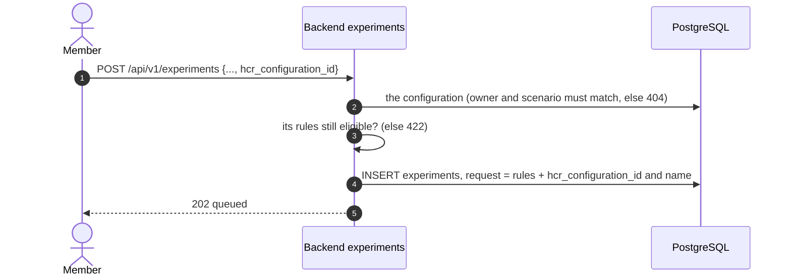
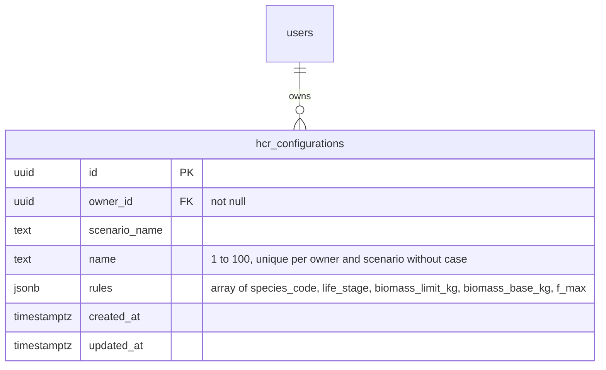

# Harvest control rules

**Status:** Built 2026-11-06 (backend and API) on `develop`, not merged into `main`; scenario defaults removed 2026-11-16; several named configurations per scenario, rules in `jsonb`, 2026-11-16. Frontend in phase 10; the backend console's New experiment tab uses the configurations today
**Plan:** [2026-11-05-scenario-catalog-hcr-experiments](../../plans/2026-11-05-scenario-catalog-hcr-experiments.md), step 4b
**ADRs:** [0018](../../decisions/0018-harvest-control-rules-per-user-and-scenario.md), [0024](../../decisions/0024-harvest-control-rules-only-per-user-no-defaults.md), [0025](../../decisions/0025-several-named-hcr-configurations-per-scenario-in-jsonb.md), [0022](../../decisions/0022-hcr-biomass-in-kg-tonnes-only-in-the-ui.md), [0017](../../decisions/0017-scenario-catalog-from-partner-config.md)

Each user keeps as many named **HCR configurations** per scenario as they
like (at most 50). A configuration is a set of harvest control rules: biomass
limit, biomass base and F max per species entry. Users create, rename, change
and delete them, and use one when they submit an experiment. There are no
scenario defaults: the reference values people set limits against, the
initial biomass and fishing mortality, come from the controller.

| File | Purpose |
| --- | --- |
| [README.md](README.md) | Use cases, design, decisions, open questions |
| [CHANGELOG.md](CHANGELOG.md) | Dated log of every change made for this feature |

---

## Decisions

| Decision | Why | Recorded in |
| --- | --- | --- |
| Stored in our database, per owner and scenario | **Confirmed by the controller team, 2026-10-16** | [ADR 0018](../../decisions/0018-harvest-control-rules-per-user-and-scenario.md) |
| Several named configurations per user and scenario; table `hcr_configurations`, the rules a `jsonb` array; name unique per owner and scenario (without case); at most 50 | Users compare alternatives (user, 2026-11-16); the rules are always read and written as a whole, so one column fits (user's suggestion) | [ADR 0025](../../decisions/0025-several-named-hcr-configurations-per-scenario-in-jsonb.md) |
| Every configuration has an owner; no scenario defaults, no admin routes, no seed | Admins will not maintain HCR values; the initial biomass and F come from the controller (user, 2026-11-16) | [ADR 0024](../../decisions/0024-harvest-control-rules-only-per-user-no-defaults.md) |
| A configuration is saved as a whole (`POST`, `PUT`), all or nothing; no per-rule routes | The form edits a table of rows; one request, never half saved | [ADR 0025](../../decisions/0025-several-named-hcr-configurations-per-scenario-in-jsonb.md) |
| An experiment takes `harvest_control_rules` or `hcr_configuration_id` (rules copied, with the configuration's id and name), not both; neither: no rules | Past experiments must not change when a configuration is edited (ADR 0018); no defaults to fall back on | [ADR 0025](../../decisions/0025-several-named-hcr-configurations-per-scenario-in-jsonb.md) |
| Biomass in kg in the database, the API and the controller request (`biomass_limit_kg`, `biomass_base_kg`); tonnes only in the UI | One unit from the database to the controller (user, 2026-11-13). The controller takes kg (**Confirmed by the controller team, 2026-10-16**) | [ADR 0022](../../decisions/0022-hcr-biomass-in-kg-tonnes-only-in-the-ui.md) |
| Only HCR-eligible catalog entries accepted | Others fail at `CreateRegulations` minutes later (**Verified** 2026-10-30) | [ADR 0017](../../decisions/0017-scenario-catalog-from-partner-config.md) |
| The protocol's bounds checked by the API: `0 < biomass_limit_kg < biomass_base_kg ≤ 3.3e12` and `0 < f_max ≤ 100` | The protocol declares them (`buf.validate` on `TargetFishingMortality`; **Read from source**, SURIMI-protocol `0c4b6c4`), but the controller does not enforce them (**Read from source**, SURIMI-controller `117e604`), so ours is the only check; since ADR 0025 it is the request models only, as the API is the only writer of the `jsonb` | this file |
| Reference values (initial biomass and initial F per species) come from the controller on every request (`GET …/experiment-options`), not stored with the rules | The values change when Ecopath's spin-up files are regenerated (user, 2026-11-12); see [scenario catalog](../scenario-catalog/README.md#initial-biomass-and-fishing-mortality) | this file |
| A rule that became ineligible stays in its configuration, flagged `eligible: false`, refused when the configuration is used, and must go before the configuration is saved again | Do not change users' data because a partner file changed, but never send a rule that will fail | this file |
| Configuration changes are not audited | They are the user's own data; the audit log records actions on other people's data and admin actions | this file |

---

## Use cases


| Use case | Actor | Pre-conditions | Main flow | Failure cases |
| --- | --- | --- | --- | --- |
| List | Any | Scenario exists | Own configurations by name, each with its rules; `[]` when none | Unknown scenario → 404 |
| Create | Any | Fewer than 50 for the scenario | Validate name and every rule → insert | Entry not eligible or twice → 422 listing every problem and the eligible entries; bounds or blank name → 422; name taken (without case) or 50 already → 409 |
| Change | Owner | Configuration is theirs and of this scenario | Validate → update name and rules in one statement | As for Create; not theirs → 404 |
| Delete | Owner | As above | Delete | Not theirs → 404 |
| Use | Owner | As above | `POST /experiments` with `hcr_configuration_id` copies its rules, id and name into the request | Not theirs → 404; a rule no longer eligible → 422; with `harvest_control_rules` too → 422 |

---

## Target behaviour

**What the three values mean** (**Confirmed by the controller team**, mail
quoted by the user 2026-11-16): the **biomass limit**: below this biomass no
catch is allowed; the **biomass base**: above this biomass the fishing
mortality used to calculate the TAC is fixed; the **(maximum) fishing
mortality**: the largest proportion of the biomass that may be caught.

**How they are used** (**Read from source**, SURIMI-fisheries-authority `a68715a`, `Services/QuotaCalculationService.cs`): the fisheries authority turns them into a
TAC (total allowable catch) per species once a year, at the start of each
simulated year. The first year uses the species' initial TAC from its
`initial_quota.csv` instead; from the second year the TAC comes from EwE's MSE
quota calculator with the three values and the species' biomass over the whole
model area. Each TAC is split between fleets by `quotashare.csv`. A species
needs a row in all three fisheries authority files, which is why only those
are HCR-eligible (ADR 0017). Between the limit and the base the fishing
mortality presumably rises from 0 to the maximum, but that formula is in the
EwECore package, which is not open here: **Open question** to the controller
team, see [ISSUES.md](../../ISSUES.md).

**Several configurations (ADR 0025).** A user names each configuration
(1 to 100 characters, trimmed, unique among theirs for the scenario without
case) and may keep one with no rules. 50 per scenario bounds the list answer,
which carries every configuration with its rules. Alternative rejected: no
limit, which lets one user make the list arbitrarily large.

**Whole-configuration save.** `POST` and `PUT` take `{name, rules}`. Every
rule is checked against the catalog and each entry only once (life stage
without case); one problem and nothing changes. The 422 lists every problem in
`details.problems` and the eligible entries in `details.eligible`.

**Stored form.** `rules` holds `species_code`, `life_stage` (the contract's
spelling, `""` when none), `biomass_limit_kg`, `biomass_base_kg`, `f_max`:
the same objects an experiment's request stores and the controller is sent.

**No defaults (ADR 0024).** A user with no configuration for a scenario starts
with an empty form, with the controller's initial biomass and F beside every
species. Nothing is prefilled from those values.

---

## Current state

Built on `develop` (**Verified** 2026-11-16, tests against PostgreSQL 17):
`hcr/` module with the routes below; migration `0007_hcr_configurations`. The
backend console's **New experiment** tab lists every contract species, loads,
saves, saves as new and deletes configurations
([backend-console](../backend-console/README.md)). The phase 10 frontend still
shows mock HCRs
(`apps/frontend/src/features/InformationalScenarios/anchovyBay/components/AnchovyInputsFlow/const.ts`).
**Read from source.**

---

## Flows

```mermaid
sequenceDiagram
    autonumber
    actor U as Member
    participant A as Backend hcr
    participant K as Catalog
    participant D as PostgreSQL
    U->>A: PUT /api/v1/scenarios/northwestern_med/hcr-configurations/{id} {name, rules}
    A->>D: the configuration (owner and scenario must match)
    A->>K: scenario catalog: HCR-eligible entries
    K-->>A: BFT, BOG, HKE adult, HKE juvenile, MUT adult, PIL adult
    A->>A: every entry eligible and once; bounds (kg); name
    alt a problem
        A-->>U: 422 {problems, eligible}, nothing saved
    else all fine
        A->>D: UPDATE hcr_configurations SET name, rules (jsonb)
        alt name taken
            D-->>A: unique violation
            A-->>U: 409
        else
            A-->>U: 200 HcrConfigurationOut
        end
    end
```



---

## Data



Unique `hcr_configurations_name_uq (owner_id, scenario_name, lower(name))`,
which also serves the list; checks `jsonb_typeof(rules) = 'array'` and
`length(name) BETWEEN 1 AND 100` (migration `0007_hcr_configurations`,
2026-11-16; the table is created directly, since the migrations from 0004 on
were rebuilt one per feature before any release).

---

## API

| Method | Path | Role | Request | Response | Errors |
| --- | --- | --- | --- | --- | --- |
| GET | `/api/v1/scenarios/{name}/hcr-configurations` | any | — | `{scenario_name, configurations: [HcrConfigurationOut]}` | 404 |
| POST | `/api/v1/scenarios/{name}/hcr-configurations` | any | `{name, rules: [HcrIn]}` | 201 `HcrConfigurationOut` | 404, 409, 422 |
| GET | `/api/v1/scenarios/{name}/hcr-configurations/{id}` | owner | — | `HcrConfigurationOut` | 404 |
| PUT | `/api/v1/scenarios/{name}/hcr-configurations/{id}` | owner | `{name, rules: [HcrIn]}` | `HcrConfigurationOut` | 404, 409, 422 |
| DELETE | `/api/v1/scenarios/{name}/hcr-configurations/{id}` | owner | — | 204 | 404 |

`HcrIn`: `species_code`, `life_stage` (default `""`), `biomass_limit_kg`,
`biomass_base_kg` (kilograms), `f_max`. `HcrConfigurationOut`: `id`,
`scenario_name`, `name`, `rules` (each `HcrIn` plus `eligible`,
`species_name`, `functional_group`), `created_at`, `updated_at`.

---

## Where the changes are

| Area | File | Change |
| --- | --- | --- |
| Backend | `src/surimi_backend/hcr/` (`models.py`, `schemas.py`, `service.py`, `router.py`) | `HcrConfiguration`, `HcrConfigurationIn`/`Out`, `validate_rules` (shared with experiments) |
| Backend | `src/surimi_backend/migrations/versions/20261116_0007_hcr_configurations.py` | The table, its index and checks |
| Backend | `src/surimi_backend/experiments/` (`options.py`, `service.py`, `schemas.py`) | `hcr_configuration_id` on submit; configurations and every contract species in the form's options |
| Backend | `src/surimi_backend/catalog/species_import.py` | Codes in use read from the configurations' `jsonb` |
| Console | `console/static/` | Configuration picker, Save, Save as new, Delete; species added to the rules list from a dropdown of every contract species |
| Bruno | `api/hcr-configurations/*` | Requests |
| Frontend (phase 10) | HCR editor in the experiment form | Configuration picker; table in tonnes of every contract species, only eligible ones editable, initial biomass and F beside each row; one shared helper turns typed tonnes into kg for the API and kg into rounded tonnes for display (ADR 0022) |

---

## Observability

Log `hcr.rejected` with scenario and entry when an ineligible species is
refused, and `hcr.configuration_saved` with scenario and rule count after a
create or a change. No audit events (see Decisions).

---

## How to test

`tests/test_hcr.py`: several configurations per scenario (create, list by
name, get, rename and replace, delete), per user and per scenario (same name
elsewhere is fine; someone else's or another scenario's is 404), all or
nothing with every problem and the eligible entries listed, bounds and name
checks, unique names without case and the 50 cap, the old routes gone, the
`jsonb` column. `tests/test_experiments.py`: an experiment from
`hcr_configuration_id`, neither (no rules), both (422), someone else's (404).

---

## What has been verified

See [CHANGELOG.md](CHANGELOG.md). In short (**Verified** 2026-11-16): the
tests above against PostgreSQL 17, and the rebuilt migrations 0004 to 0007
on throwaway databases: the same `pg_dump --schema-only` as the chain they
replace, downgrade to 0003 and upgrade again, a non-array `rules` refused. Not yet run on the compose stack; the
console's configuration picker not yet used in a browser.

---

## Open questions

- Which species can carry HCRs per scenario: the controller team's examples
  (`SAA`, `ANE`, `MAC`) are not accepted by the files in the repos, which
  allow only `BFT`, `BOG`, `HKE` adult and juvenile, `MUT` adult and `PIL`
  adult in `northwestern_med`. (controller team)
- Per life stage or per species for `ANE`, `HKE`, `MUT`, `PIL`? (controller team)
- Can an experiment run with no HCR? Without defaults this is what a user
  sends who chose no configuration and ticked nothing. (controller team)
