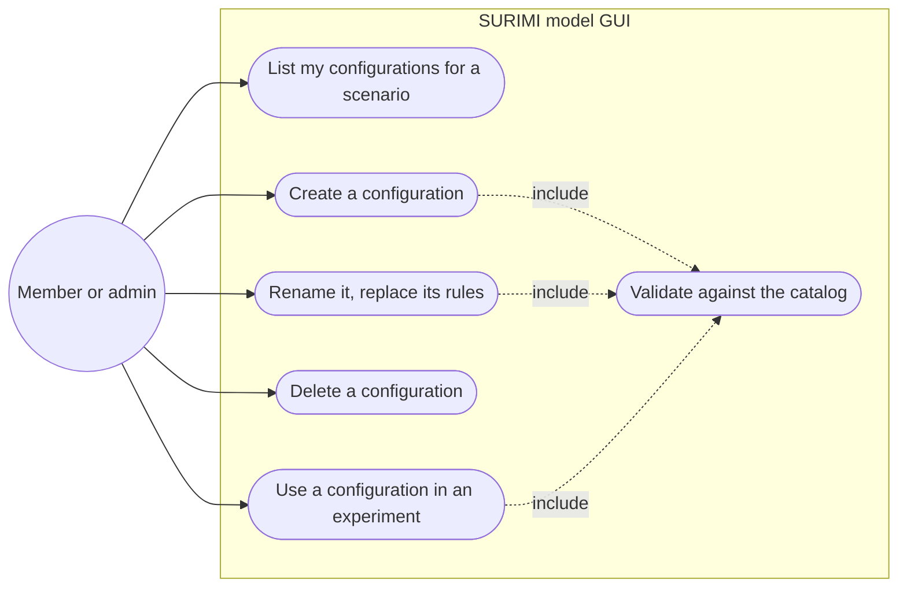
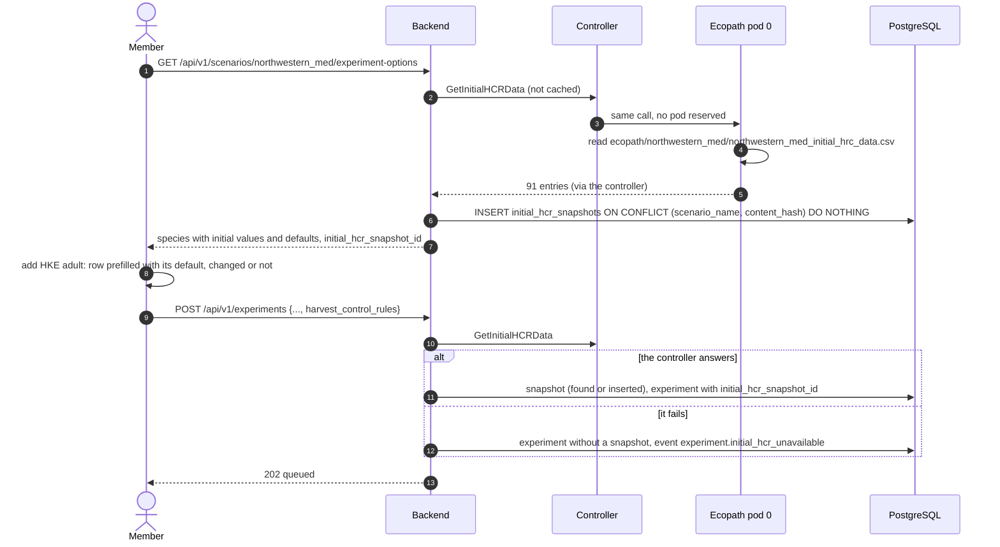
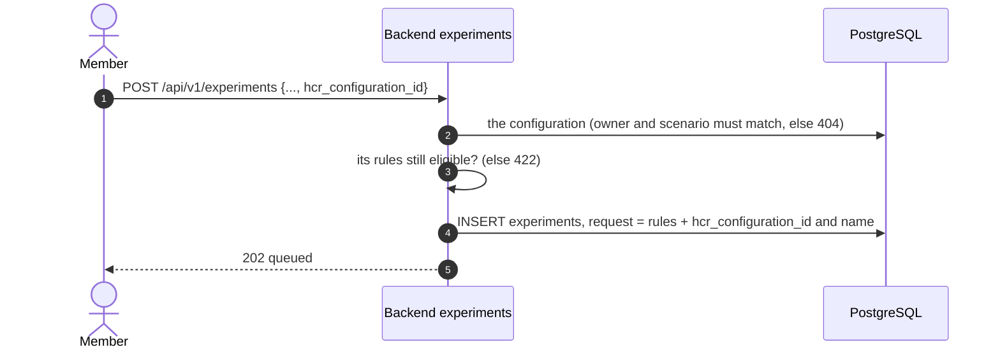
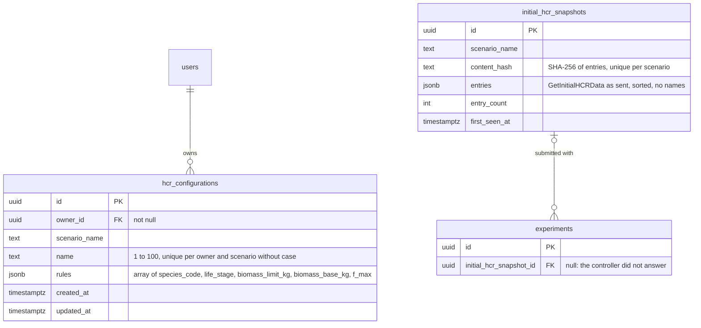

# Harvest control rules

**Status:** Built 2026-11-06 (backend and API) on `develop`, not merged into `main`; scenario defaults removed 2026-11-16; several named configurations per scenario, rules in `jsonb`, 2026-11-16; a limit at or above the base accepted, 2026-11-18; initial HCR data and default rules from the controller (`GetInitialHCRData`), with a snapshot per experiment, 2026-11-23. Frontend in phase 10; the backend console's New experiment tab uses the configurations today
**Plan:** [2026-11-05-scenario-catalog-hcr-experiments](../../plans/2026-11-05-scenario-catalog-hcr-experiments.md), step 4b; [2026-11-23-hcr-initial-data-from-controller](../../plans/2026-11-23-hcr-initial-data-from-controller.md), phase 1
**ADRs:** [0018](../../decisions/0018-harvest-control-rules-per-user-and-scenario.md), [0024](../../decisions/0024-harvest-control-rules-only-per-user-no-defaults.md), [0025](../../decisions/0025-several-named-hcr-configurations-per-scenario-in-jsonb.md), [0022](../../decisions/0022-hcr-biomass-in-kg-tonnes-only-in-the-ui.md), [0017](../../decisions/0017-scenario-catalog-from-partner-config.md), [0027](../../decisions/0027-hcr-initial-data-and-defaults-from-the-controller.md), [0028](../../decisions/0028-initial-hcr-data-snapshots-per-experiment.md)

Each user keeps as many named **HCR configurations** per scenario as they
like (at most 50). A configuration is a set of harvest control rules: biomass
limit, biomass base and F max per species entry. Users create, rename, change
and delete them, and use one when they submit an experiment. The controller
provides, per species, the initial biomass and fishing mortality to set limits
against and a default rule that a new rule starts from (`GetInitialHCRData`);
we store no defaults of our own, only a snapshot of each distinct answer, to
which each experiment points.

| File | Purpose |
| --- | --- |
| [README.md](README.md) | Use cases, design, decisions, open questions |
| [CHANGELOG.md](CHANGELOG.md) | Dated log of every change made for this feature |

---

## Decisions

| Decision | Why | Recorded in |
| --- | --- | --- |
| Stored in our database, per owner and scenario | **Confirmed by the controller team, 2026-10-16** | [ADR 0018](../../decisions/0018-harvest-control-rules-per-user-and-scenario.md) |
| Several named configurations per user and scenario; table `hcr_configurations`, the rules a `jsonb` array; name unique per owner and scenario (without case); at most 50 | Users compare alternatives (user, 2026-11-16); the rules are always read and written as a whole, so one column fits (user's suggestion) | [ADR 0025](../../decisions/0025-several-named-hcr-configurations-per-scenario-in-jsonb.md) |
| Every configuration has an owner; no scenario defaults, no admin routes, no seed | Admins will not maintain HCR values; the initial biomass and F come from the controller (user, 2026-11-16) | [ADR 0024](../../decisions/0024-harvest-control-rules-only-per-user-no-defaults.md) |
| A configuration is saved as a whole (`POST`, `PUT`), all or nothing; no per-rule routes | The form edits a table of rows; one request, never half saved | [ADR 0025](../../decisions/0025-several-named-hcr-configurations-per-scenario-in-jsonb.md) |
| An experiment takes `harvest_control_rules` or `hcr_configuration_id` (rules copied, with the configuration's id and name), not both; neither: no rules | Past experiments must not change when a configuration is edited (ADR 0018); no defaults to fall back on | [ADR 0025](../../decisions/0025-several-named-hcr-configurations-per-scenario-in-jsonb.md) |
| Biomass in kg in the database, the API and the controller request (`biomass_limit_kg`, `biomass_base_kg`); tonnes only in the UI | One unit from the database to the controller (user, 2026-11-13). The controller takes kg (**Confirmed by the controller team, 2026-10-16**) | [ADR 0022](../../decisions/0022-hcr-biomass-in-kg-tonnes-only-in-the-ui.md) |
| Only HCR-eligible catalog entries accepted | Others fail at `CreateRegulations` minutes later (**Verified** 2026-10-30) | [ADR 0017](../../decisions/0017-scenario-catalog-from-partner-config.md) |
| The protocol's bounds checked by the API, field by field: `0 < biomass_limit_kg ≤ 3.3e12`, `0 < biomass_base_kg ≤ 3.3e12`, `0 < f_max ≤ 100` | The protocol declares them (`buf.validate` on `TargetFishingMortality`; **Read from source**, SURIMI-protocol `250f617`), but the controller does not enforce them (**Read from source**, SURIMI-controller `141b7de` and `multi_core` `1705b2c`), so ours is the only check; since ADR 0025 it is the request models only, as the API is the only writer of the `jsonb` | this file |
| The limit and the base are **not** compared: a limit at or above the base is accepted | The protocol has no such rule, and the fisheries authority runs it as a valid all-or-nothing rule at the limit (see [How the fisheries authority uses the values](#how-the-fisheries-authority-uses-the-values)); the user wants to be able to set it (user, 2026-11-18). Rejected: keep refusing it (the check until 2026-11-18), which forbids a rule the models run | this file |
| Initial biomass, initial F and the default rule per species come from `GetInitialHCRData` on every request (`GET …/initial-hcr-data`, `GET …/experiment-options`); the form is never filled from a stored copy | The controller owns the defaults (agreed with the controller team, 2026-11-20); the values change when Ecopath's file is regenerated | [ADR 0027](../../decisions/0027-hcr-initial-data-and-defaults-from-the-controller.md) |
| A new rule row is prefilled with the entry's default; a saved configuration and an experiment hold the user's numbers, never "the default" | Past runs and saved configurations must not change when the controller's file does (ADR 0018) | [ADR 0027](../../decisions/0027-hcr-initial-data-and-defaults-from-the-controller.md) |
| Every distinct answer is kept in `initial_hcr_snapshots` (SHA-256 of the entries, unique per scenario), recorded on every fetch; `experiments.initial_hcr_snapshot_id` set at submit; never purged | Track how the values change over time, per scenario and per experiment (user, 2026-11-23), without a copy per experiment | [ADR 0028](../../decisions/0028-initial-hcr-data-snapshots-per-experiment.md) |
| Snapshots keep the controller's codes and values only; names, group and eligibility are added when read | One name source (the `species` table, ADR 0023); a corrected name is not a new version and reaches old snapshots | this file |
| A default of 0 is served as `null` ("no default"); the snapshot keeps the 0 | 0 is outside the protocol's bounds for a rule, and Ecopath writes 0 when EwE has none | this file |
| Which entries can carry a rule stays the catalog's HCR eligibility, not the controller's list | The controller lists 91 entries for `northwestern_med`; the fisheries authority accepts 6 | [ADR 0017](../../decisions/0017-scenario-catalog-from-partner-config.md) |
| A controller failure at submit does not refuse the experiment: it gets no snapshot and an `experiment.initial_hcr_unavailable` event | The snapshot is a record; the run does not need it | [ADR 0028](../../decisions/0028-initial-hcr-data-snapshots-per-experiment.md) |
| A rule that became ineligible stays in its configuration, flagged `eligible: false`, refused when the configuration is used, and must go before the configuration is saved again | Do not change users' data because a partner file changed, but never send a rule that will fail | this file |
| Configuration changes are not audited | They are the user's own data; the audit log records actions on other people's data and admin actions | this file |

---

## Use cases



| Use case | Actor | Pre-conditions | Main flow | Failure cases |
| --- | --- | --- | --- | --- |
| List | Any | Scenario exists | Own configurations by name, each with its rules; `[]` when none | Unknown scenario → 404 |
| Create | Any | Fewer than 50 for the scenario | Validate name and every rule → insert | Entry not eligible or twice → 422 listing every problem and the eligible entries; bounds or blank name → 422; name taken (without case) or 50 already → 409 |
| Change | Owner | Configuration is theirs and of this scenario | Validate → update name and rules in one statement | As for Create; not theirs → 404 |
| Delete | Owner | As above | Delete | Not theirs → 404 |
| Use | Owner | As above | `POST /experiments` with `hcr_configuration_id` copies its rules, id and name into the request | Not theirs → 404; a rule no longer eligible → 422; with `harvest_control_rules` too → 422 |

---

## Target behaviour

**What the three values mean** (**Confirmed by the controller team**, mail
quoted by the user 2026-11-16): the **biomass limit**: below this biomass no
catch is allowed; the **biomass base**: above this biomass the fishing
mortality used to calculate the TAC is fixed; the **(maximum) fishing
mortality**: the largest proportion of the biomass that may be caught.

**How they are used** (**Read from source**, SURIMI-fisheries-authority `a68715a`, `Services/QuotaCalculationService.cs`): the fisheries authority turns them into a
TAC (total allowable catch) per species once a year, at the start of each
simulated year. The first year uses the species' initial TAC from its
`initial_quota.csv` instead; from the second year the TAC comes from EwE's MSE
quota calculator with the three values and the species' biomass over the whole
model area. Each TAC is split between fleets by `quotashare.csv`. A species
needs a row in all three fisheries authority files, which is why only those
are HCR-eligible (ADR 0017). The formula is below.

### How the fisheries authority uses the values

**Read from source**, 2026-11-18. Neither the controller nor the fisheries
authority checks the values: the controller passes `TargetFishingMortality`
on unchanged (SURIMI-controller `141b7de`, `multi_core` `1705b2c`,
`SimulationManager.RunSimulationAsync`), and the fisheries authority copies
`biomass_limit` to `Blim`, `biomass_base` to `Bbase` and `f_max` to `Fopt`
(SURIMI-fisheries-authority `a68715a`, `QuotaCalculationService.cs`). It
leaves EwE's other rule types (fixed TAC, fixed escapement, fixed F) and
`Fmin` at 0, so every species with a rule uses EwE's target fishing mortality
rule. From the second simulated year, EwE computes, per species
(Official-EwE/Eii.Ecopath `3faddf1`, EwECore 6.7.130,
`Sources/EwECore/MSE/Model/cMSEQuotaCalculator.vb`, `UpdateQuotas`):

```text
range   = Bbase - Blim, or 1e-20 when that is 0 or less
F       = Fopt × (Bestimate - Blim) / range, then held between Fmin (0) and Fopt
TAC     = F × Bestimate × a random factor (log-normal, CV 0.2)
```

`Bestimate` is the biomass estimate of the year just ended: the species'
biomass over the whole model area with a random error (CV 0.2). So:

| Rule | Estimated biomass | F used for the TAC |
| --- | --- | --- |
| Limit below base (the usual "hockey stick") | at or below the limit | 0: no catch |
| | between the limit and the base | rises in a straight line from 0 to `f_max` |
| | at or above the base | `f_max` |
| Limit at or above the base (accepted since 2026-11-18) | above the limit | `f_max` |
| | at or below the limit | 0: no catch |

With the limit at or above the base, the base plays no part: the rule is an
**all-or-nothing switch at the limit**. As the estimate is noisy, a stock near
its limit can swing between no catch and the full `f_max` from one year to
the next; nothing tells the user, the run neither fails nor warns. EwE's own
test `TargetF_DegenerateBrange_UsesFallback_ClampsToFopt`
(`cMSEQuotaCalculatorTests.cs`) expects this. The backend console notes it
beside the row; the phase 10 editor should too.

The versions above are the ones `project-surimi` on EDITO is set to run
(service-playground branch `Surimi`, `41d617b`, 2026-11-17): fisheries
authority image `surimifisheriesauthority:latest`, built 2026-10-15 from
`a68715a`, with EwECore 6.7.130 (`+3faddf1`, read from the `EwECore.dll` in
the image); controller image `surimicontroller:multicore`, built 2026-11-18,
newer than any pushed `multi_core` commit. `cMSEQuotaCalculator.vb` has not
changed since 2026-08-27 (EwE `551689e`), so `3faddf1` and EwE's latest
(`80ff6cb`) agree. Which image the running pods started from was not checked.

**Several configurations (ADR 0025).** A user names each configuration
(1 to 100 characters, trimmed, unique among theirs for the scenario without
case) and may keep one with no rules. 50 per scenario bounds the list answer,
which carries every configuration with its rules. Alternative rejected: no
limit, which lets one user make the list arbitrarily large.

**Whole-configuration save.** `POST` and `PUT` take `{name, rules}`. Every
rule is checked against the catalog and each entry only once (life stage
without case); one problem and nothing changes. The 422 lists every problem in
`details.problems` and the eligible entries in `details.eligible`.

**Stored form.** `rules` holds `species_code`, `life_stage` (the contract's
spelling, `""` when none), `biomass_limit_kg`, `biomass_base_kg`, `f_max`:
the same objects an experiment's request stores and the controller is sent.

**Defaults from the controller (ADR 0027, built 2026-11-23).** A user with no
configuration starts with no rules. When they add a species, its row is
prefilled with the controller's default limit, base and F max, which they may
change; "Reset to default" goes back to it. We keep no defaults of our own
(ADR 0024 still holds for that). See [Initial HCR data](#initial-hcr-data).

**An experiment may run with no HCR.** **Confirmed by the controller team,
2026-11-20**; not yet verified by a run.

### Initial HCR data

`GET /api/v1/scenarios/{name}/initial-hcr-data` returns the controller's
`GetInitialHCRData` for the scenario now (never cached), each entry named:
`species_name`, `scientific_name`, `family` from the `species` table,
`functional_group`, `functional_group_name` and `hcr_eligible` from the
catalog, then `initial_biomass_kg`, `initial_fishing_mortality`,
`default_biomass_limit_kg`, `default_biomass_base_kg`, `default_f_max`. The
experiment form's options carry the same values per contract entry.

- **Where the data comes from.** The controller passes the call to Ecopath pod
  0 without reserving it; Ecopath reads
  `ecopath/<scenario>/<scenario>_initial_hrc_data.csv` from its namespace's
  bucket (see [ARCHITECTURE.md § Controller behaviour](../../ARCHITECTURE.md#controller-behaviour)).
  Our own deployment needs nothing in S3 for it.
- **Snapshots (ADR 0028).** Each answer is sorted, hashed (SHA-256 of
  canonical JSON) and inserted with `ON CONFLICT DO NOTHING`, so a row appears
  only when the values change; `snapshot_id` in the answer names it.
  `…/initial-hcr-data/history` lists them newest first, `…/history/{id}`
  returns one. `POST /experiments` (and clone) asks the controller once more
  and stores the snapshot's id on the experiment;
  `GET /api/v1/experiments/{id}/initial-hcr-data` returns it with each rule
  against its default (`changed_from_default`, within 1e-6 relative, so a
  default shown in tonnes and sent back unchanged counts as unchanged).
- **Entries a rule cannot name.** Rules are per species code and life stage,
  so the form's options leave out entries with a `length_class` or `age`
  (logged as `initial_hcr.unaddressable`); they stay in the live answer and
  the snapshot. None exist today.
- **Names.** `LXQ` (*Spicara flexuosum*) and `SOO` (*Solea* spp.) have no
  English name in FAO ASFIS: `species_name` is null, the scientific name is
  there (**Verified** 2026-11-23). Not to be filled in by hand.
- **Known data concerns** (defaults about 54× smaller than the controller
  team's earlier example, initial biomass 12× the old RPC's, two scenarios
  without a file): [ISSUES.md](../../ISSUES.md). Shown as sent.



---

## Current state

Built on `develop` (**Verified** 2026-11-16, tests against PostgreSQL 17):
`hcr/` module with the routes below; migration `0007_hcr_configurations`.
Initial HCR data and snapshots (**Verified** 2026-11-23, tests against
PostgreSQL 17 and a live run against `project-surimi`): `initial_hcr/`
module, migration `0008_initial_hcr_snapshots`. The
backend console's **New experiment** tab lists every contract species, loads,
saves, saves as new and deletes configurations
([backend-console](../backend-console/README.md)). The phase 10 frontend still
shows mock HCRs
(`apps/frontend/src/features/InformationalScenarios/anchovyBay/components/AnchovyInputsFlow/const.ts`).
**Read from source.**

---

## Flows

```mermaid
sequenceDiagram
    autonumber
    actor U as Member
    participant A as Backend hcr
    participant K as Catalog
    participant D as PostgreSQL
    U->>A: PUT /api/v1/scenarios/northwestern_med/hcr-configurations/{id} {name, rules}
    A->>D: the configuration (owner and scenario must match)
    A->>K: scenario catalog: HCR-eligible entries
    K-->>A: BFT, BOG, HKE adult, HKE juvenile, MUT adult, PIL adult
    A->>A: every entry eligible and once; bounds (kg); name
    alt a problem
        A-->>U: 422 {problems, eligible}, nothing saved
    else all fine
        A->>D: UPDATE hcr_configurations SET name, rules (jsonb)
        alt name taken
            D-->>A: unique violation
            A-->>U: 409
        else
            A-->>U: 200 HcrConfigurationOut
        end
    end
```



---

## Data



Unique `hcr_configurations_name_uq (owner_id, scenario_name, lower(name))`,
which also serves the list; checks `jsonb_typeof(rules) = 'array'` and
`length(name) BETWEEN 1 AND 100` (migration `0007_hcr_configurations`,
2026-11-16; the table is created directly, since the migrations from 0004 on
were rebuilt one per feature before any release).

`initial_hcr_snapshots_scenario_hash_uq (scenario_name, content_hash)` is the
conflict target of the insert and serves the history list; a check keeps
`entries` an array. `experiments.initial_hcr_snapshot_id` references it with
`ON DELETE RESTRICT` (snapshots are never deleted; purging an experiment leaves
its snapshot). Migration `0008_initial_hcr_snapshots`, 2026-11-23.

---

## API

| Method | Path | Role | Request | Response | Errors |
| --- | --- | --- | --- | --- | --- |
| GET | `/api/v1/scenarios/{name}/hcr-configurations` | any | — | `{scenario_name, configurations: [HcrConfigurationOut]}` | 404 |
| POST | `/api/v1/scenarios/{name}/hcr-configurations` | any | `{name, rules: [HcrIn]}` | 201 `HcrConfigurationOut` | 404, 409, 422 |
| GET | `/api/v1/scenarios/{name}/hcr-configurations/{id}` | owner | — | `HcrConfigurationOut` | 404 |
| PUT | `/api/v1/scenarios/{name}/hcr-configurations/{id}` | owner | `{name, rules: [HcrIn]}` | `HcrConfigurationOut` | 404, 409, 422 |
| DELETE | `/api/v1/scenarios/{name}/hcr-configurations/{id}` | owner | — | 204 | 404 |
| GET | `/api/v1/scenarios/{name}/initial-hcr-data` | any | — | `InitialHcrDataOut`: `scenario_name`, `snapshot_id`, `first_seen_at`, `entries[]` (see [Initial HCR data](#initial-hcr-data)); recorded as a snapshot when new | 404, 502 (no file for the scenario), 504 |
| GET | `/api/v1/scenarios/{name}/initial-hcr-data/history` | any | — | `{scenario_name, snapshots: [{id, content_hash, entry_count, first_seen_at}]}`, newest first | 404 |
| GET | `/api/v1/scenarios/{name}/initial-hcr-data/history/{snapshot_id}` | any | — | `InitialHcrDataOut`, today's names | 404 (also a snapshot of another scenario) |
| GET | `/api/v1/experiments/{id}/initial-hcr-data` | owner or admin | — | `{experiment_id, initial_hcr_data: InitialHcrDataOut, rules: [{…rule, default_biomass_limit_kg, default_biomass_base_kg, default_f_max, changed_from_default}]}` | 404 (not theirs, or no snapshot) |

`HcrIn`: `species_code`, `life_stage` (default `""`), `biomass_limit_kg`,
`biomass_base_kg` (kilograms), `f_max`. `HcrConfigurationOut`: `id`,
`scenario_name`, `name`, `rules` (each `HcrIn` plus `eligible`,
`species_name`, `functional_group`), `created_at`, `updated_at`.

---

## Where the changes are

| Area | File | Change |
| --- | --- | --- |
| Backend | `src/surimi_backend/hcr/` (`models.py`, `schemas.py`, `service.py`, `router.py`) | `HcrConfiguration`, `HcrConfigurationIn`/`Out`, `validate_rules` (shared with experiments) |
| Backend | `src/surimi_backend/migrations/versions/20261116_0007_hcr_configurations.py` | The table, its index and checks |
| Backend | `src/surimi_backend/experiments/` (`options.py`, `service.py`, `schemas.py`) | `hcr_configuration_id` on submit; configurations and every contract species in the form's options |
| Backend | `src/surimi_backend/catalog/species_import.py` | Codes in use read from the configurations' `jsonb` |
| Backend | `src/surimi_backend/initial_hcr/` (`models.py`, `repository.py`, `schemas.py`, `service.py`, `router.py`) | `InitialHcrSnapshot`; record, live, capture, history, `for_experiment` |
| Backend | `src/surimi_backend/migrations/versions/20261123_0008_initial_hcr_snapshots.py` | The snapshot table, its unique index, `experiments.initial_hcr_snapshot_id` |
| Backend | `integrations/controller/` (`base.py`, `grpc_client.py`, `fake.py`, `fake_initial_state/`) | `get_initial_hcr_data` → `InitialHcrData`; the fake serves a copy of Ecopath's file |
| Backend | `catalog/` (`scenario_catalog.py`, `service.py`) | `name_entries`; `initial_hcr_data`, `require_scenario` |
| Backend | `experiments/` (`options.py`, `service.py`, `router.py`, `schemas.py`) | Defaults in the options, snapshot at submit, `GET …/{id}/initial-hcr-data` |
| Proto | `packages/proto` | Pin `6b2079ac565b…` (SURIMI-protocol `7d0953e`) |
| Console | `console/static/` | Configuration picker, Save, Save as new, Delete; species added to the rules list from a dropdown of every contract species; a new row prefilled with the controller's default, shown under each input, with "Reset to default"; initial biomass in tonnes |
| Bruno | `api/hcr-configurations/*`, `api/initial-hcr-data/*`, `api/experiments/get experiment initial hcr data.yml`, `controller/GetInitialHCRData.yml` | Requests |
| Frontend (phase 10) | HCR editor in the experiment form | Configuration picker; table in tonnes of every contract species, only eligible ones editable, initial biomass and F beside each row, a new row prefilled with the controller's default (`default_*` in the options) and a reset to it; a note on a row whose base is at or below its limit (all-or-nothing at the limit); one shared helper turns typed tonnes into kg for the API and kg into rounded tonnes for display (ADR 0022) |

---

## Observability

Log `hcr.rejected` with scenario and entry when an ineligible species is
refused, and `hcr.configuration_saved` with scenario and rule count after a
create or a change. No audit events (see Decisions). `initial_hcr.snapshot_recorded`
(scenario, snapshot id, entries) when the controller's values are new;
`initial_hcr.capture_failed` when it fails at submit; `initial_hcr.unaddressable`
for entries a rule cannot name; `catalog.drift` for a code with no species row.

---

## How to test

`tests/test_hcr.py`: several configurations per scenario (create, list by
name, get, rename and replace, delete), per user and per scenario (same name
elsewhere is fine; someone else's or another scenario's is 404), all or
nothing with every problem and the eligible entries listed, bounds and name
checks, a limit above or equal to the base saved and read back, unique names without case and the 50 cap, the old routes gone, the
`jsonb` column. `tests/test_experiments.py`: an experiment from
`hcr_configuration_id`, neither (no rules), both (422), someone else's (404).
`tests/test_initial_hcr.py`: the live answer named, not cached, recorded once;
changed values make a second snapshot and the first stays readable (and is
found again when the values go back); today's names in an old snapshot; the
missing file (502, nothing recorded), unknown scenario and another scenario's
snapshot (404); an experiment points to its snapshot, a rule at its default
(after the tonnes round trip) is unchanged, another is changed, owner and admin
read it, another member gets 404; a controller failure at submit still queues
the experiment, with the event; entries with a length class are left out of the
form. `tests/test_grpc_client.py`: the mapping, 0 read back from absent
fields, `INTERNAL` mapped to `controller_error`. `tests/test_scenario_catalog.py`:
`name_entries` in and outside the contract.

---

## What has been verified

See [CHANGELOG.md](CHANGELOG.md). In short (**Verified** 2026-11-16): the
tests above against PostgreSQL 17, and the rebuilt migrations 0004 to 0007
on throwaway databases: the same `pg_dump --schema-only` as the chain they
replace, downgrade to 0003 and upgrade again, a non-array `rules` refused. Not yet run on the compose stack; the
console's configuration picker not yet used in a browser.

---

## Open questions

- Which species can carry HCRs per scenario: the controller team's examples
  (`SAA`, `ANE`, `MAC`) are not accepted by the files in the repos, which
  allow only `BFT`, `BOG`, `HKE` adult and juvenile, `MUT` adult and `PIL`
  adult in `northwestern_med`. (controller team)
- Per life stage or per species for `ANE`, `HKE`, `MUT`, `PIL`? (controller team)
