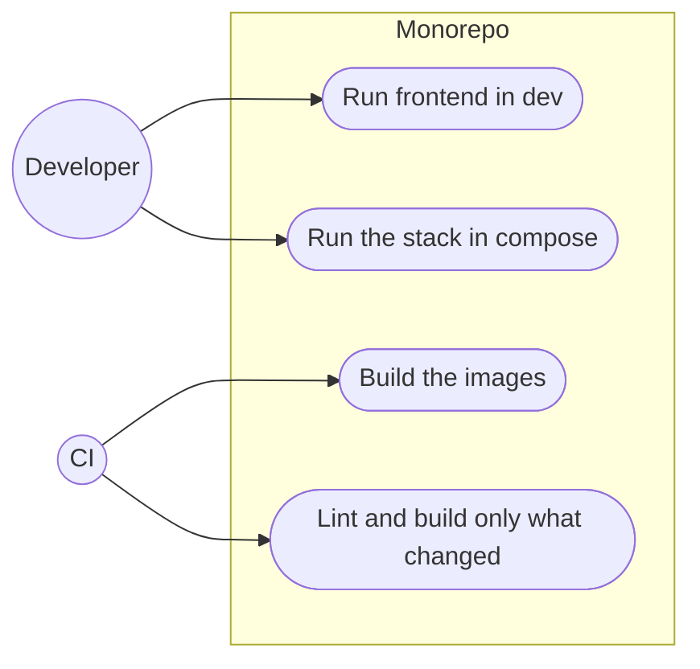

# Monorepo restructure

**Status:** Done 2026-11-03 on branch `develop`, not merged into `main`
**Plan:** [2026-11-03-monorepo-and-backend](../../plans/2026-11-03-monorepo-and-backend.md), phase 1
**ADRs:** [0001](../../decisions/0001-monorepo-layout-and-tooling.md), [0011](../../decisions/0011-controller-stubs-from-buf-registry.md), [0014](../../decisions/0014-postgresql-in-repo-bundled-or-external.md)

Moves the single Vite app into `apps/frontend`, makes the root an npm
workspace, puts deployment files under `deployments/`, and adds CI. No
behaviour change. The backend joins in phase 2.

| File | Purpose |
| --- | --- |
| [README.md](README.md) | Design, decisions, what was verified |
| [CHANGELOG.md](CHANGELOG.md) | Dated log of every change made for this feature |

---

## Decisions

| Decision | Why | Recorded in |
| --- | --- | --- |
| `apps/` + `packages/` + `deployments/`, npm and uv workspaces, no Nx/Turborepo | Native tools per language; one JS and one Python app | [ADR 0001](../../decisions/0001-monorepo-layout-and-tooling.md) |
| `git mv`, not copy | Keeps `git log --follow` history for every file | this file |
| One `package-lock.json` at the root for the workspace | npm workspaces keep a single lock; resolved versions unchanged by the move (checked) | this file |
| Docker build context is the repo root, with a root `.dockerignore` | The image needs the root lock file; the `.dockerignore` keeps `output_folder/` (1.7 GB), docs and Git out, so the context is 13 MB. Planned as a per-app context; changed while building because of the lock file | this file |
| nginx config in `deployments/nginx/`, copied into the frontend image | nginx will also front the backend, so it is a deployment concern, not a frontend one | this file |
| `buf.gen.yaml` and `proto/` move with the frontend | Only the frontend uses these TypeScript stubs, until phase 10; Python stubs get their own `packages/proto` in phase 2 | [ADR 0011](../../decisions/0011-controller-stubs-from-buf-registry.md) |
| `.env.example` split: `deployments/.env.example` (compose) and `apps/frontend/.env.example` (Vite) | Compose reads `.env` next to the compose file; Vite reads it from the app folder | this file |
| Compose project name pinned to `surimi-modelgui` | Otherwise compose names it after the folder (`deployments`) and every container and network is renamed | this file |
| Root scripts keep their names (`dev`, `build`, `lint`, `docker:up`, …) and delegate, passing extra arguments through (`npm run dev -- --port 5199`) | Nobody's commands break | this file |
| CI: build, lint (report only), image build; path-filtered | Lint already fails on `main` (20 errors); a blocking step would stop every PR until they are fixed | this file, [ISSUES.md](../../ISSUES.md) |
| `output_folder/` git-ignored | One `git add .` would have committed 1.7 GB | this file |
| Root `pyproject.toml` (uv workspace) waits for phase 2 | No Python code yet; an empty workspace would only confuse | this file |

---

## Use cases



---

## Before

Single app at the root: `src/`, `public/`, `index.html`, `vite.config.ts`,
`tsconfig*.json`, `eslint.config.js`, `package.json`, `Dockerfile`,
`compose.yml`, `envoy/`, `nginx/`, `buf.gen.yaml`, `proto/`, `.env.example`.
`output_folder/` untracked and not ignored. **Read from source**, 2026-11-03.

---

## Layout after the move

```
.
├── apps/
│   └── frontend/            src/, public/, proto/, index.html, vite and ts configs,
│                            eslint.config.js, buf.gen.yaml, package.json
│                            (@surimi/frontend), Dockerfile, .env.example
├── deployments/
│   ├── compose.yml          project surimi-modelgui: web, grpc-proxy (profile)
│   ├── nginx/               default.conf.template
│   ├── envoy/               until phase 10
│   └── .env.example
├── resources/bruno/surimi-modelgui/
├── docs/
├── .github/workflows/ci.yml
├── .claude/
├── .dockerignore            root context for image builds
├── CLAUDE.md, README.md
├── package.json             workspaces ["apps/frontend"], delegating scripts
├── package-lock.json        the one lock file of the workspace
└── .nvmrc
```

Phase 2 adds `apps/backend/`, `packages/proto/`, `pyproject.toml`, and
`postgres`, `migrate`, `api` services in `deployments/compose.yml`.

---

## Where the changes are

| Area | File | Change |
| --- | --- | --- |
| Frontend | `src/`, `public/`, `proto/`, `index.html`, `vite.config.ts`, `tsconfig*.json`, `eslint.config.js`, `buf.gen.yaml`, `package.json`, `Dockerfile` | `git mv` to `apps/frontend/` |
| Frontend | `apps/frontend/package.json` | Name `@surimi/frontend`; `docker:*` scripts moved to the root |
| Frontend | `apps/frontend/Dockerfile` | Root build context; `npm ci` for the workspace; nginx template from `deployments/nginx/` |
| Frontend | `apps/frontend/.env.example` | New: Vite settings for `npm run dev` |
| Root | `package.json` | New: workspace and delegating scripts |
| Root | `package-lock.json` | Regenerated for the workspace; same 347 package versions plus the workspace link |
| Root | `.dockerignore` | Rewritten for the root context |
| Root | `.gitignore` | `output_folder/` |
| Deploy | `compose.yml`, `nginx/`, `envoy/`, `.env.example` | `git mv` to `deployments/`; build context `..`; project name pinned; `.env.example` reduced to compose settings |
| Editor | `.vscode/launch.json` | Runs `npm run dev` from the root; the `envFile` is gone because Vite reads `apps/frontend/.env` itself |
| CI | `.github/workflows/ci.yml` | New |
| Docs | `README.md`, `CLAUDE.md`, docs paths | New paths |

---

## How to test

1. `npm install` at the root, then `npm run dev`: Vite starts.
2. `npm run build` passes; `npm run lint` shows the same 25 problems as `main`.
3. `docker compose -f deployments/compose.yml up --build -d`: the app on
   <http://localhost:18080>, container `surimi-modelgui-web-1`.
4. With `CONTROLLER_GRPC_URL` set: `docker compose -f deployments/compose.yml
   --profile grpc-proxy up -d`, then the runs page loads data.
5. `git log --follow apps/frontend/src/App.tsx` shows the old history.

---

## What has been verified

2026-11-03 (**Verified**):

- Before the move, on `main`: `npm ci`, `npm run build` passes; `npm run lint`
  25 problems (20 errors, 5 warnings) in 12 files.
- After the move: lock file versions identical (347 packages, plus the
  workspace link); `npm run build` passes and produces the **same bundle as
  before the move** (`index-uRmFF6dl.js`, Vite names it by content hash); a
  `MOCK=true` build produces a different bundle, so the flag still works; lint
  shows the same problems, none new, none gone.
- `npm run dev -- --port 5199` from the root: Vite starts on that port and
  serves `/` and `/src/main.tsx`. The first version of the root scripts
  dropped the extra arguments; fixed by ending each delegating script with
  `--`.
- Image built through `deployments/compose.yml` from a 13 MB context; the
  container serves `/`, `/scenario-runs`, `/scenario/anchovy_bay` (client
  routes) and `/favicon.ico` with 200; container name `surimi-modelgui-web-1`
  as before.
- With the `grpc-proxy` profile, Envoy starts from `deployments/envoy/` and
  forwards to the controller; the reply was the same `404` that a direct call
  to the controller gives, because **both EDITO controllers (`rikkert` and
  `project-surimi`) answered 404 to every gRPC call on 2026-11-03**. A
  successful call end to end could not be checked.
- `.github/workflows/ci.yml` passes `actionlint`; it has not run on GitHub
  yet.
- Git records 260 files as renames.

Not checked: the app clicked through in a browser; `npm run proto:pull` (the
controllers were not answering).
