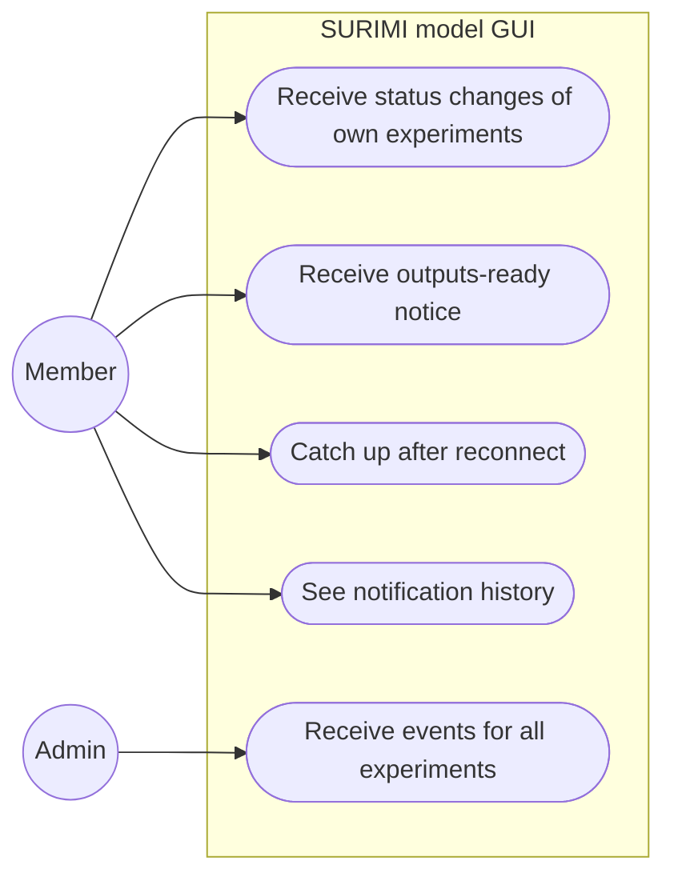
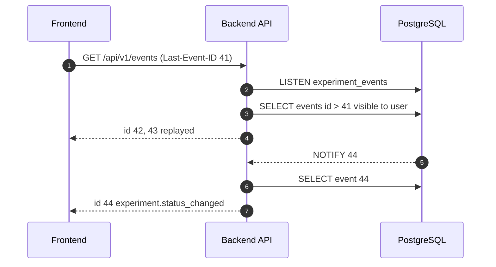

# Notifications

**Status:** Planned
**Plan:** [2026-11-03-monorepo-and-backend](../../plans/2026-11-03-monorepo-and-backend.md), phase 5
**ADRs:** [0008](../../decisions/0008-notifications-sse.md)

The browser is told when an experiment changes state or its outputs are ready,
without refreshing, and catches up on what it missed while disconnected.

---

## Decisions

| Decision | Why | Recorded in |
| --- | --- | --- |
| Server-Sent Events, not WebSocket | Traffic is one-way; `EventSource` reconnects and replays by itself; no Upgrade handling in proxies | [ADR 0008](../../decisions/0008-notifications-sse.md) |
| Worker → API through `LISTEN/NOTIFY`, sending only the event id | No extra broker; `NOTIFY` payloads are capped at 8000 bytes | [ADR 0008](../../decisions/0008-notifications-sse.md) |
| Events are rows in `experiment_events`; SSE `id` = row id | Replay after reconnect and history for free | [ADR 0008](../../decisions/0008-notifications-sse.md) |
| Replay at most 500 events or 24 h | A tab closed for a week reloads data instead of replaying | this file |
| Heartbeat every 20 s | Proxies close idle connections | this file |
| Fall back to refetching every 30 s after three failed reconnects | Works behind proxies that break SSE | this file |
| Admins receive every experiment's events; `?scope=mine` to narrow | Admins manage all runs | this file |

---

## Use cases

---

## Target behaviour

- `GET /api/v1/events`, `text/event-stream`, cookie auth. Why SSE and not
  WebSocket: ADR 0008.
- Event types: `experiment.submitted`, `experiment.status_changed`,
  `experiment.stalled`, `experiment.cancelled`, `experiment.outputs_ready`,
  `experiment.outputs_failed`.
- Payload: `{experiment_id, name, status, previous_status, at}`. Each SSE `id`
  is the `experiment_events.id`.
- Filter: owner only; admins get all, or only theirs with `?scope=mine`.
- Replay: on `Last-Event-ID`, send newer events (max 500, max 24 h).
- Heartbeat comment every 20 s.
- Frontend: one `EventSource` in a provider; on each event invalidate
  `['experiments']` and `['experiment', id]` queries and show a Mantine
  notification. If the stream fails three times, fall back to refetching every
  30 s.

---

## API

| Method | Path | Role | Request | Response |
| --- | --- | --- | --- | --- |
| GET | `/api/v1/events` | any | `Last-Event-ID` header, `?scope=mine` | `text/event-stream` |
| GET | `/api/v1/experiments/{id}/events` | owner, admin | `?page` | page of events |

---

## Where the changes are

Rows marked *Frontend (phase 10)* describe what the frontend will need.
They are built only in phase 10, the last phase, if the user agrees then
(user, 2026-11-03).

| Area | File | Change |
| --- | --- | --- |
| Backend | `src/surimi_backend/notifications/` | `broker.py` (one LISTEN connection, fan-out with per-client queues), `router.py` |
| Frontend (phase 10) | `apps/frontend/src/features/notifications/` | `EventsProvider`, toast mapping |
| Deploy | `deployments/nginx/default.conf.template` | `location /api/v1/events` with `proxy_buffering off`, `proxy_read_timeout 1h` |

---

## Open questions

- E-mail when a long run finishes? Needs SMTP (User).
