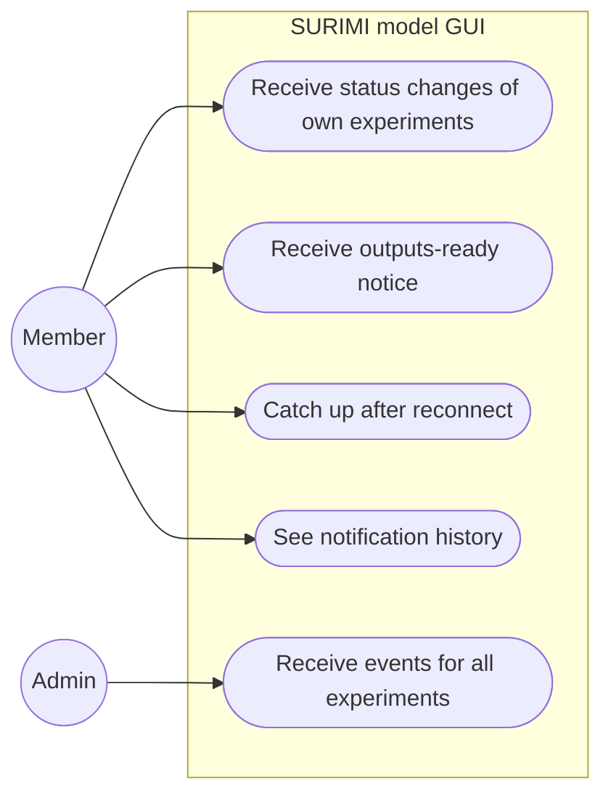
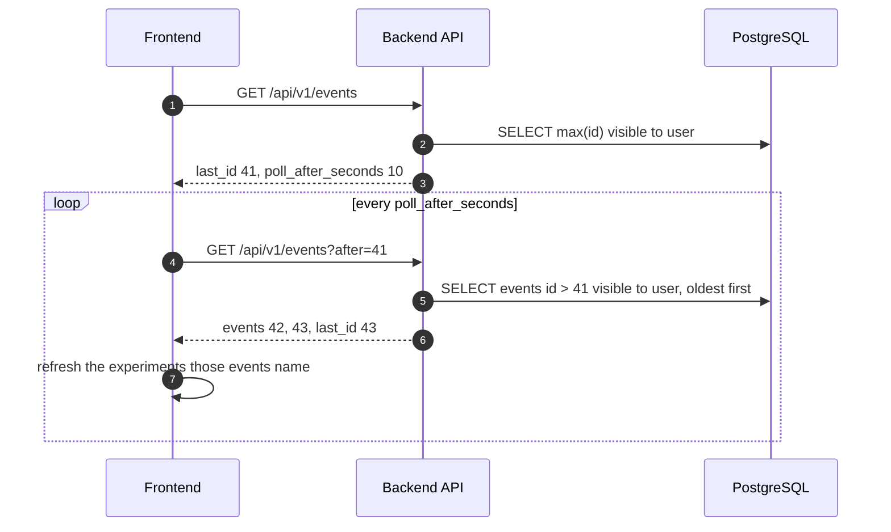

# Notifications

**Status:** Built 2026-11-06 as SSE; polling since 2026-11-12 (backend) on `develop`, not merged into `main`. Frontend in phase 10
**Changes:** [CHANGELOG.md](CHANGELOG.md)
**Plan:** [2026-11-03-monorepo-and-backend](../../plans/2026-11-03-monorepo-and-backend.md), phase 5
**ADRs:** [0021](../../decisions/0021-notifications-by-polling.md) (supersedes [0008](../../decisions/0008-notifications-sse.md))

The browser learns when an experiment changes state or its results are ready
by polling a cursor, and catches up on what it missed while the tab slept.

---

## Decisions

| Decision | Why | Recorded in |
| --- | --- | --- |
| Clients poll `GET /api/v1/events?after=<id>`; no SSE stream, no WebSocket | Statuses come from the worker's 10 s poll of the controller, so SSE saves nothing noticeable; no long-lived connections through nginx and the EDITO ingress; no `LISTEN` per API process. The user asked for it, 2026-11-12 | [ADR 0021](../../decisions/0021-notifications-by-polling.md) |
| Events are rows in `experiment_events`; the cursor is the row id | Nothing missed between polls, history for free | [ADR 0021](../../decisions/0021-notifications-by-polling.md) |
| Without `after`, only the cursor is returned, no old events | A page loads the current state from the experiment endpoints; events only signal what changes after | this file |
| `poll_after_seconds` = `POLL_INTERVAL_SECONDS` in every answer | Clients never poll faster than statuses can change; one setting to tune | this file |
| At most `limit` events (default 100, max 500) per answer, `has_more` to continue | A tab back after a long sleep catches up in a few requests | this file |
| Admins receive every experiment's events; `?scope=mine` to narrow | Admins manage all runs | this file |

---

## Use cases

---

## Target behaviour

- `GET /api/v1/events`, JSON, session cookie or bearer token like every
  endpoint. Why polling and not SSE: ADR 0021.
- Answer: `{events, last_id, has_more, poll_after_seconds}`. Each event is
  `{id, type, data, at}` with `data` = `{experiment_id, name, scenario_name,
  status, previous_status, at, ...}`.
- Event types: `experiment.queued`, `experiment.submitted`,
  `experiment.status_changed` (also `copying_results` → `completed` or
  `failed` when the results arrive or do not), `experiment.stalled`,
  `experiment.cancelled`, and for a re-index of results that were already
  there `experiment.outputs_ready` / `experiment.outputs_failed`.
- `experiment.initial_hcr_unavailable` (2026-11-23): the controller did not
  answer `GetInitialHCRData` at submit, so the experiment has no snapshot of
  it (ADR 0028); `data.error` says why. The experiment is queued as usual.
- `simulation.status_changed`: one simulation of the experiment changed state
  (or was first reported). `data.simulation` = `{id, order, status,
  status_raw, previous_status}`; `data.status` is the experiment's status;
  `data.simulations` the experiment's counts per state, for example
  `{"initialising": 3, "initialised": 2}`. An MSE run writes about 20 of them
  (5 simulations: first report, initialised, running, finished).
- Without `after`: `events` is empty and `last_id` is the newest id the caller
  may see (0 when none). With `after`: events with a larger id, oldest first.
- Filter: owner only; admins get all, or only theirs with `?scope=mine`.
- Events are hints: the experiment endpoints hold the state.
- Frontend (phase 10): one TanStack Query with `refetchInterval =
  poll_after_seconds` that keeps `last_id`; on each event invalidate
  `['experiments']` and `['experiment', id]` and show a Mantine notification.

---

## API

| Method | Path | Role | Request | Response |
| --- | --- | --- | --- | --- |
| GET | `/api/v1/events` | any | `?after`, `?scope=mine`, `?limit` (1 to 500, default 100) | `{events, last_id, has_more, poll_after_seconds}` |
| GET | `/api/v1/experiments/{id}/events` | owner, admin | `?page` | page of events |

---

## Where the changes are

Rows marked *Frontend (phase 10)* describe what the frontend will need.
They are built only in phase 10, the last phase, if the user agrees then
(user, 2026-11-03).

| Area | File | Change |
| --- | --- | --- |
| Backend | `src/surimi_backend/notifications/router.py` | The polling endpoint |
| Backend | `src/surimi_backend/experiments/events.py` | Writes the event row (no `NOTIFY` since 2026-11-12) |
| Frontend (phase 10) | `apps/frontend/src/features/notifications/` | Polling query, toast mapping |

---

## Open questions

- E-mail when a long run finishes? Needs SMTP (User).
