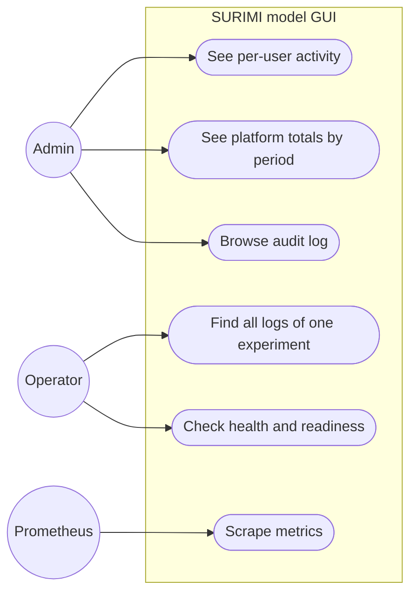

# Observability and user activity

**Status:** Planned
**Plan:** [2026-11-03-monorepo-and-backend](../../plans/2026-11-03-monorepo-and-backend.md), phase 7 (logging from phase 2)
**ADRs:** [0010](../../decisions/0010-observability-and-activity-tracking.md)

Operators can see how the system behaves (logs, metrics, traces, health), and
admins can see how it is used: per user, how often they sign in, when they last
did, and how many experiments they submitted, completed, failed and cancelled.

---

## Decisions

| Decision | Why | Recorded in |
| --- | --- | --- |
| Per-user activity in database tables, not in metrics | Exact numbers per user and any date range; per-user labels would explode Prometheus | [ADR 0010](../../decisions/0010-observability-and-activity-tracking.md) |
| structlog JSON logs with request, user, experiment and trace ids | One search finds every line about a run across API and worker | [ADR 0010](../../decisions/0010-observability-and-activity-tracking.md) |
| Prometheus metrics, OpenTelemetry traces (export only when configured) | Vendor-neutral; works with whatever EDITO or Konnecta provides | [ADR 0010](../../decisions/0010-observability-and-activity-tracking.md) |
| Controller health reported in `/readyz`, not failing it | A controller outage must not take our UI down | [ADR 0010](../../decisions/0010-observability-and-activity-tracking.md) |
| Logs 30 days, sign-in rows 13 months then monthly roll-up, IPs 90 days, audit 24 months | Enough for debugging and statistics; GDPR storage limitation | [ADR 0013](../../decisions/0013-data-retention.md) |
| Never store passwords, tokens, or the typed login of a failed attempt on an unknown user | Data minimisation; people type passwords into the username field | [ADR 0013](../../decisions/0013-data-retention.md) |

---

## Use cases

---

## Target behaviour

### Activity statistics (database)

Per user, for a period (`?from&to`, default all time):

| Field | Source |
| --- | --- |
| `login_count`, `failed_login_count` | `login_events` |
| `last_login_at`, `last_login_method` | `users`, `login_events` |
| `experiments_submitted` | `experiments.submitted_at` in period |
| `experiments_finished`, `_failed`, `_cancelled`, `_active` | `experiments.status` with `finished_at` in period |
| `total_simulated_months` | sum of experiment spans |
| `mean_run_duration` | `finished_at − submitted_at` of finished runs |

Platform totals: same counts overall, by scenario, and by week. Why SQL and not
metrics: exact numbers per user need the users table and any date range;
Prometheus labels per user would explode in cardinality (ADR 0010).

### Logs

structlog JSON to stdout. Bound context: `request_id` (from
`X-Request-ID` or generated, returned in the response), `user_id`,
`experiment_id`, `trace_id`. Event names are dotted (`experiment.submitted`).
Sensitive fields are dropped by a processor (`password`, `token`, `cookie`,
`authorization`).

### Metrics

Listed in ADR 0010. Exposed on `/metrics` of API and worker, not routed through
nginx publicly.

### Traces

OpenTelemetry, OTLP when configured. A submit trace spans HTTP request → SQL →
`SubmitExperiment` gRPC call.

### Retention

Daily worker task `purge_retention` applies [ADR 0013](../../decisions/0013-data-retention.md):
rolls `login_events` older than 13 months into `login_stats_monthly` and
deletes them, nulls `ip` after `RETENTION_LOGIN_IP_DAYS` and `user_agent`
after `RETENTION_LOGIN_USER_AGENT_DAYS` (90 days each by default), deletes
`audit_events` after 24 months and expired sessions after 30 days, purges
soft-deleted experiments after 12 months. Each run logs how many rows it
touched (`retention.purged`). Statistics older than 13 months come from the
roll-up at month granularity. Application log retention (30 days) is set on
the log platform and, locally, by compose `logging` options.

### Audit log

`audit_events` for: user created, role changed, user deactivated, password
reset, experiment cancelled or deleted by someone other than its owner, outputs
re-indexed, experiment adopted, outputs downloaded (by anyone).

---

## API

| Method | Path | Role | Response |
| --- | --- | --- | --- |
| GET | `/api/v1/admin/stats` | admin | platform totals, `?from&to&scenario` |
| GET | `/api/v1/admin/stats/users` | admin | per-user rows, `?from&to&q&sort&page` |
| GET | `/api/v1/admin/users/{id}/activity` | admin | stats + recent logins + recent experiments |
| GET | `/api/v1/admin/audit-events` | admin | `?actor_id&action&target_id&from&to&page` |
| GET | `/healthz` | public | `{status: ok}` |
| GET | `/readyz` | public | database and controller checks |
| GET | `/metrics` | internal | Prometheus text |

---

## Where the changes are

Rows marked *Frontend (phase 10)* describe what the frontend will need.
They are built only in phase 10, the last phase, if the user agrees then
(user, 2026-11-03).

| Area | File | Change |
| --- | --- | --- |
| Backend | `src/surimi_backend/core/logging.py` | structlog config, request-id middleware |
| Backend | `src/surimi_backend/observability/` | `metrics.py`, `tracing.py`, `audit.py`, `stats/` (repository, router) |
| Frontend (phase 10) | `apps/frontend/src/features/admin/activity/` | activity table, user detail drawer, totals cards |
| Deploy | `deployments/observability/` | Prometheus config, Grafana provisioning and starter dashboard, compose profile |

---

## Open questions

- Is there a Prometheus, Grafana or log store on EDITO we should send to?
  (EDITO)
- Retention of `login_events` and `audit_events` (User; proposal 12 months).
