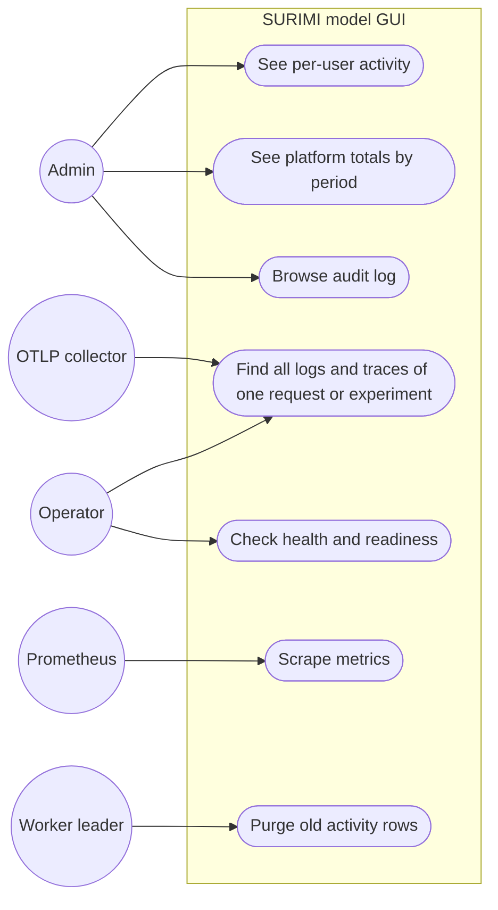
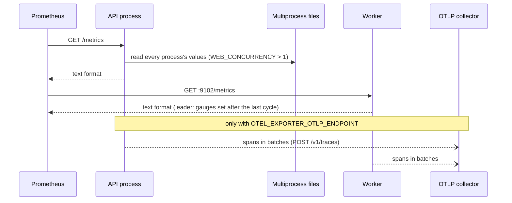
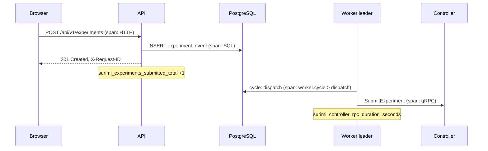

# Observability and user activity

**Status:** Built 2026-11-17 (backend, API, compose profile) on `develop`, not merged into `main`; frontend pages phase 10
**Plan:** [2026-11-03-monorepo-and-backend](../../plans/2026-11-03-monorepo-and-backend.md), phase 7 (logging from phase 2)
**ADRs:** [0010](../../decisions/0010-observability-and-activity-tracking.md), [0013](../../decisions/0013-data-retention.md), [0019](../../decisions/0019-worker-row-driven-with-advisory-lock.md)

Operators can see how the system behaves (logs, metrics, traces, health), and
admins can see how it is used: per user, how often they sign in, when they last
did, and how many experiments they submitted, completed, failed and cancelled.
Old activity rows are rolled up or deleted on the schedule of ADR 0013.

| File | Purpose |
| --- | --- |
| [README.md](README.md) | Use cases, design, decisions, open questions |
| [CHANGELOG.md](CHANGELOG.md) | Dated log of every change made for this feature |

---

## Decisions

| Decision | Why | Recorded in |
| --- | --- | --- |
| Per-user activity in database tables, not in metrics | Exact numbers per user and any date range; per-user labels would explode Prometheus | [ADR 0010](../../decisions/0010-observability-and-activity-tracking.md) |
| structlog JSON logs with request, user, experiment and trace ids | One search finds every line about a run across API and worker | [ADR 0010](../../decisions/0010-observability-and-activity-tracking.md) |
| Prometheus metrics with `prometheus-client`, on `/metrics` of the API and on a port of the worker | Vendor-neutral, the format every scraper reads | [ADR 0010](../../decisions/0010-observability-and-activity-tracking.md) |
| `/metrics` on by default, off with `METRICS_ENABLED=false` | Costs nearly nothing; some deployments want no metrics endpoint at all | this file |
| Optional bearer token `METRICS_TOKEN` on `/metrics` of the API and the worker (user, 2026-11-17) | The API port may be reachable from outside; Prometheus sends a bearer token natively. Not an IP allowlist (fragile behind proxies) or the user sign-in (a scraper has no session) | this file |
| HTTP metrics recorded by our existing request middleware, not `prometheus-fastapi-instrumentator` | The middleware already has the route template and the duration; no second timing layer, no extra dependency | this file |
| Several API processes (`WEB_CONCURRENCY` > 1) share metrics through `prometheus-client`'s multiprocess mode | Each scrape reaches one process; without it the numbers jump between processes | this file |
| No gauges in the API; gauges (experiments by state, pods in use, stalled) are set by the worker leader | Multiprocess mode handles counters and histograms cleanly; one leader knows the current state | this file |
| OpenTelemetry traces over OTLP/HTTP, on only when `OTEL_EXPORTER_OTLP_ENDPOINT` is set | Vendor-neutral; nothing runs or is sent when no collector exists | [ADR 0010](../../decisions/0010-observability-and-activity-tracking.md) |
| Tracing packages always installed, switched by env, not an optional extra | One image for every deployment; the cost is a few MB | this file |
| Controller health reported in `/readyz`, not failing it | A controller outage must not take our UI down | [ADR 0010](../../decisions/0010-observability-and-activity-tracking.md) |
| Admin statistics computed by SQL at request time, no summary tables | About 100 users and 110,000 sign-ins a year: the indexed queries take under 1 ms ([database/README](../../database/README.md)) | this file |
| Sign-in counts add the monthly roll-up to the raw rows | Rows older than 13 months exist only in `login_stats_monthly`; a row is in one or the other, never both | this file |
| Retention purge is a daily step of the worker leader, not a Kubernetes CronJob | The worker already runs one leader with a database connection; a CronJob is one more thing to deploy and lock | [ADR 0019](../../decisions/0019-worker-row-driven-with-advisory-lock.md), this file |
| Logs 30 days, sign-in rows 13 months then monthly roll-up, IPs 90 days, audit 24 months | Enough for debugging and statistics; GDPR storage limitation | [ADR 0013](../../decisions/0013-data-retention.md) |
| Never store passwords, tokens, or the typed login of a failed attempt on an unknown user | Data minimisation; people type passwords into the username field | [ADR 0013](../../decisions/0013-data-retention.md) |
| Local Prometheus, Grafana and Jaeger in the compose profile `observability` | Lets us check metrics, the starter dashboard and traces locally; nobody runs them by accident | this file |

---

## Use cases



| Use case | Actor | Pre-conditions | Main flow | Failure cases |
| --- | --- | --- | --- | --- |
| See per-user activity | Admin | Signed in as admin | `GET /api/v1/admin/stats/users?from&to` lists every user with sign-ins, last sign-in and experiment counts; `GET /admin/users/{id}/activity` adds the recent sign-ins and experiments of one user | 401, 403 for a member, 404 unknown user, 422 `from` after `to` |
| See platform totals | Admin | Signed in as admin | `GET /api/v1/admin/stats` returns users, sign-ins and experiments for the period, by scenario and by week | 401, 403, 422 |
| Browse audit log | Admin | Signed in as admin | `GET /api/v1/admin/audit-events` filtered by actor, action, target and period, newest first | 401, 403, 422 |
| Find logs and traces | Operator | Logs collected; tracing on | Search the logs by `request_id` or `experiment_id`; with tracing on, `trace_id` in the log line opens the trace | Tracing off: logs only |
| Scrape metrics | Prometheus | `METRICS_ENABLED=true` | `GET /metrics` on the API port, `GET :WORKER_METRICS_PORT/metrics` on the worker, with `Bearer <METRICS_TOKEN>` when it is set | Disabled: 404 on the API, no worker port; token set and missing or wrong: 401 |
| Check health | Operator, Kubernetes | — | `/healthz`, `/readyz` (built in phase 2) | Database down: 503 |
| Purge old rows | Worker leader | Leading | Once a day: roll up, null and delete rows past their retention | A failed step is logged and repeated next day; the next steps still run |

---

## Current state

- **Logs.** Built in phase 2: [core/logging.py](../../../apps/backend/src/surimi_backend/core/logging.py)
  writes JSON lines with `request_id` bound per request, returns `X-Request-ID`,
  drops sensitive keys, and logs one `http.request` line per request with the
  route template. **Read from source** 2026-11-17.
- **Health.** `/healthz` and `/readyz` in [api/health.py](../../../apps/backend/src/surimi_backend/api/health.py),
  phase 2. **Read from source**.
- **Activity rows.** `login_events` (every attempt), `users.last_login_at` and
  `login_count`, `login_stats_monthly` (empty, nothing rolls up yet),
  `audit_events`, `experiment_events`; written since phases 3 to 5. The audit
  actions written today: `user.created`, `user.password_changed`,
  `profile.synced`, `access.removed`, `role.synced`, `queue.priority_changed`,
  `queue.paused`, `queue.resumed`, `experiment.adopted`, the experiment
  cancel and delete by an admin, `outputs.downloaded`, `outputs.reindex`,
  `species.imported`. **Read from source** 2026-11-17.
- **Built 2026-11-17:** metrics, traces, the statistics and audit endpoints,
  the retention purge (listed in phase 5, never built until now) and the
  observability compose profile. See [CHANGELOG.md](CHANGELOG.md) and
  "What has been verified" below.

---

## Target behaviour

### Metrics

`prometheus-client`, text format. Names follow the Prometheus conventions
(`_total` counters, `_seconds` histograms). No user ids, experiment ids or raw
paths as labels: every label has a small fixed set of values.

| Metric | Type | Labels | Where | When |
| --- | --- | --- | --- | --- |
| `surimi_http_requests_total` | counter | `method`, `route`, `status` | API | Every request; `route` is the template (`/api/v1/experiments/{experiment_id}`), `unmatched` for a path with no route |
| `surimi_http_request_duration_seconds` | histogram | `method`, `route` | API | Every request |
| `surimi_logins_total` | counter | `method`, `result` | API | Every row written to `login_events` |
| `surimi_experiments_submitted_total` | counter | `scenario` | API | An experiment enters the queue |
| `surimi_experiments_ended_total` | counter | `scenario`, `status` | API, worker | An experiment reaches a final state (`completed`, `failed`, `cancelled`, `submit_failed`) |
| `surimi_controller_rpc_duration_seconds` | histogram | `rpc`, `code` | API, worker | Every controller call attempt; `code` is the gRPC status name (`OK`, `UNAVAILABLE`, …) |
| `surimi_worker_leader` | gauge | — | worker | 1 while this worker holds the leader lock |
| `surimi_worker_cycle_duration_seconds` | histogram | — | worker | Every cycle (poll, dispatch, index) |
| `surimi_worker_step_failures_total` | counter | `step` | worker | A cycle step raised |
| `surimi_experiments_active` | gauge | `status` | worker leader | After each cycle: experiments in `queued` and every in-flight state, and `copying_results` |
| `surimi_experiments_stalled` | gauge | — | worker leader | After each cycle |
| `surimi_ecopath_pods_in_use` | gauge | — | worker leader | After each cycle: pods held by in-flight experiments, by our count (ADR 0015) |
| `surimi_retention_rows_total` | counter | `table`, `action` | worker leader | Rows rolled up, nulled or deleted by the purge |

These names change ADR 0010's first list, which was written before the code:
`surimi_experiments_completed_total` became `_ended_total`, because
`completed` is also one of the statuses it counts; `surimi_controller_rpc_seconds`
and `surimi_poll_duration_seconds` took the `_duration_seconds` suffix;
`surimi_active_experiments` became `surimi_experiments_active{status}`.

Counters move when the change is made, before its transaction commits; a
rolled-back change still counts. They are for rates and alerts. Exact
numbers come from the statistics endpoints.

**Where `/metrics` is.** On the API it is `GET /metrics` on the API port,
outside `/api/v1/`: nginx forwards only `/api/v1/`, so it is not public
through the web container, and the phase 9 ingress will do the same. Rejected:
a second port for the API, because several uvicorn processes cannot share
one extra port. The worker has no HTTP server, so it serves `/metrics` on
`WORKER_METRICS_PORT` (9102) from a small WSGI server in a thread (the
standard library's, around `prometheus-client`'s app, so the token check
below applies). Every worker replica serves metrics. The standby ones report
`surimi_worker_leader 0` and 0 for the activity gauges, so dashboards take the
`max` over workers. A worker that stops leading sets its gauges back to 0.

**Token.** Whoever reaches the API port directly (published locally on
127.0.0.1 only; on a cluster, anything that can reach the pod or a Service
exposing it) can read `/metrics` unless `METRICS_TOKEN` is set. With it (at
least 32 characters), the API and the worker answer `/metrics` only for
`Authorization: Bearer <token>`, compared in constant time, and `401`
`not_authenticated` with `WWW-Authenticate: Bearer` otherwise. Prometheus
sends it with `authorization: {type: Bearer, credentials_file: ...}`; the
compose profile writes `METRICS_TOKEN` to that file at start. The worker's
port is served by our own small WSGI server around `prometheus-client`'s app,
because its built-in server has no hook for a token check. The metrics hold
no personal data (no user or experiment ids), but they show traffic and
usage, so the token is the setting for any deployment where the API port is
reachable from outside. **Verified** 2026-11-17 in compose: without the
header, or with a wrong token, the API and the worker answer `401`; with it
`200`, and Prometheus scrapes both, with the token and with none set.

**Several API processes.** With `WEB_CONCURRENCY` > 1, `surimi-backend serve`
turns on `prometheus-client`'s multiprocess mode: each process writes its
values to files in `PROMETHEUS_MULTIPROC_DIR`, and `/metrics` in any process
sums them. If that variable is unset, `serve` creates a fresh temporary folder. It
also empties a given folder at start, because values left by an earlier run
would be added in. Multiprocess mode has no process and platform collectors
(memory, CPU of the process), and gauges need special care; so the API has no
gauges, and process metrics come from the container platform. With one
process, the usual registry is used, with the process collector.

### Traces

On when `OTEL_EXPORTER_OTLP_ENDPOINT` is set (for example
`http://jaeger:4318`); otherwise no tracer provider is installed, and the
instrumentations are never loaded. When on:

- Exporter: OTLP over HTTP/protobuf, batched. Rejected: OTLP/gRPC, a second
  exporter to maintain for no gain; every collector accepts HTTP.
- Instrumented: FastAPI (incoming requests, except `/healthz`, `/readyz` and
  `/metrics`), SQLAlchemy (each statement), the grpc aio client (each
  controller call), httpx (OIDC calls). The worker opens a span per cycle, one
  per step and one for the retention purge, so the SQL and controller calls of
  a cycle hang under it.
- The SQLAlchemy instrumentation (0.66b2, the newest) declares SQLAlchemy
  < 2.1 and does nothing on our 2.1.6 unless its version check is skipped
  (`skip_dep_check=True`). It only hooks engine events, which 2.1 keeps;
  `tests/test_tracing.py` checks that SQL spans appear under their caller.
  Tracked in [ISSUES.md](../../ISSUES.md) until the package declares 2.1.
  Rejected: pinning SQLAlchemy below 2.1 for a tracing extra.
- `service.name` is `surimi-api` or `surimi-worker` unless `OTEL_SERVICE_NAME`
  says otherwise. Sampling, headers and resource attributes follow the
  standard `OTEL_*` variables, which the SDK reads itself
  (`OTEL_TRACES_SAMPLER=parentbased_traceidratio`, `OTEL_TRACES_SAMPLER_ARG=0.1`).
- Every log line written inside a span carries `trace_id` and `span_id`, so a
  log line leads to its trace.
- Traces carry no request bodies or SQL parameters, only statement text with
  placeholders (the SQLAlchemy instrumentation's default).

### Activity statistics (database)

A period is `from` (inclusive) and `to` (exclusive), both timestamps with a
time zone. Each is optional: no `from` means since the start, no `to` means now.

Per user:

| Field | Source |
| --- | --- |
| `sign_ins`, `failed_sign_ins` | `login_events` in the period (success; any other result), plus `login_stats_monthly` months inside the period |
| `last_login_at`, `last_login_method` | `users.last_login_at`; the method of the latest successful `login_events` row |
| `experiments_submitted` | `experiments.queued_at` in the period |
| `experiments_completed`, `_failed`, `_cancelled` | `status` and `finished_at` in the period; `failed` includes `submit_failed` |
| `experiments_active` | not in a final state now, whatever the period |
| `mean_run_seconds` | mean of `finished_at − submitted_at` for completed runs in the period |

Soft-deleted experiments still count: they record what the user did.
`total_simulated_months`, in the first design, is left out: it would have to be
read from each stored request, and nothing asks for it.

Platform totals: users (total, active, admins, members, SSO, local), the
same sign-in and experiment counts over all users, `active_users` (users with
at least one successful sign-in in the period), the experiment counts by
scenario, and by ISO week (`week` = Monday 00:00 UTC) for experiments
submitted and successful sign-ins. Weeks come from the raw rows only. Older
sign-ins exist only as months and appear in the totals, not in the weekly
series.

The roll-up keeps sign-ins of known users only: a failed attempt that
matched no user has no `user_id` and is not in `login_stats_monthly`, so it is
not counted in totals after 13 months.

### Audit log

`GET /api/v1/admin/audit-events` lists `audit_events` newest first, with the
actor's username (`null` for the system, or a purged user). Filters `actor_id`,
`action`, `target_type`, `target_id`, `from`, `to`, each served by an index
([database/README](../../database/README.md)). The actions are the ones
written today (see Current state). New actions are added by the features
that perform them, not here.

### Retention

The worker leader runs `purge_retention` at its first cycle as leader and then
every `RETENTION_PURGE_INTERVAL_HOURS` (24). It keeps the time of the last
run in memory. A new leader runs it again at once, which is harmless: every
step is idempotent. Each step commits on its own, so a failed step does not
undo the others:

| Step | What | Setting (default) |
| --- | --- | --- |
| Roll up sign-ins | Add `login_events` rows older than the limit with a `user_id` to `login_stats_monthly` (user, month in UTC, method: successes, failures), then delete every row older than the limit | `RETENTION_LOGIN_EVENTS_DAYS` (395) |
| Null IPs | `ip = NULL` on rows older than the limit | `RETENTION_LOGIN_IP_DAYS` (90) |
| Null user agents | `user_agent = NULL` on rows older than the limit | `RETENTION_LOGIN_USER_AGENT_DAYS` (90) |
| Delete audit events | Rows older than the limit | `RETENTION_AUDIT_DAYS` (730) |
| Delete sessions | Sessions expired or revoked longer ago than the limit | `RETENTION_SESSIONS_DAYS` (30) |
| Purge deleted experiments | Experiments soft-deleted longer ago than the limit, with their simulations, events and output index (foreign keys cascade). The files in the bucket stay | `RETENTION_DELETED_EXPERIMENTS_DAYS` (365) |

0 for one of the new `RETENTION_*` settings (all but IP and user agent) means
keep forever and skip that step. For IP and user agent, 0 already means
never store the field (phase 3), so there is nothing to null. Each run logs
`retention.purged` with the rows touched per step and adds them to
`surimi_retention_rows_total`.

Rejected: a Kubernetes CronJob or `pg_cron`. A CronJob is one more workload
to deploy and its own lock. `pg_cron` is an extension, and we use none
(ADR 0014).

---

## Flows

### Scrape and trace



### A traced experiment submit



### Retention purge

```mermaid
sequenceDiagram
    participant W as Worker leader
    participant D as PostgreSQL
    loop every RETENTION_PURGE_INTERVAL_HOURS
        W->>D: INSERT INTO login_stats_monthly ... ON CONFLICT add; DELETE old login_events; COMMIT
        W->>D: UPDATE login_events SET ip = NULL ...; COMMIT
        W->>D: UPDATE login_events SET user_agent = NULL ...; COMMIT
        W->>D: DELETE audit_events ...; COMMIT
        W->>D: DELETE sessions ...; COMMIT
        W->>D: DELETE experiments (soft-deleted, old) ...; COMMIT
        Note over W: log retention.purged, surimi_retention_rows_total
    end
```

---

## Data

No new tables or columns. The statistics, audit and purge queries use the
indexes already listed in [database/README](../../database/README.md) §
Indexing ("Activity stats per user and period", "Audit by actor, by target,
or by action", "Nightly purges"). The upsert into `login_stats_monthly` uses
its primary key `(user_id, month, method)`.

---

## API

All under `/api/v1/admin`, admin only (401 not signed in, 403 member).
`from` and `to` are ISO 8601 timestamps; 422 when `from` is not before `to`.

| Method | Path | Request | Response |
| --- | --- | --- | --- |
| GET | `/api/v1/admin/stats` | `from`, `to`, `scenario` | `PlatformStatsOut`: `users`, `sign_ins`, `experiments`, `by_scenario[]`, `by_week[]` |
| GET | `/api/v1/admin/stats/users` | `from`, `to`, `q`, `role`, `sort`, `page`, `size` | `UserStatsPage`: `items[]` of `UserStatsOut`, `total`, `page`, `size` |
| GET | `/api/v1/admin/users/{user_id}/activity` | `from`, `to` | `UserActivityOut`: `stats`, `recent_sign_ins[]` (20), `recent_experiments[]` (20); 404 unknown user |
| GET | `/api/v1/admin/audit-events` | `actor_id`, `action`, `target_type`, `target_id`, `from`, `to`, `page`, `size` | `AuditEventPage` |
| GET | `/metrics` | `Authorization: Bearer <METRICS_TOKEN>` when that is set | Prometheus text; 401 without the token when it is set; 404 when `METRICS_ENABLED=false`. Not under `/api/v1`, not in the OpenAPI document |
| GET | `/healthz`, `/readyz` | — | Phase 2, unchanged |

`sort` for users: `username`, `-last_login_at` (default), `-sign_ins`,
`-experiments_submitted`, `-experiments_completed`.

---

## Configuration

| Variable | Default | Meaning |
| --- | --- | --- |
| `METRICS_ENABLED` | `true` | `/metrics` on the API and the worker's metrics port |
| `WORKER_METRICS_PORT` | `9102` | Port of the worker's `/metrics` |
| `METRICS_TOKEN` | empty | Bearer token required on `/metrics` of the API and the worker, at least 32 characters; empty = none asked |
| `PROMETHEUS_MULTIPROC_DIR` | empty | Folder for multiprocess metrics when `WEB_CONCURRENCY` > 1; empty = a temporary folder. Emptied at start |
| `OTEL_EXPORTER_OTLP_ENDPOINT` | empty | OTLP/HTTP collector, e.g. `http://jaeger:4318`; empty = tracing off |
| `OTEL_SERVICE_NAME` | `surimi-api` / `surimi-worker` | Read by the OpenTelemetry SDK; other `OTEL_*` variables too |
| `RETENTION_PURGE_INTERVAL_HOURS` | `24` | How often the leader purges |
| `RETENTION_LOGIN_EVENTS_DAYS` | `395` | Sign-in rows, then monthly roll-up; 0 = keep |
| `RETENTION_AUDIT_DAYS` | `730` | Audit events; 0 = keep |
| `RETENTION_SESSIONS_DAYS` | `30` | Ended sessions; 0 = keep |
| `RETENTION_DELETED_EXPERIMENTS_DAYS` | `365` | Soft-deleted experiments; 0 = keep |
| `RETENTION_LOGIN_IP_DAYS`, `RETENTION_LOGIN_USER_AGENT_DAYS` | `90` | Phase 3; now also applied by the purge |

---

## Where the changes are

Rows marked *Frontend (phase 10)* describe what the frontend will need.
They are built only in phase 10, the last phase, if the user agrees then
(user, 2026-11-03).

| Area | File | Change |
| --- | --- | --- |
| Backend | `src/surimi_backend/observability/metrics.py` | Metric definitions, registry (single or multiprocess), `/metrics` route, worker metrics server |
| Backend | `src/surimi_backend/observability/tracing.py` | Tracer provider, instrumentations, log processor adding `trace_id` and `span_id` |
| Backend | `src/surimi_backend/observability/repository.py`, `schemas.py`, `router.py` | Statistics endpoints (`/admin/stats`, `/admin/stats/users`, `/admin/users/{id}/activity`) |
| Backend | `src/surimi_backend/audit/repository.py`, `schemas.py`, `router.py` | `GET /api/v1/admin/audit-events` |
| Backend | `src/surimi_backend/observability/retention.py` | `purge_retention` |
| Backend | `core/logging.py` | HTTP metrics in `RequestContextMiddleware`; `add_trace_ids` processor |
| Backend | `auth/history.py`, `experiments/events.py`, `integrations/controller/grpc_client.py` | Sign-in, experiment and controller metrics, each at the one place that change happens |
| Backend | `scheduler/worker.py`, `experiments/repository.py` (`active_counts`) | Worker metrics server, gauges, cycle spans, daily purge |
| Backend | `cli.py`, `main.py`, `core/config.py`, `core/db.py`, `startup.py`, `users/repository.py` (`matches`) | Multiprocess folder in `serve`; tracing and routes in the app; settings; engine created through its module so the instrumentation applies; user search shared with the statistics |
| Deploy | `deployments/mounts/observability/` | Prometheus config (DNS discovery of every replica), Grafana data sources and the starter dashboard `surimi.json` |
| Deploy | `deployments/compose.yml`, `deployments/.env.example` | Profile `observability`: `prometheus` (v3.16.0), `grafana` (13.3.0), `jaeger` (2.23.0); metrics, OTLP and retention settings for `api` and `worker`; container log rotation (ADR 0013) |
| Bruno | `api/admin/activity/`, `api/get metrics.yml` | The four admin requests and `/metrics` |
| Frontend (phase 10) | `apps/frontend/src/features/admin/activity/` | Activity table, user detail drawer, totals cards, audit log |

---

## Observability

This feature is the observability; its own signals are `retention.purged`
log lines, `surimi_retention_rows_total`, and `metrics.multiprocess` (logged
once at start with the folder) and `tracing.enabled` (with the endpoint) in
`app.started` / `worker.started`.

---

## How to test

- Unit: the metrics route with metrics on and off; route labels use the
  template and `unmatched`; counters move on sign-in, submit and the end of a
  run against the fake controller; a log line in a span carries `trace_id`
  (in-memory exporter).
- Integration (PostgreSQL in Docker): statistics for owner and admin,
  member refused, period filters, roll-up rows counted; audit filters; every
  purge step against rows dated in the past, run twice.
- Local: `docker compose -f deployments/compose.local.yml --profile observability up`
  then Prometheus <http://localhost:18090> (targets `api`, `worker` up), Grafana
  <http://localhost:18091> (dashboard "SURIMI model GUI"), Jaeger
  <http://localhost:18092> (service `surimi-api`).

---

## What has been verified

**Verified** 2026-11-17:

- Quality gate: Ruff, Ruff format, mypy strict clean; 318 tests pass, 118 of
  them integration (PostgreSQL 17 in Docker). New: `test_metrics.py`,
  `test_metrics_integration.py`, `test_tracing.py`, `test_activity.py`,
  `test_retention.py`, one test in `test_grpc_client.py`.
- Compose, as a separate project with the fake controller, `WEB_CONCURRENCY=2`
  and `OTEL_EXPORTER_OTLP_ENDPOINT=http://jaeger:4318`: four scrapes of the
  API's `/metrics` gave the same counts whichever process answered
  (multiprocess mode); the worker leader reported `surimi_worker_leader 1` and
  the running experiment with 1 pod; Prometheus had both targets `up`; Jaeger
  listed `surimi-api` and `surimi-worker` with HTTP, SQL (`SELECT`, `INSERT`,
  `UPDATE`, the purge's `WITH`) and `worker.*` spans; Grafana provisioned the
  dashboard (21 panels) and both data sources, and every panel query ran in
  Prometheus. The statistics and audit endpoints answered with the sign-ins,
  the submitted experiment and the `user.created` event.

**Not verified:** gRPC spans and `surimi_controller_rpc_duration_seconds`
against a real controller (the compose check used the fake one; both are
tested against an in-process gRPC server); the nginx web container (not
started in the check; `/metrics` is outside `/api/v1/`, which is all nginx
forwards: **Read from source**, `deployments/nginx/default.conf.template`);
the purge on a database with a year of data.

---

## Open questions

- Is there a Prometheus, Grafana, log store or OTLP collector on EDITO we
  should send to? It decides what the phase 9 chart deploys. (EDITO)
- Confirmation of the retention periods in ADR 0013 by the project's data
  protection contact. (User)
