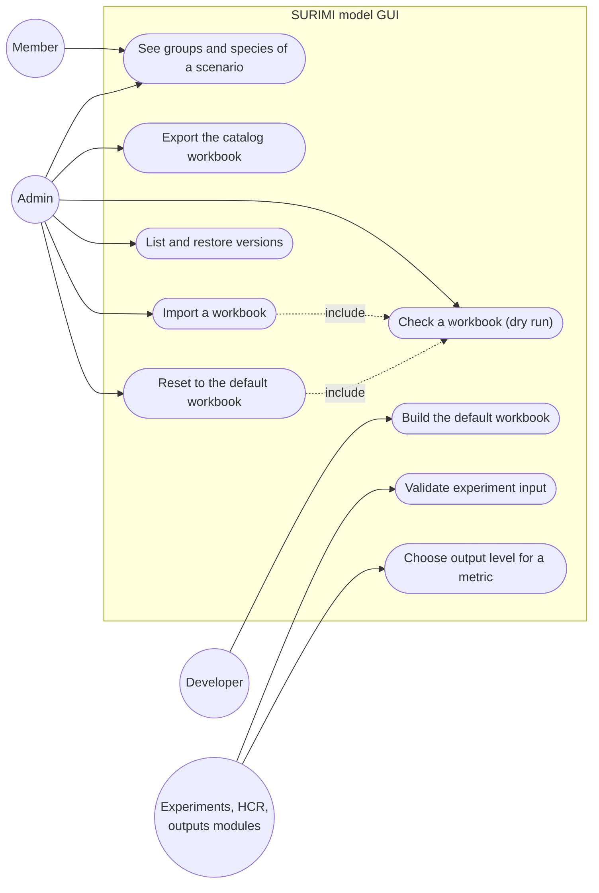
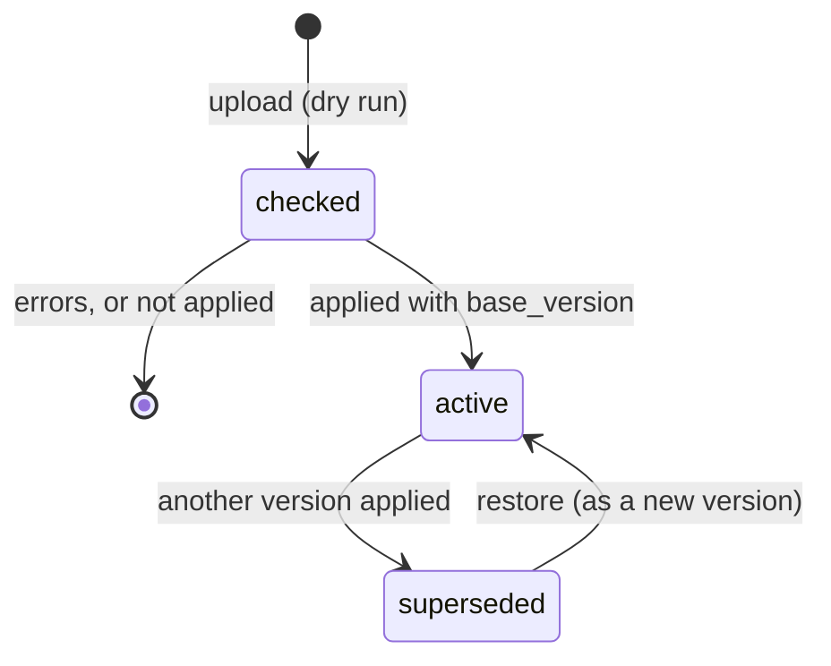
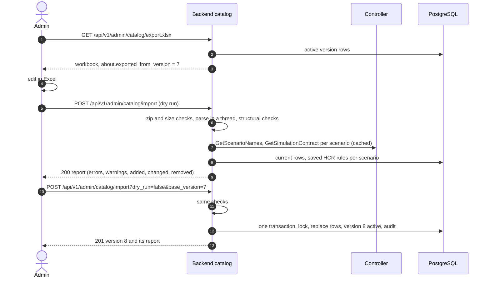
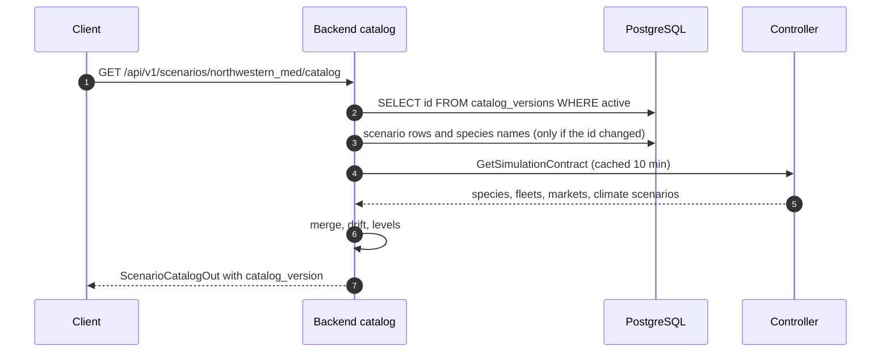
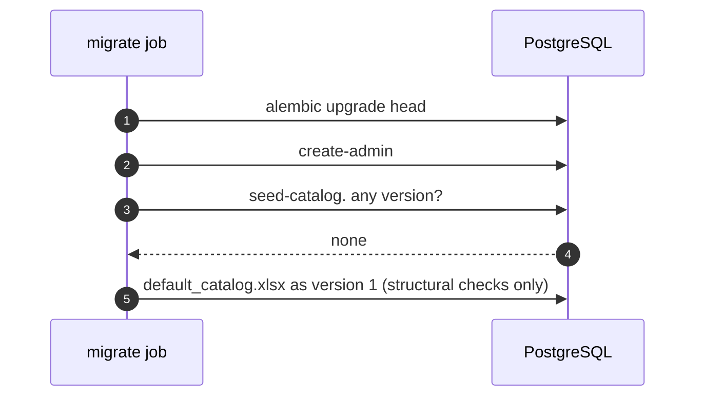
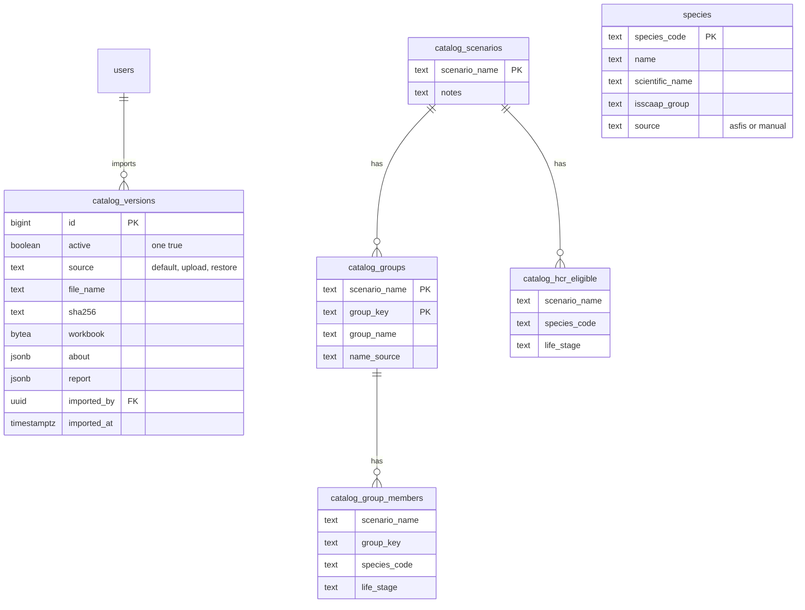

# Scenario catalog

**Status:** Built 2026-11-05 (backend and API, catalog in JSON files) on `develop`, not merged into `main`; initial biomass and fishing mortality endpoints 2026-11-12, replaced 2026-11-23 by `/initial-hcr-data` (harvest control rules). **Redesign designed 2026-11-13, not built:** catalog in the database, maintained by admins through one Excel workbook ([ADR 0023](../../decisions/0023-scenario-catalog-in-the-database-from-an-admin-workbook.md)); the import details below are **Proposed**. **Step 1, the `species` table loaded from `catalog/data/species.csv`, and step 2, admin species import and export and the console species pages, built and verified against PostgreSQL 2026-11-16** (see [Step 1](#step-1-species-table-from-a-csv), [Step 2](#step-2-admin-import-and-export-of-species-csv))
**Plan:** [2026-11-05-scenario-catalog-hcr-experiments](../../plans/2026-11-05-scenario-catalog-hcr-experiments.md), step 4a
**ADRs:** [0017](../../decisions/0017-scenario-catalog-from-partner-config.md) (storage superseded), [0023](../../decisions/0023-scenario-catalog-in-the-database-from-an-admin-workbook.md)

Tells every part of the system what one scenario contains: its functional
groups and species with their names, which of them can carry a harvest
control rule, which climate scenarios it accepts, and at which level each
output metric is real. The experiment form, the HCR editor, validation and
the output dashboards all read it, so no scenario is assumed to look like
another. Admins keep it up to date by exporting one workbook, editing it in
Excel and importing it back; a default workbook ships with the system.

| File | Purpose |
| --- | --- |
| [README.md](README.md) | Use cases, design, decisions, open questions |
| [CHANGELOG.md](CHANGELOG.md) | Dated log of every change made for this feature |

---

## Decisions

| Decision | Why | Recorded in |
| --- | --- | --- |
| The catalog lives in PostgreSQL; **admins alone** maintain it through one `.xlsx` workbook whose sheets are the tables, column for column; a default workbook ships in the backend and is the first version of a fresh install | Changes without a developer or deploy; data that is in no repo (Aegean groups) gets a place; export = what the system uses (user, 2026-11-13) | [ADR 0023](../../decisions/0023-scenario-catalog-in-the-database-from-an-admin-workbook.md) |
| `species` is global and holds the **whole** ASFIS list (13,567 species) with six fields (code, English and scientific name, family, order or higher taxa, ISSCAAP group), plus manual rows for codes in use that ASFIS lacks (`source` `asfis` or `manual`); groups, members and HCR eligibility are per scenario | A code is the same species everywhere (49 shared codes, same names, **Verified** 2026-11-13); groups and eligibility come from each scenario's models; any code a contract adds later already has a name (user, 2026-11-16, reversing the 315-code subset) | [ADR 0023](../../decisions/0023-scenario-catalog-in-the-database-from-an-admin-workbook.md) |
| Which species a scenario has comes from the live contract (gRPC) on every request, never from the database | The contract decides what runs; the database holds only what the contract lacks (`Species` is code, length class, age, life stage) | [ADR 0023](../../decisions/0023-scenario-catalog-in-the-database-from-an-admin-workbook.md), [ADR 0017](../../decisions/0017-scenario-catalog-from-partner-config.md) |
| Nothing made up: group and species names only from a source (EwE model, ASFIS) or typed by an admin, else empty; gaps in the `scenarios` sheet's notes | Placeholders look like data (user, 2026-11-05) | [ADR 0017](../../decisions/0017-scenario-catalog-from-partner-config.md) |
| "Functional group" = Ecopath group (MICE group for `aegean_sea` later); each species carries its FAO ISSCAAP group | The models compute per group; ISSCAAP is standard and covers every code | [ADR 0017](../../decisions/0017-scenario-catalog-from-partner-config.md) |
| Levels by one rule: groups → `functional_group`; a group with ≥ 2 species codes, or no groups → `species`; biomass at group level whenever groups exist | Biomass is copied to each member, catch is per species (**Verified**); a rule follows the data | [ADR 0017](../../decisions/0017-scenario-catalog-from-partner-config.md) |
| Merged with the live contract on every contract fetch; mismatches in `drift` and logged | The contract changes nightly upstream | [ADR 0017](../../decisions/0017-scenario-catalog-from-partner-config.md) |
| Species ship as `catalog/data/species.csv`, written by `scripts/build_species_csv.py` from the ASFIS CSV and the codes in use, and loaded by `surimi-backend seed-species` (insert or update, never delete) | A text file in git shows every change in review; until admins can edit species the file is the only source, so an update in a release must reach the database (user, 2026-11-16) | this file |
| `GET /api/v1/species` is paged (`size` ≤ 200) and filtered by `code`, `q`, `isscaap_group`, `family`, `order_or_higher_taxa` | 13,570 rows are too many for one response; the filters are what the higher taxa were added for | this file |
| `q` is a full-text word-prefix search (`to_tsvector('simple', code ‖ name ‖ scientific name)`, GIN index `species_search_idx`); every word must start a word of a row | Index-backed without PostgreSQL extensions (ADR 0014), as `experiments_name_fts_idx` already is. Rejected: trigram index (needs `pg_trgm`), `ILIKE '%…%'` (no index can serve it). `ake` no longer finds `hake` (user asked for good search indexes, 2026-11-16) | this file |
| `sort` by `species_code`, `name` or `scientific_name`, ascending or descending, ties by code; B-tree `(name, species_code)` and `(scientific_name, species_code)` | Users browse by name (user, 2026-11-16); the index gives each page without sorting the table, both directions | this file |
| B-tree indexes on `isscaap_group`, `family`, `order_or_higher_taxa`; code lookups use the primary key | Each filter and the catalog's name lookup have an index; a test checks with EXPLAIN that the planner can use them | this file |
| Family and order or higher taxa kept as ASFIS spells them | They let users browse `aegean_sea`'s 271 ungrouped species without made-up groups; ASFIS mixes ranks (`SCOMBRIFORMES (SCOMBROIDEI)`), so the text is not parsed (user, 2026-11-16) | this file |
| Admins import species from a CSV with a column mapping, `upsert` (mapped columns only) or `replace` (delete and insert), dry run first, all or nothing; export in the shipped format; `seed-species` becomes insert-only | Partners' lists come with their own headers; admins own the rows once they can edit them (user, 2026-11-16) | this file |
| Import is **dry run by default**; applying needs `dry_run=false` and the version the workbook was exported from | An admin sees what changes before it changes; two admins cannot overwrite each other silently | this file |
| Structural problems refuse the import; mismatches with the live contract are warnings | A broken workbook must never become active; the contract can be ahead or behind and the controller may be down | this file |
| All or nothing, one transaction; every applied workbook is kept as a version with its report and importer; restore re-applies a stored workbook as a new version | No half-updated catalog; review and rollback without git | this file |
| Every cell is read as text; a cell Excel turned into a number, date or boolean is accepted only when it is a whole number, else refused; export writes text cells | Excel drops leading zeros and turns codes into dates; refusing beats guessing | this file |
| `openpyxl`, read-only mode, in a worker thread | Reads and writes `.xlsx` with no other dependency; parsing is CPU work and must not block the event loop | this file, [ADR 0023](../../decisions/0023-scenario-catalog-in-the-database-from-an-admin-workbook.md) |
| Uploads capped (`CATALOG_IMPORT_MAX_MB`, 10), checked as a zip (≤ 100 MB uncompressed, no more than 100,000 rows a sheet) before parsing | An `.xlsx` is a zip: a small upload can expand to gigabytes | this file |
| `surimi-backend seed-catalog` loads the default workbook only when no version exists; the migrate job runs it after `seed-species` | Same pattern as `seed-species`; admins' data is never overwritten by an upgrade | this file |
| The catalog service checks the active version id on every request (one indexed query) and reloads only when it changed | An import is visible at once in every API replica, without a cache bus | this file |
| A member without life stage covers every life stage of its code, unless another member names that stage | Same as Ecopath's semantics: `HKE` and `HKE juvenile` → 26, `HKE adult` → 27 | this file |
| Life stages compared case-insensitively; the contract's spelling is returned and sent | Contract `adult`, fisheries authority CSV `ADULT`; the 2026-10-30 run sent `adult` and finished | this file |
| Model spellings kept as they are ("Juvenil hake", "Small demersal fishesl (continental shelf)") | We do not edit partner data in the default workbook; an admin may | this file |
| The generator script builds the default workbook from ASFIS and the partner repos, and still refreshes the fake controller's contracts | Partner changes come in through a new default; `CONTROLLER_MODE=fake` and the tests see real shapes | this file |
| Initial biomass, initial F and the default rules are **not** in the catalog and not cached: `GET …/initial-hcr-data` asks the controller (`GetInitialHCRData`) on every request; the catalog only names the entries | They change when Ecopath's file is regenerated (user, 2026-11-12); the call reserves no Ecopath pod (**Read from source**) | [ADR 0027](../../decisions/0027-hcr-initial-data-and-defaults-from-the-controller.md) |
| Their values are passed on as the controller sends them: no unit added, an absent F returned as 0, rows not matched against the contract | The controller states no unit (open question for the controller team); proto3 leaves a 0 out; mismatches (`SWO`, `VMA`, `HKE` with no life stage) are recorded in ISSUES.md rather than hidden | this file |

---

## Use cases



Admins are the only writers. A developer only builds the default that ships
with a release.

| Use case | Actor | Pre-conditions | Main flow | Failure cases |
| --- | --- | --- | --- | --- |
| See catalog | Any signed-in user | Scenario in `GetScenarioNames` | `GET /scenarios/{name}/catalog` → active version merged with the contract | Unknown scenario → 404; controller down → 502 |
| Export | Admin | A version is active | `GET /admin/catalog/export.xlsx` → the active version as a workbook, its id in the `about` sheet | — |
| Check | Admin | — | `POST /admin/catalog/import` (dry run is the default) → report: errors, warnings, rows added, changed, removed per sheet and scenario | Not an `.xlsx`, too large, too many rows → 422 |
| Import | Admin | Dry run clean of errors | Same with `dry_run=false` and `base_version` → new active version, audited | Errors → 422 with the report, nothing saved; active version is not `base_version` → 409 |
| Restore | Admin | Version exists | `POST /admin/catalog/versions/{id}/restore` → its stored workbook checked and applied as a new version | As for Import |
| Reset | Admin | — | `POST /admin/catalog/reset-to-default` → the shipped workbook checked and applied as a new version | As for Import |
| Build default | Developer | Partner repos cloned, ASFIS CSV, controller reachable | Run the generator → review its report → commit `default_catalog.xlsx` | A source missing → that part stays empty and the `scenarios` notes say so |

---

## Current state

Built 2026-11-05 (**Read from source**):

- One JSON file per scenario in
  [`catalog/data/`](../../../apps/backend/src/surimi_backend/catalog/data/)
  (`aegean_sea.json`, `anchovy_bay.json`, `northwestern_med.json`): groups
  with members, HCR-eligible entries, `built_from` (partner commits),
  `notes`. Since 2026-11-16 species names and higher taxa are no longer in
  these files but in the `species` table ([Step 1](#step-1-species-table-from-a-csv)). Written by
  [`scripts/build_scenario_catalog.py`](../../../apps/backend/scripts/build_scenario_catalog.py)
  and committed.
- Loaded once in `create_app` (`load_catalog_files`, a bad file stops
  start-up) and merged with the contract in `catalog/scenario_catalog.py`
  (`build_catalog`); `CatalogService.scenario_catalog` caches the result with
  the contract (10 min).
- Read by `experiments/service.py` (HCR eligibility, climate scenarios),
  `hcr/` (eligibility), `outputs/router.py` (levels),
  `integrations/controller/fake.py` (fake contracts) and `cli.py`.
- No admin can change it; a change is a developer's commit.

### Where the data comes from

The default workbook is built from the same sources:

| Data | Source | Evidence |
| --- | --- | --- |
| Species entries, fleets, markets, climate scenarios | Controller contract (produced by SURIMI-data_preprocessing `R/common/make_contract.R`, synced nightly into SURIMI-controller). `northwestern_med`: species from the EwE model's taxa (`R/northwestern_med/get_all_species.R`). `aegean_sea`: every species with EU FDI landings in GSA 22 and 23 (`pipelines/aegean_sea/_targets.R`) | Verified on `user-<developer>`; Read from source, SURIMI-data_preprocessing `eb09c05` |
| Species → group | SURIMI-Ecopath `Includes/<s>/<s>.semantics` (`speciescode[;lifestage]` → `model=group;DBID=n`) | Read from source, `156c130` |
| Group names | EwE model `EcopathGroup.GroupName` by `GroupID` = `DBID`: NW Med in SURIMI-data_preprocessing `data-raw/northwestern_med/northwestern_med.eiixml`, Anchovy Bay in SURIMI-Ecopath `Includes/anchovy_bay/anchovy_bay.eiixml` | Read from source, `92f4ad6`, `156c130`; ids and members checked against the semantics |
| HCR eligibility | SURIMI-fisheries-authority `Includes/<s>/` recruitment ∩ initial quota ∩ quota share | Read from source, `a68715a` |
| Species names, ISSCAAP group | FAO ASFIS `ASFIS_sp_2024.csv` by `Alpha3_Code` | Confirmed by the controller team, 2026-10-15 |

None of these partner inputs changed between 2026-11-05 and 2026-11-13
(**Read from source**: SURIMI-Ecopath `156c130...735cc98` adds only the
initial-state CSVs, SURIMI-data_preprocessing `92f4ad6...eb09c05` only NW Med
landings, SURIMI-fisheries-authority unchanged).

### What each scenario has (2026-11-05)

| Scenario | Model | Groups | HCR-eligible | Levels | Notes |
| --- | --- | --- | --- | --- | --- |
| `aegean_sea` | MICE (planned, issue #154): 20 groups, reports by group | none published | none | `species`, `partial` | 271 ASFIS codes in the contract; GRM, OTH, YRC not in ASFIS |
| `anchovy_bay` | Ecopath | 7 named in the model; only Anchovy (`ANE` juvenile, adult) is in the contract | none | `functional_group` | No fisheries authority inputs |
| `northwestern_med` | Ecopath "GSA0607EwENBS" | 42 mapped, all named (e.g. Other shrimps, Crabs, Adult hake, Seabirds) | BOG, BFT, HKE adult, HKE juvenile, MUT adult, PIL adult | `functional_group`, `species` | SWO and VMA in the contract map to no group |

---

## Target behaviour

### The workbook

One `.xlsx` for all scenarios. Each sheet is one table with the same columns;
the first row holds the column names. Every cell is text.

| Sheet | Columns | Key | Rows today |
| --- | --- | --- | --- |
| `about` | `key`, `value` | `key` | Written on export and by the generator (`exported_from_version`, `built_from_*` commits). Not imported except `exported_from_version` |
| `species` | `species_code`, `name`, `scientific_name`, `family`, `order_or_higher_taxa`, `isscaap_group`, `source` (`asfis` or `manual`) | `species_code` | 13,570: the whole ASFIS list (`source = asfis`), plus `manual` rows for codes in use that ASFIS lacks (`GRM`, `OTH`, `YRC`, names empty until an admin knows them). Whether the workbook exports all of them or only the codes in use is decided when the workbook is built |
| `scenarios` | `scenario_name`, `notes` | `scenario_name` | 3. `notes`: one line per gap, separated by line breaks |
| `groups` | `scenario_name`, `group_key`, `group_name`, `name_source` (`ewe_model`, `manual`, or empty) | `scenario_name` + `group_key` | 49 (42 NW Med, 7 Anchovy Bay) |
| `group_members` | `scenario_name`, `group_key`, `species_code`, `life_stage` | `scenario_name` + `species_code` + lower(`life_stage`) | 100 (91 NW Med, 9 Anchovy Bay) |
| `hcr_eligible` | `scenario_name`, `species_code`, `life_stage` | `scenario_name` + `species_code` + lower(`life_stage`) | 6 (NW Med) |

Rows that are entirely empty are skipped. Columns not listed are ignored with
a warning. A `group_name` of an admin edit gets `name_source = manual`.

**Why one workbook in these sheets:** names are global, groups and eligibility
per scenario, so species appear once and each scenario's rows carry its name.
**Rejected:** one workbook per scenario (species repeated, one upload could
leave scenarios out of step).

### Step 1: species table from a CSV

Built first, before the workbook, so the API serves species names from the
database (user, 2026-11-16).

- **File:** `apps/backend/src/surimi_backend/catalog/data/species.csv`, UTF-8,
  LF, header `species_code,name,scientific_name,family,order_or_higher_taxa,isscaap_group,source`,
  one row per code, sorted by code. Empty cell = unknown.
- **Script:** `apps/backend/scripts/build_species_csv.py --asfis <ASFIS_sp_2024.csv>`.
  Writes every ASFIS row with its six fields (`source = asfis`), 13,567 on
  2026-11-16 (about 1 MB). It also collects the codes in use (the three
  contracts, from the copies in `integrations/controller/fake_contracts/` or
  live with `--controller-url`; the catalog files' group members and
  HCR-eligible entries; the HCR default CSVs) and adds a `manual` row with
  empty fields for each one ASFIS lacks, or keeps the one already in the file.
  Manual rows are never dropped. The script prints the counts and the codes
  ASFIS lacks.
- **Load:** `surimi-backend seed-species` reads the file and inserts the
  codes the table lacks; with `--update` it also overwrites changed rows. It
  never deletes. The migrate job runs it (without `--update`) after
  `create-admin`. Since step 2 admins own the rows, so
  a deploy must not undo their imports; a newer shipped list reaches the
  table through an admin import or an explicit `seed-species --update`.
- **Catalog:** names, family, order and ISSCAAP group of each entry come from
  the `species` table; a contract code with no row is listed in `drift`
  ("no species row"). The catalog files lose `species_names`. Unit tests
  without a database read the CSV instead (the name source is passed to
  `create_app`).
- **API:** `GET /api/v1/species`, paged (`page`, `size` ≤ 200, response
  `items`, `total`, `page`, `size`), sorted by code, with filters `code`
  (repeatable), `q` (each word must start a word of the code, English or
  scientific name: `hake`, `merluc`, `european hake`; ignoring case),
  `isscaap_group`, `family`, `order_or_higher_taxa` (exact, as ASFIS spells
  them: `32`, `MERLUCCIIDAE`, `GADIFORMES`), and `sort` = `species_code`
  (default), `name` or `scientific_name`, with `-` for descending, ties by
  code; species without a name come last ascending and first descending
  (PostgreSQL's default, which lets one index serve both directions). And
  `GET /api/v1/species/{code}`. Any signed-in user.
- **Indexes:** primary key (code lookups, the catalog's names);
  `species_search_idx`, GIN on `to_tsvector('simple', species_code || ' ' ||
  coalesce(name, '') || ' ' || coalesce(scientific_name, ''))` for `q`, the
  same expression in the model, the migration and the query, or the planner
  cannot use it; B-tree `species_isscaap_group_idx`, `species_family_idx`,
  `species_order_or_higher_taxa_idx` for the filters; B-tree
  `species_name_idx (name, species_code)` and
  `species_scientific_name_idx (scientific_name, species_code)` for the
  sorts, so a page reads 50 rows from the index instead of sorting 13,570.

### Step 2: admin import and export of species (CSV)

Asked by the user, 2026-11-16: admins export the table, and import a CSV in
which they map the file's columns to the table's, either **upsert** or
**replace** (delete and insert). Designed and built the same day.

- **Export:** `GET /api/v1/admin/species/export.csv` (admin) returns the whole
  table in the `species.csv` format, sorted by code: re-importable as is, and
  committable as the next shipped default.
- **Import:** `POST /api/v1/admin/species/import` (admin), body = the CSV
  itself (`Content-Type: text/csv`, UTF-8, a BOM is allowed), options as query
  parameters:

  | Parameter | Meaning |
  | --- | --- |
  | `mode` | `upsert` (default): insert new codes, update existing rows **in the mapped columns only**, delete nothing. `replace`: the file becomes the table: rows not in it are deleted, unmapped columns are emptied |
  | `dry_run` | `true` (default): check and report, change nothing. `false`: apply |
  | `map` | Repeatable `target:header`, e.g. `map=name:English_name`. Targets are the table's columns. A target not mapped uses the header of the same name (case and spaces ignored) or, failing that, its ASFIS header (`Alpha3_Code`, `English_name`, `Scientific_Name`, `Family`, `Order or higher taxa`, `ISSCAAP_Group`), so the controller team's ASFIS file imports with no mapping. `map=target:` (empty header) leaves a column unmapped on purpose. `species_code` must resolve |
  | `delimiter` | `,` (default), `;` or `tab` (Excel in Greek or other locales writes `;`) |
  | `default_source` | `manual` (default) or `asfis`: the `source` of rows when no column maps to it |

- **Report** (`SpeciesImportReport`): mode, dry run, the mapping used, rows
  read, counts and up to 50 codes each of inserted, updated, unchanged and
  deleted rows, errors (line and message, at most 100) and warnings.
- **All or nothing:** any error and nothing changes. A dry run with errors
  answers 200 with the report; an apply with errors answers 422 with the
  report in `details`. The apply runs in one transaction under an advisory
  lock, so two imports cannot interleave, and is audited
  (`species.imported`: mode, counts, file hash, mapping).
- **Errors:** missing or unknown header for a mapped target, an unknown
  target, a bad or empty code, a code twice, a `source` other than `asfis`
  or `manual`, a value over 300 characters, a row with the wrong number of
  cells, not UTF-8. In `replace` mode, deleting a code still in use: a group
  member or HCR-eligible entry of a catalog file, a saved or default HCR, or
  a live contract.
- **Warnings:** the controller unreachable ("contract codes not checked");
  file columns not mapped (ignored).
- **Limits:** body at most `CATALOG_IMPORT_MAX_MB` (10), else 413; read with
  the cap, never whole into memory first.
- **Why a raw CSV body, not a multipart upload:** FastAPI needs the
  `python-multipart` dependency for uploads; one file needs no form, the
  size cap is a plain read limit, and Bruno and the console send it as easily.
  Rejected: multipart (a new parser to keep patched, for nothing gained).
- **Why mapping in the request, not a fixed header:** partners send lists
  with their own headers (ASFIS, FDI); a mapping imports them without editing
  the file in Excel, which changes codes and encodings.

### Console pages (user, 2026-11-16)

The backend console gets two species cards (see
[backend-console](../backend-console/README.md)):

- **Species** (any signed-in user): search `q`, filters ISSCAAP group,
  family, order, a sort choice, previous and next page, a table of the seven
  columns, the total. Calls `GET /api/v1/species`.
- **Species import and export** (admins): an export button; a file picker that
  reads the file's header in the browser and offers, for each table column, a
  choice of file column (pre-selected as the API would), the delimiter, mode
  and default source; **Check** (dry run) shows the report; **Import** is
  enabled only after a clean check of the same file and options, and asks for
  confirmation in `replace` mode.

### Cell values

`openpyxl` gives typed values. Each is turned into text, or refused:

| Cell holds | Becomes |
| --- | --- |
| Text | Stripped of leading and trailing spaces |
| Whole number (`4`, `4.0`) | `"4"` |
| Any other number, a date, a time, a boolean, an error | Refused: "Excel changed this cell, format the column as Text and type it again" |
| A formula | Refused (read-only mode returns the formula, not a value) |

Formats checked: `species_code` and `group_key` `^[A-Za-z0-9_]{1,30}$`,
`scenario_name` `^[a-z0-9_]{1,64}$`, `life_stage` at most 30 characters,
names at most 200, `source` and `name_source` from their lists. Export writes
every cell as text with number format `@`, so Excel keeps codes as typed.

### Checks on import

| Problem | Kind |
| --- | --- |
| Not a zip or not an `.xlsx`, over `CATALOG_IMPORT_MAX_MB`, over 100 MB uncompressed, a sheet over 100,000 rows | Refused before parsing (422) |
| A sheet or column missing; a bad cell (above) | Error |
| Duplicate key in any sheet | Error |
| A `groups`, `group_members` or `hcr_eligible` row whose scenario is not in `scenarios` | Error |
| A member whose group is not in `groups` for that scenario | Error |
| The same species and life stage in two groups of one scenario | Error |
| A `species` row removed whose code a member, an HCR-eligible row or a live contract still uses | Error |
| `base_version` is not the active version (when applying) | 409 |
| A contract code with no `species` row (no name) | Warning |
| A contract entry in no group, when the scenario has groups | Warning |
| A group none of whose members is in the contract; a member not in the contract | Warning |
| An HCR-eligible entry not in the contract | Warning |
| A scenario in the workbook the controller does not serve, or the reverse | Warning |
| Rules in users' HCR configurations that would become ineligible, counted per scenario | Warning (the rules are kept and flagged, as today) |
| Controller unreachable | Warning "contract not checked"; structural checks still run |

The report lists, per sheet and per scenario, the counts of rows added,
changed and removed with up to 50 examples each, then every error and
warning with sheet, row number and value.

### Versions

`catalog_versions` keeps every applied workbook (bytes, hash, file name, who,
when, source `default`, `upload`, `restore`, the report). Exactly one is
active. Applying is one transaction: lock the active row, check
`base_version`, replace the rows of `species`, `catalog_scenarios`,
`catalog_groups`, `catalog_group_members` and `catalog_hcr_eligible`, insert
the new version as active, write the audit event. Restore and reset feed a
stored or the shipped workbook through the same path, so they are checked
like any upload. All versions are kept (about 1 MB each); purge is a later
decision.

**Why store the workbook bytes:** restore re-checks exactly what was imported,
and an admin can download what a colleague uploaded. **Rejected:** keeping only
row history per table (no way to get the original file back, more schema).



A dry run stores nothing. A restored workbook becomes a new version, so the
history only grows.

### Default workbook and install

`apps/backend/src/surimi_backend/catalog/data/default_catalog.xlsx` ships in
the image. `surimi-backend seed-catalog` imports it as version 1 when
`catalog_versions` is empty, with structural checks only (the migrate job may
not reach the controller), and does nothing otherwise. Compose's migrate job
runs `migrate`, `create-admin`, `seed-species`, `seed-catalog` in that order. A
release with a newer default changes nothing on an existing install until an
admin runs reset (dry run first).

The first default is built from today's sources, so after the change
`GET /scenarios/{name}/catalog` returns the same groups, species and
eligibility as before, with `catalog_version` in place of `built_from`.

### Merge with the contract

Unchanged, with the active version instead of a file:

- `species` lists every contract entry once, in contract order, with its
  group, names and `hcr_eligible`.
- A group none of whose members is in the contract is left out and reported
  in `drift`; so are HCR-eligible entries not in the contract, and (when the
  scenario has groups) contract entries in no group.
- `climate_scenarios`, `fleets` and `markets` come from the contract only.

The catalog service reads `SELECT id FROM catalog_versions WHERE active` on
each request and reloads the scenario's rows (and the `species` rows of the
codes it needs) only when the id changed. **Rejected:** a 10-minute cache
alone (an admin would wait up to 10 minutes to see an import, per replica).

### Initial biomass and fishing mortality

Moved on 2026-11-23 to [harvest control rules § Initial HCR data](../harvest-control-rules/README.md#initial-hcr-data):
the controller's `GetInitialHCRData` replaced `GetInitialBiomasses` and
`GetInitialFishingMortalities`, and `GET /api/v1/scenarios/{name}/initial-hcr-data`
replaced `/initial-biomasses` and `/initial-fishing-mortalities`. The catalog's
part is `CatalogService.name_entries`: it gives any `(species_code, life_stage)`,
in the contract or not, its names from the `species` table and its functional
group and HCR eligibility from the catalog file (`scenario_catalog.name_entries`).
A code with no `species` row gets null names and a `catalog.drift` warning.

---

## Flows

### Import



The dry run and the apply run the same checks; only the apply writes, and
only if version 7 is still active.

### Request time



One small query per request keeps every replica on the active version.

### Install



On an existing install `seed-catalog` finds a version and stops.

---

## Data



No foreign key from `catalog_group_members` or `catalog_hcr_eligible` to
`species`: a contract code may lack a name, which is a warning, not an error.
No foreign key from the rules in `hcr_configurations`: saved rules outlive
eligibility and are flagged instead. Unique indexes on the keys of the workbook table
above (members and eligibility on `lower(life_stage)`), and a partial unique
index `catalog_versions (active) WHERE active`. Added to
`docs/database/schema.dbml` when built.

---

## API

| Method | Path | Role | Request | Response | Errors |
| --- | --- | --- | --- | --- | --- |
| GET | `/api/v1/scenarios/{name}/catalog` | any | — | `ScenarioCatalogOut`: `status`, `levels`, `metric_levels`, `functional_groups[]` (`key`, `name`, `name_source`, `members[]`), `species[]` (`species_code`, `life_stage`, `name`, `scientific_name`, `family`, `order_or_higher_taxa`, `isscaap_group`, `functional_group`, `hcr_eligible`), `climate_scenarios[]`, `fleets[]`, `markets[]`, `catalog_version` (`id`, `imported_at`, `source`; replaces `built_from`), `notes[]`, `drift[]` | 401, 404, 502 |
| GET | `/api/v1/scenarios/{name}/initial-hcr-data` (and `/history`) | any | — | Since 2026-11-23, see [harvest control rules § API](../harvest-control-rules/README.md#api) | |
| GET | `/api/v1/species` | any | `?code=HKE&code=BFT`, `?q=hake`, `?family=MERLUCCIIDAE`, `?order_or_higher_taxa=GADIFORMES`, `?isscaap_group=32`, `?sort=name` (`species_code`, `name`, `scientific_name`, `-` for descending), `?page&size` (≤ 200) | `SpeciesPage`: `items[]` (`species_code`, `name`, `scientific_name`, `family`, `order_or_higher_taxa`, `isscaap_group`, `source`), `total`, `page`, `size`; sorted by code | 401, 422 |
| GET | `/api/v1/species/{code}` | any | — | `SpeciesOut` | 401, 404 |
| GET | `/api/v1/admin/species/export.csv` | admin | — | `text/csv`, the whole table in the `species.csv` format | 401, 403 |
| POST | `/api/v1/admin/species/import` | admin | body `text/csv`; `?mode=upsert\|replace&dry_run=true\|false&map=target:header&delimiter=,\|;\|tab&default_source=manual\|asfis` | `SpeciesImportReport` (200 dry run, 200 applied) | 401, 403, 413 too large, 415 not `text/csv`, 422 errors (report in `details`) |
| GET | `/api/v1/admin/catalog/export.xlsx` | admin | — | The active version as a workbook | 401, 403 |
| POST | `/api/v1/admin/catalog/import` | admin | multipart `file`; query `dry_run` (default `true`), `base_version` (required when applying) | Dry run: 200 `CatalogImportReport`. Applied: 201 `CatalogVersionOut` with the report | 401, 403, 409 not the active version, 413 too large, 422 not an `.xlsx` or errors (report in `details`) |
| GET | `/api/v1/admin/catalog/versions` | admin | `?page&size` | page of `CatalogVersionOut` (`id`, `active`, `source`, `file_name`, `sha256`, `imported_by`, `imported_at`, warning and error counts) | 401, 403 |
| GET | `/api/v1/admin/catalog/versions/{id}` | admin | — | `CatalogVersionOut` with its report | 401, 403, 404 |
| GET | `/api/v1/admin/catalog/versions/{id}/workbook` | admin | — | The stored workbook as uploaded | 401, 403, 404 |
| POST | `/api/v1/admin/catalog/versions/{id}/restore` | admin | query `dry_run` (default `true`), `base_version` | As import | 401, 403, 404, 409, 422 |
| POST | `/api/v1/admin/catalog/reset-to-default` | admin | query `dry_run` (default `true`), `base_version` | As import | 401, 403, 409, 422 |

---

## Configuration

| Variable | Default | Meaning |
| --- | --- | --- |
| `CATALOG_CACHE_SECONDS` | 600 | Scenario names and contracts (unchanged) |
| `CATALOG_IMPORT_MAX_MB` | 10 | Largest species CSV (step 2) or workbook accepted |

---

## Where the changes are

| Area | File | Change |
| --- | --- | --- |
| Backend | `src/surimi_backend/catalog/models.py` | New: the six tables |
| Backend | `src/surimi_backend/catalog/workbook.py` | New: read (zip checks, text cells, structure) and write the workbook with `openpyxl` |
| Backend | `src/surimi_backend/catalog/importer.py` | New: checks against the database and the contract, report, apply in one transaction |
| Backend | `src/surimi_backend/catalog/repository.py` | New: active version, rows per scenario, versions |
| Backend | `src/surimi_backend/catalog/scenario_catalog.py` | The in-memory model is built from the database or from a workbook instead of JSON files; merge and level rules unchanged |
| Backend | `src/surimi_backend/catalog/service.py`, `router.py`, `schemas.py` | Active-version check, `catalog_version`, admin router |
| Backend | `src/surimi_backend/catalog/data/` | `default_catalog.xlsx` replaces the three JSON files |
| Backend | `cli.py` | `seed-catalog` |
| Backend | `src/surimi_backend/core/config.py`, `startup.py` | `CATALOG_IMPORT_MAX_MB` |
| Backend | `src/surimi_backend/migrations/versions/` | New revision with the tables |
| Backend | `scripts/build_scenario_catalog.py` | Writes `default_catalog.xlsx` with ASFIS filtered to the codes in use, still refreshes the fake contracts |
| Backend | `pyproject.toml` | `openpyxl` |
| Backend | `tests/` | Workbook parsing (cell types, zip limits), checks, versions and restore, admin-only access, catalog output unchanged after the move |
| Deploy | `deployments/compose.yml`, `deployments/.env.example` | Migrate job runs `seed-catalog` after `seed-species`; `CATALOG_IMPORT_MAX_MB` |
| Docs | `docs/database/schema.dbml`, `indexes.sql`, README | The tables and indexes |
| Bruno | `api/admin/catalog/*` | Export, import (dry run and apply), versions, restore, reset |
| Frontend (phase 10) | Admin page | Download and upload the workbook, show the report, list and restore versions. Catalog readers as before: `features/ScenarioOutputs/data/`, `FunctionalGroupDropdown`, `SpeciesDropdown`, remove the three `*_fishes.csv` |

---

## Observability

- `catalog.built{scenario, status, groups, species, hcr_eligible}` (info) and
  `catalog.drift{scenario, detail}` (warning), once per contract refresh or
  version change.
- `catalog.import_checked{dry_run, errors, warnings, rows}` and
  `catalog.imported{version_id, source}`.
- Audit `catalog.imported`, `catalog.restored`, `catalog.reset` with the
  version id, file hash and counts.

---

## How to build the default workbook

```bash
GIT_LFS_SKIP_SMUDGE=1 git clone -q --depth 1 https://github.com/SURIMI-Project/SURIMI-data_preprocessing.git <tmp>/SURIMI-data_preprocessing
git clone -q --depth 1 https://github.com/SURIMI-Project/SURIMI-Ecopath.git <tmp>/SURIMI-Ecopath
git clone -q --depth 1 https://github.com/SURIMI-Project/SURIMI-fisheries-authority.git <tmp>/SURIMI-fisheries-authority
cd apps/backend
uv run python scripts/build_scenario_catalog.py \
  --controller-url https://user-<developer>-surimi-controller.lab.dive.edito.eu \
  --data-preprocessing <tmp>/SURIMI-data_preprocessing --ecopath <tmp>/SURIMI-Ecopath \
  --fisheries-authority <tmp>/SURIMI-fisheries-authority \
  --asfis <path>/ASFIS_sp_2024.csv --fake-contracts
```

Today the script writes the JSON files; after the change it writes
`default_catalog.xlsx` and prints the same report an import gives, which is
what a reviewer reads instead of a text diff. `GIT_LFS_SKIP_SMUDGE=1` skips
the repo's large LFS inputs; the EwE model is a normal file.
`ASFIS_sp_2024.csv` is the attachment of the controller team's mail of 2026-10-15 (1.8 MB).
An admin's export can also become the next default: commit it in place of the
file.

---

## How to test

- Workbook: a code typed as a number, a date, a formula, leading zeros, an
  extra column, an empty row; a zip bomb and an oversized upload refused
  before parsing.
- Checks: each error in the table refuses the import and saves nothing; each
  warning is reported and the import applies; controller down → "contract not
  checked".
- Versions: apply, a second admin's apply with an old `base_version` → 409,
  restore, reset; exactly one active version.
- Roles: every admin endpoint as admin, member (403) and anonymous (401).
- Move: the catalog of each scenario is the same before and after, apart from
  `catalog_version`.

---

## What has been verified

See the [changelog](CHANGELOG.md). Nothing of the redesign is built yet.

---

## Open questions

- FAO's terms for reusing ASFIS: `species.csv` now copies the whole list
  (13,567 species), so the attribution FAO asks for must ship with it; it goes in the
  `about` sheet. To be checked before the default ships.
- Aegean Sea MICE model: the 20 functional groups and the species vocabulary
  of issue #154. (controller and MICE teams)
- `anchovy_bay` contract lists only `ANE`; should it list the other Ecopath
  species? (controller team)
- Is biomass meant to be copied to every species of a group? (EwE team)
