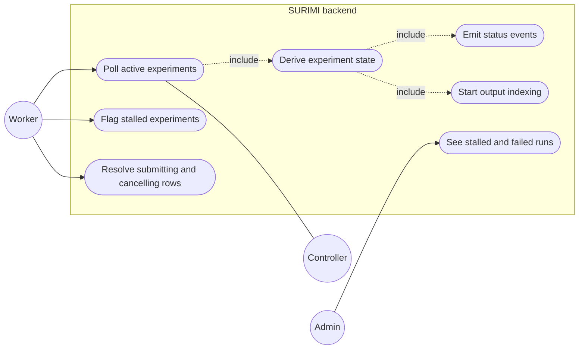

# Simulation status scheduler

**Status:** Planned
**Plan:** [2026-11-03-monorepo-and-backend](../../plans/2026-11-03-monorepo-and-backend.md), phase 5
**ADRs:** [0007](../../decisions/0007-scheduler-worker-postgres-queue.md), [0008](../../decisions/0008-notifications-sse.md)

A worker keeps every active experiment's state in our database in step with the
controller, flags runs that stopped making progress, and starts output indexing
when a run finishes. Submitting queued experiments is the
[experiment queue](../experiment-queue/README.md)'s job, run by the same worker.

---

## Decisions

| Decision | Why | Recorded in |
| --- | --- | --- |
| Separate worker process, same image, Procrastinate on PostgreSQL | Keeps slow calls and CPU work off the API; no extra broker | [ADR 0007](../../decisions/0007-scheduler-worker-postgres-queue.md) |
| Poll every 10 s with `GetSimulationStatuses(ids)` for active experiments only | The controller cannot push; cost stays flat as finished runs pile up | [ADR 0007](../../decisions/0007-scheduler-worker-postgres-queue.md) |
| One poll at a time across workers (Procrastinate lock) | Two replicas must not double-write events | [ADR 0007](../../decisions/0007-scheduler-worker-postgres-queue.md) |
| Experiment state derived from all its simulations, with fixed precedence | One experiment can have many simulations | this file |
| Map all six controller values (`Canceled` included), keep the raw value | Read in the controller code; a new value must not break the poller | this file |
| `stalled` is a flag, set after 10 min in `Initialising` or 30 min without progress | A failed init or a missing pod never reaches `Error`; the run may still recover | this file |
| An experiment the controller stops reporting for 3 polls is `failed` (lost) | The controller forgets everything on restart | this file |
| Cancel is re-tried until the simulations are `Running` | `RemoveExperiment` only cancels `Running` simulations and reports success anyway | this file |
| Worker resolves old `submitting` and `cancelling` rows itself | A crash or lost reply must not strand a run | this file |
| A final state triggers `dispatch_queue` at once | Frees capacity for the next queued run without waiting 10 s | [ADR 0015](../../decisions/0015-experiment-admission-queue.md) |

---

## Use cases

---

## Target behaviour

### Poll

Every `POLL_INTERVAL` (10 s): experiments in `submitted`, `initialising`,
`running`, `cancelling` → `GetSimulationStatuses(experiment_ids)` in batches of
100, deadline 10 s. Why by id: the cost stays flat as finished runs accumulate,
unlike `GetAllSimulationStatuses`.

### Status mapping

The controller sets exactly these six values (**Read from source**,
`SURIMI-controller` `a8a7f3a`, `SimulationManager.cs`; see
[ARCHITECTURE.md § Controller behaviour](../../ARCHITECTURE.md#controller-behaviour)):

| Controller `status` | Simulation state | Holds an Ecopath pod |
| --- | --- | --- |
| `Initialising` | `initialising` | Maybe (not if no pod was free) |
| `Initialised` | `initialised` | Yes |
| `Running` | `running` | Yes |
| `Finished` | `finished` | No |
| `Error` | `failed` | Yes, never released ([ISSUES.md](../../ISSUES.md)) |
| `Canceled` | `cancelled` | No |
| anything else | `unknown`, raw string kept, warning logged once per value | Counted as yes |

The raw string is always stored (`status_raw`), because the field is a free
string and a new value must not break the poller.

### Experiment state from its simulations

1. Any simulation `failed` → `failed`.
2. All `finished` → `finished`.
3. All `finished` or `cancelled`, at least one `cancelled` → `cancelled`.
4. Any `running` → `running`.
5. Otherwise any `initialising`/`initialised` → `initialising`.
6. No simulation reported yet → stays `submitted`.

While `cancelling`: when no simulation is `running`, the experiment becomes
`cancelled` if any simulation is `cancelled`. If simulations are still
`initialising` or `initialised`, `RemoveExperiment` cannot stop them (it only
cancels `Running` ones and still returns success), so the worker calls it again
once they reach `Running`, up to 10 minutes, then flags the experiment
`stalled` with "cancel not possible in state X".

### Progress and stalls

Progress = `(simulation_current − start_date_time) / (end_date_time −
start_date_time)` averaged over simulations. `simulation_current` is set at every
step of the contract's `time_step` (`P1M`, monthly) (**Read from source**,
`SimulationManager.ProcessSimulationStep`). `last_progress_at` updates when
progress or status changes. `detect_stalls` (every minute) sets `stalled` and
emits `experiment.stalled` when:

- a simulation has been `Initialising` longer than `INIT_TIMEOUT` (10 min):
  initialisation failed or no Ecopath pod was free, and the controller will not
  report `Error` for it;
- or `now − last_progress_at > STALL_AFTER` (30 min) in any other state.

### Lost experiments

The controller keeps experiments only in memory, so a restart forgets them
(**Read from source**). An experiment in `submitted`, `initialising`,
`running` or `cancelling` that the controller has stopped reporting for 3
polls in a row (`missing_polls`) becomes `failed` with error "lost: the
controller no longer knows this experiment (restarted?)", and an event is sent.
One missing poll is not enough, because a reply can be partial during a
rollout.

### Self-healing

- `submitting` older than 2 min: ask the controller for that id; if known →
  `submitted`, else `submit_failed`. Not resubmitted automatically: the
  controller rejects a known id, and an unknown id might still be initialising
  in a background task.
- `cancelling`: see above.

### Leadership

Procrastinate periodic task with a lock: one poll at a time across all workers.

---

## Flow

The main sequence is in [ARCHITECTURE.md](../../ARCHITECTURE.md#main-flows).
State machine: [ARCHITECTURE.md](../../ARCHITECTURE.md#experiment-lifecycle).

---

## Where the changes are

| Area | File | Change |
| --- | --- | --- |
| Backend | `src/surimi_backend/worker.py` | Procrastinate app, entrypoint `surimi-worker` |
| Backend | `src/surimi_backend/scheduler/` | `poller.py`, `mapping.py`, `derive.py`, `stalls.py`, `tasks.py` |
| Backend | `integrations/controller/fake.py` | Fake controller that advances runs over time, for local and CI |
| Deploy | `deployments/compose.yml` | `worker` service, same image |
| Config | `.env.example` | `POLL_INTERVAL`, `STALL_AFTER`, `CONTROLLER_GRPC_URL`, `CONTROLLER_MODE` |

---

## Observability

`surimi_poll_duration_seconds`, `surimi_poll_errors_total{code}`,
`surimi_active_experiments`, `surimi_stalled_experiments`; log
`scheduler.status_changed` with old and new state; `scheduler.unknown_status`.

---

## How to test

- Unit: mapping table and derivation rules, including mixed simulations.
- Integration: fake controller moves a run through every state; check events
  and final state; kill the worker mid-run and check it resumes.
- Two workers: only one poll per interval (log count).

---

## Open questions

- Will the controller release the pod of an `Error` simulation? (Rik)
