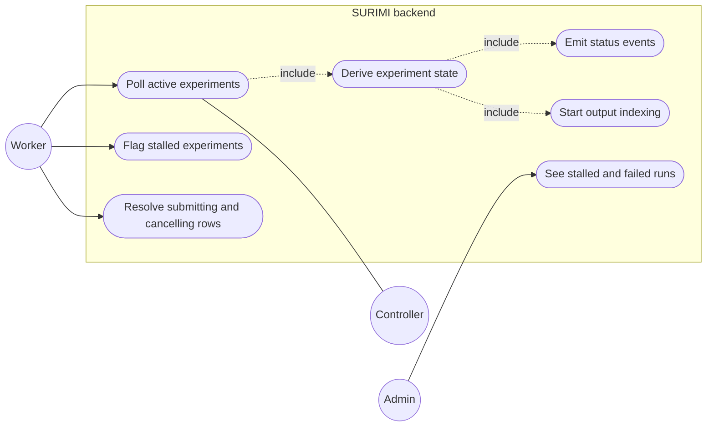
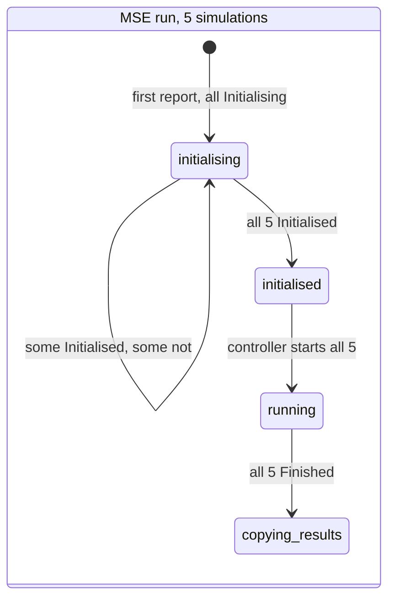
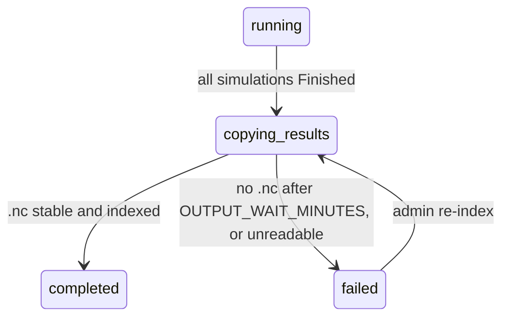

# Simulation status scheduler

**Status:** Built 2026-11-06 on `develop`, not merged into `main`; `copying_results` and `completed` 2026-11-12
**Changes:** [CHANGELOG.md](CHANGELOG.md)
**Plan:** [2026-11-03-monorepo-and-backend](../../plans/2026-11-03-monorepo-and-backend.md), phase 5
**ADRs:** [0019](../../decisions/0019-worker-row-driven-with-advisory-lock.md) (supersedes [0007](../../decisions/0007-scheduler-worker-postgres-queue.md)), [0021](../../decisions/0021-notifications-by-polling.md)

A worker keeps every active experiment's state in our database in step with the
controller, flags runs that stopped making progress, and, when a run finishes
on the controller, waits for its results in the bucket (`copying_results`)
before calling it `completed`. Submitting queued experiments is the
[experiment queue](../experiment-queue/README.md)'s job, run by the same worker.

---

## Decisions

| Decision | Why | Recorded in |
| --- | --- | --- |
| Separate worker process (`surimi-backend worker`), same image, a row-driven loop; no job queue library | Keeps slow calls and CPU work off the API; every job already reads its work from rows | [ADR 0019](../../decisions/0019-worker-row-driven-with-advisory-lock.md) |
| Poll every 10 s with `GetSimulationStatuses(ids)` for active experiments only | The controller cannot push; cost stays flat as finished runs pile up | [ADR 0007](../../decisions/0007-scheduler-worker-postgres-queue.md) |
| One leader across workers (`pg_try_advisory_lock` on a dedicated connection) | Two replicas must not double-write events or double-submit | [ADR 0019](../../decisions/0019-worker-row-driven-with-advisory-lock.md) |
| No simulation reported within `START_TIMEOUT_MINUTES` (5): `failed`, "never started"; fewer simulations than pods required, all still initialising after it: `failed`, partial start | The controller drops a simulation without a pod and reports nothing (**Verified** 2026-11-06); the lost-after-3-polls rule only applies to experiments seen before | this file |
| Experiment state derived from all its simulations, with fixed precedence | One experiment can have many simulations (5 for an MSE run), run in parallel | this file |
| Experiment `initialised` when **every** simulation is `Initialised`; one still `Initialising` keeps it `initialising` | The controller initialises the simulations in parallel and starts none until all are Initialised and its experiment services (CMSY, output creator, value chain) are ready (**Read from source**, SURIMI-controller `117e604`, `ExperimentManager.RunExperimentAsync`). The user asked to see the state, 2026-11-13 | this file |
| Each simulation's change is its own event, `simulation.status_changed`; every experiment response has `simulation_counts` | A page can show "3 of 5 initialised" from the events feed or a list, without loading each experiment's simulations | this file |
| Map all six controller values (`Canceled` included), keep the raw value | Read in the controller code; a new value must not break the poller | this file |
| `stalled` is a flag, set after 10 min in `Initialising` or 30 min without progress | A failed init or a missing pod never reaches `Error`; the run may still recover | this file |
| An experiment the controller stops reporting for 3 polls is `failed` (lost) | The controller forgets everything on restart | this file |
| Cancel is re-tried until the simulations are `Running` | `RemoveExperiment` only cancels `Running` simulations and reports success anyway | this file |
| Worker resolves old `submitting` and `cancelling` rows itself | A crash or lost reply must not strand a run | this file |
| A run all of whose simulations are `Finished` is `copying_results`, not done: it becomes `completed` only when its `.nc` is in the bucket, stable and indexed; `failed` if the file does not come within `OUTPUT_WAIT_MINUTES` (60) or cannot be read | The output creator writes the results after the controller says `Finished`; a run without results is not usable (user, 2026-11-12) | this file |
| `copying_results` holds no pod, is not polled on the controller and cannot be cancelled | The controller released the pod at `Finished`; nothing is left to stop | this file |
| A final state triggers `dispatch_queue` at once | Frees capacity for the next queued run without waiting 10 s | [ADR 0015](../../decisions/0015-experiment-admission-queue.md) |

---

## Use cases

---

## Target behaviour

### Poll

Every `POLL_INTERVAL_SECONDS` (10 s): experiments in `submitted`, `initialising`,
`initialised`, `running`, `cancelling` → `GetSimulationStatuses(experiment_ids)` in batches of
100, deadline 10 s. Why by id: the cost stays flat as finished runs accumulate,
unlike `GetAllSimulationStatuses`.

### Status mapping

The controller sets exactly these six values (**Read from source**,
`SURIMI-controller` `a8a7f3a`, `SimulationManager.cs`; see
[ARCHITECTURE.md § Controller behaviour](../../ARCHITECTURE.md#controller-behaviour)):

| Controller `status` | Simulation state | Holds an Ecopath pod |
| --- | --- | --- |
| `Initialising` | `initialising` | Maybe (not if no pod was free) |
| `Initialised` | `initialised` | Yes |
| `Running` | `running` | Yes |
| `Finished` | `finished` | No |
| `Error` | `failed` | Yes, never released ([ISSUES.md](../../ISSUES.md)) |
| `Canceled` | `cancelled` | No |
| anything else | `unknown`, raw string kept, warning logged once per value | Counted as yes |

The raw string is always stored (`status_raw`), because the field is a free
string and a new value must not break the poller.

### Experiment state from its simulations

An experiment has one simulation, or `NR_OF_MSE_RUNS` (5) for an MSE run, each
on its own Ecopath pod. The controller initialises them **in parallel**; each
goes `Initialising` → `Initialised` on its own. When all are `Initialised` and
the experiment services (CMSY, output creator, value chain) have initialised,
it starts them all **together**, in parallel (**Read from source**, SURIMI-controller `117e604`, `ExperimentManager.RunExperimentAsync`). So the simulations of one
experiment are not some `Initialised` and some `Running`, except for the moment
between two polls.

First rule that holds:

1. Any simulation `failed` → `failed`.
2. All `finished` → `copying_results` (see below).
3. All `finished` or `cancelled`, at least one `cancelled` → `cancelled`.
4. Any `running` → `running`.
5. Any `initialising` (or `unknown`) → `initialising`.
6. Otherwise, all `initialised` → `initialised`: waiting for the controller to
   start them.
7. No simulation reported yet → stays `submitted`.

Every experiment response carries `simulation_counts`, for example
`{"initialising": 3, "initialised": 2}`, and the detail lists each simulation
with its own `status`, `status_raw` and `progress`. Each change of a
simulation's state, and its first report, writes a `simulation.status_changed`
event with `simulation: {id, order, status, status_raw, previous_status}` and
the experiment's counts in `simulations`. `experiment.status_changed` carries
the counts too.

While `cancelling`: when no simulation is `running`, the experiment becomes
`cancelled` if any simulation is `cancelled`. If simulations are still
`initialising` or `initialised`, `RemoveExperiment` cannot stop them (it only
cancels `Running` ones and still returns success), so the worker calls it again
once they reach `Running`, up to 10 minutes, then flags the experiment
`stalled` with "cancel not possible in state X".

### Results: `copying_results` → `completed`

When every simulation is `Finished`, the poller sets the experiment
`copying_results`, `finished_at` (when the run ended), progress 1, and creates
its `experiment_outputs` row (`pending`). From then on the poller leaves it
alone: it holds no Ecopath pod and the controller may forget it without the
run being "lost". The outputs job ([experiment-outputs](../experiment-outputs/README.md))
waits until `<id>/<id>.nc` is in the bucket and its size is stable for
`OUTPUT_STABLE_SECONDS`, indexes it, and sets the experiment `completed` with
`completed_at`. No file after `OUTPUT_WAIT_MINUTES`, or a file that still
cannot be indexed after `OUTPUT_INDEX_MAX_ATTEMPTS`, sets it `failed` with an
error starting `results:`. An admin re-index of such a run puts it back to
`copying_results`. Each move emits `experiment.status_changed`.

### Progress and stalls

Progress = `(simulation_current − start_date_time) / (end_date_time −
start_date_time)` averaged over simulations. `simulation_current` is set at every
step of the contract's `time_step` (`P1M`, monthly) (**Read from source**,
`SimulationManager.ProcessSimulationStep`). `last_progress_at` updates when
progress or status changes. `detect_stalls` (every minute) sets `stalled` and
emits `experiment.stalled` when:

- a simulation has been `Initialising` or `Initialised` longer than
  `INIT_TIMEOUT_MINUTES` (10): initialisation failed (its own, or an experiment
  service's, which leaves the others waiting in `Initialised`) or no Ecopath pod
  was free, and the controller will not report `Error` for it. The reason says
  how many, for example "2 of 5 simulation(s) not running after 10 min
  (2 initialising)";
- or `now − last_progress_at > STALL_AFTER_MINUTES` (30) in any other state.

### Lost experiments

The controller keeps experiments only in memory, so a restart forgets them
(**Read from source**). An experiment in `submitted`, `initialising`,
`initialised`, `running` or `cancelling` that the controller has stopped reporting for 3
polls in a row (`missing_polls`) becomes `failed` with error "lost: the
controller no longer knows this experiment (restarted?)", and an event is sent.
One missing poll is not enough, because a reply can be partial during a
rollout.

### Self-healing

- `submitting` older than 2 min: ask the controller for that id; if known →
  `submitted`, else `submit_failed`. Not resubmitted automatically: the
  controller rejects a known id, and an unknown id might still be initialising
  in a background task.
- `cancelling`: see above.

### Leadership

The worker holding the advisory lock runs a cycle (poll, dispatch, index outputs) every `POLL_INTERVAL_SECONDS` or when woken by `NOTIFY surimi_dispatch`; the others retry the lock every 10 s ([ADR 0019](../../decisions/0019-worker-row-driven-with-advisory-lock.md)).

---

## Flow

The main sequence is in [ARCHITECTURE.md](../../ARCHITECTURE.md#main-flows).
State machine: [ARCHITECTURE.md](../../ARCHITECTURE.md#experiment-lifecycle).

---

## Configuration

Settings in `core/config.py` (**Read from source**, 2026-11-16). Compose does
not pass them: they keep their defaults unless the worker's environment sets
them.

| Variable | Default | Meaning |
| --- | --- | --- |
| `POLL_INTERVAL_SECONDS` | 10 | How often the worker polls the controller and runs the queue, when no `NOTIFY` wakes it |
| `START_TIMEOUT_MINUTES` | 5 | A submitted experiment the controller never reports (or reports fewer simulations than its pods) after this: `failed` |
| `INIT_TIMEOUT_MINUTES` | 10 | `Initialising` longer than this: `stalled` |
| `STALL_AFTER_MINUTES` | 30 | No progress for this long in any other state: `stalled` |
| `LOST_AFTER_POLLS` | 3 | Polls in a row in which a known experiment is missing: `failed`, lost (controller restart) |
| `CANCEL_TIMEOUT_MINUTES` | 10 | How long the worker keeps calling `RemoveExperiment` for a cancel before flagging it |
| `FAKE_CONTROLLER_INIT_SECONDS`, `FAKE_CONTROLLER_RUN_SECONDS` | 5, 60 | `CONTROLLER_MODE=fake`: how long a fake simulation initialises, then runs |

---

## Where the changes are

| Area | File | Change |
| --- | --- | --- |
| Backend | `src/surimi_backend/scheduler/worker.py` | Leader lock, wake-up listener, the cycle; `surimi-backend worker` |
| Backend | `src/surimi_backend/scheduler/` | `poller.py` (poll, status mapping, stalls, lost and never-started runs, cancels), `derive.py` (experiment state from its simulations), `dispatcher.py` (the queue), `worker.py` |
| Backend | `integrations/controller/fake.py` | Fake controller that advances runs over time, for local and CI |
| Deploy | `deployments/compose.yml` | `worker` service, same image |
| Config | `core/config.py` | The settings below; compose passes `CONTROLLER_MODE`, `CONTROLLER_GRPC_URL`, `ECOPATH_PODS`, `CONTROLLER_MSE_SIMULATIONS` (`.env.example`) |

---

## Observability

`surimi_poll_duration_seconds`, `surimi_poll_errors_total{code}`,
`surimi_active_experiments`, `surimi_stalled_experiments`; log
`scheduler.status_changed` with old and new state; `scheduler.unknown_status`.

---

## How to test

- Unit: mapping table and derivation rules, including mixed simulations.
- Integration: fake controller moves a run through every state; check events
  and final state; kill the worker mid-run and check it resumes.
- Two workers: only one poll per interval (log count).

---

## Open questions

- Will the controller release the pod of an `Error` simulation? (controller team)
