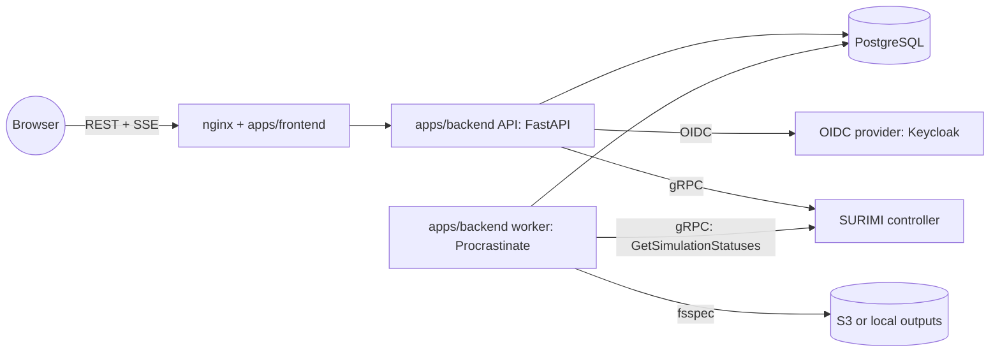

# Monorepo and backend for the SURIMI model GUI

**Status:** Proposed
**Author:** Alexios Gkikas with Claude, 2026-11-03

## Goal

- Split the repo into a frontend and a backend in one monorepo.
- Give SURIMI users accounts (local password or SSO, Keycloak first) and two roles,
  so each user works with their own experiments and an admin manages all.
- Keep experiment history and status in our database, updated by a scheduler,
  and push changes to the browser.
- Serve real simulation outputs, read from S3 or a local folder, to the
  dashboards that today show mock data.
- Be able to answer "who uses it, how often, and how many runs finish or get
  cancelled" from logs, metrics and the database.

## Requirements

From the user (2026-11-03):

1. Monorepo with frontend and backend split.
2. Backend persists data in a database.
3. Authentication: (a) username or email and password in our database;
   (b) SSO with any Keycloak now, another SSO provider later.
4. Roles: **Member** (called SimpleUser in the request, renamed 2026-11-03)
   creates experiments, sees their own simulations, cancels their own.
   **Admin** creates users, sees and manages all experiments, filters by user
   and other fields.
5. Observability and logging, including per user: number of sign-ins, last
   sign-in, simulations completed and cancelled.
6. A scheduler that updates simulation status.
7. Outputs read from local storage or S3, by configuring the simulations folder.
8. Async backend; notifications to the browser, possibly with WebSockets.
9. Documentation of features, plans, decisions and issues, with use-case and
   architecture diagrams; skills and `CLAUDE.md` to keep it up to date.

From the user's follow-up (2026-11-03):

10. SSO groups or roles map to our two roles, re-applied at every sign-in
    because roles change in Keycloak.
11. A defined retention period for logs and activity data, storing no more
    than needed.
12. The database schema as a diagram in a schema format (DBML).
13. PostgreSQL in the repo; the Helm chart can run its own database or use an
    external one; database name `surimi_modelgui_db`.
14. A queue for experiments, because Ecopath capacity is limited.
15. Each feature document shows its decisions.

Inferred:

16. The browser must no longer reach the controller directly (it has no auth).
17. Submissions are validated before they reach the controller.
18. Local development works without EDITO (fake controller, local outputs).

## Constraints and facts

| Fact | Evidence |
| --- | --- |
| Controller RPCs are all unary; no streaming, no push | Read from source, `buf.build/surimi/surimi-protocol`, exported 2026-11-03 |
| `GetSimulationStatuses(experiment_ids)` exists in the registry but not in `apps/frontend/proto/surimi.binpb` | Verified 2026-11-03 |
| `RemoveExperiment` is the cancel: it cancels only `Running` simulations (status `Canceled`) and returns success even when nothing was cancelled | Read from source, `SURIMI-controller` `a8a7f3a`; confirmed by Rik 2026-11-03 |
| 10 Ecopath pods on `project-surimi`, one per simulation; MSE experiment = 5 simulations, otherwise 1; no queue in the controller | Confirmed by Rik 2026-11-03; read from source |
| "No available pods" is thrown in the controller's background task, not returned by `SubmitExperiment`; the run stays `Initialising` | Read from source |
| `Error` simulations keep their pod; the controller keeps all state in memory | Read from source |
| The `.nc` is chunked one month per chunk, gzip 1; maps are 305 of 309 MB, chart variables 3.6 MB | Verified 2026-11-03 |
| The client chooses `experiment_id`; the controller has no users and no auth | Read from source |
| `SimulationStatus.status` is a free string | Read from source |
| `project-surimi` controller has reflection off | Verified 2026-11-03 |
| A 205-month run produces a 311 MB `.nc` and a 1.3 GB `.bin` | Verified 2026-11-03 |
| Real outputs contain infinities, outliers and duplicated series | Verified 2026-10-30, see [ISSUES.md](../ISSUES.md) |
| Deployment target: EDITO datalab (Kubernetes, Onyxia) | Read from source, controller URLs |

## Target architecture

Full picture, data model and flows: [ARCHITECTURE.md](../ARCHITECTURE.md#part-2--target).

## Decisions

| Decision | Choice | Why, in one line | ADR |
| --- | --- | --- | --- |
| Repo layout | `apps/frontend`, `apps/backend`, `packages/proto`, `deployments/`; npm + uv workspaces | Native tools per language; deployables, shared code and deployment each in one place | [0001](../decisions/0001-monorepo-layout-and-tooling.md) |
| Backend stack | Python 3.13, FastAPI, async | NetCDF needs Python; async-first; OpenAPI generated from the models | [0002](../decisions/0002-backend-python-fastapi.md) |
| Database | PostgreSQL 17, SQLAlchemy 2 async, Alembic | Relational data plus `jsonb`; also serves as queue and pub/sub | [0003](../decisions/0003-postgresql-sqlalchemy-alembic.md) |
| Authentication | Local Argon2id + generic OIDC (Keycloak first, providers as config), both ending in our session (JWT 15 min + rotating refresh, HttpOnly cookies); SSO sessions 12 h max | One session type, revocable, tokens out of JavaScript; a new SSO is config, not code | [0004](../decisions/0004-authentication-local-and-oidc.md) |
| Authorization | Roles `admin` and `member`; SSO role mapped from a configurable claim at every sign-in, deny if none; ownership in the repository layer, 404 for foreign ids | Roles follow Keycloak; shared realms grant nothing by accident; scoping cannot be forgotten | [0005](../decisions/0005-authorization-roles-and-ownership.md) |
| Protocols | REST/JSON + OpenAPI to the browser, native gRPC to the controller | Browsers lack gRPC; controller must leave the public path | [0006](../decisions/0006-protocols-rest-sse-grpc.md) |
| Scheduler | Worker with Procrastinate on PostgreSQL; poll active experiments every 10 s | Controller cannot push; no extra broker | [0007](../decisions/0007-scheduler-worker-postgres-queue.md) |
| Notifications | SSE fed by `LISTEN/NOTIFY`, replay with `Last-Event-ID` | Traffic is one-way; SSE reconnects and replays by itself | [0008](../decisions/0008-notifications-sse.md) |
| Outputs | `OUTPUTS_URI` via fsspec; files read in place by chunk through a kerchunk index; charts and maps read on request with immutable caching; no output values copied into the database; presigned URLs only for raw downloads | No duplicate data; all chart data of a run is 2 requests (measured), a map 0.15–1.7 MB of a 309 MB file; memory stays bounded | [0009](../decisions/0009-output-storage-and-ingestion.md) || Observability | structlog JSON, Prometheus, OpenTelemetry; activity in tables | Metrics for trends, database for exact per-user numbers | [0010](../decisions/0010-observability-and-activity-tracking.md) |
| Controller stubs | Generated from the Buf registry, pinned, committed | Registry is the contract; reflection is stale or off | [0011](../decisions/0011-controller-stubs-from-buf-registry.md) |
| Documentation | Features with Decisions tables, ADRs, plans, issues, Mermaid, DBML, Claude skills | Docs reviewed with the code; one home per shared decision, summarised in each feature | [0012](../decisions/0012-docs-as-code-with-mermaid.md) |
| Retention | Logs 30 days; sign-in rows 13 months then monthly roll-up; IPs 90 days; audit 24 months; no passwords, tokens or unknown logins stored | Enough for debugging and statistics; GDPR storage limitation and minimisation | [0013](../decisions/0013-data-retention.md) |
| Database deployment | `postgres` service in compose; Helm `postgresql.enabled` bundled (official image) or `externalDatabase`; database `surimi_modelgui_db`; one configurable application user `surimi_modelgui` for migrations and app, instance admin only for bootstrap; no extensions | One command locally; same backend config in both Helm modes; one credential to manage; Bitnami images no longer maintained for free | [0014](../decisions/0014-postgresql-in-repo-bundled-or-external.md) |
| Experiment queue | Experiments wait as `queued` rows; worker submits when enough Ecopath pods are free (MSE = 5, non-MSE = 1, 10 in total), fair share per user | The controller has no queue and reports no pod errors to the caller; users see a position instead of a hung run | [0015](../decisions/0015-experiment-admission-queue.md) |

### Technology list

| Area | Choice |
| --- | --- |
| Frontend | React 19, Vite 7, TypeScript 5.9, Mantine 8, React Router 7 (kept); TanStack Query 5, `openapi-typescript` + `openapi-fetch` (new) |
| API | FastAPI, Pydantic v2, pydantic-settings, uvicorn |
| Database | PostgreSQL 17, SQLAlchemy 2 (asyncio), asyncpg, Alembic |
| Auth | pwdlib[argon2], pyjwt, httpx (OIDC client, written by us; authlib rejected, ADR 0004), Keycloak |
| Controller | grpcio (`grpc.aio`), protobuf, stubs from Buf |
| Jobs | Procrastinate (psycopg 3) |
| Outputs | fsspec, s3fs, xarray, h5netcdf, numpy |
| Observability | structlog, prometheus-client, opentelemetry-sdk with FastAPI, SQLAlchemy, grpc and httpx instrumentation; optional Sentry |
| Quality | Ruff, mypy, pytest, pytest-asyncio, testcontainers (PostgreSQL), respx; ESLint, `tsc`; Playwright later |
| Packaging | uv, npm workspaces, Docker multi-stage images, GitHub Actions |

## Phases

Each phase ends with working software and its docs recorded (`/record`).
**Phases 1 to 9 build infrastructure and backend only** (user, 2026-11-03):
each delivers backend code, its OpenAPI document and Bruno requests, and is
checked with tests and Bruno. What the frontend will need is written down in
each feature's docs; it is all done in **phase 10, the last phase, and only if
the user agrees when we get there**.

### Phase 0 — Documentation and decisions (2026-11-03)

- Scope: `CLAUDE.md`, skills, `docs/` structure, this plan, ADRs 0001–0015,
  feature designs, `docs/database/schema.dbml`, `ISSUES.md`.
- Exit: the user has reviewed the plan and accepted or changed each ADR.

### Phase 1 — Monorepo restructure (done 2026-11-03 on `develop`, not merged into `main`)

- Scope: [monorepo-restructure](../features/monorepo-restructure/README.md).
  `git mv` the app to `apps/frontend`; root npm and uv workspaces; compose,
  nginx and Envoy to `deployments/`; CI workflow building the frontend image;
  `output_folder/` added to `.gitignore`.
- Exit: `npm run build` passes and `npm run lint` reports the same problems as
  before the move; `docker compose -f deployments/compose.yml up` serves the
  app as before; no behaviour change. Met 2026-11-03, see the
  [feature changelog](../features/monorepo-restructure/CHANGELOG.md).

### Phase 2 — Backend skeleton (done 2026-11-03 on `develop`, not merged into `main`)

- Scope: `apps/backend` package, settings, structlog, database engine, Alembic,
  `/healthz` and `/readyz`, controller client (`grpc.aio`) and a fake controller
  behind one interface (`CONTROLLER_MODE=grpc|fake`), stubs from
  `packages/proto`, `GET /api/v1/scenarios` and `/scenarios/{name}/contract`
  with caching. Compose gains `postgres` (`postgres:17-alpine`, database
  `surimi_modelgui_db`), `migrate`, `api`; `DB_*` settings
  ([ADR 0014](../decisions/0014-postgresql-in-repo-bundled-or-external.md)).
  `scripts/db-docs.sh` regenerates `docs/database/schema.dbml` from the
  migrated database.
- Exit: `GET /api/v1/scenarios` answers from the fake and the real
  controller; tests pass against PostgreSQL in testcontainers; regenerated DBML matches the design or the
  differences are explained; Bruno `api/` folder exists. Met 2026-11-03,
  including calls to a real controller (`user-alexiosgkikas`), except the
  DBML regeneration (no tables yet, first in phase 3); see
  [features/backend-skeleton](../features/backend-skeleton/CHANGELOG.md).

### Phase 3 — Authentication and users (done 2026-11-03 on `develop`, not merged into `main`)

- Scope: [auth-and-users](../features/auth-and-users/README.md). Local sign-in,
  sessions, CSRF, `create-admin` command, admin user management, then generic
  OIDC with Keycloak as the first provider: dev realm in compose with client
  roles `surimi-admin`/`surimi-member` and matching groups (since 2026-11-04
  the role comes from the `groups` claim instead), role mapping and
  sync at every sign-in. No frontend pages (phase 10).
- Exit: both sign-in methods work locally; moving a test user between groups
  in Keycloak changes their role at the next sign-in; a user with no mapped
  role is refused; role tests for every route; login events recorded.
  Met 2026-11-03: password sign-in and SSO against the Keycloak 26.4 dev
  realm in compose (alice admin, bob member, carol refused; bob moved to
  `surimi-admins` became admin at the next sign-in, removed from every group
  was refused and his open session ended); tests as admin, member and
  anonymous for the admin and catalog routes; login events recorded. Not
  built from the design: `OIDC_RESYNC_ON_REFRESH`, back-channel logout, the
  login metric. The DBML of the six new tables is edited by hand and checked
  against the migrated database; regeneration with `db2dbml` waits until
  every designed table exists ([database/README](../database/README.md)).
  See [features/auth-and-users](../features/auth-and-users/CHANGELOG.md).

### Phase 4 — Experiments

- Scope: [experiments](../features/experiments/README.md). Submit with
  validation against the contract, list with filters and pagination, detail with
  simulations, cancel, soft delete, admin view with owner filter, audit events.
  No frontend pages (phase 10).
- Exit: a user submits to the fake controller and to `rikkert`, sees only their
  runs, cancels one; an admin sees all and filters by user.

### Phase 5 — Status scheduler, experiment queue and notifications

- Scope: [simulation-status-scheduler](../features/simulation-status-scheduler/README.md),
  [experiment-queue](../features/experiment-queue/README.md) and
  [notifications](../features/notifications/README.md). Worker, poller,
  status mapping, stall detection, queue dispatcher with fair order and
  pod counting, retention purge task, SSE endpoint. No frontend changes
  (phase 10). Until this phase, phase 4 submits directly.
- Exit: a status change on the controller shows in the browser within 15 s;
  with capacity 1 on the fake controller, a second run waits as `queued` with
  its position and starts when the first ends; restarting the worker loses
  nothing; two workers never poll or submit twice.

### Phase 6 — Outputs

- Scope: [experiment-outputs](../features/experiment-outputs/README.md).
  Storage through `OUTPUTS_URI`, kerchunk chunk index and quality report per
  run, on-request chart and map endpoints with chunk cache and immutable
  caching, presigned raw downloads. The dashboards keep their mock data until
  phase 10. Measure
  range-request latency on the EDITO bucket.
- Exit: run `99c1e2a4…` from `output_folder/` is indexed locally; the series
  and map endpoints return its real numbers with the known data problems
  flagged, not hidden.

### Phase 7 — Observability and activity

- Scope: [observability-and-activity](../features/observability-and-activity/README.md).
  Metrics, OpenTelemetry, admin statistics endpoints, Grafana starter
  dashboard. No admin page (phase 10).
- Exit: the admin statistics endpoints return sign-ins, last sign-in,
  completed and cancelled runs per user; `/metrics` scraped by the local Prometheus.

### Phase 8 — moved to phase 10

Removing the old browser-to-controller path is frontend work; it is now part
of phase 10.

### Phase 9 — EDITO deployment

- Scope: images in a registry; Helm chart for frontend, API, worker and a
  `migrate` Job; `postgresql.enabled` to run the chart's own PostgreSQL
  (official image, PVC, backup CronJob to S3) or `externalDatabase` to connect
  to one; secrets; OIDC client; observability endpoints.
- Exit: running on EDITO against `project-surimi`, with a restore tested.

### Phase 10 — Frontend refactor (last; only if the user agrees)

- **Before starting: ask the user whether to do it** (user, 2026-11-03).
- Scope: everything marked "Frontend (phase 10)" in the feature docs: a client
  typed from the OpenAPI document (`openapi-typescript`, `openapi-fetch`),
  TanStack Query, sign-in pages and SSO buttons, experiment and queue pages,
  SSE notifications, dashboards on the real chart and map endpoints, admin
  pages (users, all experiments, statistics, audit). Then remove Envoy, the
  `/api/controller` nginx location, connect-web, `apps/frontend/src/gen/`,
  `apps/frontend/proto/` and the frontend `MOCK` mode.
- Exit: no browser request goes to the controller; the frontend uses only the
  backend API.

## Risks

| Risk | Likelihood | Impact | Mitigation |
| --- | --- | --- | --- |
| Controller marks failed initialisations as still initialising | High (seen 2026-10-30) | Runs look stuck for ever | Stall detection flag and admin view; issue raised with the controller team |
| `RemoveExperiment` does not stop runs that are not `Running` | High | Cancel appears to do nothing | `cancelling` state with timeout; show the controller's state; ask for a cancel RPC |
| NetCDF layout changes in the output creator | Medium | Charts and maps break | Parser version per output; fail loudly with a report; contract test on a sample file |
| Output data problems (infinities, duplicates) shown as truth | High | Wrong numbers to users | Clean on every read, count and display what was cleaned; issues raised upstream |
| Limited Ecopath pods | High | Submissions fail when busy | Experiment queue counted in pods, with fair share ([ADR 0015](../decisions/0015-experiment-admission-queue.md)) |
| Configured capacity does not match the real number of pods | Medium | Queue too slow, or submissions still fail | Back-off lowers capacity on capacity errors; admin queue view shows in-flight runs; ask for a capacity RPC |
| Stuck runs hold pods and the queue stops moving | High | Nobody's run starts | Stalled runs visible in the admin queue view; upstream fix of the init failure |
| Keycloak claim shapes differ from what the mapping expects | Medium | Users refused or wrong role | Dotted-path claim setting; `claims_snapshot` stored for troubleshooting; tested against the dev realm |
| OIDC client not available in time | Medium | SSO late | Local sign-in first; dev realm in compose |
| EDITO does not offer a managed PostgreSQL to us | Medium | None for deployment, since the chart can run its own | Bundled mode with backups ([ADR 0014](../decisions/0014-postgresql-in-repo-bundled-or-external.md)) |
| Large outputs fill disk and database | Medium | Outages, cost | Cache eviction; retention policy per environment |

## Suggested improvements

Beyond the stated requirements, each with the reason:

1. **Lock the controller down.** It has no auth and `RemoveExperiment` accepts
   any id. Once the backend is its only client, restrict it at network level
   (cluster-internal service or ingress allowlist) or add a shared token.
2. **Ask the controller team for protocol changes:** a status enum instead of
   a string; `Error` on failed initialisation; a `CancelExperiment` RPC that
   works in every state; a server-streaming `WatchSimulationStatuses`; the
   output location in `SimulationStatus`; reflection on all deployments. Each
   removes a workaround on our side.
3. **Validate before submitting.** Check species, life stages, dates and
   climate scenario against `GetSimulationContract` and the scenario's
   recruitment configuration; the `ANE` example fails only after minutes at
   `CreateRegulations`.
4. **Capacity from the controller.** Our queue now guesses capacity from a
   setting; an RPC that reports free Ecopath pods, or a controller-side queue,
   would make it exact.
5. **Fake controller in the backend.** Replaces the frontend mock, lets all
   flows (including status changes over time) run locally and in CI.
6. **Typed API end to end.** OpenAPI → TypeScript in CI, failing on drift, so a
   backend change cannot silently break the UI.
7. **Experiment templates and cloning.** "Run again with changes" is the common
   case for scenario exploration.
8. **Compare runs from real outputs.** The compare view exists with mock data;
   reading two runs' chart data is 4 range requests.
9. **Storage costs of outputs.** Around 1.6 GB per long run in the bucket,
   which the controller team owns; agree a retention for raw outputs with them.
   Our own tables follow [ADR 0013](../decisions/0013-data-retention.md).
10. **Security basics from day one:** rate limiting on sign-in, security
    headers in nginx, dependency scanning in CI, secrets only from the
    environment.
11. **Data-quality report per run** shown on the dashboard: how many values
    were non-finite or out of range, so users know how far to trust a chart.
12. **Rename the repo** to something like `surimi-platform` once it holds more
    than the model GUI.
13. **Keycloak back-channel logout.** Lets Keycloak end our sessions at once
    when a user is disabled there, instead of within 12 h.

## Open questions

| Question | Who |
| --- | --- |
| Self-registration for local accounts, or only admin-created? | User |
| Should admins' experiments jump the queue by default? | User |
| Confirm the retention periods with the project's data protection contact | User |
| Exact bucket path of outputs, and do we get read credentials for `project-surimi`? | Controller team |
| The EDITO experiments S3 credentials (read and write) will sign the download links: are they static access keys or temporary (session token)? And is the public endpoint `https://minio.dive.edito.eu`? | EDITO, controller team |
| What message type is in the `.bin`, and is it needed if the `.nc` has everything? | Controller team |
| How are the outputs of the 5 simulations of an MSE experiment written, and how should they combine? | Controller team |
| Partial results per simulation while a run is going (asked 2026-11-03, not answered) | Rik (controller) |
| Will the controller release pods of `Error` runs, report pod errors, or add its own queue? | Rik (controller) |

Answered on 2026-11-03 and recorded where they belong: any Keycloak for now and
other SSO later ([ADR 0004](../decisions/0004-authentication-local-and-oidc.md));
SSO roles map to `admin`/`member` at every sign-in
([ADR 0005](../decisions/0005-authorization-roles-and-ownership.md));
PostgreSQL bundled or external, database `surimi_modelgui_db`
([ADR 0014](../decisions/0014-postgresql-in-repo-bundled-or-external.md));
retention proposal ([ADR 0013](../decisions/0013-data-retention.md)); one database
user for migrations and app (ADR 0014); admins cancel, delete and download any
experiment and run their own (ADR 0005); members download their own `.nc`; no output values copied into the database (ADR 0009). Answered by Rik on 2026-11-03: cancel,
pods, MSE size, no queue (recorded in
[ARCHITECTURE.md § Controller behaviour](../ARCHITECTURE.md#controller-behaviour)).
