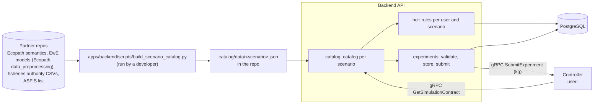

# Scenario catalog, harvest control rules and experiments (phase 4 in detail)

**Status:** Built — 4a 2026-11-05, 4b to 4d 2026-11-06; ADR 0017 accepted, ADR 0018 proposed
**Author:** written with Claude, 2026-11-05

Details phase 4 of [2026-11-03-monorepo-and-backend](2026-11-03-monorepo-and-backend.md#phase-4--experiments).
That plan stays in force; this one says how phase 4 is split and what it now
also has to cover.

## Goal

- Every scenario describes its own data: which functional groups and species
  it has, which of them can carry a harvest control rule, which climate
  scenarios it accepts, and at which level (functional group or species) each
  output metric is real. Nothing about one scenario is assumed for another.
- Users keep their own harvest control rules (HCRs) per scenario in our
  database, change, add and delete them, and submit experiments with them.
- An experiment that the controller would reject late (minutes later, at
  `CreateRegulations`) is refused at once with a clear message.
- Phase 6 (outputs) and phase 10 (frontend) read the same per-scenario
  description instead of the three hard-coded CSVs the frontend uses today.

## Requirements

| # | Requirement | Source |
| --- | --- | --- |
| R1 | Each scenario has its own set of data: one may have only functional groups, another both functional groups and species | User, 2026-11-05 |
| R2 | HCRs are stored in the model GUI database, per scenario and user; users can change, add and delete them; not every species needs one | **Confirmed by the controller team, 2026-10-16** (mail "Example Harvest Control rules") |
| R3 | Biomass limit and biomass base are entered and shown in tonnes; the request to the controller carries kg (× 1000) | **Confirmed by the controller team, 2026-10-16** |
| R4 | Phase 4 is developed and tested against the controller at `https://user-<developer>-surimi-controller.lab.dive.edito.eu` | User, 2026-11-05 |
| R5 | A submitted experiment only uses species, life stages and climate scenarios the scenario accepts; anything else is a 422 before it is queued | Inferred from R1 and the `CreateRegulations` failure of 2026-10-30 |
| R6 | The catalog for a scenario is served by the API so phase 6 and phase 10 use it | Inferred |
| R7 | Raw `.nc` downloads through presigned S3 URLs | User, 2026-11-05; already designed in [experiment-outputs](../features/experiment-outputs/README.md#downloads), built in phase 6 |

## Constraints and facts

| Fact | Evidence |
| --- | --- |
| The controller contract (`GetSimulationContract`) lists species only as `species_code` + optional `life_stage`; it has **no functional groups** and no names | **Verified** 2026-11-05 against `user-<developer>` (protocol `b10b05a0ca7f`) |
| Contract per scenario: `aegean_sea` 271 species codes, no life stages, **no climate scenarios**, 2 fleets, 1 market. `anchovy_bay` only `ANE` juvenile and adult, climate `RCP_2.6/4.5/8.5`. `northwestern_med` 88 codes in 92 entries (ANE, HKE, MUT, PIL split in adult and juvenile), 9 fleets, 38 markets, climate `RCP_2.6/4.5/8.5` | **Verified** 2026-11-05, same call |
| The contracts are YAML files `SURIMI-controller/Includes/<scenario>/<scenario>_contract.yaml`, synced every night from `Official-EwE/SURIMI-data_preprocessing/SURIMI-contracts` | **Read from source**, SURIMI-controller `a8a7f3a`, `.github/workflows/sync-surimi-contracts.yml` |
| Functional groups are the Ecopath groups. `<scenario>.semantics` maps each `speciescode[;lifestage]` to `model=group;DBID=n`; several species may map to one group | **Read from source**, SURIMI-Ecopath `156c130`, `Includes/*/…semantics`, `SurimiContractToEwEService.ReadSemanticMappings` |
| `northwestern_med`: 91 mappings onto 42 groups, 20 of them with more than one species (one has 16). `anchovy_bay`: 9 mappings onto 7 groups (Whales, Seals, Cod, Whiting, Mackerel, Anchovy, Shrimp; names from `anchovy_bay.eiixml`). `aegean_sea`: **no Ecopath semantics or model in the repo** | **Read from source**, same commit |
| In the output of run `99c1e2a4…` (northwestern_med) the members of one group have **identical biomass** (19 of 20 multi-species groups) but **different catch** (20 of 20). So biomass is real at group level, catch at species level | **Verified** 2026-11-05 with h5py |
| The `.nc` species axis is every contract `(code, life_stage)` plus one `(code, "")` row per code. 5 rows map to no group: `ANE`, `MUT`, `PIL` without life stage, and `SWO`, `VMA` (in the contract, not in the semantics) | **Read from source**, SURIMI-output-creator `da3ec9d`, `surimi_output.py:88-103`; **Verified** on `99c1e2a4…` |
| The fisheries authority has HCR inputs (recruitment, initial quota, quota share) only for `northwestern_med`, and only for `BOG`, `HKE` adult, `HKE` juvenile, `PIL` adult, `MUT` adult, `BFT`. A target fishing mortality for anything else fails at `CreateRegulations` ("No recruitment configuration found for species (ANE, adult)", 2026-10-30) | **Read from source**, SURIMI-fisheries-authority `a68715a`, `Includes/northwestern_med/*.csv`; failure **Verified** 2026-10-30. The S3 bucket may hold newer files than the repo |
| The controller team's example HCRs: `northwestern_med` `SAA`, `ANE`, `BFT`; `anchovy_bay` `MAC`. `SAA` and `ANE` have no fisheries authority inputs; `MAC` is not in the `anchovy_bay` contract | Mail 2026-10-16 compared with the two facts above. **Open question** to the controller team |
| The project asked the Ecopath and controller teams (in reply to the controller team's mail, by 2026-11-05) for a list of all fish species codes with HCR values for all three case studies. Not answered yet. The list will be the source of the scenario defaults | User, 2026-11-05 |
| `TargetFishingMortality` = `species` (`species_code`, `life_stage`, `age`, `length_class`), `biomass_limit`, `biomass_base`, `f_max` | **Read from source**, pinned stubs |
| The frontend's three species CSVs (`aegean_fishes.csv`, `anchovy_fishes.csv`, `west_med_fishes.csv`) are the same file: 48 West Mediterranean species in 9 broad groups ("Small pelagic fishes", …). The deployed site uses them with mock data | **Read from source**; deployed bundle `index-lOtmLyhP.js` read 2026-11-05 |

## Target architecture

No new container. The backend's `catalog` module gains a per-scenario catalog
built from files in the repo and checked against the live contract; a new
`hcr` module stores rules; `experiments` validates against both. See
[ARCHITECTURE.md](../ARCHITECTURE.md).

## Decisions

| Decision | Choice | Why | ADR |
| --- | --- | --- | --- |
| Where per-scenario groups, species and levels come from | JSON file per scenario in the repo, generated by a script from the partners' sources (group names only from the EwE models, null otherwise), the ASFIS list and the live contracts; merged with the live contract on every refresh | The controller has no groups; the partner files are the real source; a reviewed file in git is versioned with the code that reads it | [0017](../decisions/0017-scenario-catalog-from-partner-config.md) |
| "Functional group" and levels | Functional group = Ecopath group (MICE group for `aegean_sea`, issue #154). Levels by one rule: groups → `functional_group`; a group with ≥ 2 species, or no groups → `species`; biomass at group level whenever groups exist. A group value is **one** member's series, not a sum | The models compute per group; biomass is a group value copied to each member, catch is per species (**Verified**); a rule follows partner changes | [0017](../decisions/0017-scenario-catalog-from-partner-config.md) |
| Where HCRs live and in which unit | Table `harvest_control_rules` per owner, scenario, species and life stage; scenario defaults with no owner; tonnes in the database and API, kg only in the gRPC request; since 2026-11-13 kg in the database and API too, tonnes only in the UI; since 2026-11-16 no scenario defaults, only users' own rules | The controller team's mail; one conversion point; users see the unit they think in. Changed by the user 2026-11-13: one unit from the database to the controller | [0018](../decisions/0018-harvest-control-rules-per-user-and-scenario.md), [0022](../decisions/0022-hcr-biomass-in-kg-tonnes-only-in-the-ui.md), [0024](../decisions/0024-harvest-control-rules-only-per-user-no-defaults.md) |
| What an experiment keeps | The HCRs actually sent are copied into the experiment's stored request; later edits of the saved rules do not change past experiments | Clone, audit and comparison need the exact inputs | [0018](../decisions/0018-harvest-control-rules-per-user-and-scenario.md) |

## Phases

Each step ends with tests, Bruno requests, OpenAPI examples and `/record`.
No frontend work (phase 10).

### 4a — Scenario catalog (done 2026-11-05)

- Scope: [scenario-catalog](../features/scenario-catalog/README.md).
  `apps/backend/scripts/build_scenario_catalog.py` reads shallow clones of
  SURIMI-data_preprocessing (NW Med EwE model), SURIMI-Ecopath (semantics,
  Anchovy Bay EwE model) and SURIMI-fisheries-authority, the FAO ASFIS list
  (**Confirmed by the controller team, 2026-10-15**) and the live contracts, and writes
  `apps/backend/src/surimi_backend/catalog/data/<scenario>.json`.
  The backend loads the files, checks them against the contract and serves
  `GET /api/v1/scenarios/{name}/catalog`.
- Exit: the three scenarios are served; `northwestern_med` has 42 groups and
  the 6 HCR-eligible entries; `anchovy_bay` has 7 groups; `aegean_sea` is
  served from the contract alone with `levels: [species]` and no HCR-eligible
  entries until its partner files exist; every contract code without a group
  is listed under `unassigned` and logged, not dropped. Met 2026-11-05 with
  every group named from its EwE model, `anchovy_bay` at `functional_group`
  level only, and unassigned entries in `drift`; see
  [features/scenario-catalog](../features/scenario-catalog/CHANGELOG.md).

### 4b — Harvest control rules (done 2026-11-06)

- Scope: [harvest-control-rules](../features/harvest-control-rules/README.md).
  Table and migration, CRUD API for a user's rules per scenario, scenario
  defaults managed by admins, reset to defaults, validation against the
  catalog.
- Defaults (removed 2026-11-16, ADR 0024): the seed loader reads the partners' list when it arrives
  (the project's request) in the controller team's CSV format (`species_code, Biomass Limit,
  Biomass Base, F max`, tonnes; CRLF, spaces in headers and blank tab rows
  as in his attachment), plus a scenario and an optional life stage column.
  Rows for entries that are not HCR-eligible are reported, not loaded.
  4b does not wait for the list: until then the seed has only the rows that
  are eligible today (`BFT` from the controller team's example).
- Exit: a member creates, edits and deletes rules for `northwestern_med` and
  sees only their own; a rule for a species that is not HCR-eligible is a 422
  naming the eligible ones; `biomass_limit ≥ biomass_base` is a 422; the
  seed loader loads the controller team's example file and reports `SAA` and `ANE` as not
  eligible.

### 4c — Experiments (done 2026-11-06; exit met on `user-<developer>` with run `5067d5f7…`)

- Scope: [experiments](../features/experiments/README.md) as designed, plus:
  validation against the catalog and the contract, HCRs taken from the request
  or from the user's saved rules and copied into the experiment, tonnes → kg
  in `integrations/controller/mapping.py` (since 2026-11-13 kg throughout, no
  conversion, ADR 0022), `climate_scenario` required only
  when the contract lists climate scenarios. Until phase 5 the API submits
  directly instead of queueing.
- Exit: on `user-<developer>` a member submits a `northwestern_med`
  experiment with `HKE` adult and `PIL` adult rules (the inputs of the run
  that finished on 2026-10-30), the controller receives kg, the experiment
  reaches `Finished` in the poll of the detail endpoint; the member sees only
  their runs and cancels a running one; an admin sees all and filters by
  owner. The same with `CONTROLLER_MODE=fake` in the tests.

### 4d — Close-out (done 2026-11-06; the Bruno folder was not run as a whole)

- Bruno `api/scenarios/get catalog`, `api/hcr/*` (since 2026-11-16 `api/hcr-configurations/*`), `api/experiments/*`;
  OpenAPI examples; `docs/database/schema.dbml`; ARCHITECTURE data model.
- Exit: `/backend` quality gate passes; Bruno folder runs green against the
  local stack with `user-<developer>`.

## Risks

| Risk | Likelihood | Impact | Mitigation |
| --- | --- | --- | --- |
| The partners' HCR list covers species the fisheries authority cannot regulate (it asks for "all fish species") | High | Defaults that fail every experiment at `CreateRegulations` | The seed loader keeps only HCR-eligible rows and reports the rest; ask the partners to add the fisheries authority inputs, or to say which species are meant |
| The partner files on S3 differ from the GitHub repos the script reads | Medium | Catalog allows an HCR that fails at `CreateRegulations` | The script records the commit it read; a failed `CreateRegulations` is shown with the controller's message; ask the controller team for an RPC (below) |
| The NW Med EwE model is only in the private SURIMI-data_preprocessing repo | Known | Regenerating needs read access to it | Documented in the feature's regeneration steps; unknown names stay null, never invented |
| `aegean_sea` has no Ecopath semantics or fisheries authority inputs | Known | No groups and no HCRs for that scenario | Served at species level from the contract; flagged in the catalog as `partial` |
| Life stage spelling differs: contract `adult`, fisheries authority CSV `ADULT` | Known | Mismatch in our checks | Compare case-insensitively; send the contract's spelling (the 2026-10-30 run sent `adult` and finished) |
| Contract changes nightly upstream | Low | Catalog out of step | Start-up and refresh check; mismatches logged and exposed in the catalog response, not hidden |

## Suggested improvements

- Ask the controller team to put functional groups and HCR eligibility into
  the contract (`Species.functional_group`, a list of regulable species). Then
  the catalog would need only names, and the script and its drift risk would
  go. This is the right long-term home; the repo files are the bridge.
- Validate HCR values against the fisheries authority's own ranges once known
  (for example whether `f_max` above 1 is meaningful).
- Show next to each HCR the stock's current biomass from the last finished run,
  so users set limits with a reference.

## Open questions

| Question | Who |
| --- | --- |
| The 20 functional groups and the species vocabulary of the Aegean Sea MICE model (issue #154); until then `aegean_sea` is served at species level, `partial` | Controller and MICE teams |
| HCR values for all species of the three case studies: answered 2026-11-23 by `GetInitialHCRData` (defaults per species from EwE; `northwestern_med` only so far), see [plan 2026-11-23](2026-11-23-hcr-initial-data-from-controller.md). Still open: Not covered by that request, so to ask with it: for each species, does the fisheries authority have (or will it get) recruitment, initial quota and quota share inputs, without which `CreateRegulations` fails? The controller team's examples `SAA`, `ANE`, `MAC` have none in the repos, or are not in the contract | Controller and Ecopath teams |
| `ANE`, `HKE`, `MUT`, `PIL` exist with and without life stage. For an HCR, which form does the fisheries authority expect: per life stage (as its CSVs) or per species? | Controller team |
