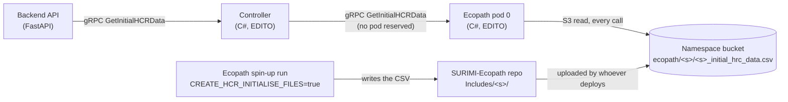

# Harvest control rule initial data and defaults from the controller (`GetInitialHCRData`)

**Status:** Accepted 2026-11-23 (user); phase 1 built and verified 2026-11-23
**Author:** written with Claude, 2026-11-23

Changes what [2026-11-05-scenario-catalog-hcr-experiments](2026-11-05-scenario-catalog-hcr-experiments.md)
built in step 4b and what [ADR 0024](../decisions/0024-harvest-control-rules-only-per-user-no-defaults.md)
decided about defaults. That plan stays in force for everything else.

## Goal

- The HCR editor shows, for every species entry of a scenario, the
  controller's initial biomass and initial F, and **prefills** a new rule with
  the controller's default biomass limit, biomass base and F max.
- The controller is the only source of initial values and defaults: no
  catalog columns, no frontend mock values, no cache.
- Every distinct answer is kept as a dated snapshot, and each experiment
  points to the one it was submitted with, so changes over time can be
  traced per scenario and per experiment.
- The backend speaks the current protocol again: `GetInitialBiomasses` and
  `GetInitialFishingMortalities` were removed from it on 2026-11-23.

## Requirements

1. The backend gets initial biomass, initial F and the three defaults for a
   scenario from `ControllerService.GetInitialHCRData` only. *(user, 2026-11-23)*
2. Remove all logic that keeps initial HCR data on our side: the two old
   RPC calls and endpoints, the fake controller's two CSVs, the frontend's
   `mock-data/defaultConfigureRules.ts` and `VITE_MOCK_HCR_DEFAULTS`. *(user, 2026-11-23)*
3. A user can pick a species, see its defaults, change them, and save or
   submit; or submit with no HCR at all. *(controller team, 2026-11-20)*
4. Saved configurations and experiments keep the numbers the user saw and
   sent; a later change of the controller's file changes neither. *(inferred
   from ADR 0018)*
5. Only HCR-eligible entries can carry a rule, as today. *(inferred, ADR 0017)*
6. A scenario whose file is missing still opens its form, with a note, as
   today. *(inferred, current behaviour)*
7. Biomass is kg end to end; tonnes only in the UI. *(ADR 0022)*
8. Each experiment records the initial HCR data it was submitted with.
   *(user, 2026-11-23)*
9. Changes of the initial HCR data over time can be listed per scenario.
   *(user, 2026-11-23)*
10. Nothing waits on partner answers; the data concerns below are recorded in
    `ISSUES.md` and the values are shown as sent. *(user, 2026-11-23)*
11. Every entry the backend returns, live or from a snapshot, carries the
    species' English and scientific name, family and functional group (key
    and name), as the catalog and the experiment options do today. The
    controller sends codes only. *(user, 2026-11-23)*

## Constraints and facts

### Agreed with the partners (2026-11-20 to 2026-11-23)

- The controller provides a default rule per species; a user picks species,
  starts from their defaults and changes them, or runs with no rules at all.
  **Confirmed by the controller team, 2026-11-20.**
- `GetInitialHCRData(scenario_name)` gives what the HCR page needs; biomass is
  kg, as in the contract. Live on `project-surimi` since 2026-11-23.
  **Confirmed by the controller team, 2026-11-23.** The controller team is
  still improving it and working on submitting experiments with rules.
- Rules left at their default values are sent like any other rule
  (requirement 10).

### The protocol (Read from source, SURIMI-protocol `7d0953e`, 2026-11-23)

```text
rpc GetInitialHCRData(GetInitialHCRDataRequest) returns (GetInitialHCRDataResponse)
GetInitialHCRDataRequest  { string scenario_name (min_len 1) }
GetInitialHCRDataResponse { InitialHCRDataSummary initial_hcr_data_summary }
InitialHCRDataSummary     { repeated InitialHCRData initial_hcr_data }
InitialHCRData {
  Species species                    // species_code, length_class, age, life_stage
  double initial_fishing_mortality   // a year's catch / biomass
  double initial_biomass             // biomass at the start of the simulation
  double default_biomass_limit       // below this, no fishing
  double default_biomass_base        // above this, quota from f_max
  double default_f_max
}
```

The same RPC is on `EcologyService` (Ecopath). `GetInitialBiomasses` and
`GetInitialFishingMortalities` are **gone** from `ControllerService`; our pin
is `be08fd333a86` (SURIMI-protocol `250f617`, 2026-11-11), which still has them.

### Where the data comes from (Read from source)



- **Controller** (SURIMI-controller `782b979`, `ControllerService.GetInitialHCRData`):
  checks `scenario_name` is not empty and forwards to Ecopath. The dispatcher
  sees a non-GUID id, reserves **no** pod and uses `surimi-ecopath-0`
  (`SimulationDispatcher.DispatchAsync`). So the call does not count against
  our admission capacity (ADR 0015), but it lands on pod 0 even while pod 0
  runs a simulation.
- **Ecopath** (SURIMI-Ecopath `3819d2c`, 2026-11-23, "Create single initial
  hcr data file"; `InitialStateFileService`, `EcologyService.GetInitialHCRData`):
  reads one CSV per scenario on every call, with columns
  `SpeciesCode,LengthClass,Age,LifeStage,Biomass,Catch,BiomassLimit,BiomassBase,FMax`.
  F = `Catch / Biomass`. A missing or malformed file, a duplicate row or a zero
  biomass fails the whole call; missing `BiomassLimit`, `BiomassBase` or `FMax`
  read as 0.
- **The original source** is EwE itself: `Biomass` is the species' biomass at
  the end of spin-up (summed over water cells); `Catch` is the gross catch of
  the last 12 spin-up months; the three defaults are EwE's MSE target-F policy
  (`MSEBLim`, `MSEBBase`, `MSEFmax`) for the group. Ecopath writes the file
  during a run with `CREATE_HCR_INITIALISE_FILES=true`
  (`HcrInitialisationFileService.WriteInitialFilesAsync`), and the Ecopath team
  commits it to `SURIMI-Ecopath/Includes/<scenario>/<scenario>_initial_hrc_data.csv`.
  Today only `northwestern_med` has one (91 rows). Note the spelling: `hrc`,
  not `hcr`.
- **Where it is read in a deployment:** the Ecopath Dockerfile deletes
  `Includes/` after the build, so the image has no copy. With `AWS_ACCESS_KEY_ID`
  set, Ecopath reads from `S3BlobStore(bucket = AWS_BUCKET_NAME, inputBasePrefix = "ecopath")`
  (`Program.cs`): the key is
  **`ecopath/<scenario>/<scenario>_initial_hrc_data.csv`** in the bucket of
  the namespace the Ecopath pods run in. The old `ecopath/<scenario>/initial_biomasses.csv`
  and `initial_catch.csv` are no longer read.

### Does it have to go into the developer's S3 bucket?

- **Our app's deployment (compose, the develop server): no.** The backend
  reads nothing from S3 for this; it only calls the controller. Nothing to add
  to `deployments/.env` or `deployments/mounts/`.
- **The developer's own EDITO namespace (`user-<developer>`, bucket `oidc-<developer>`):
  yes, if the local stack keeps pointing at that controller.** Upload
  `SURIMI-Ecopath/Includes/northwestern_med/northwestern_med_initial_hrc_data.csv`
  to `s3://oidc-<developer>/ecopath/northwestern_med/northwestern_med_initial_hrc_data.csv`,
  **and** redeploy the controller (`782b979` or later) and Ecopath (`3819d2c`
  or later). **Verified** 2026-11-23: that controller answers `UNIMPLEMENTED`
  for `GetInitialHCRData`, so it runs a build from before the RPC; the file
  alone is not enough.
- **`project-surimi`:** `northwestern_med` works; `anchovy_bay` and
  `aegean_sea` need their files generated by the Ecopath team and uploaded to
  `ecopath/anchovy_bay/anchovy_bay_initial_hrc_data.csv` and
  `ecopath/aegean_sea/aegean_sea_initial_hrc_data.csv`. **Verified** 2026-11-23:
  both fail with `INTERNAL`, "MinIO API responded with message=ecopath/<s>/<s>_initial_hrc_data.csv".

### What the data looks like (Verified 2026-11-23, `project-surimi`, `northwestern_med`)

91 entries, the same rows as the repo file. Every entry has non-zero defaults;
49 have F = 0 (no catch). The 6 HCR-eligible entries:

| Entry | Initial biomass (kg) | Initial F | Default limit (kg) | Default base (kg) | Default F max |
| --- | ---: | ---: | ---: | ---: | ---: |
| BFT | 647,974 | 0.174 | 6,768 | 27,072 | 0.622 |
| BOG | 322,115 | 0.035 | 32,148 | 128,592 | 0.043 |
| HKE adult | 414,735 | 0.091 | 15,983 | 63,934 | 0.235 |
| HKE juvenile | 264,251 | 0.248 | 9,306 | 37,224 | 1.081 |
| MUT adult | 130,874 | 0.249 | 15,228 | 60,912 | 0.318 |
| PIL adult | 778,012 | 0.588 | 188,521 | 754,084 | 0.697 |

**The sizes look wrong** (computed 2026-11-23 from the repo file and our fake
copy of the old RPCs' files):

- Every default limit and base is the EwE density (t/km²) × **846** × 1000.
  The controller team's own examples use the same densities: BFT 0.008/0.032,
  ANE adult 0.17/0.68 and SAA 0.022/0.088 t/km² all give exactly 846. 846 looks
  like the number of water cells; the cell area is missing. The controller
  team's example of 2026-10-16 multiplied by the model area, 45,547 km²
  (`0,008 * 45547 * 1000` kg for BFT = 364,376 kg, not 6,768). If that is
  right, the defaults are about **54× too small** (45,547 / 846 = 53.8 km² per
  cell).
- Every initial biomass is **12×** (11.93 to 12.14) what `GetInitialBiomasses`
  returned for the same entry. A switch from tonnes to kg would be 1000×. F
  dropped by the same factor (HKE adult 1.08 → 0.091).

Our code cannot fix either; it shows the values as sent (requirement 10). If
the Ecopath team corrects the file, the snapshots (ADR 0028) show which
experiments used the old values.

### Species names (Verified 2026-11-23)

The controller sends only `species_code` (FAO 3-alpha), `length_class`, `age`
and `life_stage`. The backend already names codes from the `species` table
(FAO ASFIS plus manual rows, ADR 0023; `CatalogService` reads it through
`self._species.get(codes)`) and puts each entry in its functional group from
the scenario catalog (`build_catalog`). All 86 distinct codes in
`northwestern_med_initial_hrc_data.csv` have an ASFIS row in
`catalog/data/species.csv`; none needs a manual row. Not all 91 entries are
in the contract (`HKE` with no life stage is not), so the group comes from the
catalog where the entry has one and is null otherwise.

### What we keep on our side today (Read from source, `develop`, 2026-11-23)

| Where | What | Fate |
| --- | --- | --- |
| `packages/proto/pyproject.toml` | Pin `be08fd333a86`; stubs `get_initial_biomasses_pb2*`, `get_initial_fishing_mortalities_pb2*` | Bump to the `7d0953e` module commit; regenerate |
| `integrations/controller/base.py`, `grpc_client.py`, `fake.py` | `get_initial_biomasses`, `get_initial_fishing_mortalities`, `SpeciesValue` | Replace with `get_initial_hcr_data` → `InitialHcrData` |
| `integrations/controller/fake_initial_state/northwestern_med/initial_biomasses.csv`, `initial_catch.csv` | Copies of the old Ecopath files | Replace with a copy of `northwestern_med_initial_hrc_data.csv` (SURIMI-Ecopath `3819d2c`) |
| `catalog/router.py`, `catalog/service.py`, `catalog/schemas.py` | `GET …/initial-biomasses`, `GET …/initial-fishing-mortalities` | Replace with `GET …/initial-hcr-data` |
| `experiments/options.py`, `experiments/schemas.py` | `initial_biomass`, `initial_fishing_mortality`, `UNIT_NOTE` | `initial_biomass_kg`, `initial_fishing_mortality`, `default_biomass_limit_kg`, `default_biomass_base_kg`, `default_f_max`; unit note removed |
| `console/static/app.js` | Shows initial biomass and F in the New experiment tab | Show the defaults too; prefill a new row with them; show tonnes |
| `apps/frontend/mock-data/defaultConfigureRules.ts`, `flows/northwestern/developmentRules.ts`, `VITE_MOCK_HCR_DEFAULTS` | Hand-written NW Med default rules (dev only) | Remove; prefill from `experiment-options` (phase 3) |
| `apps/frontend/src/network/services/scenarios/scenarioSchemas.ts` | Zod schema with `initial_biomass` | Follow the new fields (phase 3) |
| Bruno `controller/GetInitialBiomasses.yml`, `GetInitialFishingMortalities.yml`, `GetInitialHarvestControlRules.yml` (calls the old F method) | Requests for the removed RPCs | One `controller/GetInitialHCRData.yml` |
| Bruno `api/get initial biomasses.yml`, `api/get initial fishing mortalities.yml` | Old endpoints | One `api/get initial hcr data.yml`; update `api/experiments/get experiment options.yml` |
| `hcr_configurations` table, the catalog's `hcr_eligible` | User rules; eligibility | **Unchanged** |
| *(new)* `initial_hcr_snapshots`, `experiments.initial_hcr_snapshot_id` | — | A record of each distinct answer and which experiment saw which (ADR 0028) |

## Decisions

| Decision | Choice | Why | ADR |
| --- | --- | --- | --- |
| Source of initial values and defaults | `GetInitialHCRData` on every request; the form never reads a stored copy; clients prefill new rows; saved rules hold the user's numbers | The partners decided the controller owns defaults; a copy would drift; past runs must not change | [0027](../decisions/0027-hcr-initial-data-and-defaults-from-the-controller.md) |
| History | Table `initial_hcr_snapshots`, one row per distinct answer per scenario (SHA-256 of the entries), recorded on every fetch; `experiments.initial_hcr_snapshot_id` set at submit; never purged | Track changes over time per experiment and per scenario without a copy per experiment | [0028](../decisions/0028-initial-hcr-data-snapshots-per-experiment.md) |
| Which entries can carry a rule | Still the catalog's HCR eligibility; the RPC adds values, not entries | 85 of the 91 entries the RPC returns fail at `CreateRegulations` | [0017](../decisions/0017-scenario-catalog-from-partner-config.md), [0023](../decisions/0023-scenario-catalog-in-the-database-from-an-admin-workbook.md) (unchanged) |
| Units | kg in the API, `_kg` field names; tonnes only in the UI | One unit end to end; the controller team confirmed kg | [0022](../decisions/0022-hcr-biomass-in-kg-tonnes-only-in-the-ui.md) (unchanged) |
| Stubs | Re-pin `buf.build/surimi/surimi-protocol` and regenerate | The old RPCs are gone from the protocol | [0011](../decisions/0011-controller-stubs-from-buf-registry.md) (unchanged) |
| Names | Joined when read: name, scientific name and family from the `species` table, functional group from the scenario catalog; snapshots store the controller's codes and values only | One name source for the whole app; a corrected name must neither count as a new controller version (the snapshot hash) nor leave old snapshots with stale names | [0023](../decisions/0023-scenario-catalog-in-the-database-from-an-admin-workbook.md), [0028](../decisions/0028-initial-hcr-data-snapshots-per-experiment.md) (unchanged) |

Accepted 2026-11-23 (user): ADR 0027 and 0028 accepted; ADR 0024's decision 3
(empty fields) superseded by 0027.

## Phases

### Phase 0 — Prerequisites outside this repo

**Scope:** what the partners and the `user-<developer>` namespace must provide.

**Deliverables:**
- `anchovy_bay` and `aegean_sea` CSVs on `project-surimi` (Ecopath team; not
  waited for).
- `user-<developer>`: controller `782b979`+ and Ecopath `3819d2c`+ deployed; the
  NW Med CSV uploaded to `oidc-<developer>` at the key above (the developer).

**Exit criteria:** `GetInitialHCRData` answers for `northwestern_med` on the
controller in `deployments/.env`. Phase 1 does not wait for the others: it
treats a missing file as a note (requirement 6).

### Phase 1 — Backend

**Done 2026-11-23.** Quality gate green (332 tests, integration included); live
against `project-surimi`. Details: [harvest control rules CHANGELOG](../features/harvest-control-rules/CHANGELOG.md).

**Features touched:** [scenario-catalog](../features/scenario-catalog/README.md),
[harvest-control-rules](../features/harvest-control-rules/README.md),
[experiments](../features/experiments/README.md), [backend-console](../features/backend-console/README.md).

1. Re-pin `packages/proto` to the module commit of SURIMI-protocol `7d0953e`
   and regenerate; check that the stub drift job in CI passes.
2. `ControllerClient.get_initial_hcr_data(scenario_name) -> list[InitialHcrData]`
   (`species_code`, `life_stage`, `length_class`, `age`, `initial_biomass_kg`,
   `initial_fishing_mortality`, `default_biomass_limit_kg`,
   `default_biomass_base_kg`, `default_f_max`), values as sent (0 kept, so the
   snapshot is faithful); the API serves a default of 0 as `null` ("no
   default"), since 0 fails our bounds. Remove the two old methods and
   `SpeciesValue`.
3. Fake controller: serves the copied CSV for `northwestern_med` and raises the
   same `INTERNAL` error as `project-surimi` for the other two.
4. Endpoint `GET /api/v1/scenarios/{name}/initial-hcr-data` (any signed-in
   role; 404 unknown scenario, 502 controller error, 504 timeout). Each entry
   has the controller's values plus `species_name`, `scientific_name`,
   `family`, `functional_group`, `functional_group_name` and `hcr_eligible`,
   from one helper `name_entries(scenario, entries)` that the history and
   experiment routes (step 8) reuse. A code with no `species` row gets null
   names and a `catalog.drift` warning, as the catalog does. Remove
   `/initial-biomasses` and `/initial-fishing-mortalities` (no released
   clients).
5. `experiment-options`: the five values per entry from one call (two today),
   `initial_biomass` renamed `initial_biomass_kg`, the unit note removed. Key
   on `species_code` + lower-cased `life_stage`, as rules are. Rows with a
   non-empty `length_class` or `age` are logged, as HCRs cannot address them.
6. Snapshots (ADR 0028): migration `0008_initial_hcr_snapshots` (table, unique
   `(scenario_name, content_hash)`, nullable `experiments.initial_hcr_snapshot_id`
   with its foreign key). One function `record_snapshot(db, scenario, entries)
   -> snapshot_id` hashes the entries as sent and inserts with
   `ON CONFLICT DO NOTHING`; steps 4 and 5 call it after every answer.
7. Submit: `POST /experiments` calls `GetInitialHCRData`, records the snapshot
   and stores its id on the experiment. A controller failure leaves it null,
   adds an experiment event, and does not refuse the experiment.
8. Read routes: `GET /api/v1/experiments/{id}/initial-hcr-data` (owner or
   admin; the snapshot plus, per rule, the default it could start from and
   whether it differs; 404 when none), `GET /api/v1/scenarios/{name}/initial-hcr-data/history`
   (newest first: `id`, `first_seen_at`, `entry_count`) and
   `…/history/{snapshot_id}`, the entries named by `name_entries` (step 4).
   The experiment detail gains `initial_hcr_snapshot_id`.
9. Backend console: show the defaults beside each species, prefill a newly
   added rule row with them (in tonnes), and a "Reset to default" per row.
   (The console has no experiment detail view, so there is no snapshot link
   there; `GET /experiments/{id}/initial-hcr-data` serves it.)
10. Tests: client mapping (including F = 0 left out by proto3 and default 0 →
    `None`), the fake, the endpoints, the options answer with and without the
    controller; snapshots: the same answer twice gives one row, a changed value
    a second row, submit links the snapshot, a controller failure at submit
    leaves it null and still accepts; names: every entry named, a code with no
    `species` row null with a drift warning, an entry outside the contract
    with no group, a renamed species shown with its new name in an old
    snapshot. Quality gate (`/backend`).
11. Bruno (`/bruno`), OpenAPI examples, and the records (`/record`): feature
    CHANGELOGs, `docs/CHANGELOG.md` (breaking API change, migration),
    `ARCHITECTURE.md` (§ Controller behaviour, data model), `docs/database/`
    (`schema.dbml`, `indexes.sql`, README), `ISSUES.md`.

**Exit criteria:** the gate passes; the migration upgrades and downgrades on a
throwaway database; a submitted experiment on the compose stack has a
snapshot; Bruno's `GetInitialHCRData` and
`get initial hcr data` answer against `project-surimi` (or `user-<developer>` after
phase 0); no reference to `GetInitialBiomasses`, `GetInitialFishingMortalities`,
`initial-biomasses` or `initial_biomasses.csv` remains outside changelogs.

### Phase 2 — HCR submission check (after the controller team's next step)

**Scope:** the controller team is working on submitting experiments with
rules (2026-11-23). When that is done, submit a NW Med run with a rule built from
the defaults and one changed by hand, and confirm it finishes and its quota
follows the rule (fisheries authority output).

**Exit criteria:** one verified run per case, recorded in the experiments
CHANGELOG.

### Phase 3 — Frontend HCR editor *(phase 10 work: ask before starting)*

**Scope:** under the scope rule in `CLAUDE.md`, frontend feature work waits
for the user's go-ahead. Remove `defaultConfigureRules.ts`, `developmentRules.ts`
and `VITE_MOCK_HCR_DEFAULTS` (also from `apps/frontend/.env.example` and
`vite-env.d.ts`). Update `scenarioSchemas.ts`. Build the page as agreed in the
partners on 2026-11-20: a species list; on selection, the initial biomass
(read-only, also as a dashed vertical line on the chart), F, limit and base
prefilled from the defaults and editable; the chart drawn from the values.
Tonnes in the UI (ADR 0022).

**Exit criteria:** `npm run build` and lint pass; the editor shows the
controller's defaults for NW Med and a note for the other two scenarios.

## Risks

| Risk | Likelihood | Impact | Mitigation |
| --- | --- | --- | --- |
| The defaults and initial biomasses are wrong in size (846 cells without area; 12× change) | High (computed, see above) | Users run rules about 54× too low; experiments look plausible but are wrong | Shown as sent (requirement 10); the snapshots identify every experiment that used a given version, so they can be found once the file changes |
| The call lands on pod 0 while it runs a simulation; Ecopath's comment says to call it before `InitialiseSimulation` changes the blob store's scenario directory | Medium | Wrong file read or errors while pod 0 is busy; at worst, a disturbed run | Errors become notes (requirement 6); watch the controller log during phase 2; a short cache would reduce calls if needed |
| The protocol changes again while the controller team "makes improvements" | High | Stubs and mapping break again | Pin per release; the CI drift job shows it; keep the mapping in one module |
| Rules on entries the RPC lists but the fisheries authority does not | Medium | Runs fail after minutes of initialisation | Keep catalog eligibility (ADR 0017) |
| `anchovy_bay` and `aegean_sea` files do not come | Medium | No defaults there | The form still opens, with a note (requirement 6) |
| `user-<developer>` stays on the old controller | Certain until redeployed | Local stack gets `UNIMPLEMENTED` | Phase 0; the options answer degrades to a note |

## Suggested improvements

- An admin event (and a line in the console) when a new snapshot appears for a
  scenario, so a changed Ecopath file is noticed the day it lands.
- A diff between two snapshots of a scenario (per entry: which value changed,
  by how much), in the API and later in the UI.
- If the controller ever returns only HCR-eligible entries or a flag per
  entry, eligibility (ADR 0017) can come from one place.

## Open questions

None blocking. The user decided on 2026-11-23 that nothing waits on the
partners (requirement 10). The data concerns found (defaults equal to density
× 846 × 1000, initial biomass 12× the old RPC's, 91 entries against 6
eligible, `HKE` with no life stage, two scenarios without a file, calls landing
on a busy pod 0) are recorded in [ISSUES.md](../ISSUES.md) under
"`GetInitialHCRData`: values look wrong in size, two scenarios missing".
